# 【慕尼黑工业大学】多视角几何 ｜ Multi View Geometry 2025 p16 P16_讲座_14_视觉SLAM的直接方法 -BV1KgZEBrEXV_p16-

All right， that concludes now the bundle adjustment and unless there's more questions to bundle adjustment。

 I would move to the next chapter。Which brings us again， a step further into the current day。

And that is a chapter on so calledled direct methods for。😔。

AVis slam for structure and motion or visual slam。And this is techniques that were to a large extent developed here at T Munich。

😔，So I'll talk a little bit about the motivation for these techniques and why。They are valuable。

The first thing is to see that in all the past chapters we studied classical approaches to multi view reconstruction and they tackle this problem of structure and motion or slam as it's sometimes called in multiple steps。

 you saw it in the p time you first identify points， and you extract typically features corners。

 something like that， and then you try from image to image to identify point correspondences across images。

And you can do that in many ways， you can use optical flow techniques like what we talked about。

 but you can also introduce so- calledled descriptors like Sift Ser brief。

 there's many descriptors that were developed explicitly for that purpose。

 they basically assign a vectorvalued signature to each point in the image。

 such that you can find the same point in a different image based on descriptors similarity。

 and ideally two points correspond if the descriptors are sufficiently similar。

But you can imagine you know how can you be sure that these points really correspond if it's some checkboard pattern。

 there is a lot of points that look very similar and their environment look similar。

 but still you don't know for sure if they are really in correspondence。

And the tricky thing is if you make any error in this step 2。

 that will propagate into your reconstruction， because then in step 3， you estimate camera motion。

 for example， with something like the8 point algorithm。

 or there is a version called the five point algorithm that actually is。More powerful。

 but far too complicated to explain in class。And once you have estimated camera motion as or initialize this。

 then you can use that for bundle adjustment because in bundle adjustment。

 you need a fairly good initialization for this to converge。And then on top。

 we can actually compute a dense reconstruction。 I'll talk about dense reconstructions in the next chapter。

So this is like a four step pipeline to reconstruct the world from images。

 and that is a little bit suboptimal because at every step you can make mistakes， step1。

You take points， you know why these points， why not others right。

 so this is a technique that we would call indirect because you don't go straight from your sensory data to a reconstruction。

 No you first extract points， you find correspondingence。

 you assign corresponding pairs and then then you go and reconstruct。

And this is suboptimal in the sense that in every step you can make errors you can。

 you know you lose valuable information， step one， you select a small set of points。

 the rest of the colors they don't factor into your reconstruction。And in some sense。

 whenever you do sensory analysis， if you want to do it optimally from any sensor， you have to ask。

 did I actually look at all the sensory information and any algorithm that at step one kicks out 90% of the sensory data cannot be optimal because it just ignored most of the information。

And secondly， you lack in robustness， right？ So if you have errors in the point correspondence and things will easily deteriorate。

 In fact， what I didn't mention in classes in practice。

 a lot of these pipelines have an intermediate step。In between steps 2 and 3。

That reests correspondence， a technique that is often called Ramsack。It's a heuristic technique。

 it stands for random sampling consensus， it basically samples a set of potential correspondences。

 then computes a camera motion and 3D structure and checks does it make sense are all the points in consensus with this motion or not and if not it goes back to the correspondences and tries to find a better correspondence and kind of randomly。

 you know more or less randomly samples different correspondences。

 quite a heuristic step and a very you know error prone obviously。

But this is often what you need to do in order to get Rome in a day。

 you need to have all these heuristics inbuilt。Which makes it pretty ugly actually as an optimization。

😔，And any incorrect correspondence will lead to incorrect motion estimation and maybe the reampling of correspondences will recover it。

 but it will add to the runtime and it makes things a lot more complicated in the end。

And in some sense， the problems of motion estimation。

 identifying correspondence and reconstruction of a dense structure。

 they're coupled problems and one should not try to solve them separately。😔。

And ideally the challenge would be to do it jointly。

 and that is what we've been advocating under the term direct approaches to multi view reconstruction。

 so rather than first estimating points and correspondence and then computing camera motion in 3D。

 we try to do everything in one go。So we try to estimate camera motion and dense or semid 3D geometry directly from the input images directly from your sensory data。

And this has several advantages， direct methods tend to be more robust to noise and other nuisances because they exploit all the input information。

 all the brightnesses will contribute to your estimation。

They also provide semi dense reconstructions， so typically the reconstruction you'll see。

 they look much better because they are much more dense than the point cloud reconstructions of classical methods。

And so depending on the application， you may not need a separate dense reconstruction。 afterwards。

 you can do it all in one go。Direct methods are typically faster because the feature point extraction and correspondence finding is emitted。

 you don't need to resample correspondences。 you can do it all in one go。And even on a CPU。

 you can run these often in real time。That said， the P time， as you saw， was also real time on a CPU。

So to some extent also these classical indirect or key point based methods can be done in real time。

😔，So the key difference is kind of visualized on this diagram that is taken from one of our papers from 2013。

On the left you have the feature based approach where you extract points and match points and then based on corresponding points。

 you can do the eight point， you can you know they all start with we assume we have corresponding point pairs。

That's also what Croer assumed more than100 years ago in his seminal paper， he said。

 I assume we have five corresponding points in two images。The key question is。

 when do you ever have perfect corresponding points， You see intensity， you don't see points。

 And once you try to identify points and try to match them， you'll make mistakes。

And so the idea of the direct methods is to really retain the input brightness information and estimate camera motion and 3D structure directly。

😊，And the key differences what you minimize in the classical approaches is this bundle adjustment re projection error。

 It's an error between points。Points that are projected and points that are observed。

 and that error should be minimized。Whereas in the direct approaches on the right hand side。

 I minimize intensity。So basically the key idea of the direct methods is to say。

 find a camera motion from one frame to the other and a 3D world such that if I project this colors into the world and back out into the other camera。

 the colors should match the intens should coincide。

So it's much like the intensity consistency that drives the optical flow correspondence here。

 it drives the 3D reconstruction。So in some sense， rather than first estimating correspondence and flow。

 and then 3D， we do it all in one go。And this is what we've been pioneering for the last 15 years or so。

 and that one of the first papers is this by Jan Duer。

 this was actually a master thesis that got everything started。

 so you can see sometimes master thesis can be very influential。

If you start on an interesting new endeavor， and in fact。

 the way this work came about is that Jann Ster， my then master student， he found Piam。

He found the software pam that I just showed you that allowed to track the camera。

And one of the things you could do in Pam is if you move the camera sideways。No， sorry。

 this was in our optic。 so he combined the P time with our optical flow methods that we had at the time to get directly a dense geometry from a handheld camera in real time。

So that depends on what you do and depends on how much you need to compute like in this work。

 we actually compute a dense geometry that is obviously something that will be computationally more demanding。

 but if all you care about is the camera motion then the dense the direct methods can be very fast。

Because you don't have this abstraction intermediate steps。 but you know， in the end。

I think in terms of run time。I would say they are often similar， P timeM was real time， for example。

 there is a follow up called OrPSlam that is very powerful。

 a key point based approach that is also real time。

 so I would say depends very much on the implementation details。😔。

And then another paper I wanted to mention in this context is the method of Steinberger Stor and Kremers and Carol Stor Kremers。

 this is a technique to directly compute the camera motion using brightness consistency。

AndThen there's a work called Detime Denense Traracking and mappingapping by Richard Newcomb and collaborators。

 and this is also he created in the wake of his PhD， he created a startup that was then。

Required by metata that all went into Meta and also into the Aria project。嗯。

And then these methods by Jacob Engle and collaborators。

 they are also for a monocular camera and estimate camera motion and semi dense geometry directly。😔。

And。And then there's this work again from Egle and collaborators that is even superior in many waysted this one。

😔，Jacob Engel also joined Metas Aria team， so they're all now。 typicallyyp a lot of the AR teams。

 they recruit former。Graduates。So here's the idea of what Jan Stemer developed。

 it's a paper called real time Den Geometry from a handheld camera。

And the idea is if you think back of the optical flow work。

 the idea in optical flow was to say I have two images， let's call them i1 and I2。

 and then I say the color for pixel X at i1 should be the same as for X of i2 at pixel X plus the displacement。

 the optical flow V of x， right？And then you can say this should be consistent。

 So I want to find emotion such that the color at point x and the color at x plus v should be the same。

For image 1 and image 2 here， right， And then you can say this discrepancy should be small。

 and then you can sum or integrate that up over all the pixels of your image D2 x。

 So this would be your image plane omega。And then you can say find a motion field V of x such that the intensity is much。

 this is called optical flow is one way to do it， and typically you would then add a so-called regular riser that says this motion field。

 the derivative of it， the spatial gradient， this should be small。

 so you minimize with some weight lambda you minimize you basically impose a form of smoothness of this correspondence field spatial smoothness。

And this existed， and this is things that we developed over years and years to estimate correspondence and flow。

And we had them running around 2007。 We had them running in real time using graphics， hardware， GPUs。

And one of the things you could do in these demos is if you move the camera sideways， you saw。

 I don't know if I have a video of this， let me see that would be very illuminating somehow。😔，No。

So I don't have it here it's a different class where I teach on optical flow。

 but basically you can color code the motion that you see and when you move the camera sideways。

 you see the depths of the scene in the brightness because you know things that are further away if you move the camera sideways。

 the motion of things depends on how far they are from the camera the observed motion。

 it's much like when you look out the window of your driving car on the side。

 things that are nearby fly by faster， things that are further away move more slowly and so in the magnitude of this motion field。

 you can see the distance of things。And Id noticed that。

 and I thought there must be a way to directly get out this tips map。

 the distance of things from the observer， and this is what we did here。😔。

And the thing that was necessary， though， for this to work is we needed the camera motion。

And this is this G I is the rigid body motion of the camera between image1 and image I。

And the idea of this whole loss function is to say。

 let's assume we have something like Pam that can track the motion of the camera。

 the rigidty body motion of the camera。SE3 here， the rotation translation for every camera。

 Can we now estimate the 3D geometry of the world directly from the brightness values。

 and this is what we set out to do here。 and the idea is very simple。 you can read it off。

 We save for any pixel in the image X。 We take this pixel。 we multiply it with the dips H。

So that gets us to the 3D location， if you will。 So here's our two images。

 let's say we have two images， one here。One image here right and then we have this point X and now we say we multiply it with H if it's in homogeneous coordinates。

 H times x is this point here， then we rotate and translate into the camera I and then we do a perspective projection pi back into the image。

 and then the idea is to say this color here， the intensity of the first image at that point x should be the same as the intensity of the second image here。

And so you see， we have rephrased this intensity discrepancy directly on the unknown dips。

And now the idea is to say find an unknown depth value for every H for every pixel x。

 such that this color is consistent。😊，Such that if I take this point。Oh， sorry。

I think it's the opposite。 this is image。Now， this is image 1。At X。And this is the image I。

And there is a rigid body motion here， that GI that gets you into the other camera。

So this is the brightness consistency that drives the estimation of the unknown dip。And then we said。

 in addition， we want the dips not to change too much。

 so we have a term that was inspired by the smoothness of the optical flow field。

 we instead propose a smoothness of the dips map。Which basically says from one pixel to the next。

 the distance from the camera should not change too much。

 so things in the world should be spatially smooth to a common assumption in these kinds of optimization approaches。

What is notable here is this is an optimization approach in H。 Now H is not just one parameter。

 it's a function that maps， H is a function that maps to every pixel in the image plane omega that's a subset of R2。

 It maps a height value， a scale of value， a real value that is basically the distance from the camera。

Here it is。And so the idea of this approach is to say。

 can we directly given the images a sequence of images from one through n images？

Can we find a depth such that colors are consistent。And in fact， if you look at it。

 we only impose consistency of image I to the first image。

 in principle we could have more terms and say the consistency to all previous images should be there。

 but for simplicity we said let's just impose consistency with respect to the first image I。

And so this is a direct method in the sense that I don't estimate correspondence and then 3D structure。

 but I estimate 3D structure directly from the brightness screen。And how do we minimize it。

 we minimize this in a course to find scheme， this is much like the Gaus Newton approach that we talked about before and this can be run on a GPU and it can be run in real time。

And this is what gave rise to this title realtime dense geometry。 And here you see results。

 This is one of the input images。 This is the reconstructed 3D structure。

 and you can see it's really dense。 It's not just a point cloud， but the fully dense reconstruction。

And you also see the effect of this regular riser， it's called this additional term here weighted by some positive constant Lambda。

 this term。Has an effect much like a soap film， right。

 soapap films are are physical structures that have minimal surface area。

 and this is essentially what you have here is much like what you expect from a soap film。

 and so these reconstructions， they have an effect of sitting over the real world。

 much like a soap film。 And so you can see whenever things are not so observable on the sides here。

 it kind of creates a fill effect。And this is and you can reduce that feeling in effect。

 if you reduce lambda， things get a little bit more crisp。

And once you superimpose the original color， you get a fairly decent reconstruction of the scene。

And these are example reconstructions and close ups that we showed of office environments。😔。

So this solved half of the problem， right， in the sense that in this approach。

 we assumed that the rigid body motion of the camera was known given by， for example。

 the software Pam and it worked super well for us and this is why Peam made all of this happen because Janan came about and showed me hey。

 Daniel， look， I just downloaded this code called Peam and it tracks the camera in real time。

 And that was for me。The archaeopters so to speak the missing link right because I could see how you can estimate 3D structure。

 but I didn't know how do you get the camera motion in real time。

 the rigid body motion of your camera and then Pam does that so we took GI from P time and we plugged it in here and just estimated the 3D world and there it was。

And we had a lot of nice live demos。 Let me， let me find one。This is the input video。I just。

 you know， a camera。 and you don't even need to move it around a lot just a little bit。Right？

So it's a pot of I think strawberry flowers。😔，So you know。

 this is the thing when you when you do research， you demo your techniques on completely random stuff that you find。

You people would say， why did you choose it？Sberry flower I don't know。

 we had it around and this is the output and you'll see here initially the reconstruction is not so good but with more images streaming in the thing stabilizes because then it has more information from the different views and then you get a fairly stable reconstruction but here you see the fill effect and stronger than in the example I have in the paper so this depends on how you set lambmbda but it kind of fills in like a soap film。

Nowadays， you would probably not use this kind of soap film like regularizerizer。 Nowadays。

 you would revert to deep learning based regular rises that hallucinate things。😔，And that， you know。

 obviously whatever you don't observe in the image because you cannot see it from the side。

 you need to fill in with something， right？😔，And this is classical filling techniques that act much like a soap film。

 and if you have something more sophisticated that can hallucinate worlds than you would use that。😔。

So， then。ね？Sorry， where am I？So this was the Jann Dima work 2010。But it only solved half the problem。

 The camera motion we assumed it was given by Peter。

So then we turn to the question of can we estimate the camera motion also with the same loss function。

 and you see it's the exact same loss function here， in fact， only two images， image one image2。

And this is nice， you know， sometimes you can recycle things in research。

 you can solve a completely different problem with the same loss function。

Here the loss function says that brightness should be consistent。

 this color and that color should be the same for all pixels in the image。

 right here Dx is some over all pixels or an integral over all pixels。

But now what we're doing now is we assume we have a so-called dip sensing camera。

 an RTBD camera that measures the dips， and so in some sense you have a sensor that measures the color and it measures the dips。

 so you have the exact dips map from your sensor， this dips map of the world， right？

So you know the depths and now what you can do is try to estimate the camera motion and this is what we have here。

 so we assume the depths of the scene is known because we have the depth sensor。

 so we have the intensity and we have the depths， this is if you will the depths with respect to image1 so H1 to be precise。

The depths read out from the first camera。Then we project that into the subsequent camera。

And then we say， the colour should match。In fact， what we did later on is you can also say the depth values should match because you get a readout from the second camera of a depthPS profile and this should also match the depthPS profile of the first image。

 right？So in fact， we not only have color consistency。

 but we should also be able to enforce depth consistency。

And here we started with just color consistency， the reason being that the color values are much more high resolution。

 so we get much better precision from these。And then we said find a rigid body motion here。

 you know parameterized in the Lee algebra coordinates little SC3。

 so six parameters for rotation and translation， we plug that into here Gs is x of Psi， if you will。

 is the rigid body motion。And then we say， find a rigid but emotions such that things match。

So this is easy to set it up as a loss function， the question is then always how do you minimize this loss function here we revert to a technique that you have already seen before。

 we basically take this what is this this is a least squares problem a sum over pixels if you will。

 and then a lot of quadratic losses， this is a nonlinear least squares problem yes。Wouldn't what？

Good point。 Yeah， So you're right。 It's not more precise。 I was wrong。 Yeah。

 maybe I should be more accurate。 The lighting can vary。

 You're right in rooms whereas the depths is typically more consistent。

 But what I wanted to say is the color images are more higher resolution。

So typically if you take a dip sens in camera， it will have， say 512 by 512 color resolution。

 but the dipPS resolution is much lower， it's often more like 100 by 100。And in fact。

 some of the sensors have higher color depths resolution。

 but then the depths is artificially ups sampleampled。

The actual measurements are only on 100 by 100 cr。And so there is a limitation in the resolution of the dip sensor。

 whereas here we can take the resolution of the color stream。😔。

So we can measure movements of the camera at pixel accuracy。

 and the pixels are more pixels in the color images than in the depths。But in principle。

 you would always use both if you have， and in fact， in follow up works。In 2013。

 we used both colorends。And that gives you more reliably。😔。

So what we do here is is called the Gaus Newton approach。 we talked about it。

 What you do is you take this one way to derive the Gaus Newton is you linearize this residual。

And the unknown issi right， so how do you linearize this with respect tosi you have to differentiate the I2 by its argument that is actually Nala I is。

 the derivative of I and then the derivative of the argument with respect to G and the derivative of G with respect tosi and if you do that by chain rule you get this whole expression right？

This is the derivative of the second image with respect to its argument。

 so this is the gradient of the image， then D pi by Dg， Dg by di timessi。

And now I'll tell you one secret about research， for me， this takes one minute to write it down。

And then I give it to my PhD student， Frank Steinberger。

 to actually make sense of this expression and implement it can take a whole day。😊。

Because you know typically these expressions are matrices or tensors and you know things because thexii itself is a six dimensional vector。

 so this is and then G you have to think about what G is。

 is's a 4 by4 matrix and you take the derivative of a 4 by4 matrix with respect to a6 dimensional vector。

The devil is in the detail， how to actually make sense of this expression。

 how to implement it that takes time， but in some sense it is some expression that by construction is linear incii。

 so this is a tailor approximation here is atsi zero and here is in the offset。Deltasi。

 if you want to be precise， and then we try to find this offsetsi that makes this consistent。😔。

And once you do this by construction， since this is linear ingi。

 the whole expression is quadraticingi， and then the solution is a linear equation system with some matrix A。

6 by 6 matrix and some 60 vector B， and that gives you thexii。

And so all you need to do is a matrix inversion of a 6 by6 matrix to getsi。

 and then you can you're ready to go and you can then estimate that。

 And what's nice about this Ga Newton approach， it is very fast。

You know this matrix inversion takes no time and you typically do that in a course to fine manner。

 meaning you do it first on a coursear spatial grid。

 and then you use that as initialization for the finer scales。And again。

 this idea is that basically if you approximate this with a quadratic function and you have a Hasian matrix。

 then what you're doing is is an approximation of the Hasian by this Jacobian transpose times Jacobbian so you can go back to the。

Drivation of the Gaus Newton algorithm。 But that's essentially what we do here。

So it's a very common strategy。In in research to solve nonlinear E squares。

 and this is why I'm basically teaching you all of this nonlinear E squares estimation so that if ever in your research。

 you see a loss function of this type， you might have an idea of what to do。You know。

 it's an nonlinear least squares problem， linearize and iteratively solve with a constantsnu。😔。

This is the method of choice typically and if you want to be more you know more if you want to do better。

 you might even revert to some Linberg Mawa type weighted version of this or damn version。😔。

But that's up to you。😔，And this is what you see here。

 so this is the sensory stream from the RGBD camera， the two color images left and right。

And this is then the registered， so this is image1 registered onto the second one。

 and this is the difference。 It' the difference。 This shows you how well do the colors really match and what you see is they match fairly well except that certain discontinuities you see on the coke can。

 for example， it's not so good， Why is that Well the co can is specular It's shiny。

 It's metallic Cols will not match when you move things start to move around。

 That's why not surprisingly metallic objects will light up a little bit。

The rest is fairly an ambertion。 The other thing you see at the boundaries of objects。

 you don't get color consistency。 This is also typical for these things。 Why。

 Because when you move with a camera， all of a sudden。

 you see points that were occluded in the other image。

 It is an notorious challenge for all of these approaches at occluudd boundaries。

 the assumptions are invalid， because I don't see the same color。

 I see a new color that was not visible before that appears from behind the objects at the boundaries。

 And so at all the boundaries of objects， you see black and white。

 meaning there is a mismatch of the colors。I'll show you a nice video of this。So where is it？😔，2000。

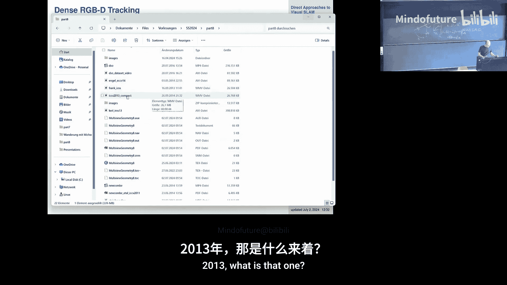

13， what is that one， Oh no， that's it。 Yeah， is that it just a second。

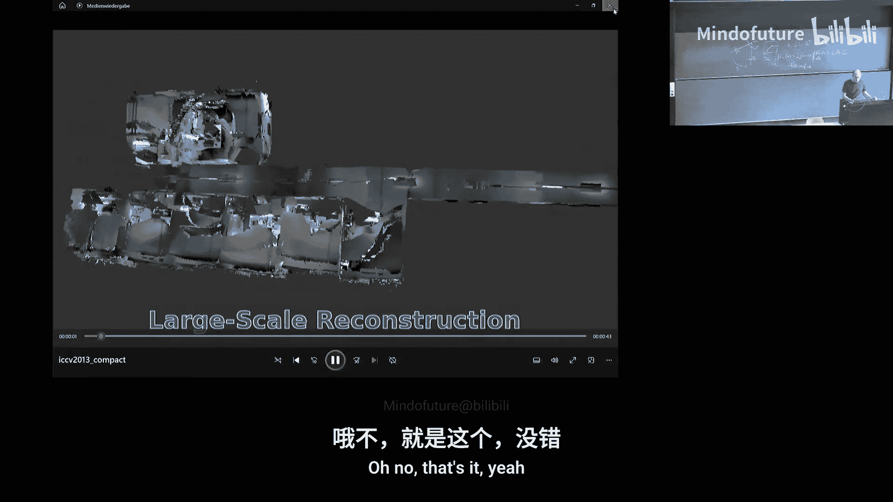

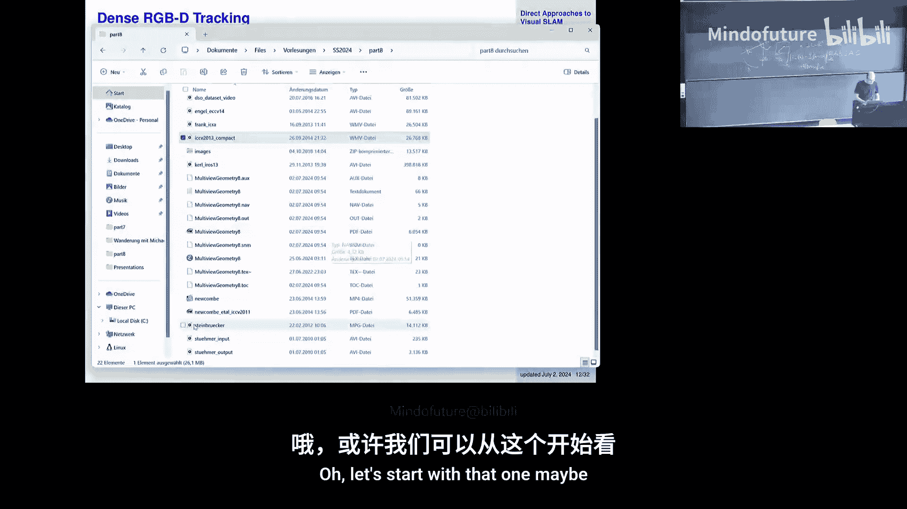

Let's start with that one， maybe。Yeah。So here you see the Kinineick camera that or prime sense also there's a lot of IGBD sensors that were around for a while。

 some are still on the market， some are gone。😔。

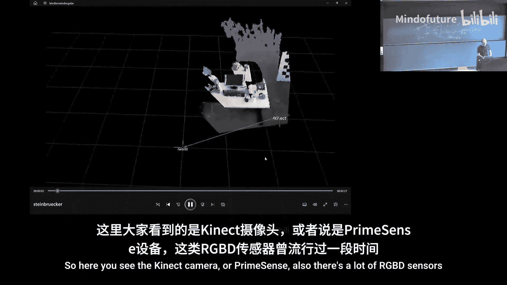

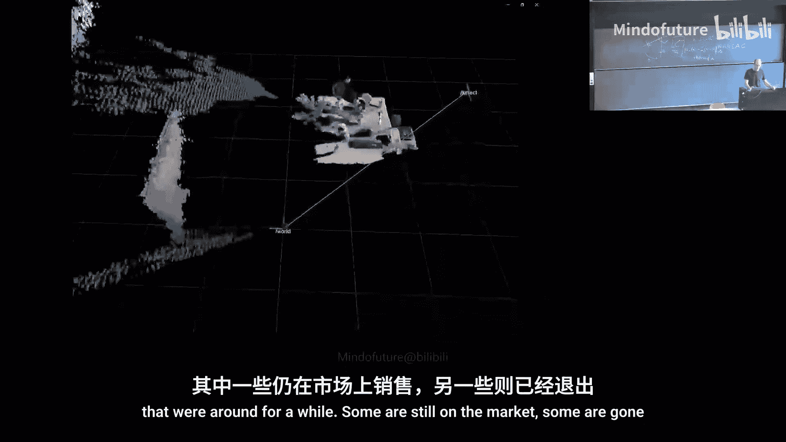

Connect from with the Xbox was one of the first commercially available ones。

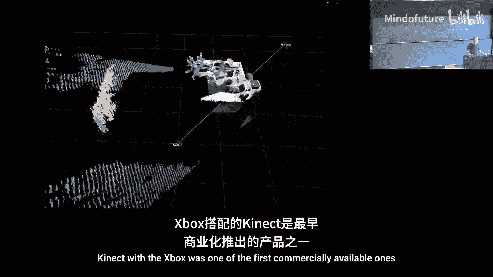

And here you see the camera moving around and what we're showing here is the dips map and the color dips map from the camera。

 but always we removed the estimated camera motion and so we don't see things from the camera perspective。

 but we basically transformed everything in a third person perspective。

Some static world coordinate system right and the fact that the table doesn't move around too much shows you that the camera motion is being estimated quite accurately at some point the table wobbled a little bit。

 that is moments where we clearly didn't estimate the camera motion correctly。

But apart from those wobble moments， things here you wobbled a little bit。

 but typically things are fairly stable， and it shows you we have a good estimate of where the camera was at any given time。

😔，Yes。Mmhm。😊。

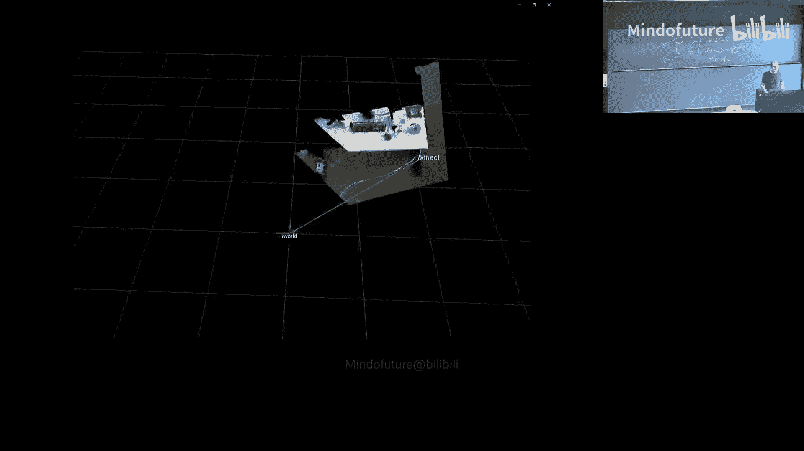

So here we're not estimating the depths。 You mean the previous one with a flower pot。Yes。

 so there we assume that the assumption is always in these approaches。

 that the world we observe is static。 It doesn't move。 sorry。

 the only thing that moves is the camera。And then the assumption is that we have an unknown depths。

 H of x， that is this depth here， this one and we're trying to estimate that for all pixels X。

 and then we basically do a transformation into the other camera with the rich body motion and the perspective projection and then we say these colors should coincide so we say find the depths such that if our project into this image。

 the colors match。Now there could potentially be many points。

 it could be that with a completely different depth， maybe there is a different structure here。

 right， maybe with this depth， this point would you know would also。

 if that point has the same color as that one， then you have a problem。

This whole approach somehow assumes that there is brightness variations in our world。

 that not everything is uniformly colored。😔，That is the key assumption if everything is pure white。

 then you cannot estimate geometry from colors。So the whole assumption is that the world we live in is sufficiently texture。

 that there' is sufficient variability， but the reason you know obviously for some points you might accidentally find other values that happen to have the same color let's say blue and blue here and then it might get the wrong dips for this point right because it would say oh with this dips I get the same color here and here right that camera is looking at this point that cameras looking at that point and here you would hallucinate the same color that is a problem but this is why we add this regular riser the regular riser basically that says nabla of H of x should also be small that basically means the neighboring point should have a similar dips value and that is unlikely that the neighbor point happens to have also the color as that neighbor point that's when things start getting unlikely and that's how the。

The algorithm can differentiate what is the more reasonable estimate for the depths。

And this is why this regular riser actually is important。To stabilize the whole estimation process。

Right， so this let me see if there's more。 yeah， so obviously we can look at this camera tracking and see does it look plausible if this table doesn't shake too much Yes。

 but obviously what we can do more is we can actually go ahead and create a data with ground truth and this is what we did here we actually generated a data for RTBD cameras where we had put markup points on the cameras to estimate our motion and then we know where each camera should be and then we can quantify errors and this is what we do here is basically and this is an evaluation where we show how robust is this and we show that if you take one image and then the next one how accurately can you estimate the motion and we find for not too large displacements of the camera we can estimate more accurately than baseline methods same here。

But also， if we have two white baseline， then this linearization that we do is not valid anymore because this linearization we do。

 it basically assumes that we have a fairly small motion of the camera。

There is a number of papers in this line。 For example。

 One of the things we did then in 2013 is non quadratic penals。

 That means rather than penalizing the quadratic difference， you find something more robust。

 Let's say just the norm。 So you can play around with different error measures。

 And that way you can be more robust， meaning if some brightnesses don't perfectly align。

 for example， on the Coke can， it will not deteriorate the estimation too much。

This is typically advisable so that you have more robustness。Here's the benchmark that we set up。

Here's the K camera， we equipped it with a set of marker points。

 we also had calibration rigs with marker points， we put you know this in a hand and moved around with hand。

 but we also put it on robots in case you have a robotic application。

 you know robots undergo kind of somewhat constrained movement and you can see how accurately can you track this motion or that motion of the depthensensing camera。

And here is Nicholas Eglehart， Niicolaos Eglehart， the second author on this paper。

Installing the mocap sensors and， and calibrating everything。

And then you have benchmark and ground truth， and then there's different data sets。

 this is work together with Walram Borggart， who's now professorfeor Nurenberg， roboticist。

And what we show here is you know these are the different movements。

 this is X and Y coordinates and here this is a very simple data where the camera moves forward and backward and left and right so nothing fancy right and then we have more complicated movements in much larger environments that are then more challenging so often useful if ever you do a data to think about。

 you know having。Problems in the data that are easy and problems that are increasingly more difficult because the movements are more complicated。

 the movements are faster， the rooms are bigger， etc。

And so this is often useful because you will find once a big problem with data sets is often people publish a data。

 then the community jumps on it and two years later the problem is solved that happens a lot right。

That all of a sudden the state of the art methods get 99。999% accuracy。

 and then you can basically say， okay， okay， it's done， we solve。

And sometimes it's good to have data sets that have different levels of difficulty so that they are not immediately solved。

As I mentioned you can also impose consistency not just of the colors。

 but also of the depths values and then you would expand the loss function。

 you would have a residual with respect to the colors。

 this would be RI and then in the color RCI for the I's image the color channel and then Z is the depths channel and then you have a residual in the depths channel that says the depths should be consistent。

And then you can have a covariance weighting of the different channels。

 as you see here with a covariance matrix sigma， and then maybe some weights that you can put in front that give you some more robustness。

😔，This without the W it would be a quadratic loss and with the WC we divide here by this one over this。

 so that would be a more robust loss function， this is called a student T distribution。

It's not so important， but there's lots of different error distributions that you can deploy and my then student Christian Car。

 he found this one to work particularly well。😔，For optimization。😔，And then since we do aing。

 we have something like a a weighted nonlinear least squares estimation problem。

 so we would revert to some Gauss Newton optimization and possibly reestimate both the weights and this covariance matrix on the fly。

😔，And that relates a little bit to the weighted least squares things that I've been telling you in the previous chapter。

😔，诶 let me。And then one thing we introduced in the same paper here。

Is a technique called posegraph optimization， I should say it was known before in lighter based slam or laser based slam。

But we propose to use it for camera based。The idea of this is you could see in the previous approach。

 we can estimate the camera motion from one frame to the next。

Now once you keep moving right you can always estimate camera motion from one frame to the next but one of the things you want is you want some form of global consistency。

 you want to make sure that for example once I loop around and I come back to where I started that things match and line up and so what you can do is you can always move your camera around like so and have another camera here and another camera here right and then you can always estimate the motion from one frame to the next from one frame to the next right and let's call this motion how do I call it here。

Sai， I J hat。This is the motion from frame I to frame J， the rigid body motion from I to J。

 I call P psi I J hat。This is the one that I estimate by image alignment， like we showed。

And now I can say， wait， now I want one single trajectory for the whole camera。😊。

Through the entire sequence， such that it's consistent with the pair wise image alignments that I have computed。

And so you can say the camera motion from frame I to J is given by Psi I concatenated with Psi J inverse。

 that is the relative motion from frame I to frame J。

 and that should be consistent with the one I measured by image alignment。So in other words。

 you tackle the camera motion estimation in two steps。

 one is you estimate relative motion between pairs of cameras。

And second is you find one globally consistent trajectory that is。

As consistent with the pairwise image alignment as possible， and what you have here is again。

 a least squares approach where you penalize the discrepancy between the camera motion estimated for frames I and J。

Between I and J and the one from I to J。I think the easiest is to show you this in a video。

And this is what we have here。So what you have here is the initial trajectory and the relative camera motion estimated over time。

This is the current camera。This is a previous camera。

 and now we can basically try to find an alignment and every time you find an edge here。

 it means we were able to match these two images with a rigider body motion。And now know。

 we not only find matches to the previous， but ideally to all previous images and then try to make everything globally consistent。

And sometimes you'll see a distortion happening， especially once there is a loop。

 once I come back to something I've seen before， you'll see it in a second。

 you see the whole set of frames， you just saw it now is realigned。😊。

So you can correct for the whole past trajectory based on the current observations。

And that way you get a trajectory that is globally consistent。

This is a technique that is called pose graph optimization。In some sense。

 this technique pose graph optimization is a little bit like bundle adjustment where I estimate all camera motions at the same time。

 except I don't have the 3D points， so it's a stripped down version of bundle adjustment。😊。

And this is why in general， this framework of bundle adjustment is very powerful and very general in bundle adjustment。

 I say find by minimizing some loss function E。In the camera parameters， Si I。From one through n。

 and in the 3D coordinates of the points， J。 So this is for I equals1 through M。 the camera motions。

 And this is J， J equals one through n。 the points。 That is bundle adjustment， right。

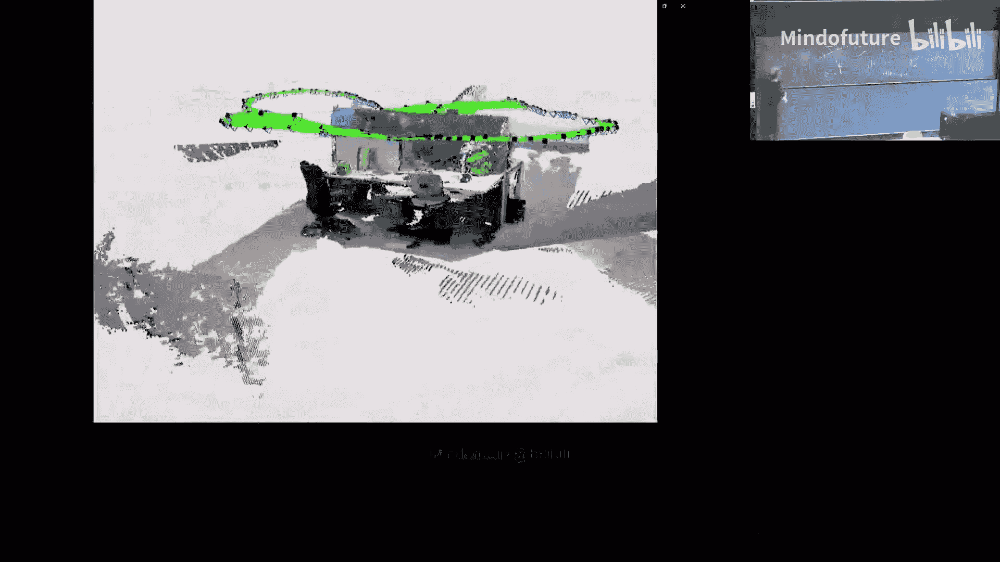

Camera motions Si I and the 3D point coordinates Xj。For all points in all cameras。

What I do in P graphra optimization is in some sense。

 just that part of the problem where I say find all the camera motions to make things consistent。

And I don't have the 3D points and what's nice about this is since the camera parameters are far fewer。

 you can do this in real time on a laptop CPU。

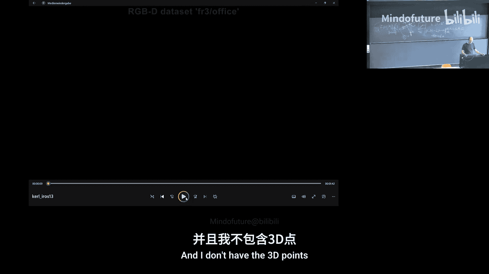

Even on a single core of a CPU and this is what we do here。

 and this is what we introduced in this connect based scanning is to assure globally consistent trajectories with this approach。

😔，And I think it is being implemented in pretty much all RGBD scanning techniques nowadays people would always use this kind of post graph optimization because you assure global consistency and that creates that leads to an undistortion。

 sometimes you drift with the camera but then when you come back things get corrected and aligned again。

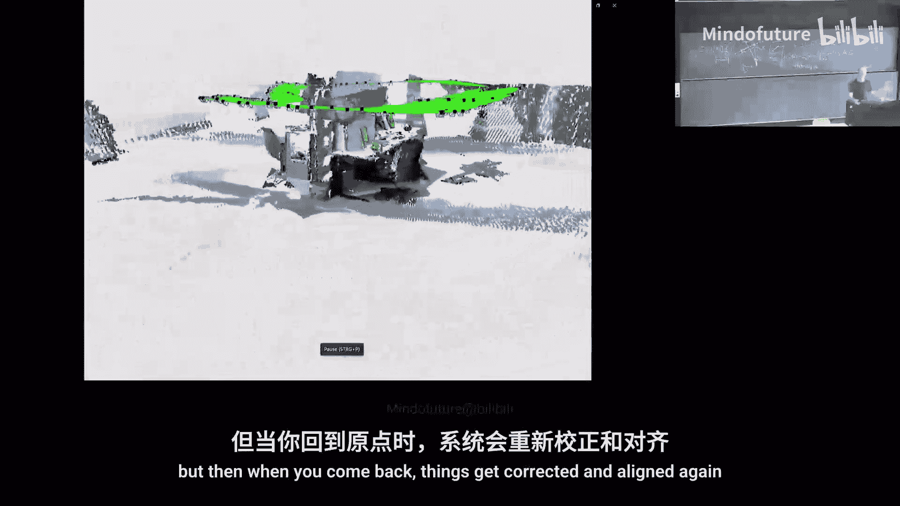

Much like in that that way you can recover fairly large environments without drift。Next。

Once you contract the camera at high precision。Yeah， so here you see comparison。

This is just the ground truth is in green here， the green curve and the optimized trajectory is the pink one and you see they really align very well whereas the local tracking of the camera drifts with time that is the red curve is just locally tracking by estimating relative motion from frame to frame。

 once you do the post graph optimization you get much better overlap with the ground truth。

Once you have estimated the camera motion， you can actually do a dense reconstruction because these RGBD cameras。

 they can let me show you where I start just a second。😔，Because there are several videos。😔，This one。

 maybe。I know， this one we've seen。😔，Then this one， this is an implementation of， you know。

 we estimate camera motion in 3D structure and then we can merge all these depth values in an O tree fusion。

 as you see here in a course to find hierarchical scheme。

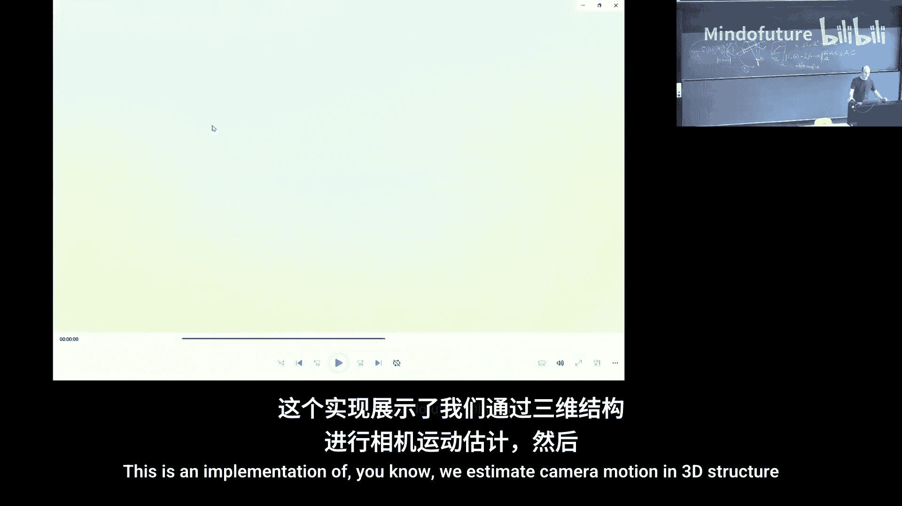

And we can generate dense reconstructions of the world and what was nice and in this paper is we could do that in real time。

 even on a small tablet。😔，And so back 10 years ago。

 we were able to move around in rooms and scan rooms at fairly high precision in real time。😔。

Something that was then picked up by a number of other research labs， for example。

 and Matias Nisna and Angela D here at Tomb， they're doing a lot of RGBD mapping， as you may know。

So the field has been evolving a lot， but this was some of the earliest works to introduce post graph optimization and to run things on Oukre data structures to get real time。

😔。

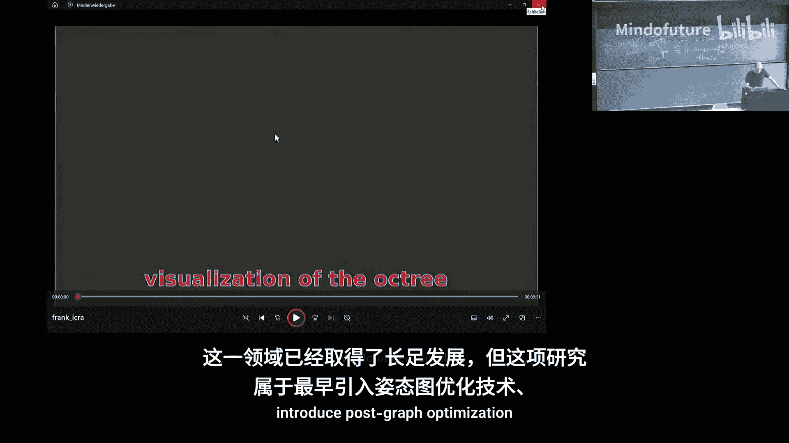

嗯。This was some10 years ago， Iikra was Ira 2014。😔，There is then another work。

 this is dense tracking and mapping by Richard Newcomb and collaborators and Andy Davidson。

 who is at Imperial College in London and what they propose is you can see is rather similar to the work of Stmer at Al。

 if you compare heres，Los function of yarn doomer， brightness consistency。

 and then a regular riser in the depth map。What they did is similar， but in some forms different。

 and this is often how research progresses。 here you see the brightness consistency。

 but as you can see the key differences they don't parameterize in the depths H。

 but in the inverse depth。So u is 1 over h， and so instead of h times x。

 they have1 over u times x in here。And the otherwise it's quite similar。

 and the other difference is that they regularize in Nala U and not Nabla H。

 and that seems to be superior in terms of performance。

And then they have an adaptive smoothing with this function row that basically says if you have very strong brightness discontinuities。

 you can down weight this smoother， It basically means at the object boundaries you will not create too much of a soap film filling。

😔，So if you have a boundary of an object， typically there is a discontinuity in the color channel and once you have a strong discontinuity in the color channel。

 the weight row gets close to zero and then you don't impose depth consistency。😔。

And then camera tracking is performed very much in the way that it was done by Steinberger at all 2011 in this Gaus Newton type optimization here。

And I think they also initialized with Pete Tom much like we did in 2010。😔，And here's a results。

 so you see it's somewhat similar here you see the points of P time。

 so this is clearly the p time running as a baseline for camera tracking。

 and then this is the dense tipsma。😔，And I think the discontinuities are slightly better。

 probably due to first using one over H instead of H and secondly。

 using this adaptive smoothing term row here。So this was now I come to a new work that we published in 2013 and 14。

 and it became known under the name largege scale Direct Monocular Slam or short LSD Slam。😔。

And this is。I think to date the most influential work that I've ever written。

 and you'll see a little bit why it is， it is in fact the first direct slam method that is really real time and large scale capable。

😔，And so rather than tracking and putting into correspondences at the feature point。

 it tries to really estimate the semid steps map。And estimate the camera motion all directly from the brightness images。

And。It seemed very novel to the community， but I should say it does build up very much on the things I've just shown you and in some sense you can see it already from this work emergings and that kind of shows you how research progress happens once you're in it right？

😔，You saw in the Scher work， we assumed the camera motion was given and we estimated the depths H。

 a dense depth map H by minimizing this brightness consistency loss。

Then we had a paper where we minimize the brightness consistency in order to estimate the camera motion。

The obvious next step is to say， can we estimate both at the same time？😔。

And this is whatS this is in some sense， what D time is about。

 but they needed to run the P time as an initialization and LSD slam is also along this way。😔。

And in order to account for noise and uncertainty in the inverse steps value。

 we actually propagate an estimate of uncertainty。 This is something that is often not done when you estimate1 steps maps。

 you estimate a value， but you don't know， you don't typically estimate how uncertain am I。

And what Jacob Engel did is he introduced like a common filter like。

Approach to update an estimate of uncertainty。And something that he did in this work that is quite interesting。

 but I think he actually dropped it in later work is rather than estimating just the rigid but emotion。

 he estimated something from the so called similarity transformation group。

So that includes a scaling so in addition to rotating the world relative to the camera and translating it relative to the camera。

 he had a parameter that allowed to rescale things and that is this parameter is that you see here right so what you see here is the same as a rigid body motion with rotation and translation。

 but there is one additional parameter， some positive parameter is that allows you to rescale things。

Now in principle， you could also add that S here and here to rescale everything。

 also the translation， but he added just in here。😔，It doesn't really matter so much。

 It's some way to rescale things relative to it， to one another。

And he found this was useful in LSD slam because sometimes you know in Moncular slam。

 you cannot estimate how big things are， and then in order to assure color consistency with a given image。

 it's helpful if you can just rescale the structure to match your camera image。

And that's what he did here。And then he estimates it with a nonlinearly squares approach with some weights。

 some residuals， color consistency， like we saw， and then the unknown parameters。

 you see the loss functions seemingly get simpler and simpler。

 but that's because all the details are hidden in RI。😔，Our eye is the residual。

 That's essentially this brightness consistency term that you have here， right？

Lots of residual sorry let mean not jump lots of residuals and then you have to estimate this over Sim3 so that is the Lee algebra associated with large Sim3。

 the Lee group， so again there is a Lee group of so-called similarity transformations these here。

 there is the corresponding Lee algebra and then you optimize over these seven parameters。😔。

And then he uses。Some weighted Gaus Newton algorithm。😔，As you can see here， this is the update。

 this is the old estimate and then this is the update and here you see the typical Gaus Newton is this weighted J transpose J with the weighting matrix inside。

 this is the approximate Hessian inverse times the weighted。😔，And Jacobbian。

Where Jay is the Jacoban here。So this is a typical Gaus Newton type update。

 I don't think Jacob used a Lin back Maqua adaptive version here。

 but I think he said this one worked better for his purpose。😔。

Here are some example reconstructions and here you see a little bit why we call it large scale direct monocular slam because instead of Pam where you could show that it works on a small desktop environment。

 this thing actually works， you can go outdoor and move around the block and come back and things match。

There is loop closureing， there is postgraph optimization so we kind of integrated a lot of the components we had developed in previous works we integrated in one monocular approach this often is the way you progress in research that you try to solve parts of the problem first and then much like in a puzzle you put the pieces together。

And sometimes putting the pieces together is the biggest challenge。

But it also creates the biggest reward。 this is common in research， as you see here。

 I'll show you videos， and this is something that really had a huge impact in the community。

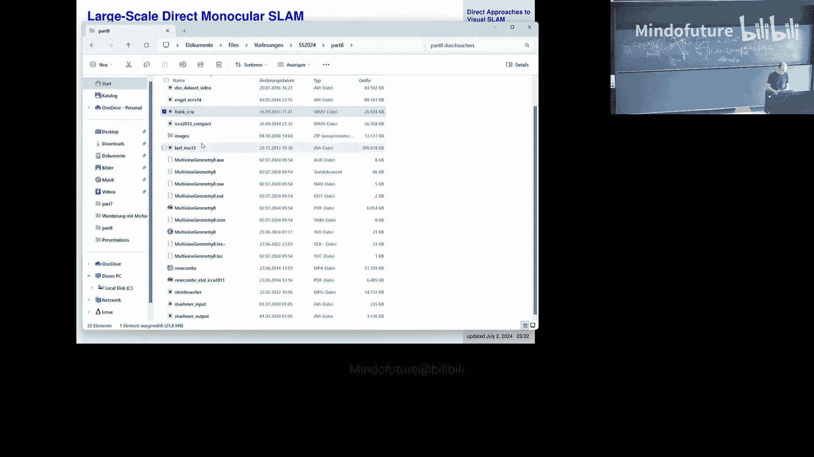

Did I show you this one already？No this is from the sorry this is the previous work from Frank Steinberger where he did it in a scalable way。

 so this is reconstructions from our entire corridor with many offices all created in real time on a tablet。

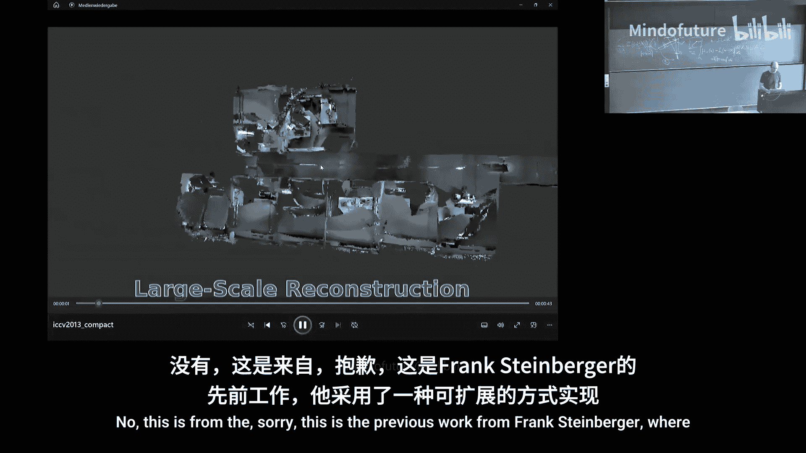

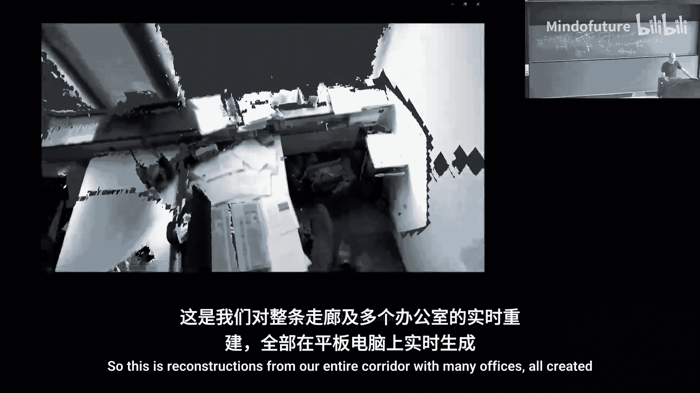

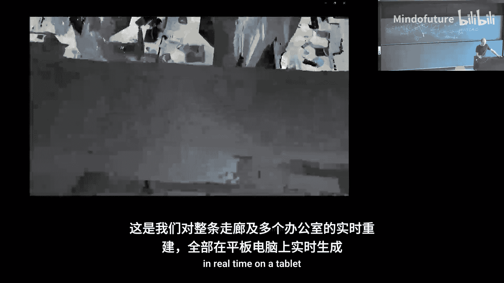

And you can see you can zoom in and see a lot of detail， so this is now we're talking 2012 or 13。😔。

But the LSD slam is this one。

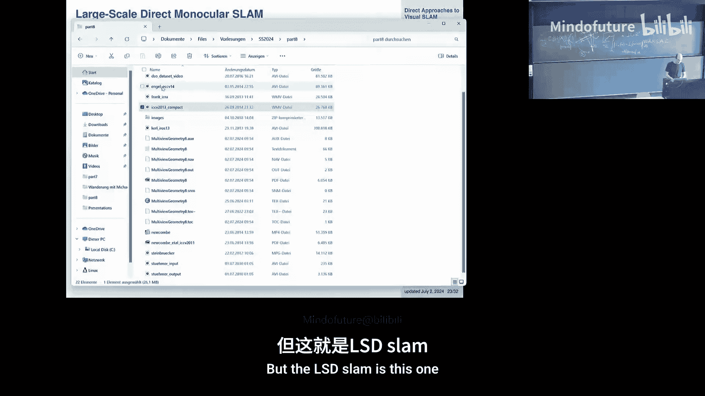

So here you see the system in action， that is the current keyframe。

 that is the live camera position and the point out and here is the camera on the top right。

 you see this is the monocular camera Jacob holding the camera and this all runs in real time on a laptop CPU。

😔，And this is were talking 10 years ago。😔，A long video。 Let me see。

 So here's the monoculars and ordinary monocular cameras are now depth sensor， al right。😔。

I just realized this is a super old video。

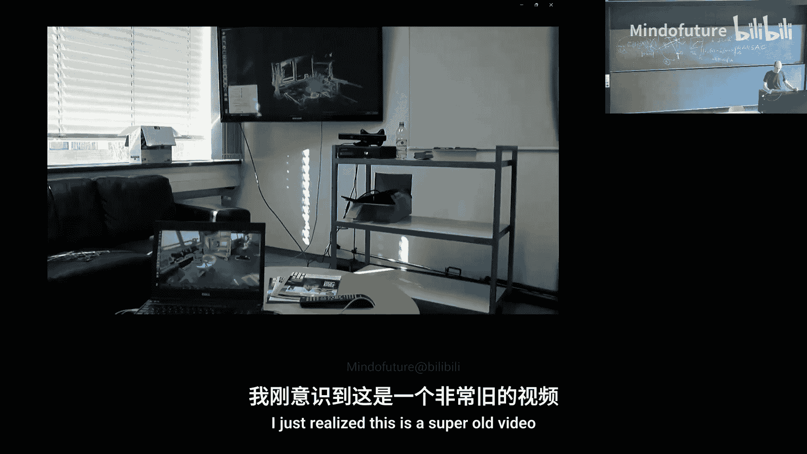

Let me here here's more examples and here you see we can reconstruct things at fairly good detail close up。

 right？😔，still， when we move out， we get a very large reconstruction。

 and this was the nice feature that LSD Slam brought about that you can do fairly high resolution 3D reconstructions at massive scale in real time。

😔，So here we're moving around the whole structure。😔。

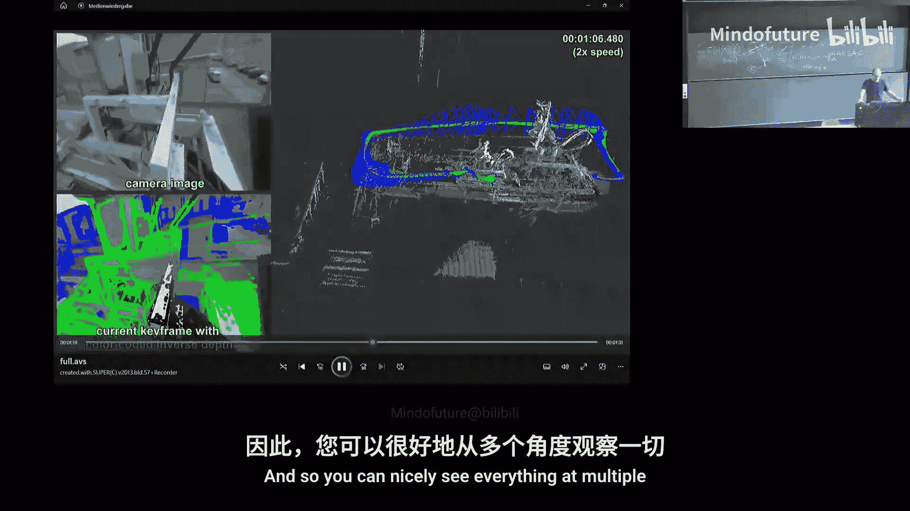

And so you can nicely see everything at at multiple。

 And you can really recognize things in this reconstruction。 It's not dense， but semi dense。

 which means for about 50%。 And this is right outside the building here。诶。

On campus and we walk around and you can see the trash cans emerging。

 so you get a fairly pleasing semi dense reconstruction of the world in real time from just one monocular camera。

😔，And here as well， you will see the loop closureing in action you saw it already that the structures start to align。

 especially once the loop is closed， you'll see it again towards the end。😔。

Once it finds an alignment to the first frames。Then things get undistored。

 see how this pho optimization corrects for every further drift。

 and then you get a drift free reconstruction。😔。

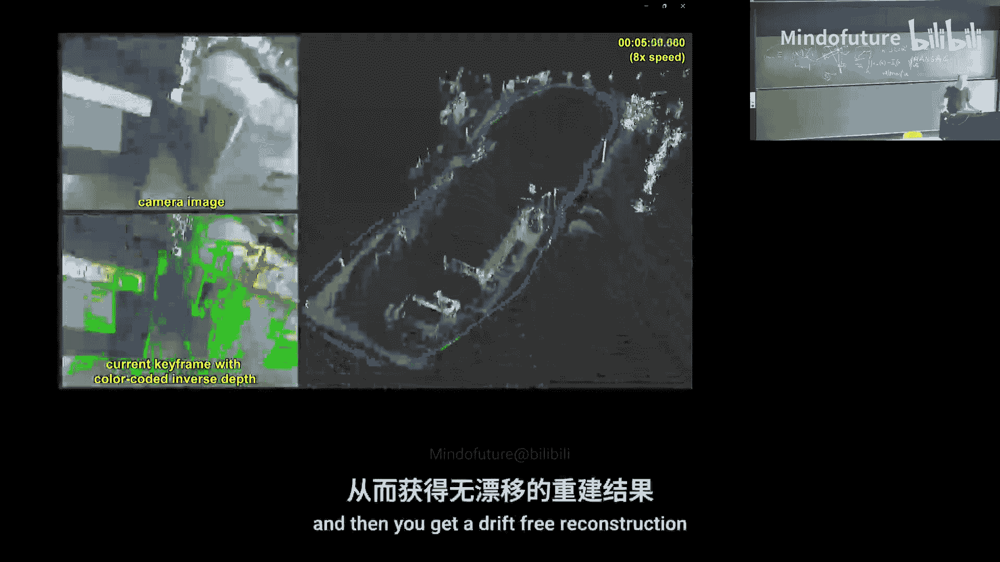

So this was LSD slam， as I said， it left a huge impact in the community。😔。

And here you can see the reconstruction on multiple scales in these closeups。😔。

Lastly I wanted to mention as the last direct method， this is a technique called direct sparsaometry。

 despite its popularity and this is notorious for all the research we do as you never stop right。

 even if you've achieved a fairly impressive result。

What drives us as researchers is the belief that it can always be done better。

And here if you look at LSD slam， more closely， I didn't go too much into detail is it integrated all the components。

 but very often in a somewhat engineered fashion， so we had one thread that estimated depth maps and fused them into this point cloud reconstruction and we had another thread that estimated the camera motion and in fact they actually minimized not one loss function but two slightly different loss functions。

And then。We also alternatingly estimate camera motion and 3D structure。

 whereas everyone knows from Croa's works that things should be estimated jointly。

And then there was this approach to spatially filter the inverse depth values。

 which reproduced this smoothing effect here in a somewhat heuristic fashion that you say neighboring points should have similar depth values that often prevents you from getting very crisp discontinuities in the reconstruction。

And it created correlations among the geometry parameters。

 and so the joint optimization of camera and 3D structure was actually not so easy。😔，And then lastly。

 LSD slam assumes like optical for brightness constancy。

 but it turns out brightness is not actually preserved in real world sensors。 they're complicated。

 They have something like called a gamma correction right they have something called the vignette such that pixels that appear more in the center of the camera are brighter than if they appear at the boundaries of your image。

 and these were things admittedly I didn't even know as an image processing person you always make assumptions and the real camera typically doesn't fulfill these assumptions。

And there is a brightness transformation that you have to apply in order to get from the measured intensity。

 the measured brightness depends on the irradiance， so you have to distinguish。

 what is the light emitted from an object， this is called the irradiance。

 and what is the light that I measure on my sensor that is the brightness。

 and they depend upon each other in this nonlinear fashion。And there is an aperture time T。

 there is a vigning function V that it looks like that。

 and then there is a gamma correction or also called camera response function that is hardware dependent that the camera imposes。

And so basically what we advocated in this follow up paper called Directs parsodometry， we said。

 let's invert this whole transformation to get from the measured brightness back to the emitted irradiance。

 and then we impose not brightness consistency but irradiance consistency。

 saying that the light emitted from the structure should be the same。

 how it appears in my sensor depends on my camera。And then we do a real bundle adjustment。

 but as I mentioned bundle adjustment doesn't work in real time。

 so what Jacob Engel did to jointly estimate camera motion in 3D structure is to make this real time capable。

 he did what's called a windowed optimization， which means you take the camera sequence and you take as many frames from the previous images as you can compute in real time and you estimate all their camera parameters together。

In a window and and in practice， this was typically seven or eight frames。

 I guess nowadays you could do more with more compute power。

 but at the time we typically did a window optimization and then a technique to somehow marginalize out the last the past frames。

 This is a little bit technical。 I don't want to go too much into detail。

 but it's somehow averaging out the past。And then we used the sure compliment trick to really make this Haitian inversion fast and real time capable is something I mentioned in the bundle adjustment paper in chapter 7。

So this is the matrix here is the post parameters， this is the pose pose block。

 and this is the large block that we assume essentially diagonal。

 and the problem is with the smoothing that created correlation such that it wasn't actually diagonal。

 but once he dropped the smoothing and the spatial smoothing of dips values that he had in LSD slamb。

 he got something that was diagonal so it took him quite a while to figure out how to make this Gaus Newton approach really work in real time。

😔，But that ended up leading to this technique called direct sparssoometry。

 and let me show you videos。DO here。😔，So first of all， yeah， so here's DSO。

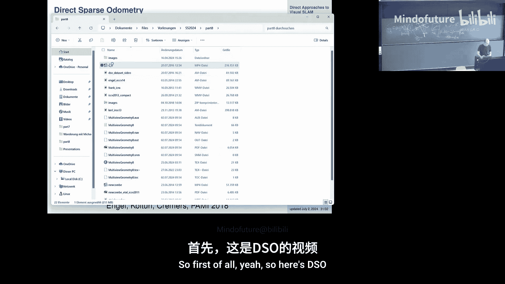

It is just one video。 I think there's gazillions of videos on the net。

 It's a technique that is extremely popular。 Lots of people use it。 The code is online。

 So this is at the subway station outside。 Many of you may have come here this way。 We go into。

 You notice there are people walking through the image。 It doesn't matter。

 The approach is extremely robust to moving objects。

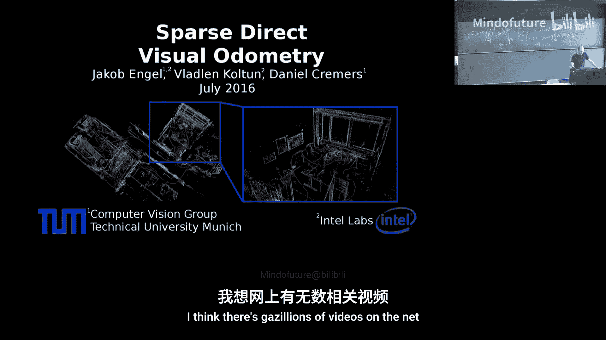

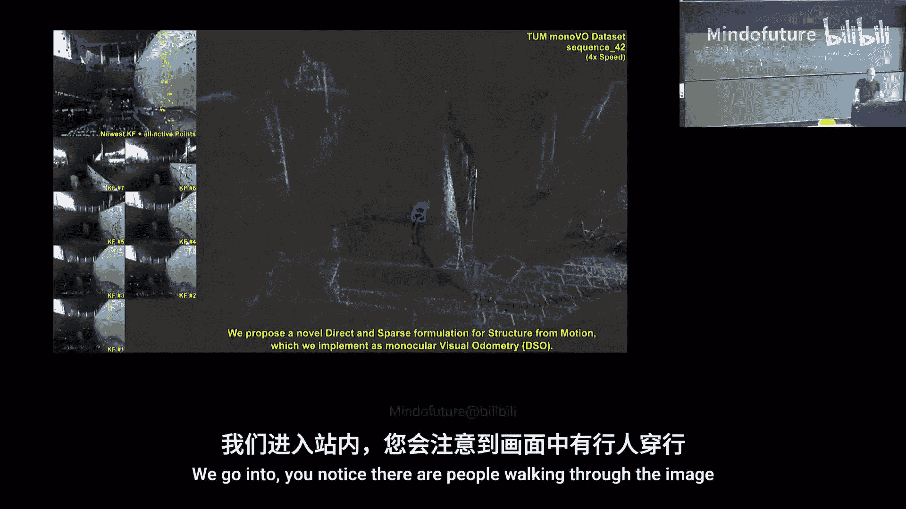

And you see on the bottom right on the big screen how it tracks the camera through the entire subway station and then back out on the other side。

 you see the all staircase coming up here right and so you can with just one camera walk through the subway station around on the outside and you see there's very little texture。

 this is just gray roads， gray sky trees in the background。

 but the system can accurately track the camera over very long distances and you see the time window is these blue lines。

 this is the set of frames that are being estimated jointly at any given time。And sure。

 if you track the camera for very long times， you will make errors， right。

 and these errors will accumulate into what is called a drift。Tid me。😔。

Rewind just a little bit if I can do that。Right，And you see that drift here， right， you see。

How the bicycle here is reconstructed twice once at the beginning， once at the end。

 And you see there is an offset。These bikes， these two bikes are here and here， right？ Now。

 how big is that offset， maybe 1 m on a distance of hundreds of meters walk。

And this was among all real time capable camera tracking systems by far the most accurate the world had ever seen。

And as I said， there's many more videos here。😔，You know going through corridors。

 reconstructing environments， even corridors where there's very little texture just white walls and grazed。

 gray floors， etc cea， still the system can track， this is in the main building of tomb and we see how things are being and again there is a drift right and you can see that drift and here's a comparison to LSD slam。

 a comparison them to the competitor orb slam by a team in Saaragosa。

 so this is a more classical much like Pam classical key pointbased approach but the extremely powerful。

😔。

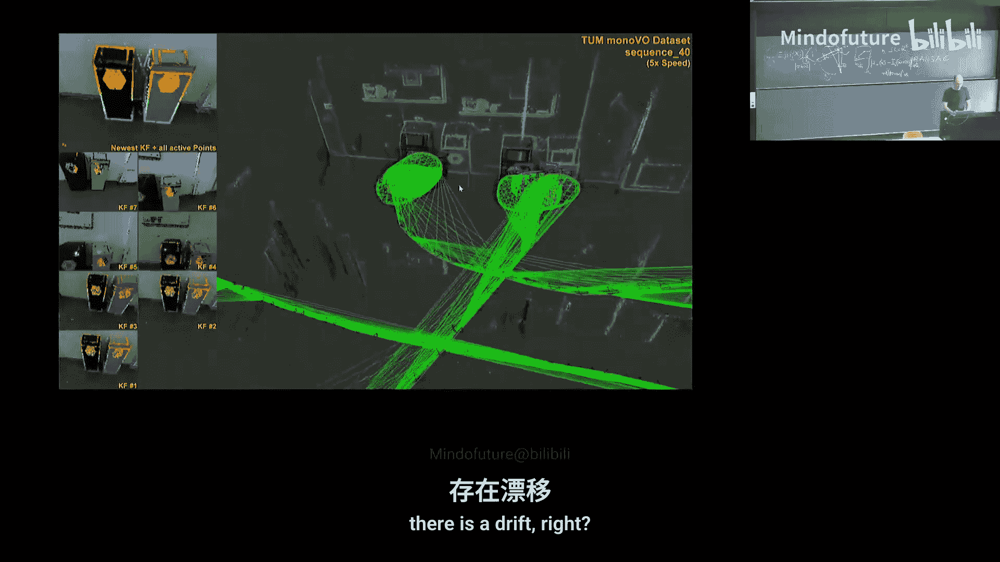

And what we find is， you know， typically in textist areas like corridors。

 it's just very hard to find reliable key points。

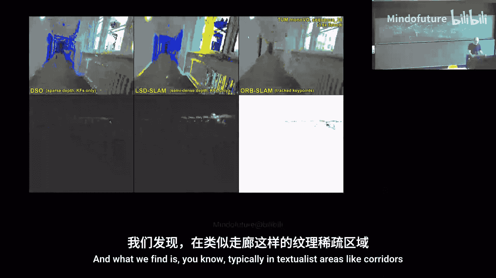

And DSO doesn't need key points， even line like structures， like here。

 any points where brightness varies， they affect the estimation and they assure that you get correct camera tracking。

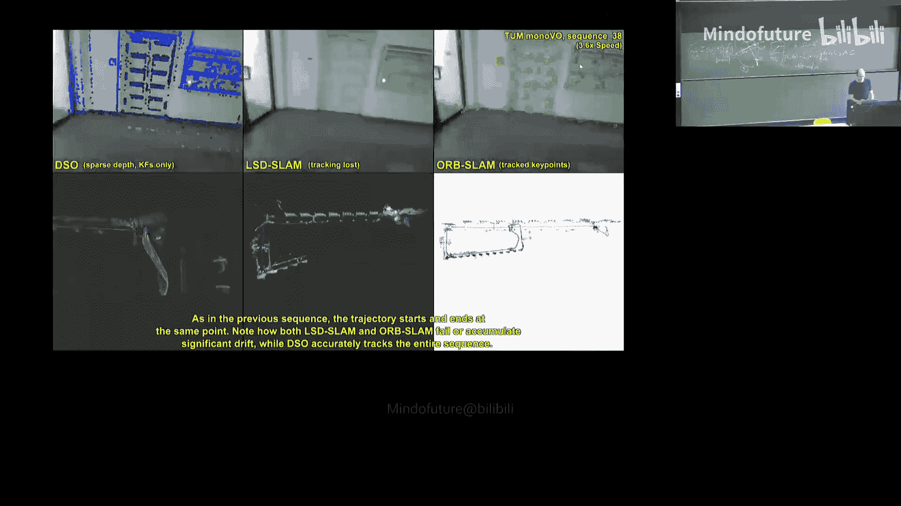

In fact， we did a quantitative evaluation and compared to the leading competitor orPSlab and here's the results。

 so what we did is Jacob recorded about 100 sequences。You know。

 sequences like this indoor outdoor with different lenses， different movement。

 different environments， right some faster， some slower， some you know more rotation。

 some more translation right， I get a headache， which is watching all of these。

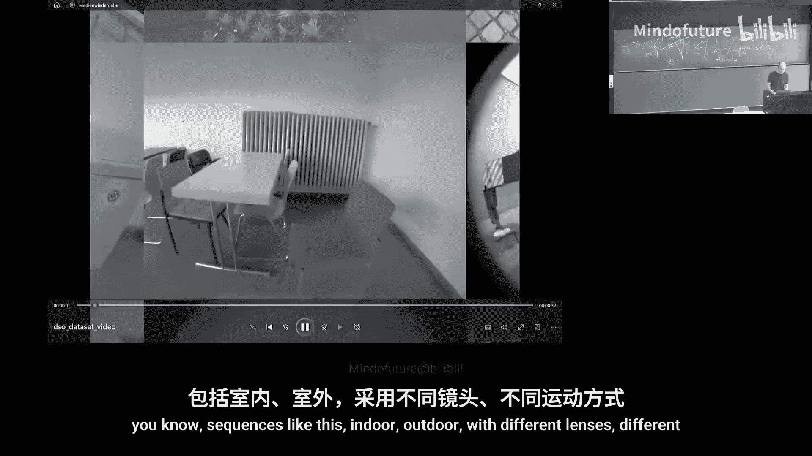

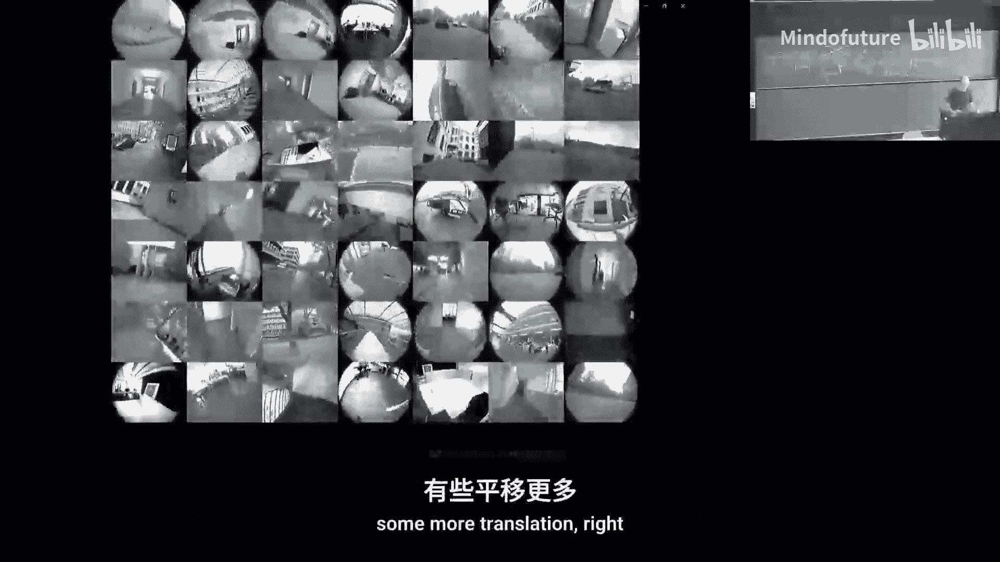

And then he quantitatively evaluated the precision on all these sequences and he has a total drift in translation rotation and scale for the two methods and on the x axis is the error in translation rotation and scale per sequence and on the y axis is the number of sequences out of 500 sequences where we achieve that error。

And you can read these plots in many ways， but let's say you want to say what is the maximum error on the best 300 sequences。

 orlam you can see here has an error of6， we have an error of about one。

 so that's about a reduction in error by a factor of 6 that's almost a magnitude more accurate than the state of the earth。

So when I said， this was more precise than anything the world had seen significantly more precise。😔。

Almost an order of magnitude more And why is that Because the direct methods really use all available sensory information。

 all the brightnesses from the sensor， they affect your estimation。

 They make sure that you estimate the right motion。And so these two works， LSD Slam and DSO。

 they have really propelled the whole field of camera based reconstruction and camera tracking and augmented reality。

 and this is basically the source and the key foundation for techniques like Metas， Aria glasses。

 if you've heard of this a fairly recent development from metata。Jacob Engel is the lead。

 the tech lead on the Aria team， and he's brought in all this expertise to make it work。

So in some sense， the techniques that we're developing here do have quite an impact in the world around us。

And that's good to see。 There is a lot of things that come from being able to track cameras and completed。

 completely unprecedented precision and robustness。 That's it for the direct methods。

 Thank you for your attention。

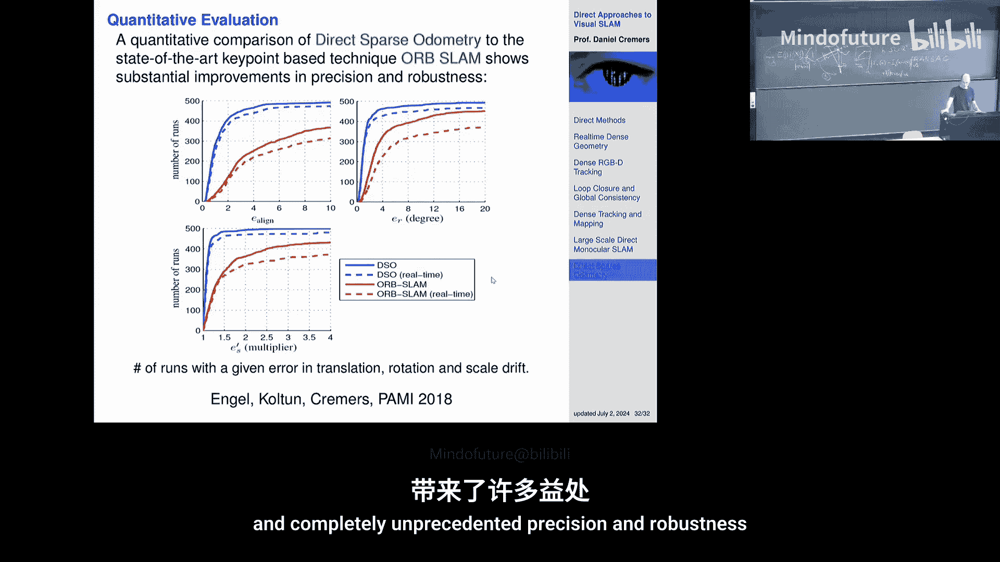