# 【慕尼黑工业大学】多视角几何 ｜ Multi View Geometry 2025 p17 P17_讲座_15a_视觉SLAM的直接方法-回顾 -BV1KgZEBrEXV_p17-

Okay， good morning， everyone。 Welcome to class。😊，Last week I was at the CVPR conference in Nashville。

 Tennessee， CVPR is the biggest conference in computer vision and in fact the most influential conference worldwide in terms of impact factor as you may know researchers are increasingly evaluating with all sorts of metrics and one of them is the H index。

 the impact factor that measures how many how to what extent their work has been picked up by others and cited and referenced and now people are increasingly also evaluating journals and conferences based on impact factor so they will go into a conference like the CVPR and say the papers that are published there in a certain time window how many citations do they aggregate in total and there's different metrics that you can use。

In terms of these metrics， this is the number one conference worldwide across all disciplines。

Which first of all shows you that computer visionion is a big topic， it's a hot topic。

 it's a popular topic and within computer visionsion this is the number one venue but there are two other venues that are fairly on par that is the international conference on Comp visionsion and the European conference on Comp visionsion ECCV and so these are the three big conferences where relevant works get published and so all the computer visionsion research labs in the world they really try to be part of that。

And this is a good measure if you ever see a computer vision researcher and you want to know。

 are they any good， you can take do they publish in any of these venues， if not， it's a bad sign。Yes。

 and so it's a big conference。 It aggregates over 10000 people that come to Nashville， for example。

 and present their research。 things are getting a little bit complicated these days。

Some researchers cannot attend because of visa issues and so unfortunately this for example people with Chinese background or Russian background often have a harder time to actually attend these conferences and this is something that the whole communities concerned with and we don't really have a solution for it but。

Yeah。And so this year， for the first time in many， many years apart from COVD。

 the number of participants actually went down from I think 12000 or so to something like 11000。

 so there was a bit of a drop and this is associated with visa issues that are。😔。

Increasingly complicated。

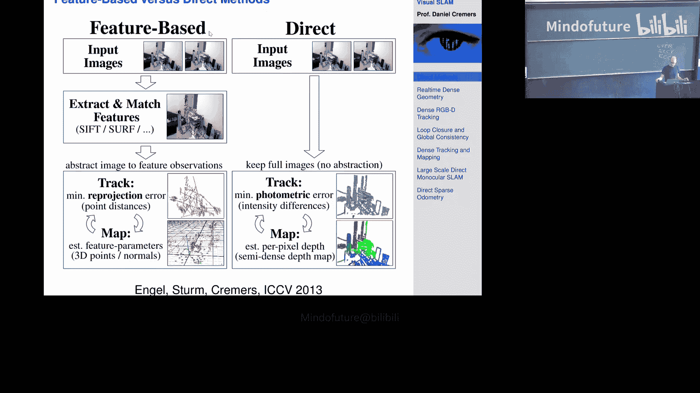

So we can of all hope that world politics will look up at some point。 But at this point。

 things seem to be more going downhill。

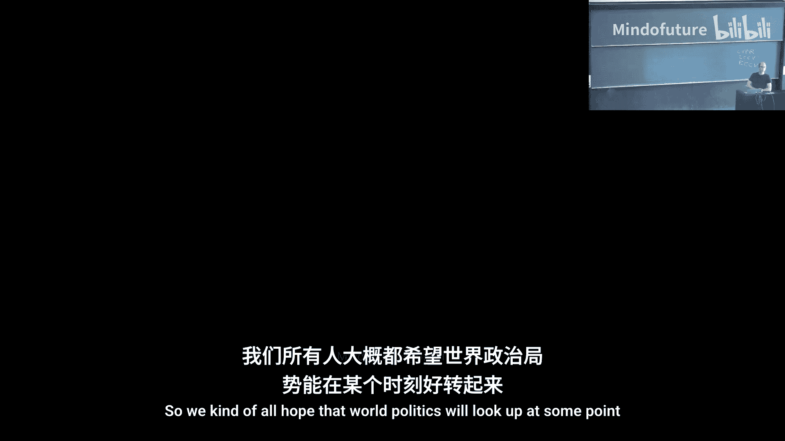

嗯。So what we we so we showed videos last week and I think maybe more than we should have。

 but you should have watched these videos of the lecture。

 let me recap nevertheless one of the key insights from chapter 8。

 so chapter 8 is on direct methods for visual slam， so structure from motion or slam。

And the key idea of these direct methods that we've been promoting for a little over well。

 almost 15 years now is that rather than extracting feature points and putting them in correspondence and matching and then computing a reprojection。

 and minimizing a reprojection error like you do in bundle adjustment。

You go straight from the raw sensory data， the brightness values of your camera to a reconstruction of camera motion and 3D structure。

And the key idea is a very simple one， the key idea is that you say find a camera motion and a 3D structure such that if I project these cameras into the world and back out into the other camera。

 I should have color consistency。And so it is this photometric or color consistency that drives everything。

And so in other words， you can say I want to find a model of the data how the data was acquired through a projection of the world into camera。

 the movement of the camera， such that I can explain the data。

And this is usually a good way and in some sense， the optimal way to tackle problems。

 there is many ways to do data analysis， but the most powerful is to do what's called probabilistic inference and Bayesian inference where you say find the most likely interpretation of the world given what given the data that you have。

And the data is， in the case of cameras is brightness values that your sensor gives you。

 So the data is not points and it's not corresponding points。

And so all the assumptions that we've been talking about that go into structure from motion that you have corresponding point pairs。

 well in reality you don't in reality all you have is the intensities。

 the brightness values from your sensor。And if you do this abstraction were that you first extract points and then match points。

 then whatever mistakes you make in that step one， they will propagate into your reconstruction algorithm in a way that you can hardly recover from it。

And I should say this is an aspect that we don't go too much into detail about in this class。

 there are techniques that allow you to recover from bad correspondences。

 and one such technique is a technique that is called ransack。It's called random sampling consensus。

 It's a very popular method。 The idea is that you put points in correspondence。

 and then you do some form of 3D reconstruction structure for motion。And then you see。

 does that explain the points or not？And if you find somehow it doesn't。

 then you reshuffle the correspondences randomly and try to find other pairing other points and see if that gives you a better reconstruction and you can kind of alternate。

 which means you basically go back and forth between the middle block and the bottom block right。

 saying， okay， this reconstruction is not really good So maybe the correspondences are wrong。

 Let's try other ones。 and you can keep itating that。

 and then you will obviously get better with time right But it's a very kind of。

 I would say not very elegant solution， because it's not clear how long you have to iterate back and forth until you get a reasonable result。

 but it is a technique that does work to some extent。

 And so this is often what people have been doing。And here， in the direct methods。

 you avoid that abstraction step， you go straight from your intensity values to camera motion and 3D structure。

And there's a lot of approaches that go in this direction。

 one of the earliest is this one by Stummer and collaborators， so this was a master thesis。

 by the way， 2010， real time dense geometry， maybe I can show you a quick video so that shows what this method does。

So this is the input video。I hope it plays。

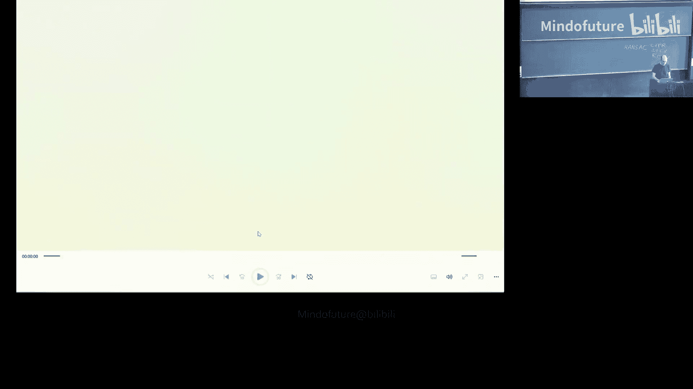

I don't like that video player is too slow。 Okay， so here's the video。

 And you see there is a flower pot and the camera moves just a little bit all around， right。

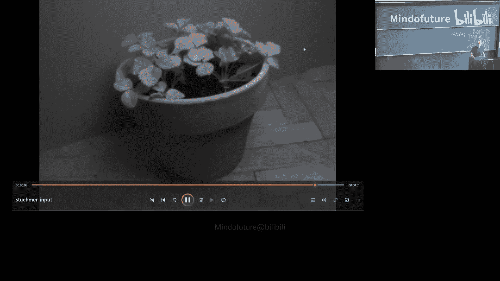

And the method works in real time。And generates a dense reconstruction。 And to my knowledge。

 it is the first real time dense reconstruction from a handheld camera。

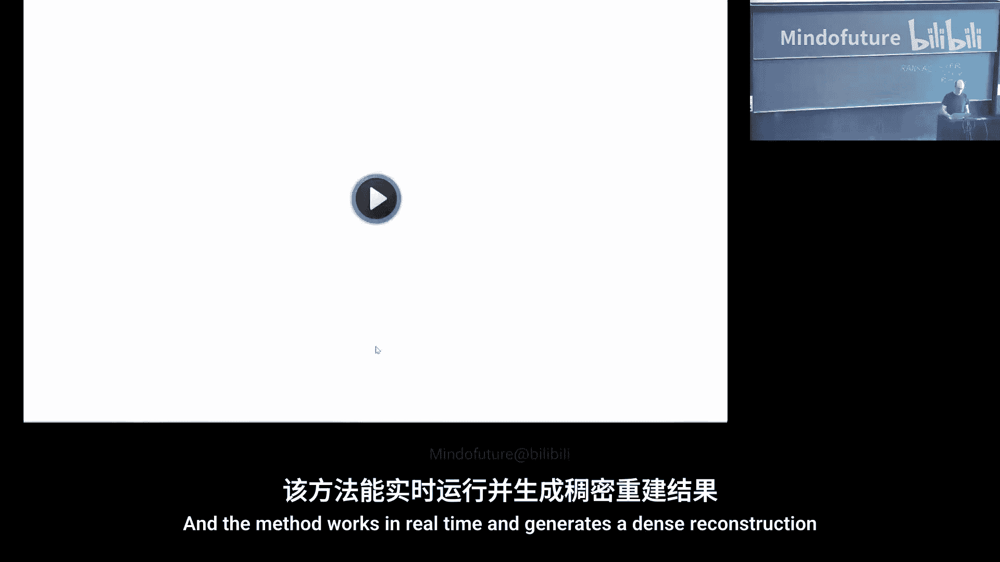

At that way。Introduced in 2010。Part of why it was real time is like everything we did back then。

 it was running on a GPU to make things very fast。Just to put that in context。

 the neural network community discovered the GPU in 2012。We had been using it since 2004， probably。

 And this was one of the works in 2010 that was running on the GPU。

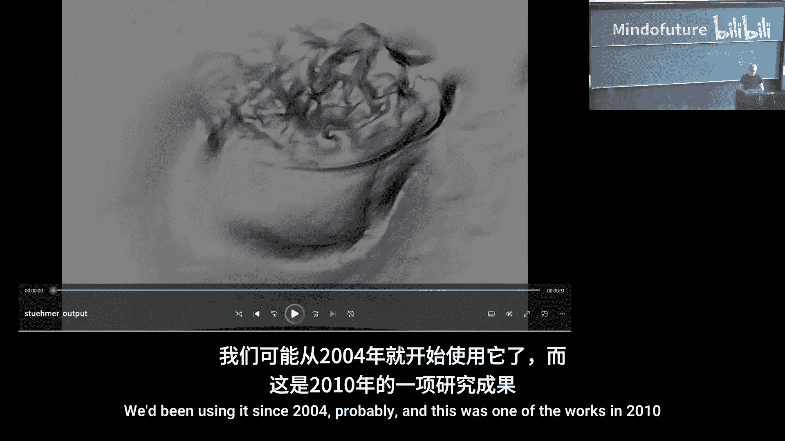

So this was some of the early works and the key idea here this is the example in 2010 is that you work on the brightness values so you have an intensity of let's say the first image or some baseline reference image and then you have the later images 2。

3，4 and you say the colors should be consist and in what sense well if you take the point x in homogeneous coordinates。

 this is something we learned about in this class so you have the image1。

 let's say this is the image1 you take this point X here and then how do you and you say the intensity of image1 at that point。

 so this would be i1 of x right here。This intensity should match once I map it into 3D and then back out into the other image。

 this is for this would be the image I I and this here is the image I1 right and in the other image it should match the corresponding intensity here and what is that point well you go from x to 3D。

 so this would be h times x if x is in homogeneous coordinate and H is that distance here。

The distance for the point x， then you are in 3D， then you take a rigid body transformation into the camera frame I。

 and then you do a perspective back projection into the image plane。

 so this projection that projects back into the image and then you take the intensity at that point and then you say the intensity should coincide in the sense that the discrepancy between these two should be small。

And the key idea is now that you do that for all pixels in the image。

 for every pixel X that you have， and you sum up or integrate over all pixels in the image。

And then the idea is。You want to estimate the height or the distance for every pixel x you want to determine how where is it in 3D space。

 So you want to estimate this full dense surface here。

 So for every x you want to determine what is H of x。So you do that for all H at the same time。

And then this is typical for these kinds of works。 you add what's called a regular riser。😔。

I'll put that term in in case you haven't heard regular riser。

This is an additional term in the loss function that says， well among all conceivable tips maps H。

 which ones do I favor？And here， the preferences is for depth maps that are spatially smooth。

Which means that from one pixel to the next， the height shouldn't vary too much。

And that acts very much like a soap film that sets on the world。

 And you can see it in the output video。 this soap film like regular riseor， the effect it has。

 especially in areas that were not observed on the sides of the pot。 I don't see the intensities。

 You can see how it fill in much like a soap film that sets on the world。

And this is a choice that we make。 We say we want to continue a steps map。

 and that means wherever we don't have measurements。

 the things should somehow fill in in a reasonable way。

 and what is reasonable here is just given by this regular riser that says。

 so this is the energy that is typical for soap films that they are minimal surfaces。

 and this is very much like a minimal surface that you get。

This whole approach is what's called a variational approach。

 We'll talk more about that very in the next chapter。So this is an example of a variational approach。

 which means I set up a loss function as a function of H and I determine this function H that minimizes this loss。

And we'll talk more about variational methods。 Nowadays， you would typically tackle this differently。

Nowadays， you might want to train a neural network。

Based on lots of examples that would tell you which depthPS maps are more or less likely and here this is not using any training data so this is really an a priori assumption that I say I don't know what the depthPS map is。

 but I expect it should be smooth in space。😔，嗯。And let me jump a little bit here。

Then this is LSD slam is another approach that has become extremely popular， it is。

 I believe my most influential publication to date。

 it's a method that combines in some sense this tips map estimation with an estimation of the camera movement right。

 so in the 2010 paper we were using a different base algorithm to estimate the rigid body motion GI of the camera。

And so we just use this as known， but obviously you want to estimate both at the same time。

 and this is what we did in this work， LSD slam。So that combines both of these ideas and this。

 so there is an alternating approach where we alternate。

 I don't know if there's a schematic drawing in the paper there is an alternating approach where we alternatingly estimate the depth map and the camera movement。

😔，By minimizing a certain cost。And here are some videos that I can show you that show this LSD slam。

And。This is probably a good one。

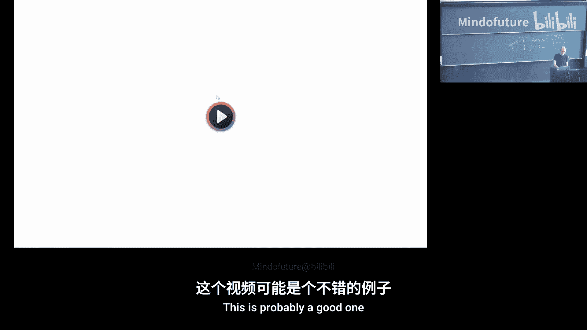

As I said， so here you see very nicely， this is the camera on the top moving around here。

 there it is。 Jacob is demoing it。And。Here you can see the current key frame and here you can see the live camera position and the depths reconstruction that we have here。

 What you can see is in this LSD slam， the world is reconstructed， but not densely。

I remember we discussed it because we had this flower pot results。

 We had a dense reconstruction that was running in real time on a GPU。 But Jacob Engle。

 who developed LSD slam， he said， first of all， he wants a method that works on a CPU that doesn't need a GPU and still runs in real time。

 And so this is what this is。 And secondly， it's not dense， but as you can see semidense。

 So for about depending on the settings， but for roughly 50% of pixels， you get a depth value。

 And for those where you have really constant intensities， it will not give you a depths。

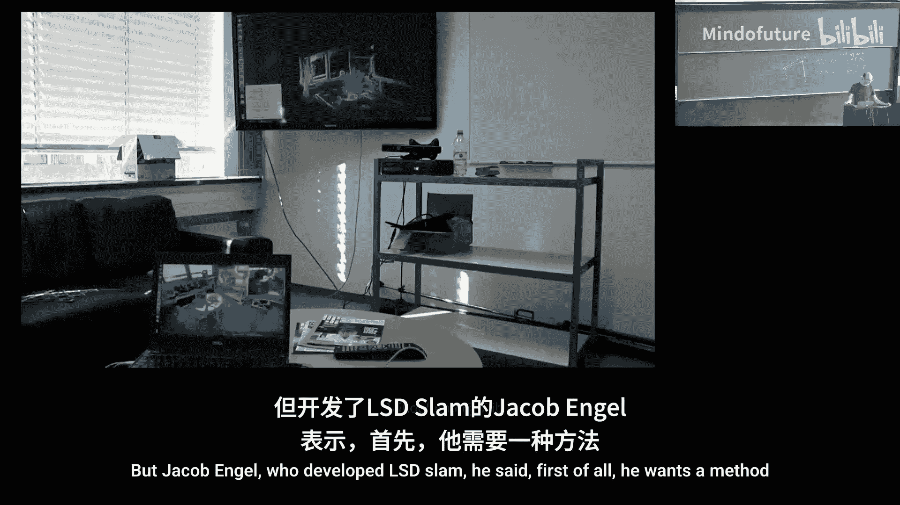

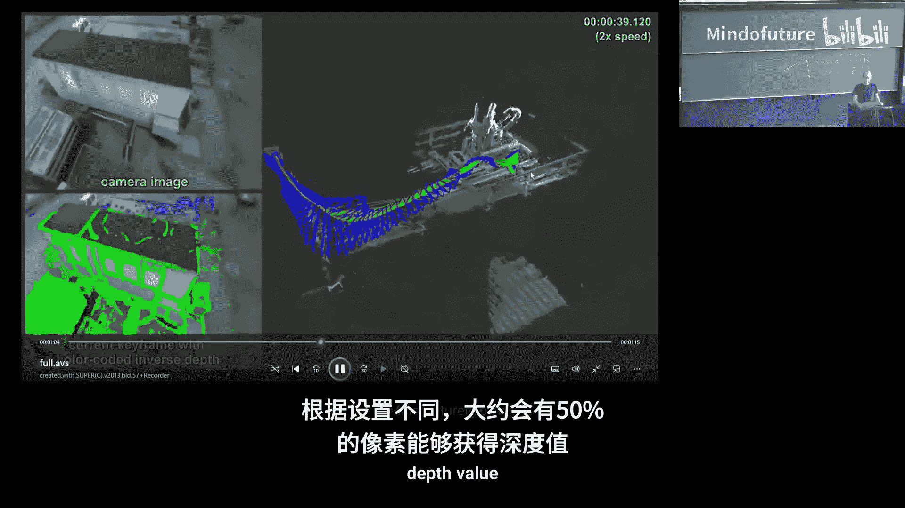

And then Jacob said， I don't want the system to hallucinate the dips like the soap film that sets on the world。

 It basically means the algorithm hallucinates De where it's not observed。 And he said。

 I don't want my algorithm to hallucinate。

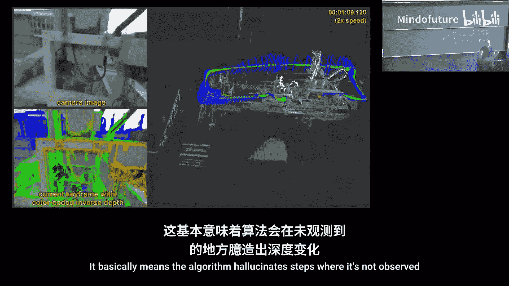

This is a trade off， right。 That means if you don't have any brightness variations。

 say on a white wall， then it will not give you much in terms of tips。

So it really in the application depends， do you need a dense reconstruction or is it good enough to have a sparse reconstruction。

And what was really innovative about this approach to my knowledge。

 it was the very first work in the history of 3D computer visionion where you could track a single gray value camera at massive scale and map the whole 3D world on the fly in real time。

And so I think the title LSD slam for a large scale direct slam was quite justified。

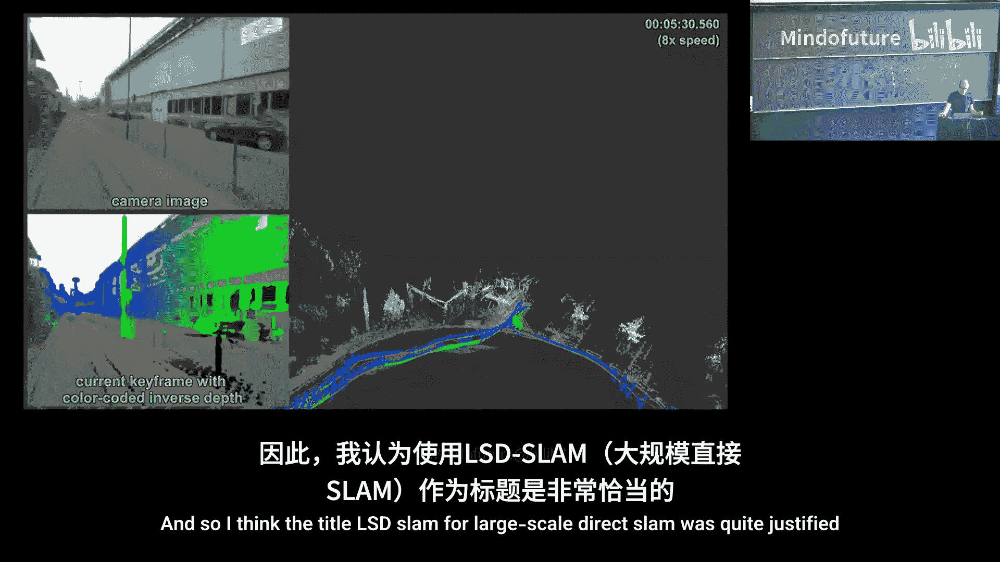

And this paper last year 10 years after the making received the so-called Test of Time Award at the European Conference in Computer visionsion。

 so the award for the work that stood the test of time after 10 years。

 so what people do is they look at how much impact had this work in the last decade and among all the papers that were published at ECCV 10 years earlier。

 they look at which one was the most influential。

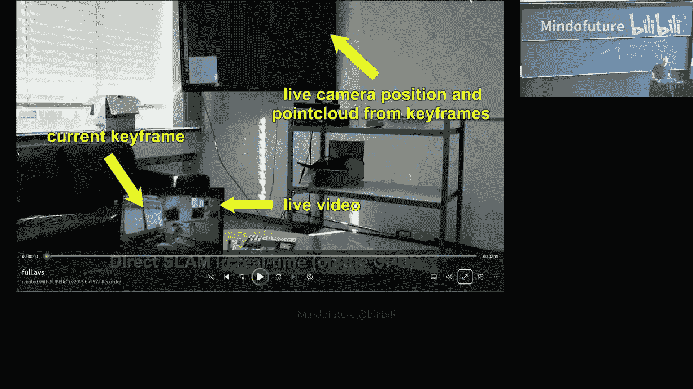

And so this was given the test of time award。There is then a follow up that we did。

 It's called direct sparssoometry， and it's even more sophisticated。

 There are two aspects that we do more systematically。

 We really model the brightness that the sensor reads， because in practice。

 if you film a scene with a real camera， you have aperture changes and so the brightness can actually vary quite significantly。

And so we show and then you have what's called the vignette that means if you see a structure more in the center of the image it's actually brighter than towards the boundaries。

 this is typical for real cameras and it turns out if you properly do a photometric calibration of your camera。

 you can invert all of these processes and then you can talk about rather than the brightness constancy meaning you assume the same brightness for corresponding points。

 you can assume what we call irradiance constancy。Which means the brightness emitted should be the same of a point how it's received in the sensor depends on your sensor。

And that gives you a much more accurate model of the brightness。

 and this is typical for direct methods that the better you can understand how your brightnesses emerge。

 the more accurately you can estimate structure and motion。

The second difference compared to LSD slam is that we did a joint optimization in a Gaus Newton framework so much like you do in bundle adjustment。

 it's like a Gaus Newton method that jointly estimates so rather than having one thread that estimates camera motion and one thread that estimates 3D you know the whole lecture is about this being a joint problem a chicken and egg problem that cannot really be separated and so in the DSO in direct paronometry we estimate things jointly and now as we talked about when you do bundle adjustment with hundreds or thousands of cameras that gets to be computationally intense and typically not realtime capable So what Jacob did for DSO he does a windowed optimization so he takes a set of consecutive keyframes and optimizes their position jointly。

But not all of them。 So in some sense， the current position of the camera is very much tied to the last k positions of the camera。

 but where the camera was an hour ago doesn't really matter so much， right。

And so that kind of makes sense to consider like a windowed approach。

 which takes a certain temporal window in which things are estimated together。

And you see that in the the in the videos， you see the set of keyframes that is being jointly estimated。

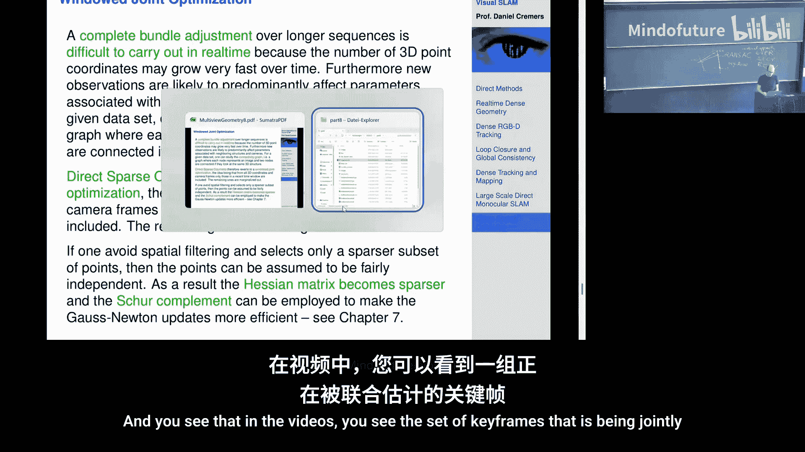

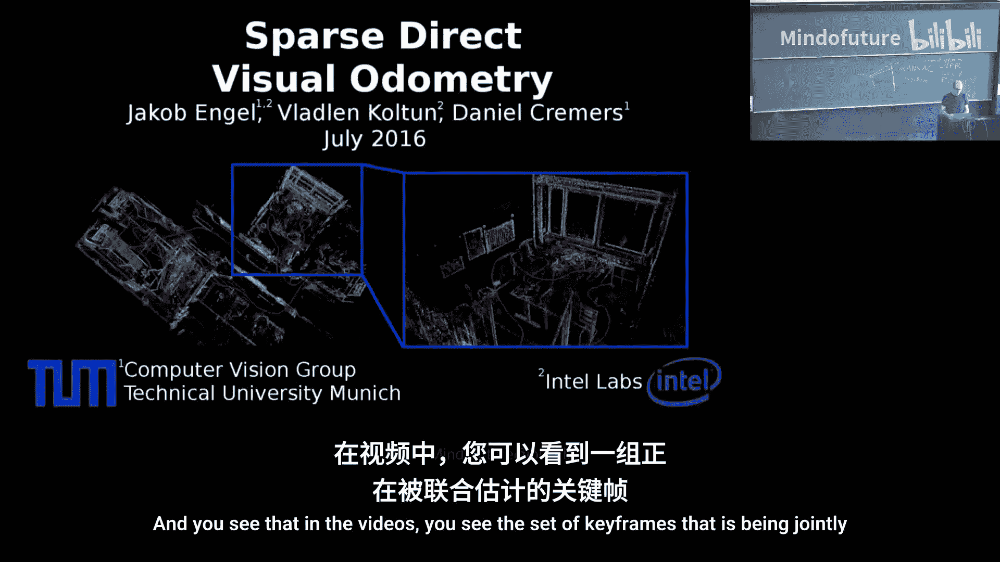

Here this is the blue frames are the ones that are jointly estimated。

 So you see there is a set of consecutive frames over which it always estimates and updates the movement jointly。

 and that gives a dramatic boost in both precision and robustness。

 So this is going through the subway station out here。

 And you can see there are people walking through the scene。

 So this is extremely robust also to moving objects。

 And it is significantly more precise than L compared to LSD slam。There is one reason， though。

 that I've realized why this method is， you know， I believe it is to date among the most accurate methods around。

 but people don't use it as much as they could。 One reason is you need to do this photometric calibration for it to work really well。

And most users don't know anything about cameras。 They just want some black box， you know。

 get the camera， plug it in and play and run right， I don't want to calibrate。

 I don't right So so this is something that we never spend so much effort on how can we kind of do an automatic photometric calibration that estimates it。

 we had one paper that does it， but this is something that might be worth investing more time to get from this method to something that is really black box deployable to any random video。

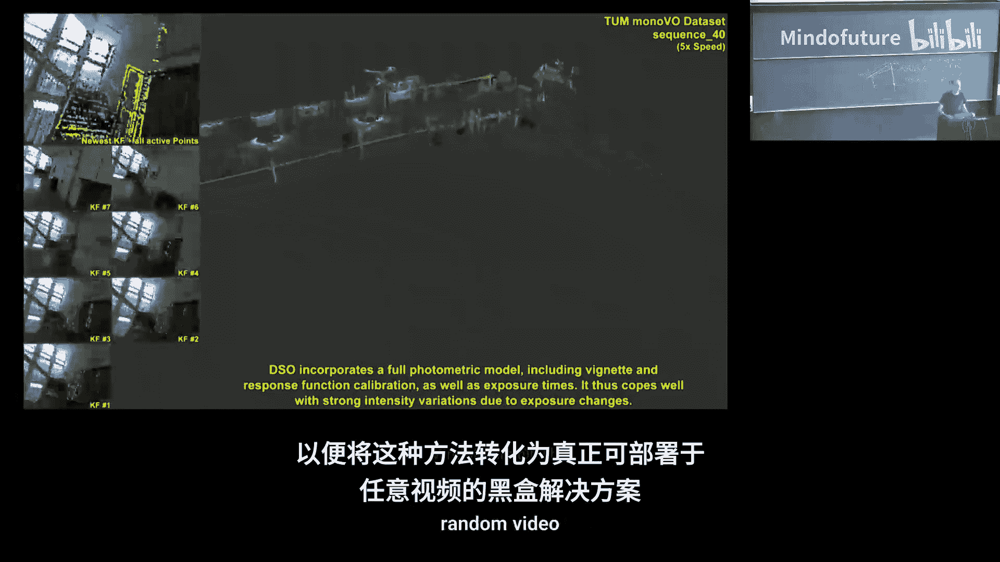

At this point， it is applicableable as long as you know your camera and as long as you've calibrated your camera。

 and this is a method that needs what's called a global shutter camera。So that's a camera which。

 like what you would assume， takes an image at different time steps。

But in practice most consumer cameras， like the ones you have on your smartphone or the ones that they put in cars。

 they are called rolling shutter cameras。So rolling shutter and this is something they often don't teach you in computer vision。

you just assume that you have an image that is taken at time T and another image at time T plus1。

 Well， reality is quite far from that。In practice， most cheap cameras are rolling shutter。

 which means every line is taken at a different timest。And that means if the camera moves。

 then the first line of this image is it has a different time steps than the second third， etc。

 so it's a big mess actually。Sometimes you know exactly what the timest of each line is。

 but very often you don't。So you get these and you know。

 so there is still a lot of need for to improve vision algorithms so they work with real cameras and real cameras can have a lot of nuisances。

 not just radial distortion that we talked about， not just vigning and aperture changes。

 but also rolling shutter and other phenomena。That can be quite a nuisance。嗯。

There was one other effect I was gonna mention that plays a role。

Maybe it's come gonna come back to me。 So these are issues that mean that just deploying it on a real camera can may not always work。

So well so for example， yeah， real cameras， when you record a video。

 they do impact compression very often and so you don't get to see the raw brightness values。

 but some compressed version of it。And so if you don't understand how this compression。You know。

 processes， images， then the respective algorithms will not work super well， yes。The question is。

 if s research is still going on， yes， very much so。Yeah， yeah， yeah。

 So a 3D computer vision and slam are are some of the hottest topics in the community right now。 So。

 for example， we just had CVPR last week there were like four or five best paper awards。

 half of them went to 3D computer vision and camera based reconstruction yeah。

So this is the hot topic right now。😔，And more specifically， one of the biggest challenges。

 and I'll talk about that at the end of class to where I'll talk more about recent developments and mention some of the things that are happening now right now。

 the biggest challenge is，How to deploy neural networks to these problems。

And if you look into computer vision since the advent of neural networks around 2012。

 it has revolutionized pretty much any area of image analysis。Whether it's object recognition。

 that's where things started detecting airplanes and cats and dogs and images， right。

 this is where neural networks and in particular convolutional networks really excel。

And I should say I， I don't know what it is， but I've never been fascinated with detecting airplanes and images。

 I always found that some one of the more boring aspects of image analysis。

But that's where the deep learning excs and so we and many others have looked into what are other challenges that can be tackled with neural networks and we found that even you know estimating optical flow。

 estimating depths and stereo， estimating scene flow。

 all of this can be done with neural networks and we showed that you can do it and that it actually leads to better results。

And one of the holy grails that to date has not been fully cracked by neural networks is the reconstruction of the 3D world from cameras。

But there is quite some progress in the world now and I expect at some point， and at this point。

 we have methods to tackle slam and stuff like that with deep learning。

 and there are deep learning based slam algorithms that we and others develop。But today， you know。

 purely learning based approaches have not yet outperformed these kinds of classical methods。

But we're getting there， right， We're working on it。And I may talk more about that。

So this is a comparison and we actually evaluated here is LSD slam here is DSO。

 this is by far at this point the most popular slam method is called orb slam。

 and we showed that DSO is like an order of magnitude more accurate than orbSlam。Still。

 the community to date uses Orbslam。And that has multiple reasons， first of all， as I said。

 people don't want to do a photometric calibration。 Secondly。

 when you have a rolling shut their camera， or slam works better。

And the reason is that Orb slam is a more classical key point based technique。

 and in the key point techniques， what you minimize is the reprojection error of points into images。

 right， this bundle adjustment reprojection error。

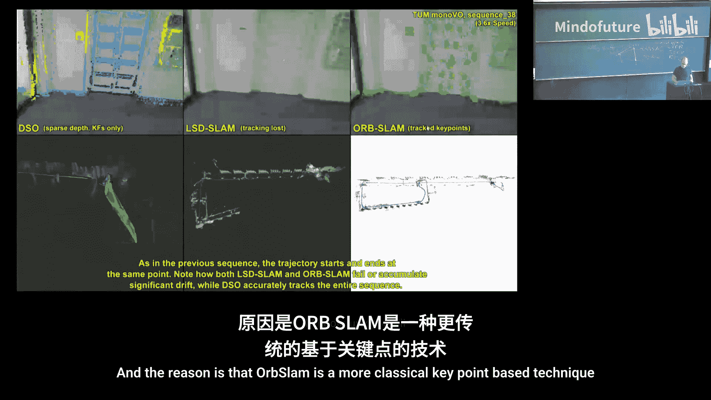

And when you have rolling shutter， what it induces are distortions in the image。

Meaning since the line wasn't taking exactly at the same time。

 the point that I'm looking at is actually by now， a little bit offset。

With respect to where it should be， right and this discrepancy between where the point is and where it should be this geometric distortion。

 this is what the the key point based methods that they minimize in form of some kind of bundle adjustment。

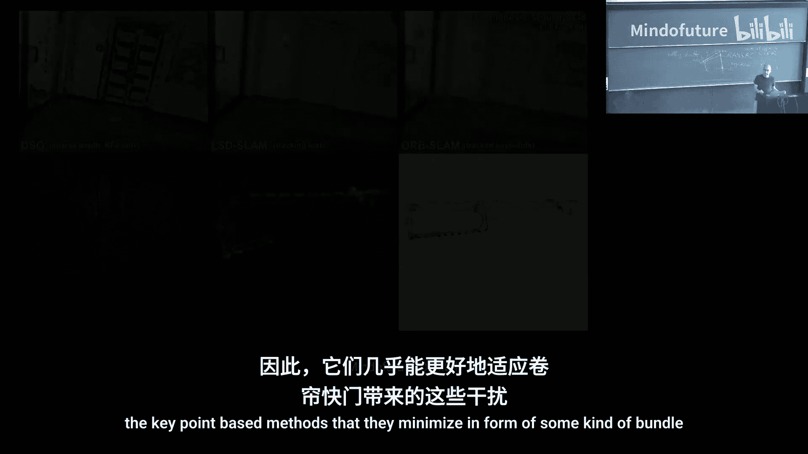

And so they're kind of almost you know， better tuned to these。

 these nuisances from the rolling shutter。What we showed， though。

 is that if you calibrate out the rolling shutter and you can estimate it， then DSO is very accurate。

And so we have a rolling shutter DSO version that works well for rolling shutter and it gives you the same pretty much same accuracy as the original DSO even for rolling shutter imagery。

 but it's not real time capable anymore。And so there was this downside that the rolling shutter version was not real time。

 And so there's still need for algorithms that are on one hand， direct on， but on the other hand。

 model and capture the rolling shutter effect properly。

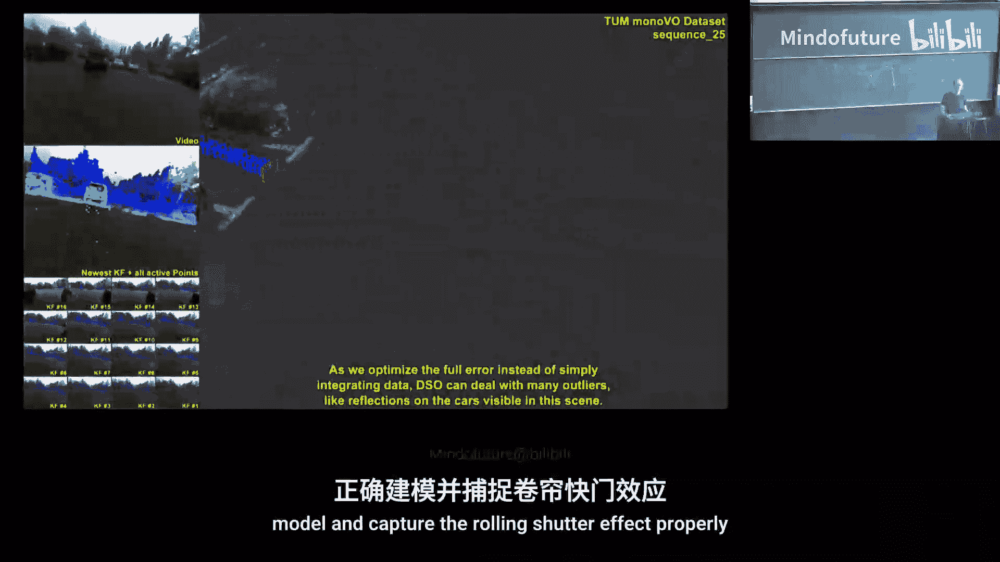

But these techniques are used very intensively。 And at this stage， we're looking。

 and I'll talk more about recent developments， how to deploy deep networks to。Enhance。

 slam and ultimately come up with learning based approaches。

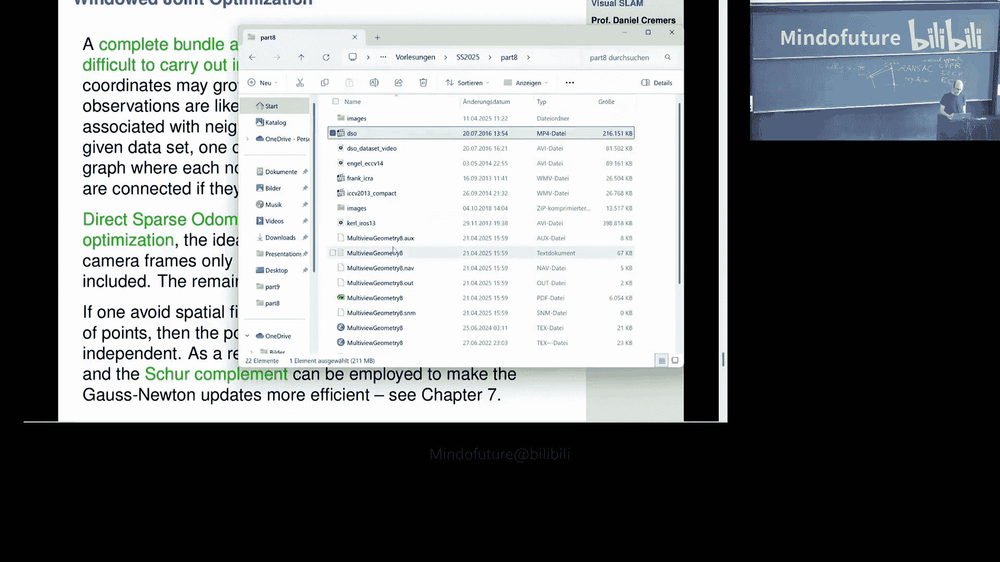