# 【慕尼黑工业大学】多视角几何 ｜ Multi View Geometry 2025 p18 P18_讲座_15b_变分多视图重建_第1部分 -BV1KgZEBrEXV_p18-

And now I'll come to part 9。

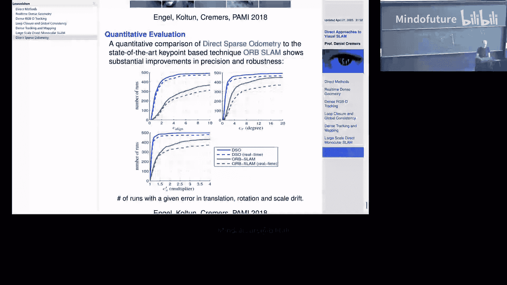

Of class。And part 9 is about variational methods。呃 to。3D reconstruction from multiple views。

So this is in one chapter and what it focuses on is a lot of what we've seen now with the direct methods。

 also with bundle adjustment， these are sparse reconstructions。

 reconstructions where you estimate a set of points in 3D。But as we know， the world is a dense world。

 and typically we want to infer the 3D world densely。

 and we've already seen one variational method in the last chapter。

 this work of stmer at al hears and the general idea of variational methods that are being deployed for dense reconstruction。

And so why are these method called variational， Well， typically you want to find a solution。

 let's say a reconstruction of your world， for example。

 by a surface that represents your object right， so you want to estimate a surface in 3D。

 let's call it is that captures whatever is in front of the camera。And that is my surface S。

 and how do I solve this problem， I set up an energy or a loss function on the space of all conceivable surfaces。

 This is something a little bit， you know， maybe initially hard to grasp。

 So you have to consider the space of all conceivable surfaces in 3D。

And each of them is associated with an energy， or a cost。

And then the idea of variational methods is that you minimize this cost with respect to the surfaces。

So it's an energy or loss minimization， Why is it called variational。

 Because the way you minimize these losses is if this is your space of surfaces and here is your energy E of S。

Let's say like so。 Then you start with an initial surface S in it。

Initial surface that has some cost up here。 and then you vary that surface infinitesimly to make sure the energy decreases。

 and then you basically go down the hill by you know， the gradient descent， for example。

 and that way you compute an optimal surface。And we've talked about gradient descent in the chapter on numerical methods and on bundle adjustment。

 so this is a baseline optimization algorithm， What's different about this here is that this space of surfaces is infinite dimensional。

Alright， so that's the difference。 It's not a 1 d optimization， a scale a parameter， but I estimate。

 so， so I don't update a single value here。 but what I'm updating when I vary this is a whole surface。

And so the way you and why is it infinite dimensional， maybe to give that better intuition。

 if you take the surface and you perturb it in the normal direction at all these points。Then。

 you know， each of these points is a degree of freedom to your optimization problem。

And since it's a continuous surface， there are infinitely many points along that surface。

 And these are your degrees of freedom。And so mathematically speaking。

 you would call this an infinite dimensional infinite。Dimenssional optimization problem。

Optimization problem。And and so its it's a gradient descent， not in one， not in two。

 not in three dimensions， but in infinitely many dimensions。

 And so there are numerical methods to solve these kinds of energy minimization problems of this form。

 but the key is that this function U that I'm looking for， is a mapping from R2 to R， for example。

 here， if it's an image， or if it's a surface， it's a continuous object in R3。

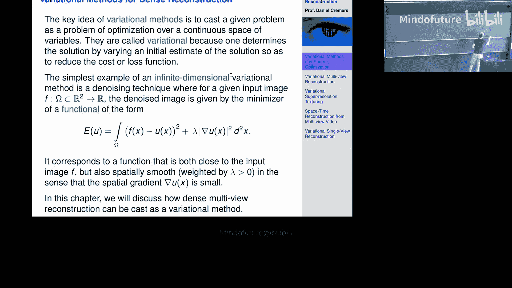

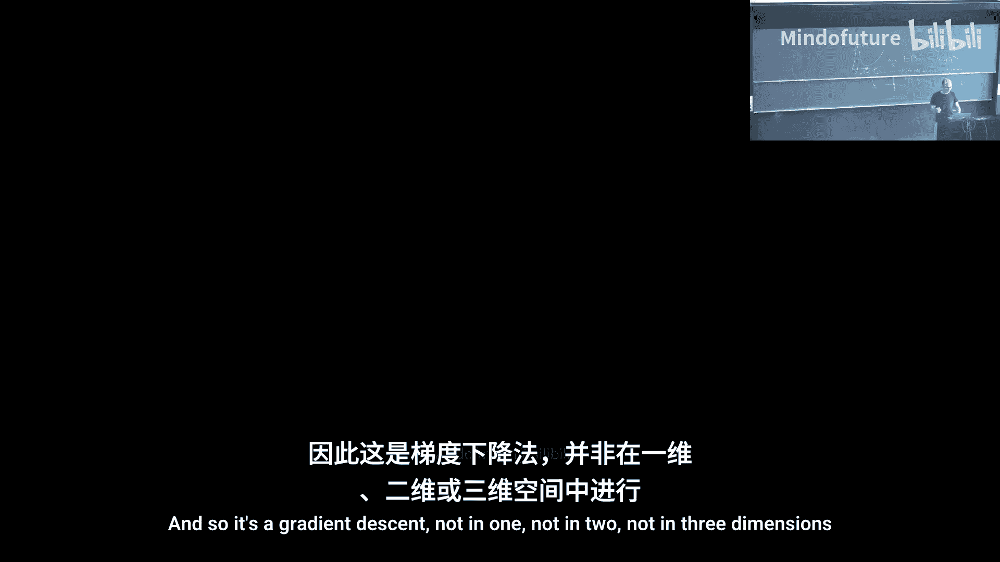

And in fact， that brings us one of the key questions here when you want to tackle 3D reconstruction as a variational problem。

 the first question is how can I represent my surface is what are good mathematical representation。

 and once you choose a representation， then this whole field is called shape optimization。

Because you have a shape and you want to optimize that shape to match your images。

Shape optimization is a very big field in mathematics， and it plays a role in many areas。

3D reconstruction is one area where it plays a role， but also if you want to design airplane wings。

 for example， that's a shape optimization problem， right， you have material steel， for example。

How do you distribute that steel on your wing to get it optimal properties in terms of。

weightight in terms of stability in terms of getting a good lift， etc cetera， right。

 and and aerodynamic。 And this， you can imagine designing an airplane wing or a car surface is a very complicated shape optimization problem。

And whereas， you know， originally people did that manually and tried different wings and looked what happened。

 you remember， you know it took centuries to develop airplanes。 It wasn't easy right。

 to come up and often people looked at biology and said。

 let's look at the bird wings and see what they looked like。

 And then they found oh they're slightly curved above。

 maybe we should do the same right And so humans tried for centuries to make airplanes。

 it wasn't easy， right。And， and so this is still an active research area as well to design car surfaces or airplane surfaces that have optimal properties。

And these properties are multiple， right， You want them to not break， obviously， and you want。

 you know， you want them to fly and， and with you know， most efficiently， if possible， right。

So this is all challenges of shape optimization and typically this is where you know the physicists come in and they tell you what the energy is that I want to minimize over the space of surfaces and that energy should capture things like the wing should be stable。

 the wing should be aerodynamic so you have ways to for a given surface to measure its aerodynamics and then you bring that in here to make sure that whatever surface you come up with fulfills the requirements。

And so this is a modeling challenge to put all of the things that you care about in your energy and then come the mathematicians that deal with numerics of optimization。

 Once you have this loss function， how do you minimize it。 That's a whole nother story。

so it takes a lot of you know， experience on all these fronts to， to do shape optimization。

And that's not just air p wings， but any kind of materials， right that you design。

 whether it's bicycles， you name it， right。And so you think all of these problems are solved up until someone comes out with a new bicycle and is better than the previous one right。

 and so these are optimizations that are taking place。Now， when it comes to shape optimization。

There are different representations and they have different properties so for example。

 one property that you can look at is how compact are they。

 how well can I express that shape and how much memory do I need。

 how much to store that shape with a certain representation。

And then another question is how efficiently can I compute the optimal shape。

 and that depends on what representation you choose。

 whether this minimization problem is feasible or not， whether it's computationally solvable， right？

And unfortunately， the bad news is there is not one shape representation that has all the advantages。

There are some representations that have some advantages， others have other advantages。

 and there is no one optimal solution， at least from what I know。By and large。

 there's lots of different ways to represent surfaces in 3D or shapes， by the way， they can be in 3D。

 but you can also consider surfaces in 4D right， for example。

 if you model the deformation of an object over time。

 this can be seen as a surface in four dimensions in space and time， right。So for example， in 2D。

 all I need to know is is this voxel inside， the surface or outside。

 and is this voxel inside the surface or outside？But if you take a temporal surface。

 you can consider voxels and a timest and you can say。

 is this voxel at time T inside the surface or outside。

 and then you have a 4D surface to represent an evolving surface。

But there's also a shape optimization problem。There are。

Two types you can group all the representations that people have come up with into what's called explicit and what's called implicit representations explicit representations are often more intuitive。

 What you represent is for a given surface you represent all the points on the surface is this point on the surface basically you store all the points that make up the surface of your object。

And then you get something that is either a mesh。😔，Or a sp surface or something like that。

 So there are different ways。 And this is called an explicit representation。

So you encode the surface points directly。And then you have， on the other hand。

 implicit representations。 That means you don't store the surface points。

 but you basically label the ambient space。 So， for example。

 I will say this is my ambient space in which the surface lives。

 and I will basically label all these points that I， you know。That I shade here。

 I'll label these points as inside and the others as outside。 And that way。

 I have implicitly encoded the surface。 That's why this is called an implicit representation。

Here is an explicit representation， typicallyypically you will have a polygon or something。

 but if you want a smooth surface， then they are also so called sp surfaces。Which is， in a way。

 a generalization of polygons， actually。And so the spline surface。

 it can be encoded with what's called control points， C I and the basis functions。

 The basis functions are typically specified， fixed。 You can choose a basis。 and these are。

 for example， so called quadratic basis functions because they're locally。

Pabbolas right so this is a parabola opening to the top and this is a parabola opening to the bottom and so you basically concatenate parabolas to get this basis。

 these bumps here， these smooth bumps and then you say my curve this is in one dimension。

 let's say my curve is given by the basis functions multiplied with these coefficients that are called control points and it's exactly like what you see here。

 this curve is encoded by these set of control points。And if I move one control point。

 if I' working it， the curve in that vicinity gets affected。And that is， for example。

 if the control point affects the basis function B2。

 it means in that parameter interval where B2 is nonze， that's where it acts。

 So typically the area between these adjacent points here。In this part it will move the car on。

 so you can imagine if I wiggle one point， the corresponding surface moves up and down。

What's really nice about splines。 I've worked with splines a lot。

 and I really like them is it's an extremely compact representation。So what you see here。

 this entire curve is encoded by about 10 points that have two coordinates。 So it's 20。

Double variables。 That's all you need to encode this whole continuous curve。

And you can move it around by you know， once you change these these control points locations。

 then you move the whole surface around。And if you want higher resolution。

 you can just increase the number of control points is very。

 but it remains a very compact representation of and that's typical for explicit representations Obviously this is for curves。

 right， but you can do the same for surfaces in which case you have control points CJ。

 So it's a whole 2D grid of control points in R3。And there they are。And then you multiply C。

 I J with B， I of S， BJ of T， and then you have a 2D parameter interval。

RightSo some parameters are grid here。And then that create and then you have this mapping that maps two points on that 3D surface here right。

 so every point on the grid is mapped to some point on this surface in R3。And that mapping is this。

 this what I call is。The surface。And so this is the parameter intervalval， this is the parameter S。

 little S and little T， and for any S， I have a mapping that maps to this surface in R3。

And this is what this mapping looks like and so here again you have that surface that you see here in purple and then the little red control points and you can imagine if I move them a little bit。

 then the surface that the area in the vicinity will move along accordingly。

And so you can do shape optimization with splines rather than moving the whole surface。

 you move the control points that control the surface。Again， a very compact representation of shape。

Typically， if you do it this way and these are your basis functions。

 you would model open curves or open surfaces that have some boundary。But if you loop， you see here。

 we loop them around， so this basis function here， this one it goes up here。

 BN and it comes back down here right and that way you basically close the circle。

 you identify0 and1 and that's how you get closed surfaces。

Just by looping the basis functions around。Now that's an explicit representation， spline curves。

 sp surfaces in R3， and that can be done in any dimension， right。

 I can have splines in arbitrary dimension。 It doesn't matter。By the way。

 I mentioned a shape optimization， and I mentioned cars。

 that's where splines were invented in the first place。This was two French companies。

 One was sittoir， and the other one。I forgot， but there's another French car company。

 and that's where the splines came up in the， I think，50s or so。

 They wanted to optimize the surface of a car， and they did so by reverting to splines。

 They introduced splines to model car surfaces and optimize them。😔，H no。Reno and Sitoan。

 these are the two French car companies that were extremely innovative in the， I don't know。

50s or so， 40s。 I don't remember when long time ago。But you can read up。

 and it's quite a fascinating history of， of how blind came into the world。

So it was on this topic of shape optimization for cars。Because until then。

 you know it was very hard you had a car shape， if you want to modify it， you know。

 how do you tell even someone what the shape of your car is right it's a smooth surface。

You know you can send them the car and say here it is， but if you want to represent it。

 let's say in a computer you need to have some mathematical representation and that's where the splines were invented and obviously if it's part of a sphere。

 that's easy， anyone can represent this sphere， but you know cars don't have spherical parts necessarily。

 they have smooth surfaces that you want to continuously modify and deform and that's where you need splines。

😊，That's explicit representations， very compact。 That's nice。

 but there is a very powerful alternative， and this is implicit representations。

 So representations where you represent the embedded the ambient space。

 you label the ambient space in some form or other。😊。

And there are basically two popular ways to do this implicitly one is the indicator functions that's like super simple。

 I just label every point inside as one and every point outside is zero Now if you ask me why one and0。

 why not zero and1 doesn't matter you can label the inside with zero and the outside with one you know some indicator representation that distinguishes inside from outside。

And so by labeling every point in the surrounding volume as inside or outside。

 that's how I can encode any surface。And there already is a big advantage of implicit representations I can encode surfaces that have holds。

 right。😊，Let's say you want to represent a surface that has a hole inside， right， So like a donutt。

With a spline surface， that's not easy， either you have a spherical spline or you have a taurrus spleline。

 but you cannot go continuously from one to the other。 It doesn't work。

 so and in the case of camera based reconstruction， I give you images of my object。

 I don't tell you what that object is， I don't tell you what its topologies。

 This is called topology refers to the number of holes of your object。Could be  one hole。

 could be two holes， could be3， and it could change， right， if I put my arms here。

 that creates a hole here and a hole there， right， And if I move the arms。

 the holes disappear so the topology of your object can vary from one moment to the next with the spline。

 you can't do that。You specify the topology， and it cannot just split and merge， right。

With indicator representations like the binary labeling， it doesn't matter。

 you can label every voxel as inside or outside， and then you will have u equals 0 in here。

 u equals 0 in here and u equals 1 in the tone in the donor， right no problem。And in fact。

 this is one of the most powerful advantages when it comes to shape optimization of implicit representations。

 they can handle arbitrary topology and they can handle changing topology。Now， I said splines cannot。

 That's not quite true。 You can engineer splines and people have done that many。

 many times that can split and merge， but it's a heck of an engineering challenge to make it work。

 right， It's not very beautiful。So a lot of you know for example if you have a curve and you want it to split you know you have to basically check at any moment how close are the points of the curve if they are two close then I say okay make a split and create two curves out of one right you can do that but you have to constantly monitor for intersections and then whenever you have one you know and at the critical point of meeting it's ambiguous is it one curve is it too well it hasn't fully split yet you know so this is a lot of engineering to make something that works I've seen amazing research and very wonderful techniques but。

Is shaky， let's say。Whereas with implicit representations。

 you don't have that issue because you just label every point。

 are you in or out in or out and you don't care what the topology is。 The method is indifferent。

There is another powerful， implicit representation that I should mention。

 It's the so called s distance function。And so this is a function where you know you go a little bit further and you label the points not just as inside and outside  one and0。

 but you actually store at each vel a function that tells you how far is that point from the nearest surface point。

So if I want to represent， say a curve in an image。For this point。

 I will store what is the nearest point on the surface。 Let's say this one。

 And this is my distance to the surface。 And that's why what I assign to this voxel。

And then if the point is outside the surface again。

 I'm going to find the nearest point on the surface and then I will take that distance and my construction。

 I'll say minus t is the value that has store for points outside the surface。

So I can distinguish inside and outside based on whether it's positive or negative。

 but I have more information at each voxal I can read of whereas how far is not where。

 but how far is the nearest surface point。And that can be helpful。And this is called。

 if you just take the distance， it's called the distance function。

And if you take it positive inside and negative outside， it's called the s distance function。

Because you additionally have the sign that distinguishes inside from outside。

So both of these representations are used quite frequently in shape optimization。

 A few words I already started talking about it， the benefit of implicit So the drawbacks。

 let's say if we take the vantage point of the implicit representation。

 What are its strengths and weaknesses， the implicit representations。

 they typically need more memory， right， rather than storing。A dozen points on the surface。

 maybe 100， maybe 200。 I have to label the entire ambient space。And so the memory， by default。

 the memory will grow for representing a curve， it will grow linear in the number of points on the curve。

 but it will typically go grow quadraically for the implicit representations。

Because you have to label the whole ambient space。You have to basically specify the occupancy value for every vel in space and that especially for 3D。

 if you want high resolution，3 d reconstruction， that can be prohibitively large at some point。Now。

 all of these。Drawbacks and advantages， there are ways to fix them， right， For example。

 a very powerful technique to， to， to have efficient。

 implicit representation is that you revert to what's called oak trees。

Oak trees is you may have heard of quad trees。For the plane。And oak trees is the same in 3D。

And it basically means you take your ambient volume and you group it into large voxels and small voxels。

 right， And here you say this whole big voxel is inside， so I label it as' one done。

And then when you're near the boundary， let's say here。

 then you make each large voxel smaller and then you say。

 okay this one is fully inside and here I discretize again adaptively and so you can imagine you take an adaptive grid that fine tunes on where the surface is and that's where you refine it but in areas of space where there' is only object or where there's only background you don't need to refine the grid。

 and so you have this adaptive grid and then you store the occupancy for that adaptive grid and that way you have a grid that doesn't grow quadraically with your resolution。

But that is essentially adaptive。And this is called O trees。

 And we've used that a lot for 3D reconstruction。Let me see if I can find a video of that。In part 8。

I think this may be a good way。 So here you see an Ore discretization in action。

This was I think one of the probably the first method that did connectbased dense reconstruction in real time on a laptop CPU。

 even on a tablet CPU and one of the reasons how we got high resolution in real time is we usedocre trees so you could see it in the beginning of the video。

 how we had this adaptive grid with coarse voxels here and finer voxels around the surface， right？

And so we provide more discretization when we're near the surface to get a finer resolution and less in areas that are all background anyway。

And that way， we can get fairly high resolution mapping in real time。 So this was using oak trees。

 for example。And so， again。Yes， they need more memory， but there's always solutions for this。

The other thing is that moving or updating an implicit representation is typically slower。

Rather than moving just a few control points here， like in the spline case。

 I have to update all the ambient space， the voxel occupancies。

 and that typically takes more compute effort。And so it's a little bit slower as well。

But the implicit methods have massive advantages， which is why they're extremely popular for shape optimization。

 as I said， no， I didn't mention that， but what's nice about implicit representations is that they don't depend on a choice of parameterization。

Let me explain that what that means。 It means if you have a sp or a polygon， right。

 then you label the。 you have to label these points。 This is 01。 This is 02。 This is 0。3， This is 0。

4， etc cea， right。Now， if I label the points differently and I call this 1。1 and this 1。2。

 and then that's going to be 027， I have exactly the same shape。

But you don't see it because the points， the vector of point coordinates is a different one。

 It's all permuted， right。And it's even more complicated。 I could take all different representation。

 I don't know。 there is no other color here where I I take the points in between。

 I label this point and that point and that point in between the red points。 iss the same shape。

 but it has a different representation。 and that's not good。If you in general， you know， in sciences。

 you want to find a representation for the things you care about， but it should be unique。

You don't want a gazillion of different representations that really encode the exact same object。

But with explicit parameterizations， you always have to。There is this reparmetization you can do。

 you can re parameteraitize the whole surface and you get a completely different encoding of the exact same object。

That is always bad。Why， because let's say you reconstruct the object。 and then you w to see。

 is that an object I've already seen in my database。How do you compare two different objects， right。

 You cannot just compare the sp control point vector because it will not be the same one， possibly。

 even though you're looking at exactly the same object。

 you don't see that it's the same object if you if you use this vector of control point coordinates and then you might have two completely different vectors that encode the same object。

So this is generally， it's much like the oiluler angles and this you know multiplicity that you have here there。

 you don't want representations where the same thing has multiple representations。

Why is that not the case for implicit， Well， in implicit representations， you give me the shape。

 Then I'll tell you for every voxel， whether it's inside or outside。

 There is only one way to do that。Either the voxal is inside or the voxal is outside。

 there is no ambiguity， so you will always get the exact same function U for the same shape。

And if the function U is different， then it's not the same shape。Whereas with splines。

 if the spline vector is different， it might still be the same shape。

And so this is a big issue that there is a choice of parameterization。

That goes into explicit ones that I don't have in implicit one。

As I mentioned already implicit ones you can represent objects of arbitrary topology so the number of holes can be arbitrary。

 you can start with a sphere and you can end up with a donut or whatever else you want or you can have an object that is multiply connected maybe the shape that you care about has another component here and another component there because maybe what you're looking at is not one person but three people right if you start with a blind surface。

 how do you want it to split to Model3 it's tricky。

And the last thing that is not as obvious is that with implicit representations。

 and this is something we showed in quite a number of works。

 you can convexify the problem of optimizing shape。

And this is not so obvious why that should be the case。

 but it is something that comes out in the mathematics， but to give you an intuition， if I start。

 let's say I want to reconstruct something that is a donnuut， right。

 but then I start with a surface that is around here that is spherical right。

 it might converge to this part。😔，But it's not going to cover the interior somehow and that's because it cannot jump。

 you know， the curve to get the optimal reconstruction。

 it would have to split and then somehow jump from here to there curves that evolve over time。

 they don't jump。 they have to move continuously。If you do an indicator variable。

 it means you label every voxel you say， is this inside or outside and the algorithm will look at this voxel and say。

 is this in or out and it can just label that voxel as outside and thereby it can create material and remove material anywhere in space。

And this is what you do when you update and indicate a variable U。

 you basically for every point in space， you can ask independently， should I put material here。

 is this object or should I remove material because it's background。And it can do that。

And that's ultimately why the optimization problem。

 when it represented with respect to implicit variables， often becomes convicts。

Convixity is a huge advantage because it means you can actually compute the optimal solution。

And if your energy E is not convex because you have lots of local minima。

 then there is no way to compute the optimum。In1 D， of course， in1 D， even for non convex problems。

 you can do a line search and find the best solution， not so in infinite dimensions。

 Then your it's hopeless。 you can So minimizing a non convex problem in infinite dimensions is not something you want to do。

I say that， you know， the whole neural network community is doing exactly that。

They optimize very high damage， no problems that are not convicts and。Somehow it works。

 But as I mentioned before， no one really knows why。

So let's look a little bit more into how can we do multi view reconstruction as a shape optimization problem。

So theres lots of different ways to tackle that。 and people have come up with some of the most amazing ideas over the years。

 but one of the most powerful techniques is that notion of photocon。

 I don't know if I have a drawing， yeah。And。no。It's not a good try。

So the idea is that you know we see that surface from two vantage points， say this one and that one。

 and then we say a point is likely on the surface if the color projected into each image is the same。

So this notion of photocon we've had it before， so for this challenge I should say。

 we assume that the cameras are calibrated， meaning we know where each camera is located and how it's facing the world。

 so all we care about is not the camera relative camera motions but we only care about the shape of the object。

😔，And that means once we know where the cameras are。

 we can take points in 3D space and we can project them into cameras。

 different cameras right and then we can check for color consistency。

And then we can assign to each point in 3D space。A value that measures that photo consistency。

So that measures how well do the projections coincide in terms of their color。

 and I can do that for points on the surface like here。

But I can also do it for points outside or inside the surface。

 Maybe I should do a new drawing because this is getting amiss。So I'll do it here。

 so you have the surface here and you project points on the surface or any voxel。

 you project into pairs of images， you check is the colors that I see consistent and if the point is on the surface you should expect the color should coincide if the point is inside the object。

Once I project， then I see this color here。 and once I project into the other camera。

 I actually see that color there。 and they are different colors， typically， I would expect。

On average， you should not see the same color and same with points outside the surface。

 if I take this red voxel outside the surface， once I project into the camera I actually see the color of this point here and once I project into that camera。

 I see the color of this point here right so you see different colors。

And only for points on the surface do you expect to see the same color。

 and so I can use that notion of photocon to distinguish which points in 3D space are likely on the surface and which points are likely not on the surface。

And by convention I would assign low values of rh， I would assign values in some interval 0 to 1。

 and by convention I would assign low values near zero if the projected voxels give rise to the same color so that should be four points on the surface and high values near one。

 if the projections don't match in terms of the color。And in practice to really disambiguate better。

 you typically don't just take the color consistency。

 but you take a small patch around your projection and a small patch here and you compute patch similarity because that's more informative。

Let's say if I take a wall like this one and I project points。

 then likely I will see the same reddish color because it's all kind of reddish， right。Or yellowish。

But if I take a little patch， then I can start to distinguish whether it's really the same patch or a different one。

And so this is how you measure photocon and you can do that for all voxels。

And then here comes the key idea that was advocated by Fogeas and Carrian in '98。

Then you say find a surface that is maximally photoconistent， meaning for all points of that surface。

 I want maximal photocon and how well I take the surface S。

And I sum up the values of row across the whole surface。 So I aggregate for any given surface。

 Let's take that one here。 I aggregate the values of row along that surface， and ideally。

 I should get a small value。If the surface is the right reconstruction。

And I should get the high value of cost if the surface is not the right reconstruction。

So that's very simple。The only caveat is now I need to compute a minimizer。

And if you do this with a parametric surface， then you will invariably get stuck in local minima。

 then you have a highly non convex problem。And so unfortunately。

 these loss functions are not convicx as a function of the surface。

 and you can see why it's because you move the surface around and whenever you had different values of photoconistency。

 the energy will go up and down depending on what points you hit。系い。

And so you cannot expect this to be a convex problem。More specifically。

 one can show that the minimizer， the global minimizer of this loss function is actually the empty set。

And that's because the function row you saw it here is always non negative。

 So at best you will have0， right， If you shrink a surface to nothing。

 then you have zero cost because you are summing up the row values along all points of the surface。

 the fewer points you have， the smaller your cost。 and this is called a shrinking bias。

Meaning this energy prefers smaller surfaces， and ultimately the empty set is the preferred reconstruction。

And so you can see at a first glance， it looks like the right approach。

 but then if you think about it some more， you realize there's something fishy with his lost function。

In the sense that you would set up cameras， you would take images， you would calibrate。

 and then you run the algorithm， and it would tell you there is nothing there， right。And you think。

 well， I see something there is definitely an object there。 Don't tell me there is nothing。 Well。

 this algorithm would tell you there's nothing。Not very clever in a way， right。

Why was this not really discussed in the literature， say in this work， Well。

 people were not computing the global optimum anyway。

 They usually initialized in the vicinity of the correct reconstruction somewhere here， let's say。

 right， And then they would move this to。To optimize photo consistency。

 And I would give acceptable solutions。 But I should say， not really great solutions， either。

And so one question is， how can we prevent the empty set。

 And this is something we set out to do in this paper in 2011。We said okay。

 let's take this loss function with the photocon， but nutss now somehow enforce the information that there is an object that I see an object。

 how do we do that well basically we have these observations let me do another drawing。

So let's say here's my object。And then I have all these images that see this object right。

 so I have my image plane here and once I project this into my camera。

 then here is an area where I clearly can say there is object there， right？And for another image。

 again， I can also say， well， there is object here， right。

 So I know if I move from this v into 3D space， I have to hit the object somewhere。

 It cannot be empty， right。And so we wanted to enforce that is called silhouette consistency。

 That's the， the term in the community is called silhouette。Consistency。Consistency。

So you have the silhouette that you have in your image plane here， right。

 this is the area of the object that I see。And you should enforce that。

 And so what we said is minimize this photocon weighted surface area like everyone did。

 but such that the projection of the surface matches the silhouette that I see。

 So S I is that silhouette area and pi of s is the projection of the surface onto the image plane。

It looks really nice this way because for all images I can constrain the surface。

 whatever you reconstruct must match the silhouettes and it's a hard constraint。

 there's no way around it。The key question is， obviously， in this way。

 how do you implement that numerically， And this is， again。

 a question of how do I represent my surface S。And as I argued。

 indicator functions are very powerful， so we chose an indicator representation。

And then you can rewrite this optimization problem， as you see here。

And here I'll tell you why that is， so the first term， this is a very interesting term。

 if you have an indicator representation of the surface， so u is1 inside and u is0 outside。

 then the derivative of U so this gradient is the derivative operator gradient in x and y and Z direction。

 this function will be0 in most places because u is constant and so the derivative is0 outside。

And the derivative is also zero inside。 the only points where it's nonze is exactly at the boundary。

And there the gradient is actually infinite because u jumps from 0 to1。At the boundary。

But it's infinite in a way that if I integrate the gradient， I get the surface area。

So if you have an indicator representation of your surface S。

 then the surface area is nothing but the integral of this gradient。T3 x。

 So this integral gives you exactly the surface area。And more specifically， the weighted integral。

 So if I weight the gradient norm with the photoconistency at that voxel x and I integrate。

 this should be D3 x to be exact。 I drop it in the three here， if you integrate this over the volume。

 you get exactly the weighted the photoconency weighted surface area that you have here。

 So this term is the same as this one。So that's really nice， by the way。

 this is a very popular expression in applied math。

 theres entire books dedicated to this thing is called a total variation。😊。

Total variation of the function， variation。Some of you may have encountered that if you。

 if you do mathematics， you will likely hit the total variation at some point。

 it is one of the most well studied and most powerful regularizerrs。In the playedmouth。

And it has numerous really beautiful properties。 One beautiful property is it corresponds to geometric properties like surface area or boundary area。

 boundary length， right？😊，But another beautiful thing about it is its convicts。

 And that's very important because we want energies that are convicts。And this is a convex energy。

 So what's nice about this energy is it is convicx。

Now how do you enforce the silhouette con that's actually also fairly straightforward on the indicator variables。

 I take rays that go out here and let's say this ray is RIJ。

 it's the ray for image I so this is image I and this is pixel J in this image right there's lots of pixels and then I call this ray that goes through a pixel J in image I I call it RJ。

And now if I have this ray， I can integrate the occupancy values of U along this ray。

 basically count how many voxels are on if I move down this ray？

And now I can say if that pixel J is in the silhouette area。Then I should hit at least one ver。

And that's exactly what this constraint reads。 it says if I sum up all the occupancy values along this ray。

 then I should get at least one。Whereas if that pixel is not in the silhouette area because it's a pixel outside here。

 then if I go along this ray， I will not hit the object ever。

 and so all the occupancy values should be0 and hence that integral should actually be0。

And so that's the two kinds of constraints that we have。 this silhouoid constraint。

 I can boil it down to constraints on all these rays。 There is a lot of rays。

And a lot of images in with a lot of rays。 But what's really nice is。As constraints。

 these are linear constraints because it's just a sum of U values being larger than one or a sum of U values being 0。

And linear means convicts。And so as a result the loss function is convicx and these constraints。

 the silhouoid constraints are also convictx， and that is ultimately why we can compute optimal solutions to these kinds of problems。

And so here's the visualization。 This is the silhouette S I in the image I。And here。

 if it's inside the silhouette， it will hit some voxel， at least one voxel will be on。

 and then the integral will be at least one。 and if it's outside， then there will be0。

And what we prove is that once you take， so the there is a binary constraint that the user should take on value0 and1。

 that is not a convictx constrained， but we can allow real values between0 and1。

 and then the optimization problem that we get is fully convict。And we show that in the paper。

 but it's not very profound。 It's really because the total variation here is a convex cost。

 and these linear constraints are convicts as well。

And that means we can compute provably silhouette consistent reconstructions and this is what I want to show you here with this approach here are three out of I think 33 images。

 the data is online and increasingly nowadays you can do 3D computer vision without a camera because everything is on the internet。

 there's images and that started already more than 10 years ago that people like Yasu Furukawa put their data sets online and said here's the data if you want to develop methods try for yourself。

And this is what he did。 So he put the data set online and these are the reconstructions that we were able to compute。

 and I know Yassu was very impressed by the results that we achieved。So here， for example。

 you see lots of fine scale details like the hammer or the sword are nicely preserved in the reconstruction。

And in fact， these are preserved because of the silhouette constraint。

Because when you just do a minimal surface approach with this photocon weighted minimal surfaces。

Fine scale structures will disappear because of the shrinking bias it prefers to just remove them。

But if you impose enforce silhouoid consistency， you get very nice reconstructions that are perfectly silhouette consistent。

Here's more examples where you can see we can recover dense reconstructions from a set of images。

 typically 20， 30 images， and we can get very fine scale reconstructions where a lot of the creases in the clothing are。

Properly reconstructed。And if there's one thing that I find a little bit puzzling。

 it's actually that now。Almost 15 years later， the reconstruction quality of algorithms has not really improved massively。

And if you take a set of images and want， you know， an accurate surface reconstruction。

 I think these methods are still to date some of the most。Accurate ones。

Maybe one more work in this line。You can also compute。 you see the geometry is fairly accurate。 Now。

 what you can do is you can compute the color on the surface， right， This is just the surface itself。

Once I see a surface in images， I can also try to estimate the color on the surface。

The way you traditionally do that is very simple， you take the reconstruction that you have。

 you take your texture from the image and you just project it onto the surface， very easy。Now。

 the problem is there is no one image that sees the whole surface， right。

So you need to project this texture from here and some texture from there and some texture from down there。

But then what happens is the textures will not coincide。In general。

 if you project this color from here and then some color from there。

 then this image will say I see red and this image will see well I see green， what do you do？

They don't agree on what they see。In principle they should agree but in the real world they don't because nothing is perfect。

 the reconstruction isn't perfectly exact， the camera positions aren't perfectly exact。

 the world is not perfectly Lamborian so the color may actually vary with viewpoint right and then what do you do？

And then what you can do and what is commonly done is you average all the back protections。Yeah。

 someone is smiling already。 that's not very clever to average， why， because it creates a blurring。

 especially if they don't agree。 then you get not red and not blue。

 but something in between some orangey or whatever right And then you think， well。

 that's not really what any of the cameras are It's an average。

 And so what this averaging creates is a blurring of the texture and you don't want blurring。

 you want sharp reconstructions with sharp textures And so this is bad to average。 next you can do。

 and people have done it So you just to show you how sophisticated people got right they said， well。

 this camera is looking front to parallel So I'll give this camera more weight and this is looking from a obbleque angle so I'll give that one less weight and then they do a weighted averaging。

Slightly better， it's a hacky solution， but yeah， that improves the textureuring。

 but it's still blurry。😊，And so what we set out to do， this is work from 2009 ICCV。

Is we computed what's called a super resolution texturing。 And this is， again。

 a variational approach。 It looks a little bit complicated at first glance。

 So let me walk you through this。 What we do is essentially we do back projections of the texture onto the surface。

 But then we do it in a more clever way。 Then we say。I have this image I I， so this is my image。

 the brightness here， and what I see on the surface should match what I see in the image。

 but after blurring and down sampling。So what you have here is you have an operator B that models a blurring and downsampling。

 So pi I is the projection into the image。 Pi I inverse is the inverse is going from the pixel back to the surface point right so this is pi I inverse of X this point and then I say the texture here T is what I call the texture once I blur and downsample it and this is done by this operator B then it should match the observation So I can actually model what a real camera does to an image namely once you pixelize it。

 there is a blurring by the lens and a downsamp into pixels。

And so what I expect to achieve by modeling it this way is I expect to achieve a very sharp texture that is high resolution and super sharp and only after blurring and downsamp does it coincide with my observations and so the aim is that I will invert that blurring and down sampling。

 once I solve this optimization problem I find the most sharp texture that after blurring and down sampling matches my observations。

😊，And then there is this total variation， regular riser on on T that you know。

 we introduce with a very small weight lambda because we don't want too smooth of a texture。

What's really nice about this approach as well is this is convex in T why。

 because ultimately this expression is quadratic in T， even if theres some linear operator。

 it's still quadratic and the total variation， as I mentioned is convex。

 which means the whole thing is convex， which means I can actually compute the optimal texture。

And we found an efficient algorithm。 And so what you see here is the input。

 one of 36 input images of a bunny that I have in my office。And。

And this is the textured reconstruction。And， in fact。Here is a comparison on the left。

 you see one of the 36 input images。 and as always， with digital cameras。

 once you zoom in sufficiently， you see a pixelization in the in the image， right。

And this on the right is the texture that our algorithm recovered。And as you can see。

 it's massively sharper than the input image。 you see much more detail than you see in the raw input image。

 And since all images have the same resolution， they all have this pixelization。

 It's not like we have one sharp image that allows us to get the texture。

 No from a lot of these pixelized images， we can recover one really high resolution texture。

And so as a result， I hope I have a video of this bunny here。Do I have a video。No。

I'll show you a video of the bunny。

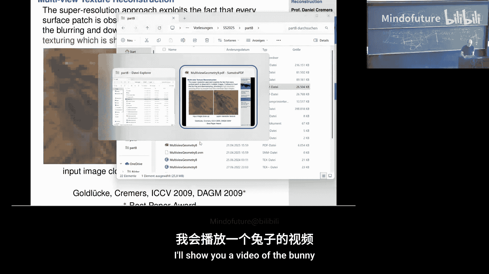

Let me pull that up。嗯。I from a talk I gave last week at CVPR。

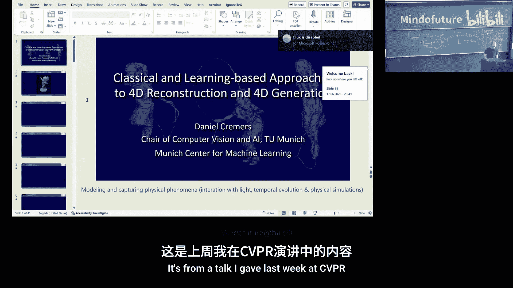

Here is。The reconstruction of the bunny。

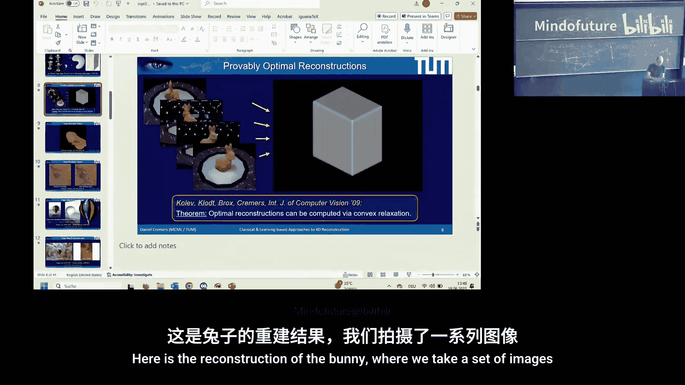

Where we take a set of images and then this algorithm finds the optimal reconstruction and you can see it's fairly detailed but not super high detailed。

 and then we can compute the text string and this is the reconstructed bunny after texting it。

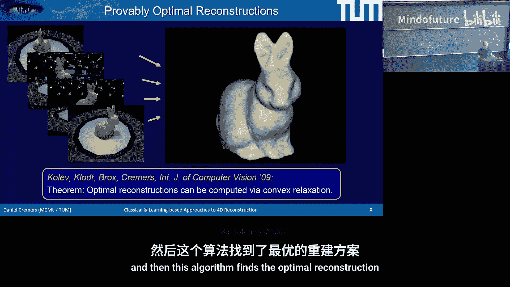

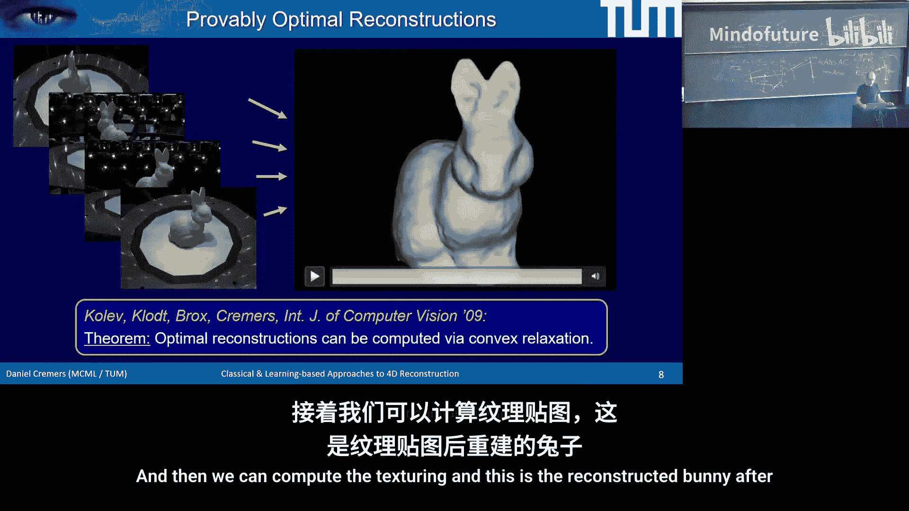

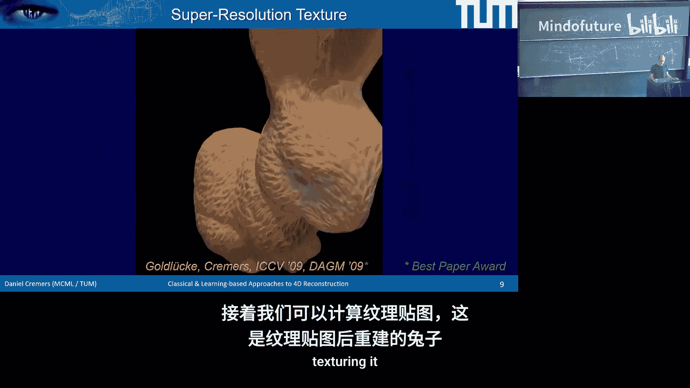

So it's super high resolution， and you cannot distinguish it from the original bunny by eye。

And so this shows you where we're at or where we were at 15 years ago with camera based reconstruction that we can recover objects at such a resolution that you can't distinguish them from the real object。

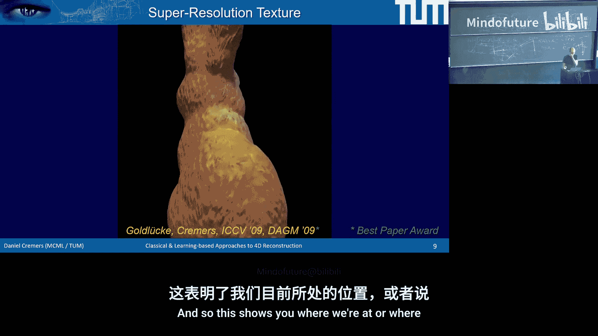

Alright， I think I'll leave it at that today and we'll reconvene。 I think tomorrow is a holiday。

 so we'll meet again next Wednesday。

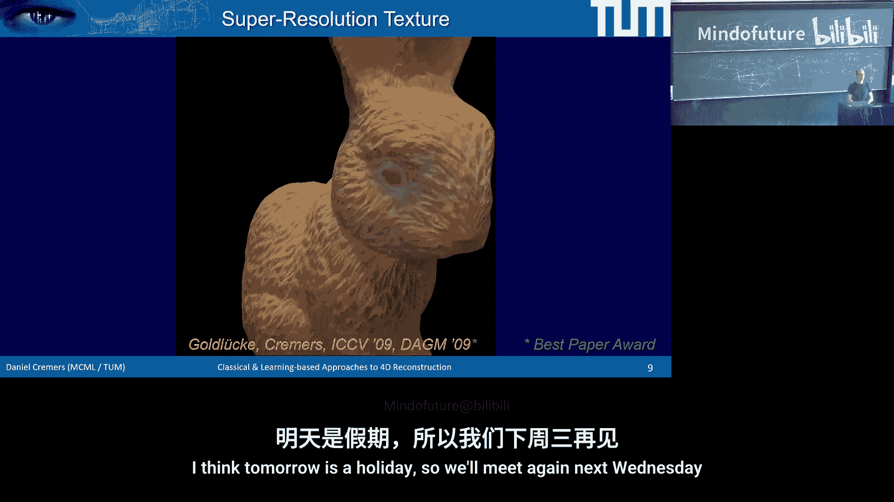

Thank you。