# 【慕尼黑工业大学】多视角几何 ｜ Multi View Geometry 2025 p19 P19_讲座_16a_变分多视图重建_第2部分 -BV1KgZEBrEXV_p19-

Okay， welcome to class， I guess we can get started。

 we left off in chapter 9 on variational multi view reconstruction and I briefly mentioned what variational methods are。

 this is obviously not a class on variational methods but just to recap the key idea。

And how you can deploy them for shape optimization in that particular for 3D reconstruction from multiple images。

And I left off last time with super resolution texturing。And I think the result I showed you must be。

This one。Probably。So， this is。The video plays。

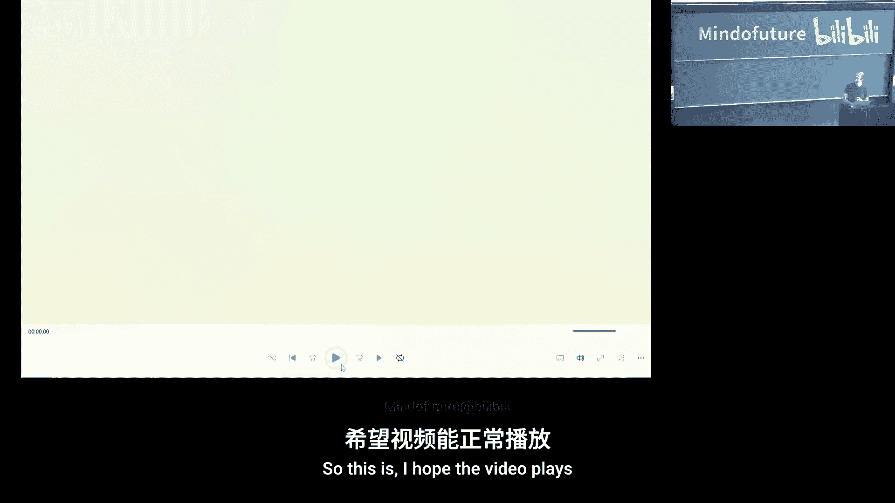

あです。Yeah。So here you go so this is kind of the reconstruction of the bunny and you can see you get a fairly detailed reconstruction of the shape and also the texture on the surface。

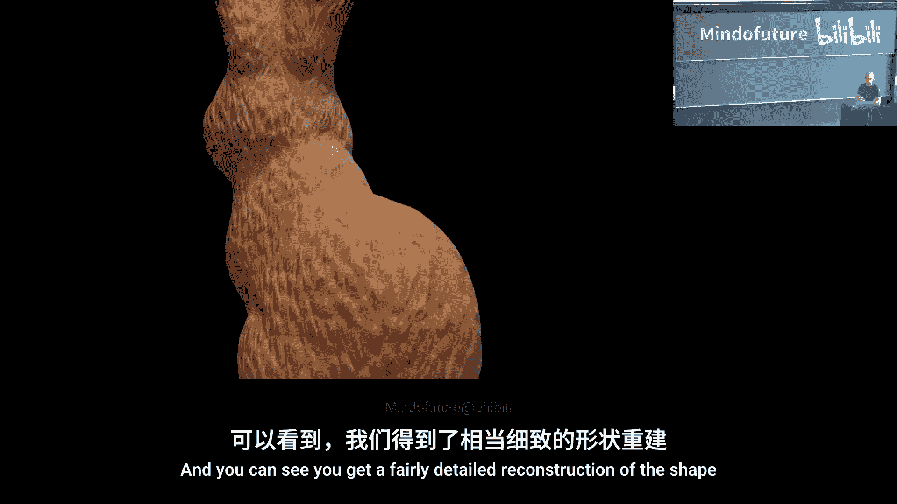

In fact， as I mentioned， the resolution is sharper than that of the input images and someone was asking after class yesterday。

 how is that possible， well， the way you can see it is。😔。

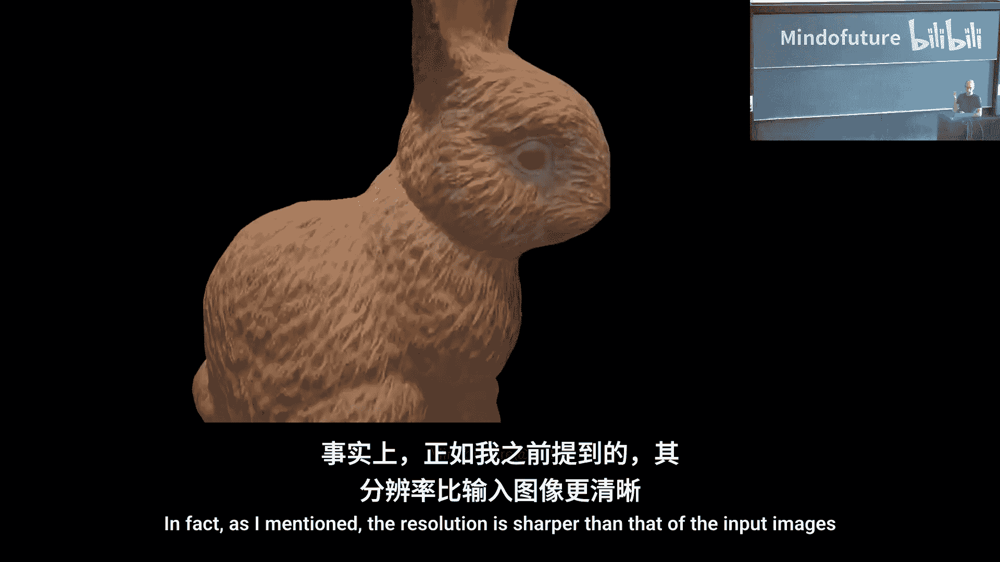

The way you can see it is that you're averaging， you have a grid right in which you perceive the world with your image and what you see get here in this grid is an average of the brightness values or color values in that patch。

😊，And then if you see the same structure with a slightly different grid， let's say this one here。

 then what you get here in the blue square is the average of the colors here。

 and if you measure enough averages of colors in different patches。

 then you can actually disambiguate and figure out what is the color here， right？

The most extreme example is if you have a continuous set of colors and then you sample them。

 you compute an average in this patch and then I'll take a different color。

 and average in that patch right then if you take the difference between the two you get the colors in a subpart of this right so by computing lots of averages you are able it's in some sense a linear equation system at the root of it right？

You can say these colors that I have here that I care about。

 I call them Xi and what I measure is just the average， so Yi is an average over a lot of X's right。

 x Js J in some neighborhood neighborhood of I so if this is I then in that neighborhood I get the average and if I get a lot of such YIs for a lot of different Is you know then then I can try to infer what was the X。

And this is in principle， a linear equation system。

 but in practice it's a little bit more sophisticated。

 but this is roughly the idea of why that works。It works ultimately because I see the same colors multiple times。

 always in a slightly different averaged version。Next you can see we can do 3D reconstructions from cameras and obviously you can go further and you can try to reconstruct actions and this is where cameras really excel right if I want to capture the geometry。

 the 3D structure of the world， then the best is often to scan it with a laser scanner or with a structured light scanner。

 but these scanners are often very time consuming the laser beam has to scan the object you know point by point right and then you get very accurate geometry but what if you have things that move over time。

Then a lighter scanner will not do a good job because you cannot capture the full geometry in one time instance。

 you have to scan it， right。Whereas with cameras， you can film an action synchronously。

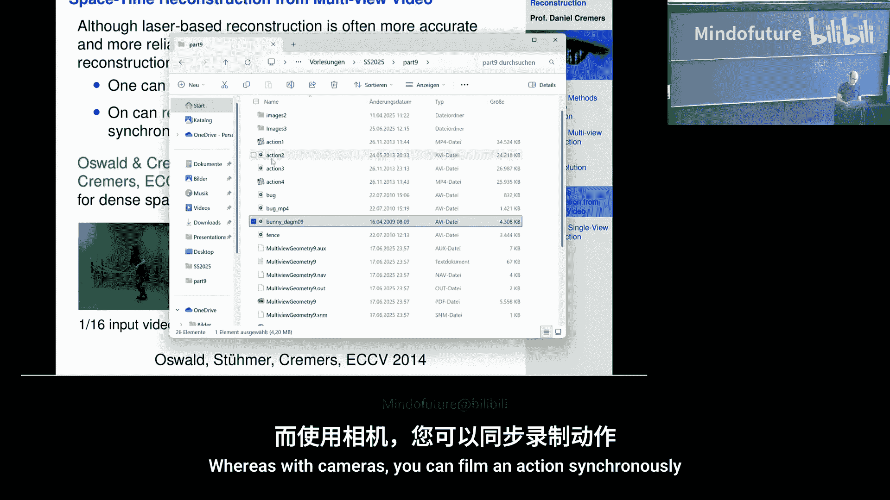

And then you can reconstruct it in 3D。 So here we put two professional athletes into a multi camera setup。

 Okay， maybe not professional， but。Athletes。And then we can film them and we can reconstruct the actions over time。

Becauseuse we can tap into all these images， the cameras are synchronized， so we get 30 frames。

 the second synchronous images， and then we can project the colors back on。

 and what you end up getting is a reconstruction of the action in a way that's often referred to as free viewpoint television。

And I believe this is one possible future of television。

 now I should say these reconstructions were obtained 13 years ago， 12 years ago。

So I keep talking about the future and I keep wondering when does it actually come， Sometimes。

 you know， technologies from the lab take years to get into products。

I should say maybe we didn't help because we didn't actually put the code online nowadays we tend to put our code online that accelerates。

 obviously the tick transfer， that is a code that we never put online because 13 years ago people didn't put their codes online nowadays you would typically put your code online。

😔，But what you can see is we can get very detailed reconstruction quality。

 we can get the colors and we can get something that allows you to follow an action from a vantage point where there was never any camera right because I have the whole action in the machine and so I can not only regenerate what would the action have looked like if there was a camera here。

But I can also change things。 I can change， you know， once I have a 3D model， I can go in。

 I can change the illumination and put the spotlight illumination in， right， That's a no brainer。

And I can change the material properties of things。 I can change the the closing people wear， right。

 so I can really start to edit the action。Once I have captured it。

And there is basically no end to what you can do once you have an action in the machine。😔。

You have a lot of freedom and then you can reach out to people。

 your colleagues in computer graphics and they'll tell you how to relight things and it's fairly straightforward actually。

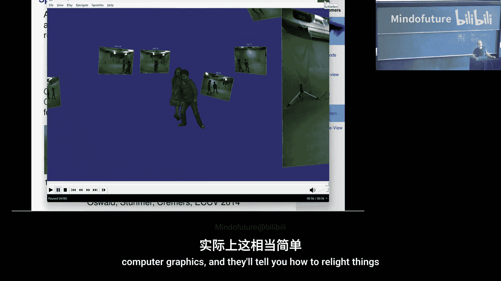

And so here's more examples。😔。

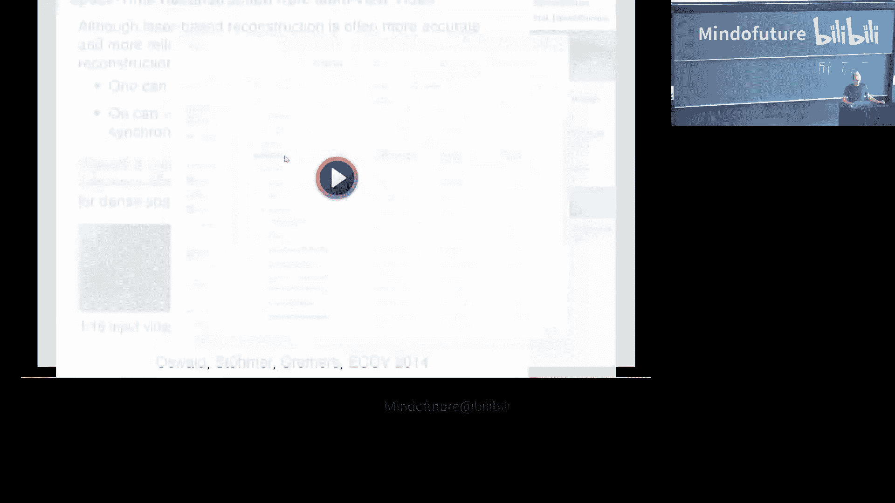

And here you see another example， a rope jumping girl。And you can see the level of detail。

 this is actually not the latest this is from 2013。

 there was a 2014 version where the rope is fully reconstructed here。

 you see the rope is still broken in parts， it's disconnected in certain parts here。

 but we manage to close these gaps and reconstruct something where the rope is fully reconstruct。😔。

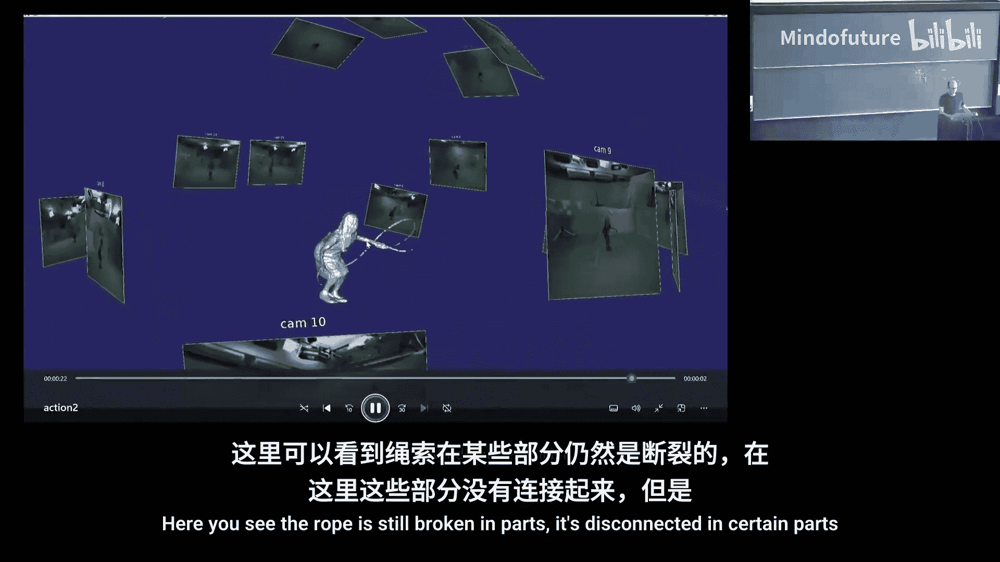

嗯。

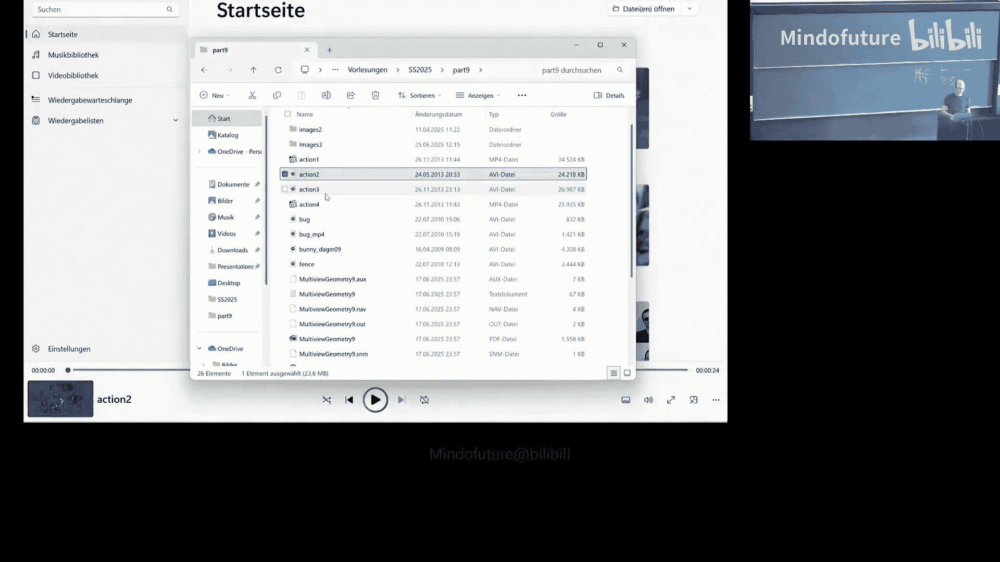

嗯。Yes， that's a very good question， how did we do the temporal integration here it's really there isn't much temporal integration for every time step we reconstruct the action。

😊，Not quite。 There is a slight bit of temporal smoothing。 We add。

 What we do is we say that for every voxel， the occupancy of that voxel。

 whether it's filled or empty， should not change too much from one time step to the next。

And that creates a little bit of temporal regularity。 By the way。

 the key assumption is that of a Lamorian world， meaning a world where the color doesn't change with viewpoint。

Well that Lamberian world starts to break down with man made， shiny objects。Interestingly。

 most of the world is fairly Lamberian。 Lamberian， for those who don't remember。

 is the term that basically says the colour doesn't change with a viewpoint。In computer graphics。

 this is called Lamberian and the Lamberian assumption means if I take any point。

 let's say this one on the table and I move around。

 I should see the same color no matter from which vantage point I look。

And that is true for most of the world， but not， as you can see for the ball。

 And this is why the ball， especially on the top， where there are very strong reflections of light。

 where the reconstruction degrades， right， where the ball isn't really round any more。

But apart from these non Lamorian structures for the rest of the structure， it actually works。

 as you can see quite well。And these are things that， and I should say。

We now live an age where everyone deploys neural networks to do a lot of things。

 and there have been very popular approaches in the field， one is called neural radiance fields。

 neural radiance field I'll briefly touch on them at the end。

 and another one is called Gaussian Splattting。😔，If you follow media。

 you might have run into these terms， there's a lot of PR around these approaches。

 they allow really nice novel view synthesis。But the reconstruction quality that you get with them。

 I think， you know， is not on par with what we had 13 years ago。

So I'm still waiting for people to beat that kind of reconstruction quality for actions in videos。

 one should also not be fooled the neural radiance fields。

 they're designed to do novel view synthesis， they don't typically they don't optimize the surface reconstruction quality。

😔，They optimized the view aspect。Here's another example。Will you see someone with a dog in a scanner。

And sometimes you see the legs of the dog are a little bit broken。

 This is largely because this approach requires the silhouette information here。

 We can play back and forth in time。And once the silhouettes are not correct。

 that deteriorates the reconstruction。And the key challenge is how to get the silhouettes reliably from the images。

 And that's actually more difficult than you'd think， you know， this is a green screen environment。

 that's what people typically use here。But， you know。

 it's not easy if you put the person with a white T shirt in the green screen。

 then that T shirt in all videos will be green。you know I always thought well that must be easy white t-shirt green background。

 no， no， no， the green background shines on everything and then everything is green and then you cannot distinguish the white t-shirt from the green background because it's no longer white in your images。

 it's actually green， the lighting， it reflects the green light from the surroundings。

And so it does become challenging。😔，And theres， you know。

 one of the key technical challenges is extracting silhouette information in tons of images because you have 16 cameras filming at 30 frames a second。

 so you have hundreds of frames per second。Come down on you and you have to process all of these。😔。

So you need algorithms that are fast that are automatic。

 you cannot have a user in the loop to correct the silhouettes in every image。

 it's just not scalable。😔，So this is this action reconstruction that we did back in 2014， 2013。😔。

And here you see examples of a rope jumping girl and the precision of the reconstruct。

What is this good for？ It has a lot of applications。 You can use it for video conferencing。

Nowadays we have Zoom， but what I can tell you is coming is 3D video conferencing systems and one of my colleagues。

 Steve Ss at Google he's working very hard to make that happen these are systems where the last thing he showed me it has six cameras I think on the screen and they film you from six positions simultaneously and from these you can get some 3D reconstruction and then you can display to the viewer depending on where so you do an eye tracking to determine where the viewer is the other person that's in the call with you and you can project the 3D model as it would be seen from exactly that vantage point。

And he said the consequences is very different from Zoom。

The person you're talking with is not flat on the screen。

 but he says it looks very much like seeing the other person through a window。

Which means if you move， you can correctly see the you know。

 the position from which you're looking at things change。

 So you have a feeling that the person is not in a Zoom call， but actually sitting。

EBehind the window in front of you。 And that gives you yet a better sense of being。

Together with the other person。 And that's， I think， vital and I I keep every time I Steve， I say。

 when are the screens coming out， how much longer because I really want to get one of these。

But the technology to reconstruct， even， you know， in time is， is all there。えてす。

Sod you can also use these techniques for sports analysis。

 for example you can take real gymnass and put them into the system and then you can go into the reconstruction and discuss every limb movement precisely to check whether all the joints and limbs are in the proper order and figure out what some gymnast is doing wrong because if you do a double flip。

 then you know it's very hard to reconstruct where did you go wrong halfway through right？

But if you can resolve that in time and reconstruct it in 3D。

 then you can do a very careful sports analysis。And so this is used a lot for sports， for gymnass。

 but also for soccer playing， that's one of the big markets。

 soccer and some of the first action reconstructions appeared in the Super Bowl in the US where they put cameras in a stadium and reconstruct everything in 3D and then they can do virtual flythroughs。

 I'm sure you're seeing some of that stuff。And these are colleagues of mine in the field who pioneered that。

Yeah， and previewpoint television means that you can watch your favorite movie。

 but while the action is playing very much like you saw in these videos， the videos are played。

 What you see here is real time screen capture。😊，Where basically my PhD student， Martin Oswald。

 he while the action is playing， he pans around with a mouse and can choose from which vantage point to look at the action。

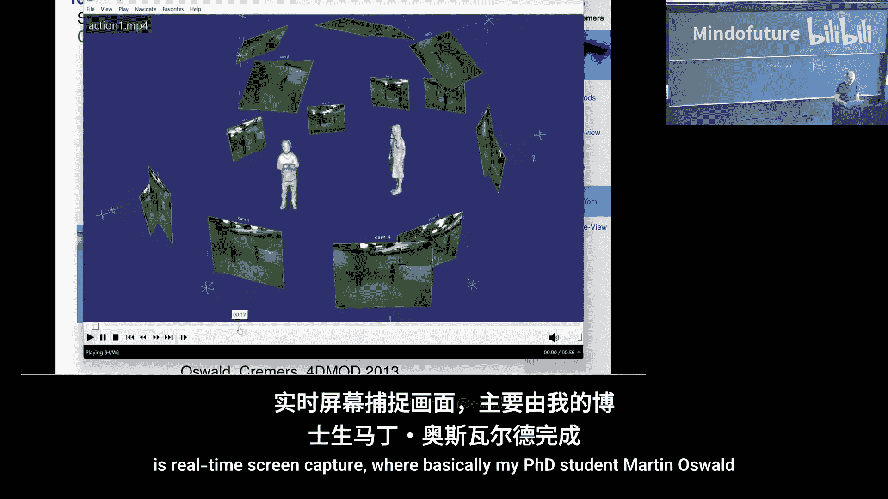

So you can decide， you know， in a critical scene， whether you want to see Brad Pitt or Angelina。

 Jolie or whoever you want to look in the face， whoever you prefer。

 you can choose your vantage point and can and this creates what in the movie in this week is called a sense of immersion。

A sense for the spectator that he's actually part of the action。

 because there's no almost no better way to feel part of the action than having the capability to literally walk into the action。

And move around in it while things are happening。And so this is this for you viewpoint television that。

😔，I do hope willll be coming at some point。Now this is all 3D reconstruction from multiple views in this semester I was a little bit faster with this class than usual students pointed that out to me。

 I'm not quite sure why that is I think it's because we played videos when I wasn't there and maybe a little bit more than we should have so we're now ahead of schedule。

And so there's going to be material in this class that I haven't ever covered in the class before。

And some of it is you know showing kind of extreme limits of 3D reconstruction and a lot of it is showing recent developments and that's triggered by someone one of the last classes。

 ask me， is this a very active field still or isn't this all solved and I want to give you a glimpse of that and showing you that it's an extremely active field and that there's a lot of things happening？

And so I'll talk a little bit about recent developments in the next part。

 but this is also a part that I never talked about。 It's not recent， as you can see， it's fairly old。

But it is a work focused on an interesting side question that can be solved with variational methods。

And that really brings out the power of variational methods。

And that shows you a little bit how they work。 and the question is the following。

 The question is given a single image like the one on the left here of this。

 I think it's from Arches National Park in the US。You have this arch。

 and you want a 3D model of the arch。 But all you have is one image。 So not multiple views。

 not stereo， not light are just a single image， right？ And the question is。

 can I get a 3D model of this arch from one image。And you'd say that's not well defined。 Indeed。

 it's not well defined because I don't know how thick things are， right， I can see them。

 but I don't know what thickness they have from just one image。 It's not possible。

But imagine you were given the silhouette and often we have algorithms that can easily extract the silhouette of the object separated from the background。

 So now we have the area that is part of the foreground of the object。Now。

 imagine you were to place a balloon inside that silhouette and blow air into it。It's very simple。

Concept I just place a balloon， blow some air into it， how much air you decide as a user， right？😔。

And what you're going to get， you're going to get something that is 3D and fits the silhouette of what you see in the image。

 and that's exactly what we do here because it turns out this problem of finding that balloon surface is a solvable problem and we show that it can be solved optimally and we show in these two papers that it can be solved in fractions of a second。

With what's called a variational method。 So we say find a surface S。In 3D space。

And much like any balloon， balloons have one property。 They minimize surface area。 Why。

 Because the balloon is a rubber material and everything tries to contract and minimize the surface area。

 That's why blowing air into it is hard， because you have to put energy to make it expand。

 It tries to minimize the area。 That's what all balloons do。So that's this optimization problem。

 Find a minimal surface。Such that and now come the interesting boundary conditions。 first of all。

 I specify the volume inside the surface。 That's the amount of air you blow into it。

 This is this parameter v0， which just one parameter and you can change it interactively in a realtime demo because this takes fractions of a second so you can iteratively put more or less air into it。

 and we had a live demo at a time that we like to show and in fact it got a Microsoft what was it。

I didn't put that here， but he got the Microsoft T Fest Award for the stuff that we did because it was a collaboration my student。

😔，Sp an internship at Microsoft， and we developed this together。At the time。

 And so the volume you specify and then you say it should match the silhouette。

 So S0 is the area of the silhouette。 pi is the projection into the image。

 and if I project the surface into the image， it should match the silhouette。

 This is the same silhouette consistency that we used in multi view reconstruction earlier right When I project the surface into the image we use it for multiple images。

 but you can do it for a single image as well， right。And so this is this constraint。

 The silhouette projection should match the silhouette。And then there are different ways to do it。

 but for example， you can use an indicator function to represent the object， one inside，0 outside。

 So you label all voxels as to object or background。

Then the surface area is what I mentioned last time is called the total variation。

 it is the gradient of the function you integrated over 3D space why。

 well the gradient if the function is constant inside then inside the gradient is zero outside the gradient is zero because it's constant and it's nonzero exactly at the boundary。

So this again， is this idea that if u is1 inside and u is0 outside， then the gradient of U。

 the derivative is only non-zero exactly on the boundary in such a way that if I sum up the gradient。

 I get the surface area。That's a classical property of this binary indicator functions。😔，And this。

A termerm called the total variation。And then I have this constraint that says the volume is specified。

 Well， what is the volume is just summing up all voxels where U is one that gives me the volume right。

 So the interval of U should be v0。And then the projection， I don't go into how this is done。

 but that is fairly straightforward to protect the voxel occupancy grade onto the image and that should match the silhouette。

 right？And so this is the optimization problem that I need to solve and in these papers we show how to do it numerically。

And you can do it very fast。And now you could say， well， that's great。 You have a model of a balloon。

To reconstruct a balloon right？ yeah， I mean， that a balloon model works for a balloon。

 I'm sure you're going to believe that， but what's interesting。 And here's the examples right。

 So this is the input image this is the reconstruction that we get。

 you know it does look very much like what you expect a balloon and if you blow more air into it equal sticker like you see here right So this is an oblique view and you see if we add more air。

 this arch just becomes fatter with the additional volume。

And then you can actually look at what does it look like from a complete 90 degree view。

 the object that I see here， what would it look like from that side。

 and you get something that is fairly plausible， right？The textures are not perfect here。

 This is basically a spillover from the background texture。

 we didn't really take much care in how we compute the color here。

 we just took it from the image and project and then on these sides you get a bit of spillover from the background area if the silhouette is not super precise and that's what you see on these seams here one could fix that if one wanted to。

😔，But we didn't put that much effort into the text string。Here is more examples。

This is the input image and are the novel views that these show you the reconstructions that we get from very different angles and it looks fairly plausible。

 so even from just one view you get a fairly nice teapot as observed from different views。

And as I mentioned， once you have 3D， you can change the material properties so you can take that 3D model and change its material properties and say what would it look like if it was more shiny if it was made with varnish or of metallic or aluminum or something。

 right？And then basically you know the graphics colleagues。

 they have reflectance models for what does aluminum， how do reflections of aluminum look like。

 how does the background room， you know， how would it appear if there was a background room and had a very shiny reflecting surface what would it look like right。

 and then you get these different appearances of the same object？So as I said， once you have 3D。

 you can do all sorts of things。😔，And I'll show you some videos that show you how well this actually works。

 even for objects that are not balloons， like here is a fence， right？😔，And I can just。

 given that single image， create a 3D model of the fence。 and that looks fairly plausible。

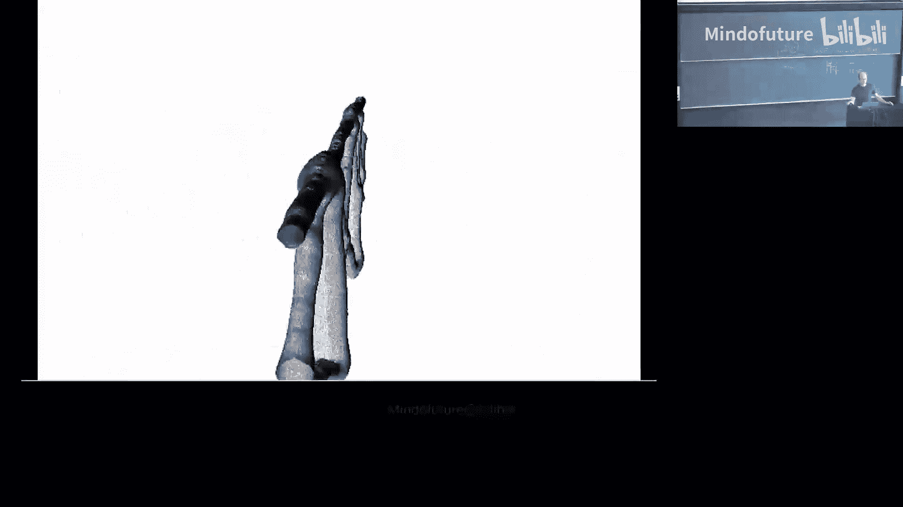

Again， you see a bit of the green color spilling in the textary。😔。

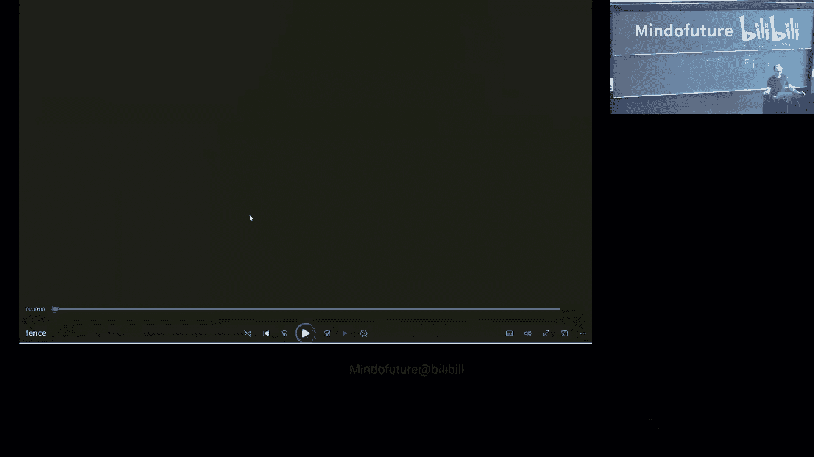

Or here's another example of this。I think， bug。So again， we start with an input image。 sorry， let me。

Stop the action。 This is the input image， right。It's this beetle here。On the stem。

 and this is the reconstruction we can get from just a single image。😔，Very good question。

 so what I don't show is what we do is we basically go in and scribble。

 put one scribble with a mouse as foreground foreground and one scribble for this being background and then it extracts the silhouette autonomously and this works fairly well so this is a kind of an interactive process to extract the silhouette and it typically takes two or three seconds for a user to scribble and separate object from background。

But how well that works depends a little bit on whether the object has sufficiently distinct colors from the background。

If it's a green bug on a green background， like in nature， that's going to get tricky， obviously。

 so this is kind of assuming that there is a way to interactively extract the silhouette。😔。

And once you do that， you can get these reconstruction。

And what's nice is you can see it here with this regular riseizer， this minimal surface approach。

 whenever the silhouette is very narrow。Then it will put little volume in there。

 And whenever the silhouette is wider， much like a balloon， it will expand more。

And this does make sense for a lot of things in nature。

 And so it kind of shows that nature has a tendency of creating minimal surfaces。

And this is no surprise because it is the adhesive forces in the world that make particles come together and so these objects in our world tend to be compact。

 they tend to be not distributed randomly。😔，So we get just an RGB image。 There is no depths。

 So the depths is completely hallucinated with this balloon model。 And there's also。

 that's important。 There is no learning。 You know， nowadays。

 a lot of people expect there are some training data set here。 No it's。Well， you know。

 the bug isn't really shaped like a balloon or the grass， right， But but in a way。

 you have the silhouette and you place a balloon like rubber thing， and then you blow air into it。

 And it will adjust to the silhouette， obviously。 And then you get these。

 So it works well for a lot of shapes， not for all shapes。 a lot of。Man madeade shapes。

 if you take cars， for example， they have very sharp edges， well the traditional cars。

 the modern ones seem to be pretty smooth as well， and so the balloon model would work fairly well for more modern cars but classical Mercedes type cars with very sharp edges。

 they don't get recovered properly here。So there is a set of objects that it can handle and other objects less。

😔，Let me see if there is another。I think there was one more。There is a。😔。

There's a number of objects that we tried。 I don't find the other one now。

Yeah so and so this gives you an example of where how well variational methods work they really work on basic principles。

 minimal surface right and if that assumption works for what you're solving then they really do well and then they can solve things very fast infractions of a second without any training data or any 3D。

 it just just blows the air into this balloon like structure and。

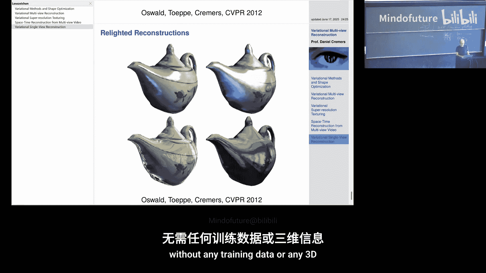

Gets a reconstruction。