# 【慕尼黑工业大学】多视角几何 ｜ Multi View Geometry 2025 p20 P20_讲座_16b_多视图重建的最新进展_第1部分 -BV1KgZEBrEXV_p20-

The aim of this chapter is twofold， first of all， I want to show you that there is a lot of things happening in the field of camera based reconstruction and 3D from images。

Multi view reconstruction， but secondly， I want to show you potential areas that might be of interest to you for doing a thesis。

 maybe a master thesis or something。And so this is why I decided to in this class more than ever bring in a lot of recent developments。

In two ways， first of all， I'll give an overview of recent developments that is happening。

And in addition， I've asked quite a number of my students to prepare short research presentations where they can highlight their own research in the field and maybe advertise possible master thesis topics that could connect to them。

😔，And so for example， tomorrow we'll have a class where I think three of my students will be presenting research current research from their research。

😔，And we'll do more of that in， in the coming weeks。I talked about slam， structure for motion。

 visual slam。 This was one work， this LSD slam。 I also talked about direct sparsoometry。

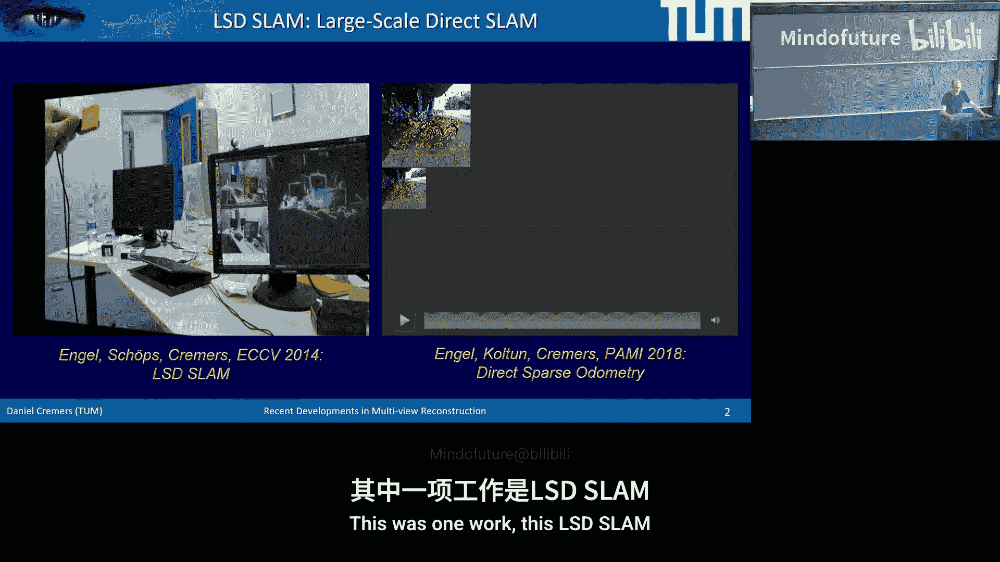

Here is the direct sparsoometry， so methods that can recover the movement of the camera and the 3D structure of the world in real time at very high precision。

😔，Now， what you can do is you can take these systems and。

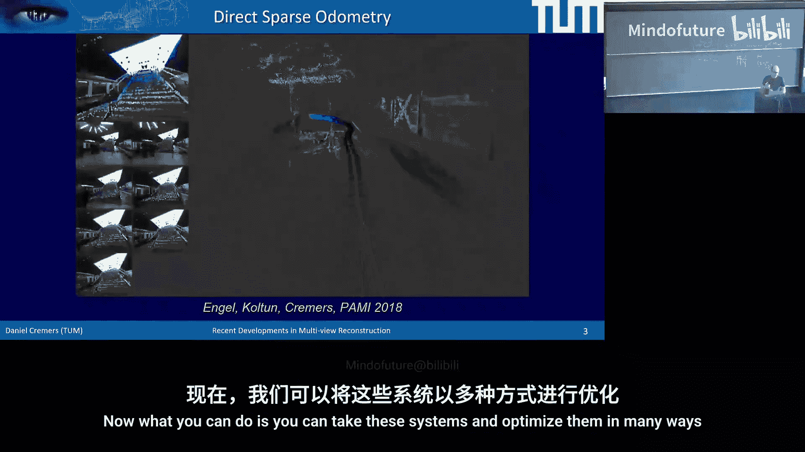

Optimize them in many ways。 this is just an off the shelf gray value camera that we have running here。

 but obviously once you were to go into robotics， applications or applications of self- drivingriving cars or autonomous drones。

 things like that， something we do a lot， and we have been doing for decades。

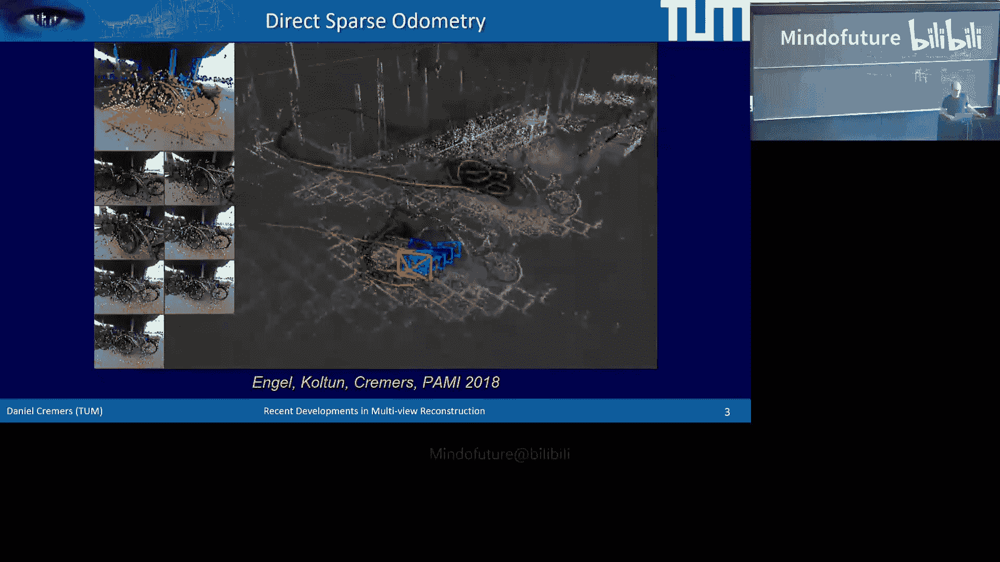

Then you might want to put more sensors， right？And so for example。

 in one of my last startups artisans， we develop multisensory systems that typically have two cameras that are synchronized。

 timested， calibrated， they have inertial measurement units onboard， possibly even GPS information。

 and then all of this information is gathered， and then you can create real-time algorithms of spatial AI that run either onboard or in the cloud to process all this data。

And obviously， if you tap into more sensors， then you can boost both the precision and the robustness of these systems。

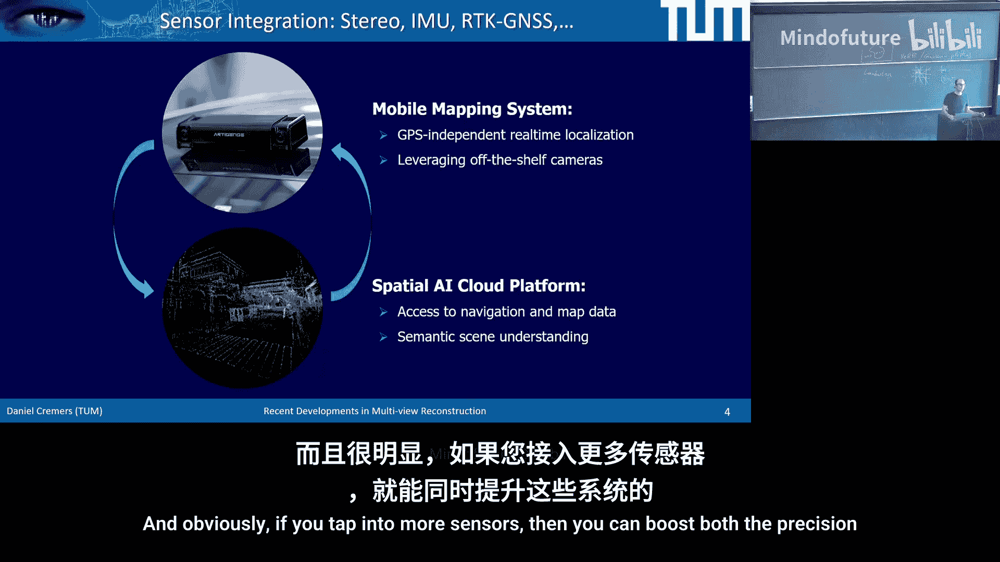

So here's one example， this is a system that Lucas Fontomberg developed in my team。

 it's called delayeded DMVIO in short， and it tackles the problem of tracking a camera。

with an IMU so very much like what you have on your smartphone。

 you have a camera and you have an inertial measurement unit。

 inertial measurement units are akin to what humans have in their ears。

 what's called the vestibular system， it tells you something about your orientation about accelerations and that is the system that is responsible if you throw up in the car like I used to do as a kid and like my boy does nowadays right。

And why does that happen， Someone explain that to me。 It's very interesting。

 You drive in the car and let's say you some of you may be familiar with that。

 Let's say you sit in the back of a car and you read a book。And then you go say to downtown。

 I don't know， Rome。In that way。Who would get sick at some point？生么饭家。😔。

It's about half of the people I would say。😔，In our family， I can see it's not everyone。

 my son throws up， my daughter doesn't throw up， beats me why one is like this， the other one not。

And I've always wondered because I threw up a lot in the car when we drove around as a kid。

 And so I've always wondered， why is that。 And then one day， someone explained it to me。

 So what happens in， apparently in the human is that you have multiple senses that tell you about the world。

 And that's in this case， in particular， your eyes that tell you how you move from。Paraax。

 and then also the vestibular system that measures your accelerations and you tells you how you move。

If these two senses don't match。Because you read a book and from the book。

 your eyes tell you you're not moving， but your vestibular system senses the car motion。

 then the senses don't align。There is one case when senses don't align。

 and that's when we eat something poisonous。 And so evolutionarily， when you know。

 I've always wondered how did we humans come about， we go through this world。

 we see all sorts of plants， how do we know what's edible and what's not。You know， you grow up。

 your parents tell you， But what if you grow up in nature as a wild animal。

 you don't have parents saying that you can eat that， you cannot eat。

 So you nibble on something and it might be poisonous。 What happens。 Your senses start to diverge。

And so the instinct that reflex is to throw up poison out of the system。

And so it's a very natural instinct that when our senses diverge， we start to throw up。😔，Meaning。

 I guess， you know， those people of you who throw up in a driving car。

 you're a little bit closer to your ancestors evolutionarily than the others。But as humans。

 we use all our senses to localize ourselves in space。 and so we can ask。

 can we do the same with a system that has a camera and an IMU like on your smartphone。

 this is called visual inertial oometry。

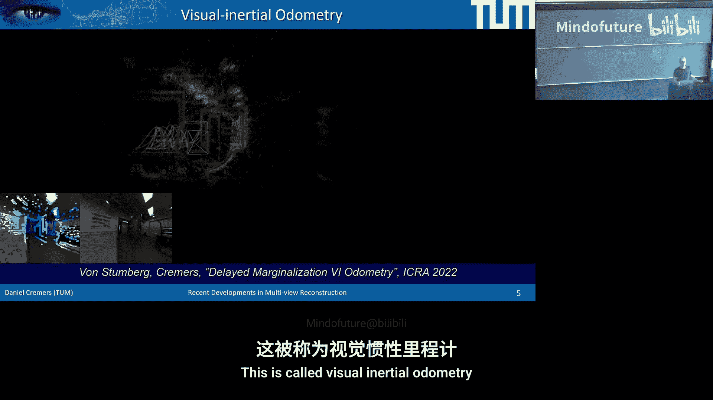

And what Luc has developed。 And this is demoing here in the building， right。

 He's on the second floor。 He walks around。 He goes up to the third floor。

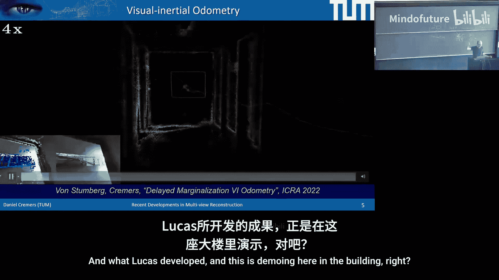

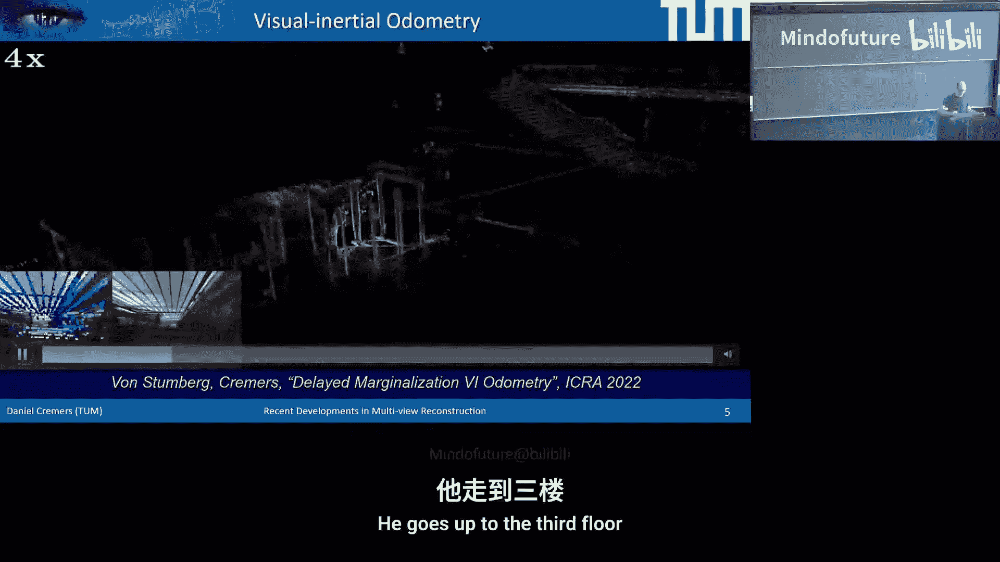

And then he goes into the slides。 We often go into the slides when we evaluate algorithms。

 and in the slides you can see it's pretty dark halfway through visually there is very little structure because it's just very shiny right And still this system can track at completely unprecedented precision。

 There is no other method when we evaluate it， there was no method that could do what he could do As you can see he goes down three floors up three floors back through the corridor he came from and there is hardly any drift right It's very precise things line up。

😊。

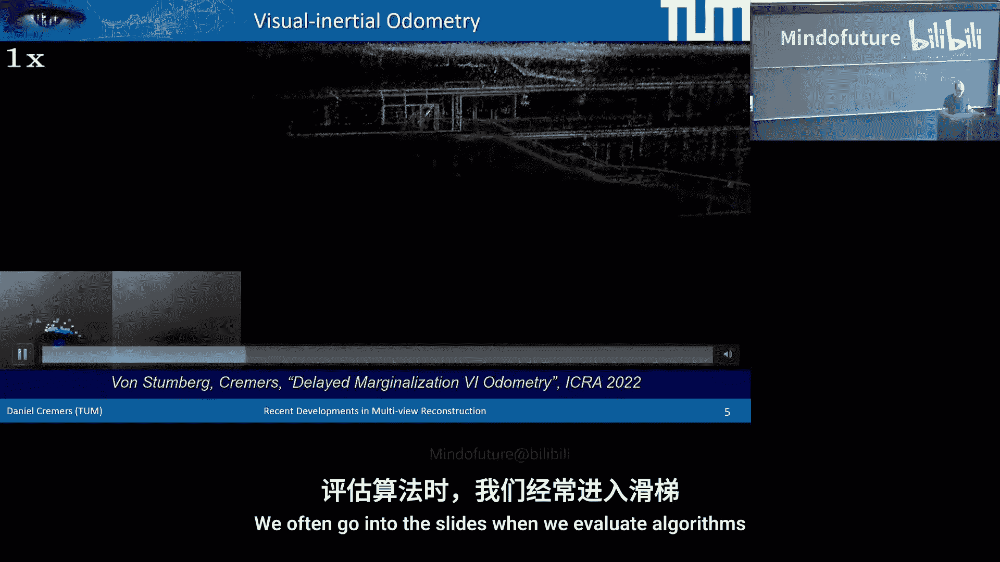

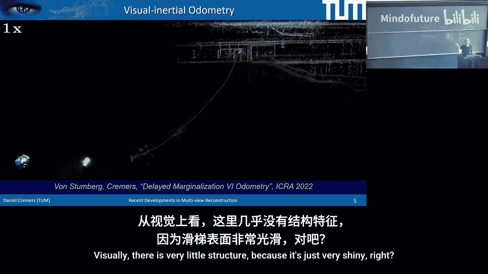

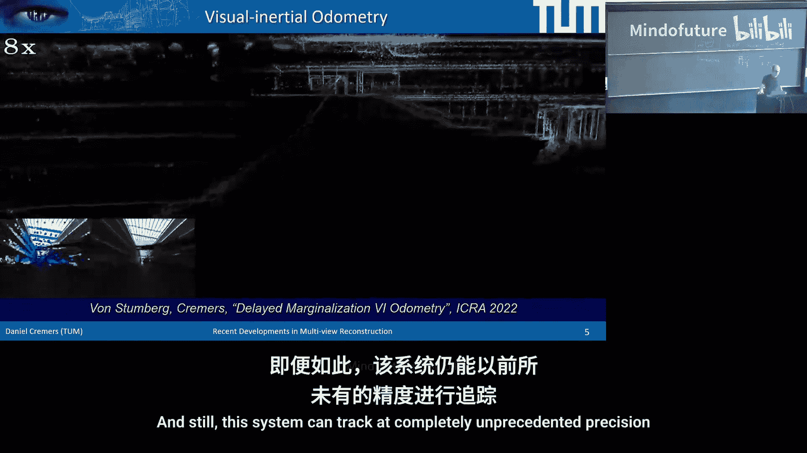

And this runs in real time， and it runs indoors。 It runs on a car。

 So a visual inertial system is super useful because it's plug and play。 You can just， you know。

 in sensory wise， is very small。 All it means is one camera，1 I M U that is very lightweight。

 very small， very cheap also。 So you can plug it anywhere。 and this will track。😊。

And map the 3D world at very high precision here。

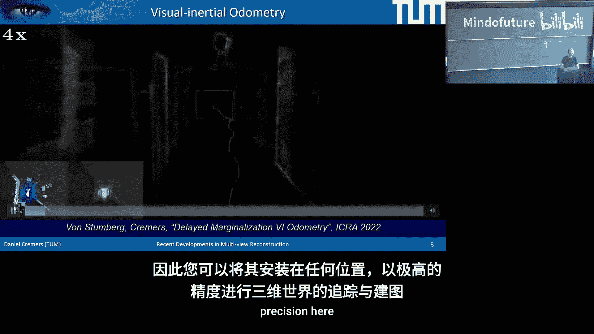

So you can do Pokemon on a completely new level now。😔，If， if you really care about Pokemon。

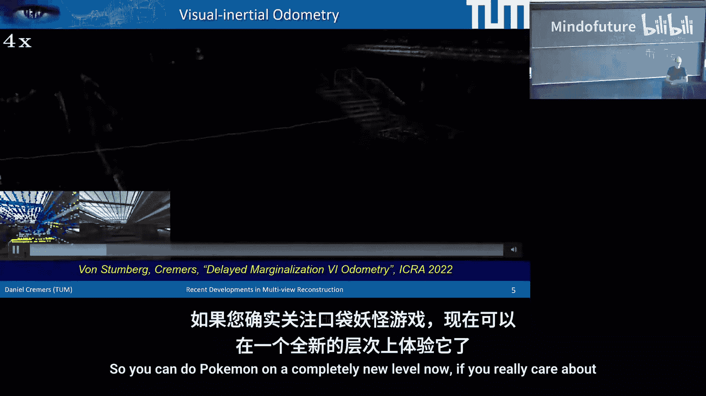

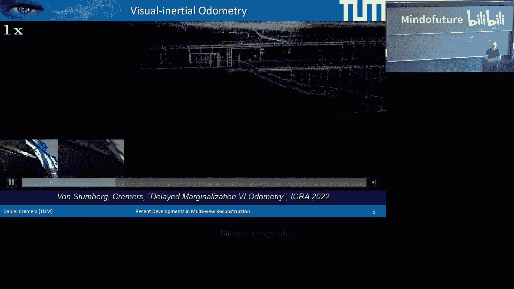

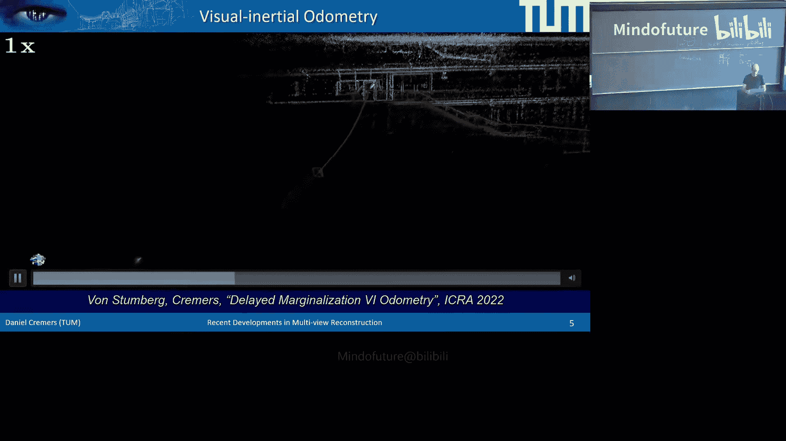

And then you can also deploy these sensors on cars and we did that extensively and this is a project where we deployed them on a whole fleet of cars and we drove I think 8000 kilometers of road and we map the whole large world and its semantics so what you see here is the drivable area。

 the sidewalks， the cars， buildings， vegetations so we can tap into neural networks that can run。

 say in the cloud and process all of this data semantically。

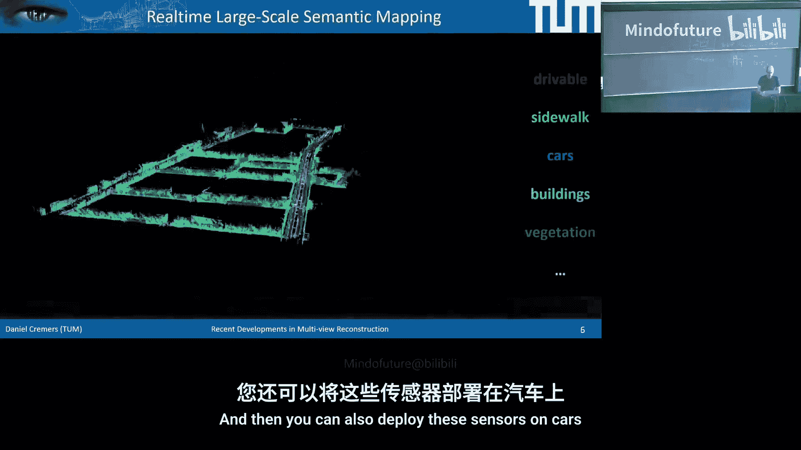

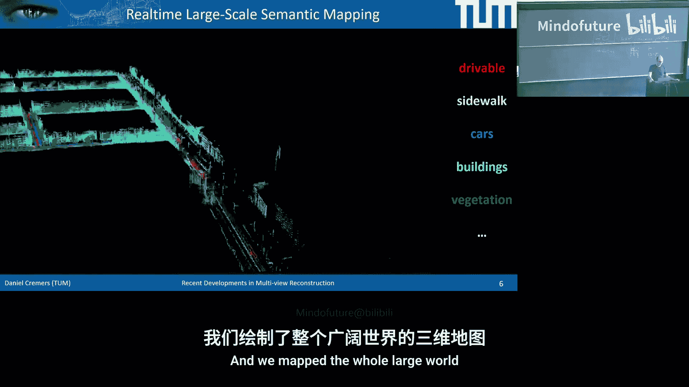

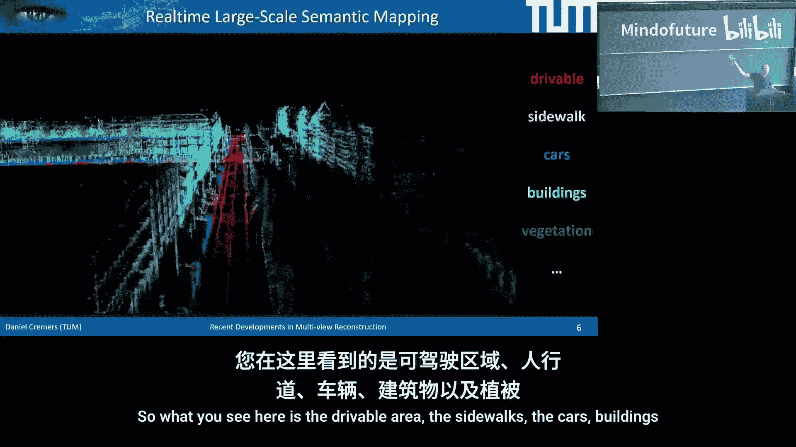

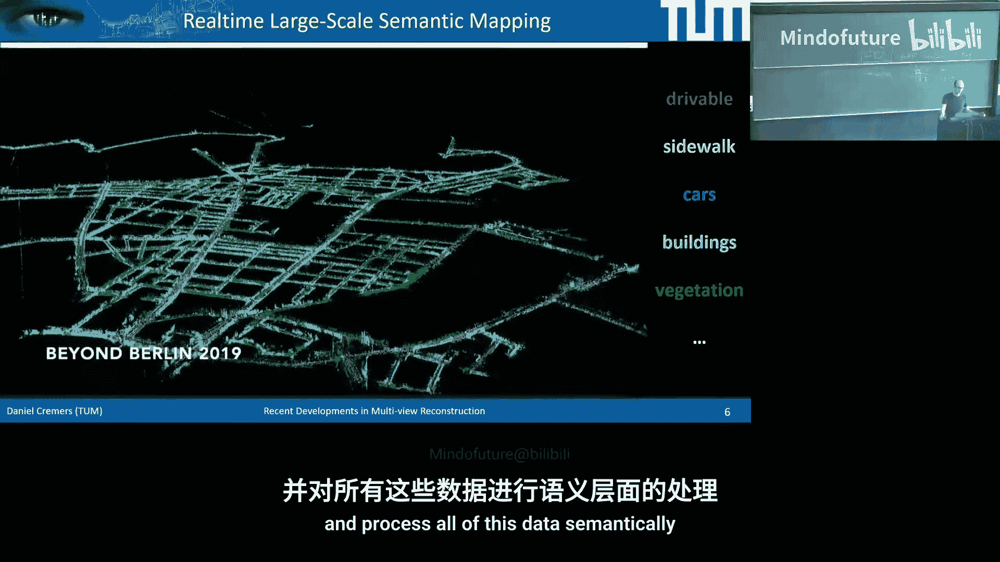

And this is very useful because you can map the 3D world with very cheap camera based sensors in real time。

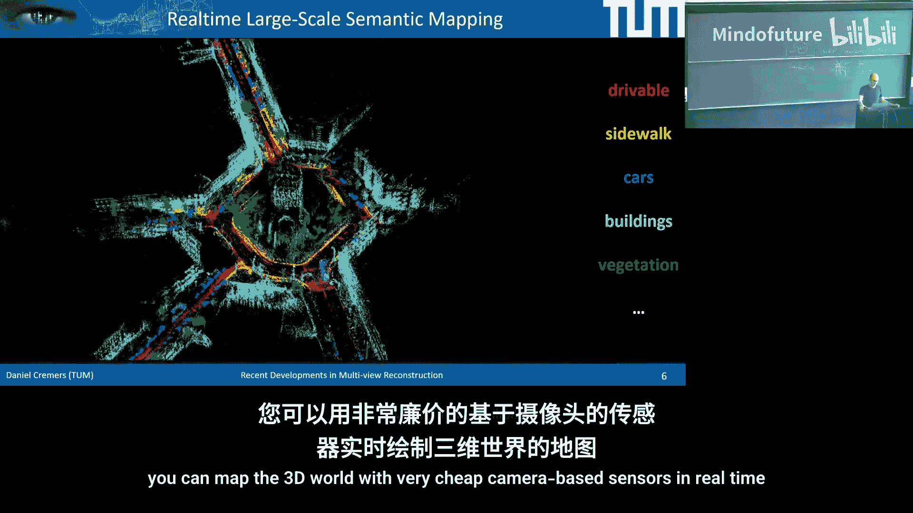

So you don't again， don't need a Liar sensor。 you can just put cameras in map。

And this you can extract semantics， the semantics are important for self-driving because you want to know where is the drivable area。

 where are the sidewalks， where are potentially pedestrians， cyclists you name it。

 and we can extract all of that and neural networks are very good nowadays to extract semantics from images。

 what we do here is we can label not images but the 3D world that we see through these images。

And I think what we did in this project is we went an entire step further into what should really be done。

 Computer vision for the longest time， was constrained to processing images。And the truth is。

 in most applications。 we don't care about images。 We care about the world behind the camera or in front of the camera。

 And this is what we can get here。 We can semantically understand the 3D world。

 And what makes it happen is slam。The question is whether we evaluated the positional accuracy。

 yes and no， what we always focused on is the accuracy at which we can track the position of the camera。

A separate question is， how accurate is the 3D world that we recover。

 I believe is slightly less accurate。But I would say sufficiently accurate to enable self driving。

So it should be in the range of centimeters， but I do believe if you want super precise surface structure。

 then maybe the lighter is still more accurate because it tends to give you millimeter precision。

But then the question is， if you want to avoid an obstacle on the street。

 do you really need millimeter precision or is a precision in the range of one or 2 centt。

 not sufficient。And I think we are at a level where the accuracy is good enough to enable driving。

And so a lot of the technologies we developed here on real time semantic mapping were designed to advance self driving technologies。

😔，A bit more， maybe about I talked about neural networks。 Now。

 I haven't actually touched on neural networks in class much。

But they have revolutionized computer vision for the last。13 years。

And it all started for the computer vision community with this data set called ImageNe that a friend and colleague of mine Feiei Li at Stanford put out with her students。

 It's a data many of you will know it contains millions of images of different objects。

Most of these objects are familiar to humans like this one。

 You probably recognize what the object is。 There's always one dominant object， anyone。

What is the dominant object here。A dog。 Which one。It's important because theres different dog breeds。

Dalmatian， exactly。

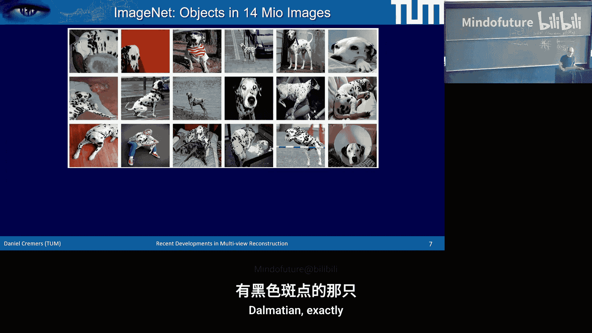

The thing with a black dots。How about this one， Does anyone recognize what category of object studies。

That's hired， right， It's not a dog， some plant。 Which one。Anyone？Fizalice， yeah。

 that's what he's called exactly。It's a fruit， but it's not so common in Germany when I grew up。

 we didn't have them， for example， now you can get them， but as a result。

 plus if you see them on a tree， most people just see them in a box in the supermarket we don't usually see them on trees or it's not a tree。

 probably it's a bush or something。And so humans are notoriously not so good and so as a result。

EEven humans， when asked to classify what is the object， they will invariably make mistakes。

At least when you talk about the average human and so what people did for the longest time is they put out this challenge。

 can you devise an algorithm that says what is the object in the image and there was a limited number of classes for the algorithm to choose from and for the human to choose from。

And then whereas the best algorithms in 2011 would make 26 errors on some set of data， humans。

 the average human would only make five mistakes。And that was a massive gap between machine performance and human performance。

And that was one of the biggest riddles in computer vision。As to。

 can we ever achieve human level performance。And now， if you see the whole history of AI right。

 for decades， humans have tried to build machines that exhibit some form of intelligence， right？

And then you can start with things like chess playing。

 but then you know humans were not designed to play chess by evolution。

 we don't come into this world and can play chess and for any of you who have learned chess you know。

 it's a very hard learning right， it takes years and years of practice and practice so that humans can actually play chess。

😔，In contrast， recognizing things with our eyes is something that we are born to do。

That by evolution， we were trained over thousands of years to understand the world around us with our eyes。

 Why， well， the better you can detect the lion in front of you， the longer you live。

 It's a very strong， you know， evolutionary drive that drives people to recognize things in their world。

 even camouflage things， right。And so this， for me， is the real intelligence。

That we need to somehow beat that capacity to understand the world with our senses。

And so as a result， I would argue that computer vision is really the core of artificial intelligence more than anything else。

😔，Why， because for humans， the visual sense is the dominant sense。50% of the， of the of the brain of。

 of mammals is。Is basically constantly processing visual information。

 Half of your cortex is working on visual information processing。 That tells you two things。

 First of all， it tells you it's important。 Otherwise。

 we wouldn't dedicate half of our brain power on this challenge。And secondly， it shows you。

 it's not easy。 Otherwise， we could dedicate5 neurons and be done with it， right。

But it's difficult recognizing things， understanding the world， perceiving things。

And reproducing that capacity is really computer vision。 And so this is one of the core challenges。

And so in 2011， the community felt like there's no way we can ever get near our human level performance。

 And then something almost magical happened。 Alex Kzyevsky and collaborators around。😊，Jeff Hinton。

Proposed to apply a deep neural network。 They had been around。 They had been refined over the years。

 There were a few people who worked on this。 I should say， I don't know if I mentioned that。

 but in the late 90s。 I came from physics。 I wanted to change。

 I wanted to do something that impacts the world。 And so in 97 when I was done with a master's in physics。

 I turned to what can I do next。 And I decided neural networks。

 I was fascinated with that topic I found it super exciting The capability to reproduce human cognition and and perception and things like that。

And so I reached out to many people， including Jeff Hinton。 I remember sending him an email in 97。

 saying， dear Professor Hinton。I want to do a PhD in neural networks。 Are you looking for people。

He didn't reply to my email。I know that for fact， nowadays。

 if I say someone didn't reply to my email， most of the time it turns out I just didn't read the reply because I get so many emails every day。

But back then， I didn't get hundreds of emails a day。 So I know， for fact。

 he did not reply to my email。And maybe I should have persisted and send follow up emails。

 I didn't send emails to other people in that field。 And some of them did reply。 And they said。

 young man， you seem quite talented。 Why do you want to go into an area that is completely dead。

I was shocked。 This was 97。 It was really the the winter of AI， maybe the second winter or third。

 depending on how you count。😔，And I was very disappointed because I did believe in deep networks and neural networks。

 not they were not deep at the time， but I did believe in this approach of neural networks。

 And so I actually didn't listen， and I went into neural networks anyway。😔。

But not with Jo Hinton and this is a work of Jo Hinton's team where they showed that with a deep network where you basically you probably know how they work。

 you get the image information coming in from the left and then layer by layer。

 it's processed through different filtering and pooling steps and then on the right side at some point you get a classification out and the idea is that you can train with supervision or some form of self-supervision。

 you can train the weights so that it does the best classification。And initially。

 these networks were designed to do classification。And what you see。

 the Alex N as is nowadays called based on Alex Kzyevsky， the first author。

This had a massive boost in performance from 26 to 16。4。And so the whole world。

 my entire community is pivoted into neural networks saying， wow。

 there is a somewhat new formalism that seems to be very promising。😔。

And so they devised deeper and deeper and more sophisticated architectures over the year。

 such that around 2015，16， we were able to outperform even the human on a task which I would argue the human was designed for by evolution。

😔，And so for me， this slide marks the real breakthrough of AI。Of being able to beat the human。

Not on an artificial challenge like chess playing， but on the challenge that the human was designed for。

Now， that's not the end of the story， of course， right。

 because beyond just seeing that there is a lion humans can do more。

 they can anticipate what the lion is going to do next， how it's going to move， things like that。

 and they can anticipate what might be the best reaction to survive， etc cetera。

 so humans have a lot of skills that to date， machines do not have right。

 And so there's still room for improvement， but at least on a specific challenge of recognizing things we manage to beat the human。

Now， that said， for some reason， detecting objects and images， I've never found that fascinating。

 I don't know what it is， but whether there is an airplane or a cat or a dog in the image。

I don't really care about that challenge and so that's never been my thing。

 but what I care about and what we started looking into my team and many others in the world is following the 2012 paper is what else can we do with neural networks。

 what other challenges can we tackle？😔，And so for example。

 in 2015 we started around 2014 working on deep networks for many， many things。

 and then in 2015 we showed that you can do optical flow estimation with neural networks and this is。

 I believe the very first work that does optical flow with the deep network and so not surprisingly we called it flowNe and pretty much any optical flow algorithm today goes back to that flowNe paper。

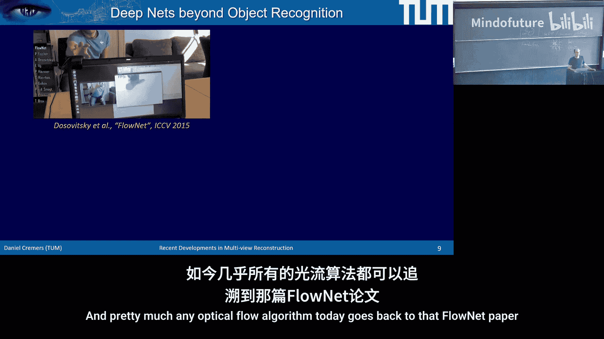

And we went further and showed that also problems， this is， I should say， not our work。

 but we also had other works in showing that you can do stereo and Scflow and other things with deep networks。

 This is work from my colleague Robert to Chipoola in Cambridge， it's called Signnet。

 It does segmentation of images。😔，And you see also came out 2015。

 so all of these low level image analysis， tasks of segmentation， optical flow estimation， stereo。

 etc ce。 we showed that you can solve them with deep networks。

 and we also showed for problems like this one， protein prediction。 This is also 2016。

 We showed that you can train deep networks to predict the protein structure。😔。

And if you followed the news， you will know that this recently got the Nobel price。To our dismay。

 the Alal team never cied our work， even though we were two years earlier。

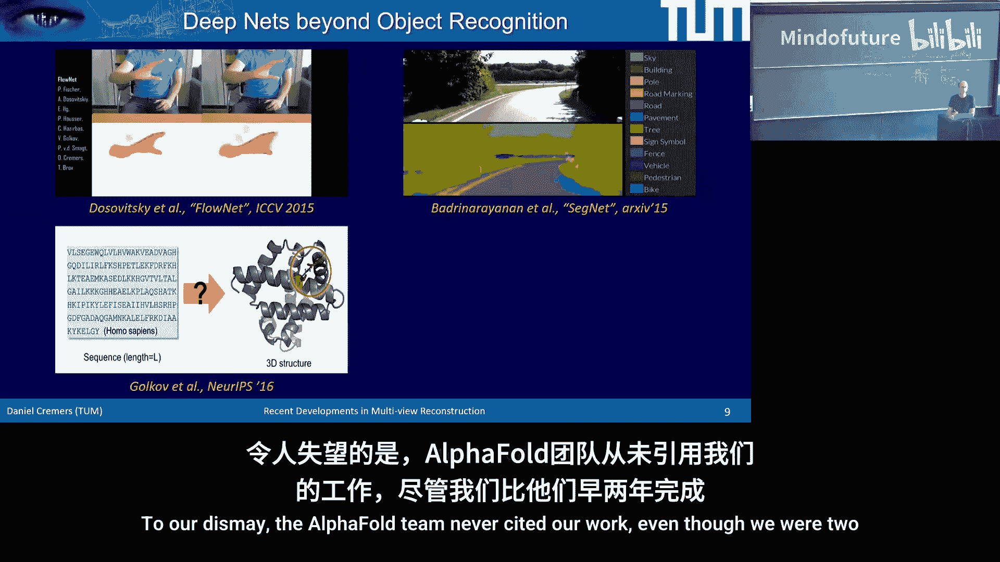

Here's another example from my team， video object segmentation。

 and you can see we can track objects really pixel precisely in complex videos with neural networks。

By coming back to the topic of this class， one of the questions that emerges is。

 can I leverage deep networks for 3D reconstruction？And to some extent。

 one can say in the field of computer vision， 3D has。

 up until this year remained the holy grail for classical methods。😔。

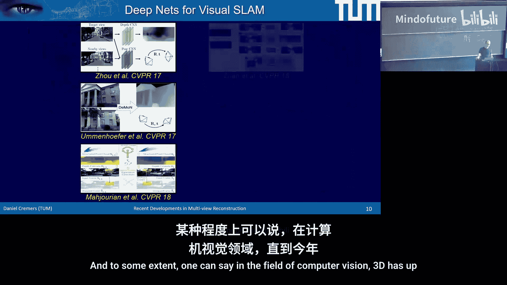

There have been learning based approaches。 These are examples of learning based approaches that started appearing around 201718 for simultaneous localization and mapping。

Most of them show you can do it with a deep network。

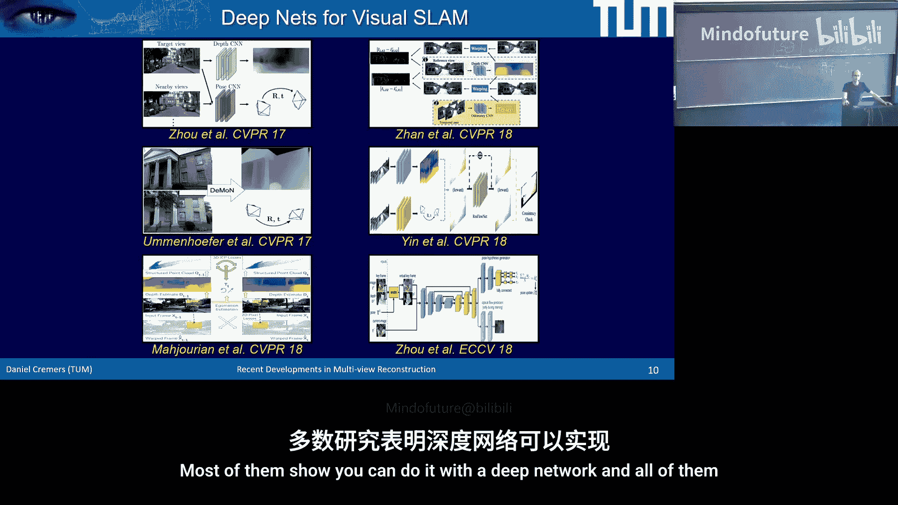

And all of them do not exhibit state of the art performance。So you can do it。

 but you don't get better performance than with what we already had。

 The slam approaches like LSD Slam and DO that my team and other teams developed。

 They were just better。 They were faster。 They didn't need training data。

 and they got more precision and more accuracy， more robustness。

Then the learning- based approach why that was is a little bit hard to say， but in a way。

 taking a set of images from a video and throwing them into some black box deep network and hoping that magically this will give you the trajectory and the 3D world is maybe too much to expect。

 right？😊，Maybe it would take too many too much training data right because you would maybe expect it would need training data of all sorts of 3D worlds observed with all sorts of cameras in all sorts of movements。

 and that's just too much of a multiplicity。 Maybe millions of images wouldn't be enough to train it。

 I don't know。So in a way， the challenge was to constrain it appropriately and to deploy deep networks such that you actually outperform the baseline methods。

And this is what we set out to do in this work， so this is work where we built up on neural networks that can predict depths。

 so it turns out this is one example from 2017 by Quiz itself and collaborators turns out given a single image you can predict the depths。

And now you'd say， how can that be， Well， how do I know how far things are， in principle， I don't。

 right， and they could be at any distance， but in practice， obviously。

 when you train a certain scenario like self driving。You know， the cars， the objects that， you know。

 the lanterns， the things I see， they all appear in a particular size。

 And so I know if I see even for a human， if I could ask you how far is that car。

 And you could tell me， right？ Maybe not centtre accurate because humans are never good with numbers。

 let's be honest， but you could say some 10 me or so， right。

And so what I can do is I can train a neural network to do exactly that。

 I can train it in a supervised way， for example， or this is what we did in this series of papers in a self-supvised way。

 how does that work Well， we assume we have a stereo camera system in a car。And that means we can。

 you know， we can say find a depth of the scene such that if I project the colors into the world and back out into the other camera。

 I should get color consistency。And so much like in the s approaches。

 this brightness or color consistency， we can use it to train dips prediction in a self supervised way。

😊，Meaning we don't need ground truth， meaning we don't have to carry a lighter scanner along to tell us what was the actual distance。

 We can use the stereo setup， And that means it's cheap。 stereo cameras are cheap。

 You just plug them in a car。 You can drive for days and you can create infinite amounts of training data。

And so in general， the key challenge that I see in the scientific community these days is to develop self supervised learning techniques that don't need ground truth。

And as you can see， our deep network predicts very crisp depths， much better than baseline methods。

 and then we went further。 we took these depth predictions and we fed them into a slam approach。

 So we had an optimization approach like DSO or LSD slam。

 and then we feed all these predictions into the slam pipeline more specifically。

 we say given two consecutive images I and IT Prime。Train and neural network。

To predict the depths for each image， to predict the relative camera motion between the two frames。

 So oppose prediction， And we also train a network to predict an uncertainty。

And then we feed all of these predictions into a slam pipeline。 more specifically。

 we predict the dips。 We predict the relative camera motion。

 So T is stands for translation and rotation of the camera between the two frames。

 and once we can do the camera alignment based on this rigid body motion。 We can warp the two images。

And align the brightness values。 And then we can have a residual for training the system that is self supervised。

 So that is basically saying the colors of these images should coincide。

Once I project into the world and back out into the other camera。

 I can measure the color discrepancy or brightness discrepancy and this is the residual I use to train these networks。

Once you do that for a real camera， it actually doesn't work， right。

 because real cameras have aperture changes。 So the same image， once are warped。

 then the brightness is very different。 As you can see here， it's the same image。 and for humans。

 it looks like the same。 but if you compare the actual brightness values， they're very different。

Because the aperture changed。 But what's nice is you can also train a network to predict an a fine brightness correction for the whole image。

An offset and scaling of the intensity to make it most consistent with the other image。

 and what's nice is you can train the network to predict these two parameters that model that correction。

And then you have consistent brightnesses that you can use as a residual for training dipsNe and PoNe。

That works for a Laorian world。But as I mentioned， the real world is not always Lamberian， right。

 because we have here's the term Lamberian。 So meaning if I have shiny structures。

 metallic structures。 And I look at them shiny like here， that reflexes， you know。

 the brightness changes。 If I see metal structures， mirror like structures， They reflect things。

 It's not Lamberian。 If I see glass windows， right， they are not Lamerian。

 So the whole manm world has tons of structures that are not Lamberian。

 And then you have to ask yourself， what can I do at that point。

And there's different ways you can go。 you can try to model the reflectance properties of the world。

That can be done， right， The B RDfs that capture the reflectance of shiny materials。

 I can try to infer the material parameters to simulate the light transport through windows。

 the diffraction， everything that you have in optics， you can try to invert that process。

 And from the images reconstruct the 3D world， the material properties， everything。

 We've tried that to some extent， you can make that work， but。

Not in real time because modeling the physics of image you know of light transport is a very complex phenomena and to model these in real time is just。

 I think， not feasible。😔，So what can we do instead where the truth is we want to track the camera。

 we don't care about the reflectance properties of things around us。

 all we care about is tracking the camera。So what we can train is we can train a neural network。

To tell us。Which areas have the brightness preserved and which areas do not。

RightAnd it turns out you can train a network and what you get for test images is what you see here。

 whereas you can see the metallic structures on the cars in the windows they light up and other parts are darker。

Where and then so that basically tells the system you should rely on the darker areas to do brightness consistency checks。

And so what you do is you actually down weight the residual by this what's called allliaatoric uncertainty sigma。

And then obviously， if you do just that here， then it will down weight everything because that will make the cost go down。

 right， So you need a regular riser that this is all based on a Gaussian assumption and then you will have the log of sigma that basically says。

 well， you can't just downwe every pixel， right。Otherwise， that term will grow large。

And so in the end， you have a self supervised learning approach that can tell you dips。

 that can tell you camera movement， a fine brightness， correction， and it can tell you uncertainties。

 It just tells you which areas are lumbertion and which ones are not。😊，Yes。So the good question。

 So the question is， how well is the dips prediction compared to dips cameras or to stereo。

It's surprisingly good there is a disagreement currently in the community。😔。

Some people say depths prediction is not so good， and one should rather predict normal information。

 that seems to be more reliable or relative dips。 So saying which point is nearer without giving it absolute dip。

 for example， obviously， if I pipe in the same image from a Lego world。

Then it will not give the right tips if it's been trained on the real world where things are 10 me away。

 and then I give it an image of the same world but miniaturized， it will not give the right scale。

 And so in a way you can expect these systems， you know， they only do what they're trained to do。

 And if you train in a self- drivingr setting on the road。

 it learns the size of different objects that it sees。 But if you take that system into the forest。

Where you have leaves that can be any size， you don't know。

 You can have the same leave in different sizes。Then likely， they will not work so well。

 They still work surprisingly well， but not that well， so。In short。

 whether they work well or not is in the eye of the beholder。

But I've seen recently colleagues of mine saying dips cameras are obsolete。

In the sense that I can take a normal camera and and run a depth prediction network on top。

 and I'll get something that is。Maybe not the same， but similar， right。

And I think they are obsolete for certain settings In the self driving world， I'd say that's solved。

 We can do depth predictions， And we showed it with our work and other works。 That's solved。

 If you want something that can give you the depths for completely random environments。

 the forest the jungle， that's a different story。So in other words。

 whether you can predict dips or not depends on the application scenario。

 if it's a constrained world and self driving is a very constrained world。

 even the geometry of the world is for every image， the depths is practically the same。

Why because the road tends to be flat and so I can tell you the depths without looking at the image right and no kidding we showed and others also showed that if you train a depths prediction network。

 it's not so easy to outperform a super naive method where you take all the training data and just average the depths and that's the one you predict。

It will give you the road， it will give you the sides。 and so， you know。

 it will give you a pretty good depth prediction， apart from the actual cars that stand on the road。

 everything else is nicely so and that worked surprisingly well and beating that baseline was not so easy with the neural network。

😊，When things started。And so this self driving world， you see it， you know。

 it's always the same depths up to you know， a few meters back and forth。And so as I said。

 all of these predictions， you train in a self-supervised way， once you run it。

 it predicts the relative camera motion， it predicts the depths。

 and now here comes the clue of this method， we don't fully trust these predictions。

 but we use them as a prior， if you will， right， we say find a reconstruction of the camera movement and of the 3D world such that for every frame。

 things are as consistent as possible with the predictions of the deep network。

 and so we feed these predictions into the loss function。

And so we have a classical slam algorithm that's running on brightness consistency。

 and then we have terms in the loss function that say， well。

 it should all be compatible with the deep net predictions。😊。

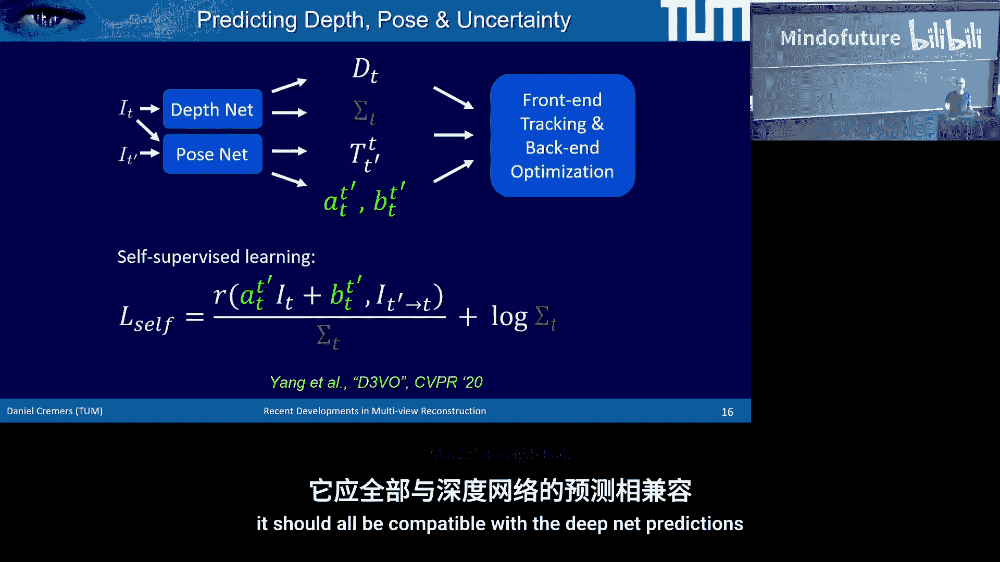

And that increases the precision and robustness massively。

 And so what you see here is one of these methods running on just one single camera， No stereo。

 no GPS， no I M U， just one gray value camera。 And as you can see with one single camera we can drive around the block。

 And this is a world that we have not seen before， this is from the test set。

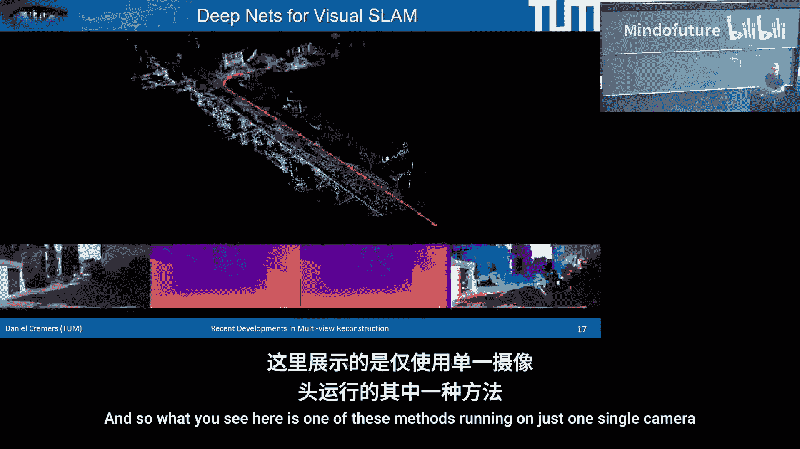

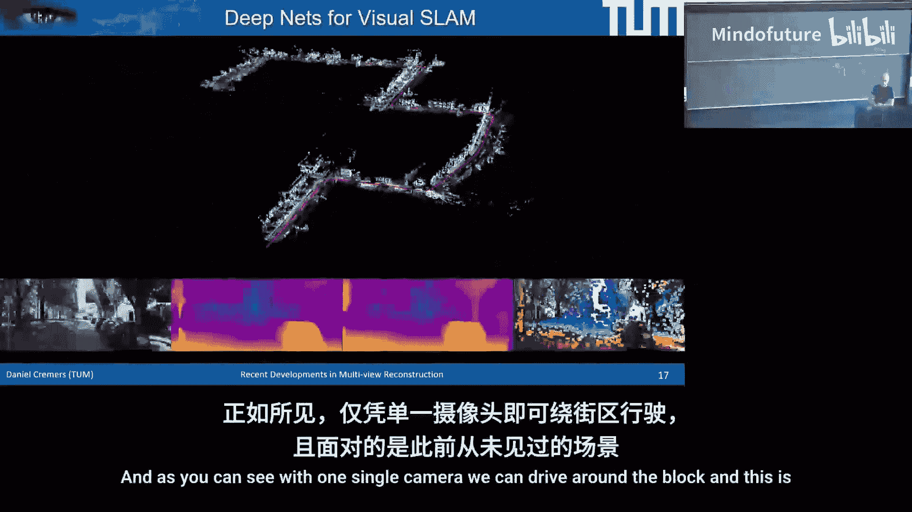

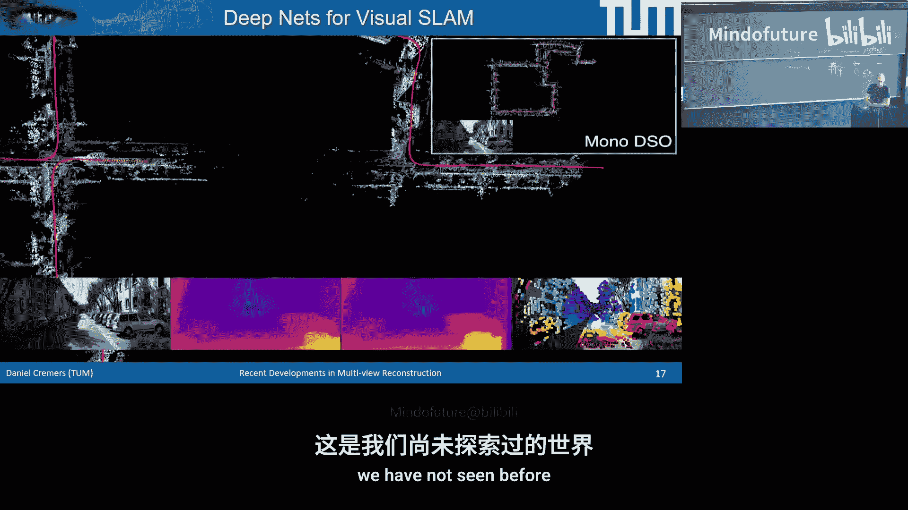

And you can see in comparison to the standard monocular Islam algorithms that create a drift in the scale。

 here， there is no drift， things actually line up almost perfectly。

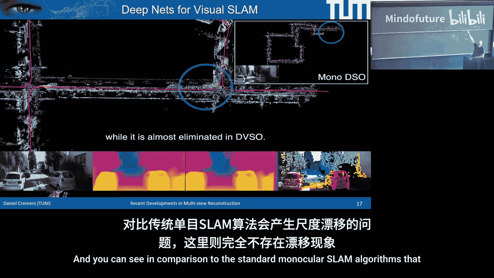

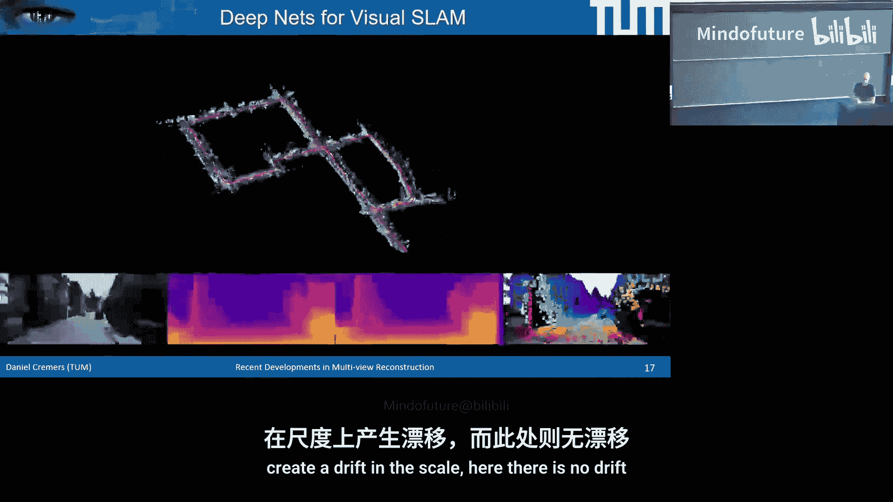

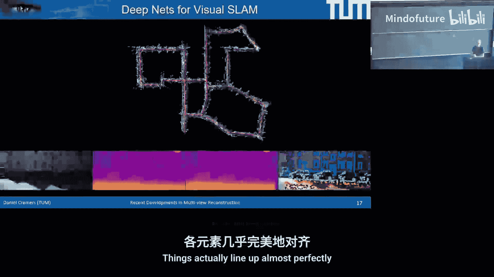

And so upon publication， this work was by far the most accurate monocular s system in the world。

 a deep learning， enhanced classical slam system， and I do believe often people ask me that there is a bright future in methods and technologies that combine the best of both worlds that take whatever they can from classical methods。

 and they bring in whatever they can from a learning-based approach。

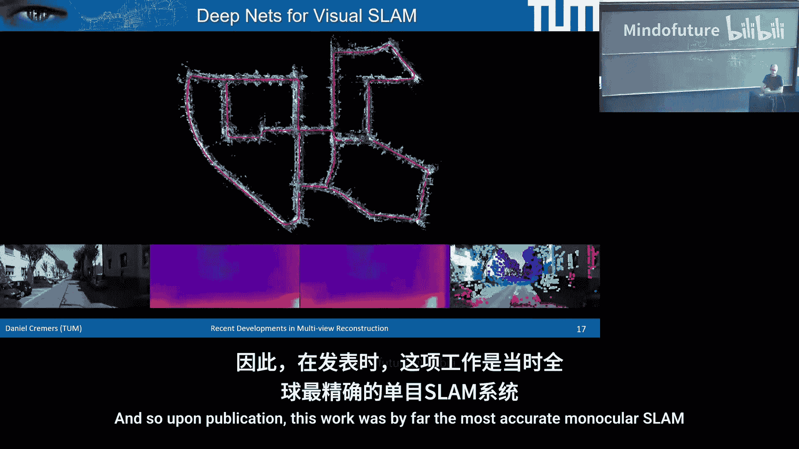

For example， I kept saying in classes for， for you know， all the classes multi view geometry。

 I always， one of my messages was you cannot estimate the scale of the world from one camera。

I told you that， right， how in a bathtub， you can film Titanic and it's going to look fairly real because。

 you know， it's everything is scale andvariant。That was actually not true。

You can determine the scale of the world from a single moving camera if you know the world that you're driving through。

Then a neural network can make depth predictions。 And even if one prediction is not good averaged over the whole sequence。

 they will aggregate to something that is very precise。 And so there is no scale drift in this。

And so the big benefit that the deep network predictions bring is that the depth predictions。

 they are， metric predictions in meters and they enter and they fix the scale。

Over time right and so so there is no scale drift happening here and so we evaluated it quantitatively and not surprisingly we found it works super well。

 both compared to classical methods like orb slam or even stereo methods like stereo DSO these monocular methods still outperforms them。

😔。

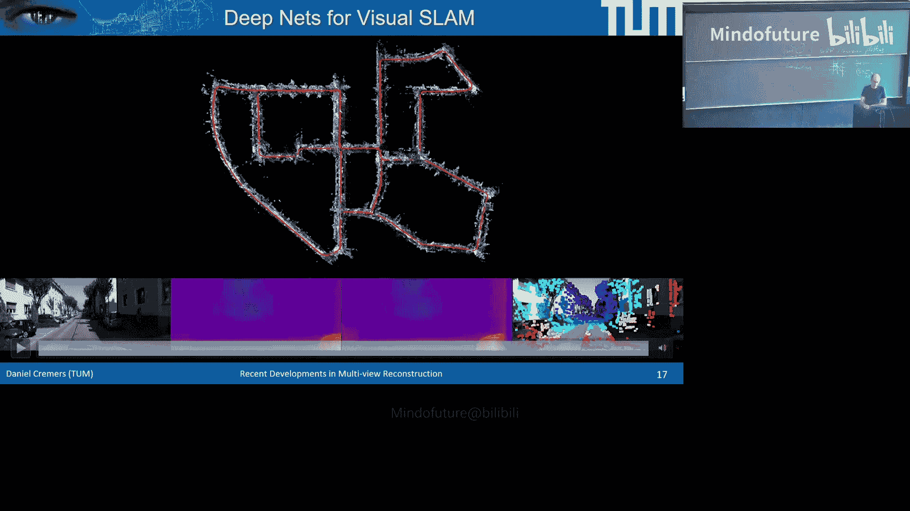

So you're better off with one camera and a neural network than with two cameras and no network。

So this is generally the message of all these papers is that the deep networks they can compensate for missing sensory information。

 they can hallucinate whatever the other sensors would have measured， right？In fact。

 this is why the first method we published， we called it DVSO Deep virtual stereo Doometry。

 essentially we trained it with stereo and the system was trained to hallucinate the second camera。

And when you applied it， it will just hallucinate the second camera and give you the tips，So this is。

 you address one of the biggest issues in self driving。

 the certification of self driving technologies is an notious challenge for everyone in that field。

 you know， can you prove that it's safe？😔，There are two ways to go about proving that the system is safe。

 One way is that you somehow upfront guarantee that the depth prediction it makes will always be within 2 cm error。

I believe that kind of certification is not possible for machine learning and AI algorithms today。

 especially not with deep networks that are to some extent black box systems that predict something you cannot guarantee that the error will be below a certain threshold。

😔，But there is a second way to certify them。 and this is very practical and it works。

 is you run them。For miles and miles and miles， and you show how many errors they actually do。

And then you want to do that across as wide a spectrum of applications as possible。😔。

And in particular， you want to do self driving， not just on the US West Coast。

 like a lot of car companies are doing where。To my experience， it's always blue sky。

 It's always sunny。And the roads are sufficiently wide and the traffic is extremely regulated。

 but you want to also demonstrate their functionalities in places like Rome or Sicily or Mumbai or Beijing。

Where traffic in my experience， is significantly more chaotic。

And where you can have obstacles that you don't see on US roads， especially in China。

 I've seen interesting you know， vehicles with a bicycle with stuff loaded on top of it。

 And then if your network has never seen a structure like that， it might be very confused。

And so this kind of certification certification is happening as we speak， and that so can be done。

And then you may want to also drive through the forest and make sure it still works。

And so this is all solvable。 And so we did a lot of evaluations ourselves on different streets。

 in different towns， in different environments， also in the forest or in in a man made world。

 and we showed it still works。But typically， as always， with any deep learning method。

 and this for me， is the biggest drawback of learning based approaches。

They do degenerate when the further away you move from your training set。

This is the natural thing to expect。But how quickly the performance degrades when you move away from your training set depends on how you formalize the methods。

 For example， this method degrades very gracefully， why。

 because it has a classical s pipeline built in the deep net predictions they are not taken for ground truth。

They feed in as constraints。And if they are not correct， you know， for a couple of images。

 that's not going to deteriorate the performance。 There is an overall global optimization happening that assures that things are optimal。

And so as a result， this method actually degrades very gracefully。

When you move away from the training data。And this is generally I think。

 the benefit of hybrid methods that the degradation。

 once you go what's called once you have a domain shift。

 domain drift or you go out of domain of the training data， they still often work。

Now as you can see this is all based on depths predictions。

 obviously and this was kind of puzzling to me， I suggested to my student。

 let's do depths predictions and feed them in the slam pipeline and then this came out right it can track the camera very accurately。

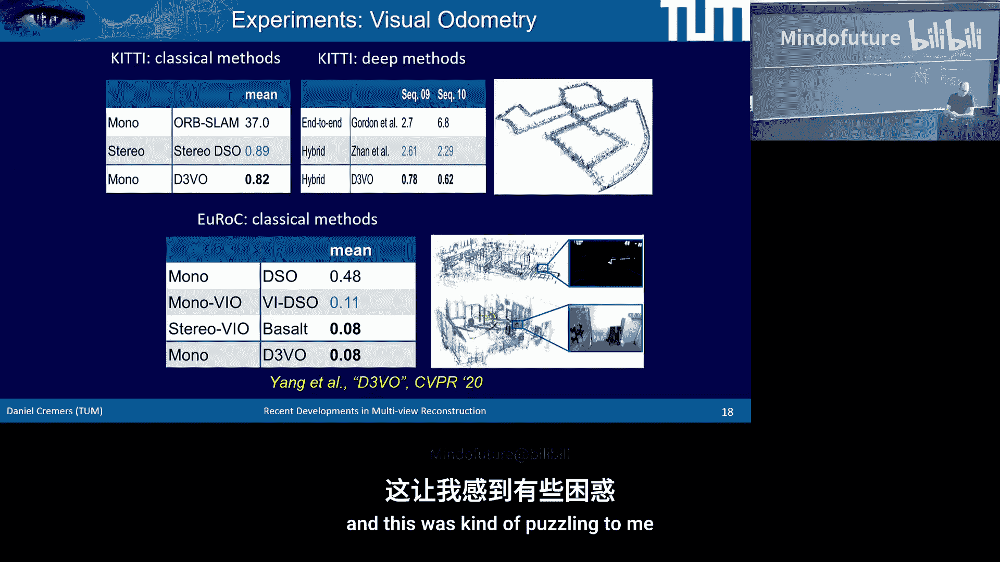

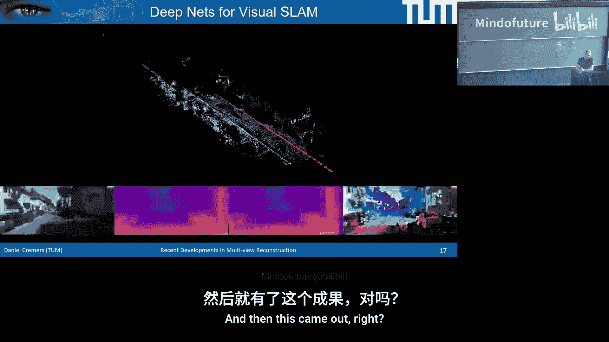

But the world is not dense。 It's sparse。 And then I say， wait a second。

 the depth predictions of the network are dense。 Can you not build the dense work out of world out of it。

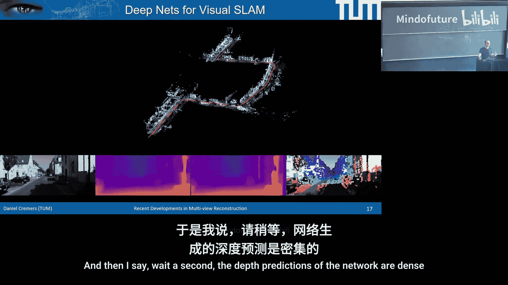

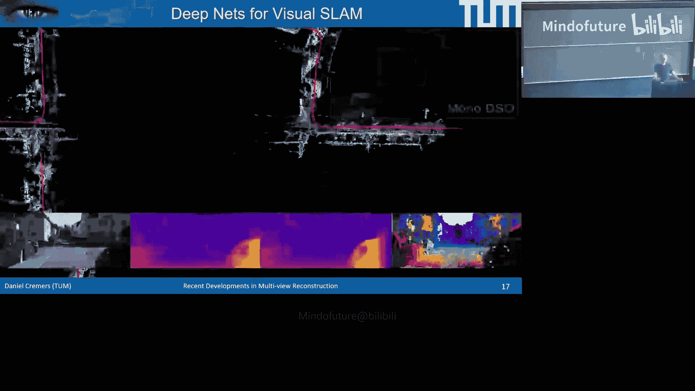

Well， I think for the sake of tracking the camera， he only focused on the most precise points。

 in a way。

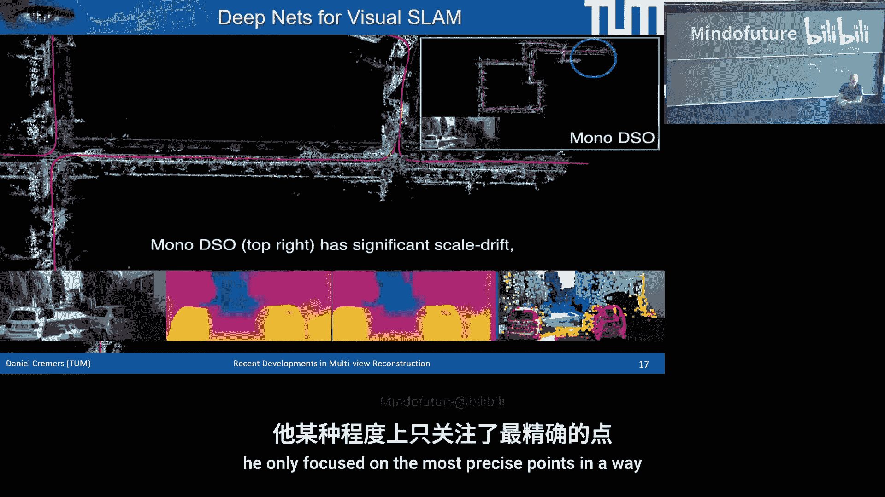

But then we went further and this was a follow up work by Felix Wiba and collaborators where we focused more on the depths prediction。

 and so we said take all the depths predictions and aggregate them into a dense 3D world because I wanted to see can we reconstruct a dense world from a single moving camera？

A very classical computer vision challenge， right？Once you do that for these self drivingiv scenarios。

 there is cars driving around and once you predict the depths of these， but then they move over time。

 then what happens if you aggregate these depth predictions over time。

 you smear out the moving obstacle over the world， right， you can imagine looks really nice。

 I like these smeared out moving cars。But my students didn't like them。 They said。

 we don't want any smeared out obstacles， right， So they added a module in here。

A so called mask module。 And that mask module is designed to filter out objects based on。

Lack of brightness consistency。 So we use brightness consistency over several frames to predict the depths。

 and then we use the same brightness consistency to say if the depths is not consistent。

 it is likely with the camera movement that we estimated， then it's likely because some object moved。

Cause then the color is not the same， right。So I can warp all the images based on the camera motion and then the brightnesses should coincide if they don't。

 then possibly the object moved and we can feed that into a mask module that identifies the areas of moving objects and these are filtered out so the moving objects are kind of filtered out from the reconstruction。

And then we get the ultimate depth module that predicts depths only for the static world and not for the moving world。

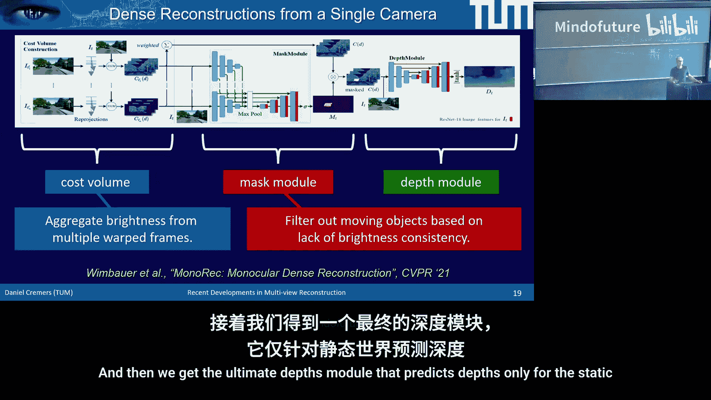

And so what comes out is this technique that we call monorech for monocular dense reconstruction。

 And as you can see， we can recover a fairly pleasing 3D world。

Recovered from just one single moving camera driving through the world。

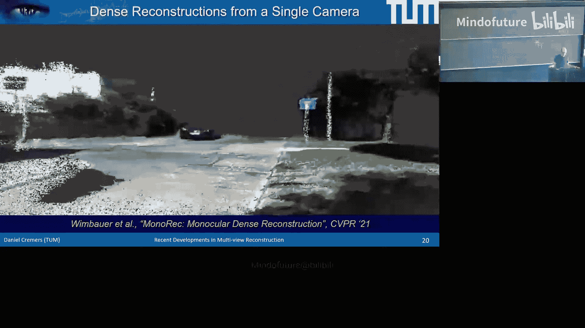

And here again， you can ask how precise is this reconstruction。

 I don't think it's as precise as a lightar point cloud， but the point cloud is much more dense。

 It's a colored point cloud so we can actually recognize things that's much harder in lightar point clouds where you see points but you don't see what you're looking at。

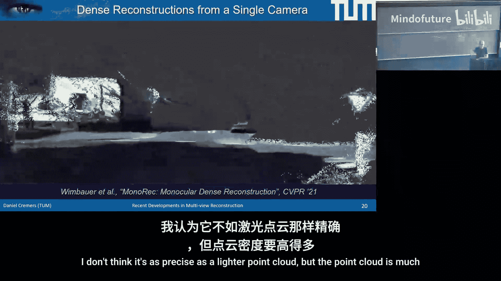

If you have a stop sign， you can scan it with a lighter。 You will never read what's written on it。

 because you need the color to do that。 And here we get a colored reconstruction of everything。

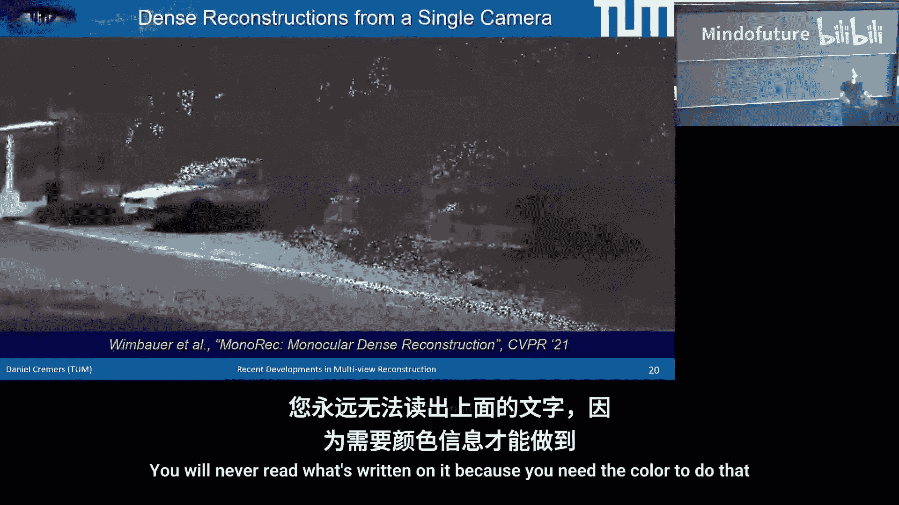

And the precision may be not on par with the lighter point cloud。But it's， I would say。

 sufficient to do obstacle avoidance， path planning and everything you need to drive through the world safely。

What you can see is that the reconstruction， the visuals are not yet fully dense。

 you know that's because the depth is predicted from one vantage point and when you look for a different one you have these discretization artifacts so that it ultimately is a bit sparse。

There are nicer ways to create novel views once you have the 3D camera movement。

 and I mentioned one of them is the nerves， the neural radiance fields。

 This is a work that came out five years ago by Ben Mildenha and collaborators made a huge splash in the community。

 I think partly because it was able to generate very nice， pleasing novel views。

 So it typically takes about 100 views or so of an object。😊。

It assumes that you have the camera locations， people often forget that I often get asked why do you do your 3D reconstruction。

 why don't you do their nerves instead， well nerves use the 3D reconstruction they need some algorithm front that tells them where are the cameras right？

😔，So and then what nerves do is really more designed to create the novel view。

 once you have the camera locations， it trains a neural network to predict for a given voxel and a given viewing direction。

 the color that you should see there if you were looking at it。

So it tries to fit what's called the light field here， the radiance field。

And it trains a multi layerer perceptron to do that prediction from the voxel。

And the viewing angle to the color。 And since it uses the viewing angle。

 it can actually also model non lumertion objects where the。

The colour I see depends on the viewing angle at which I look at a certain box。

And so this can all be trained from tons of examples。

 I can fit a neural network to do that prediction， and so then I can take a lot of images of objects like these。

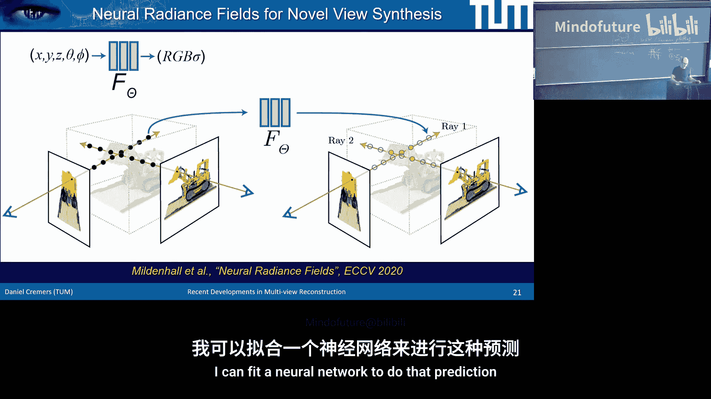

And then， you can see。How you can get very nice reconstructions。

 And they visualize it by moving the camera around virtually。

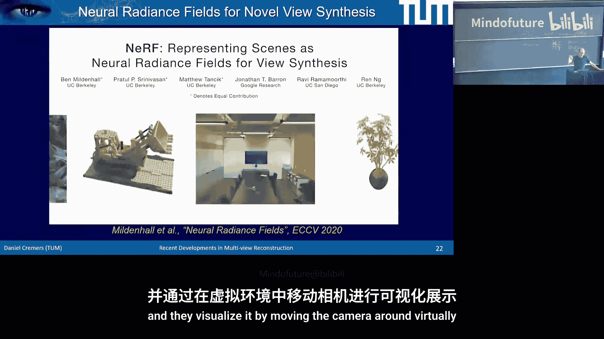

But you see， it's like hundreds of frames。And in comparison， as I mentioned。

 the rope jumping girl example that I showed was done with 16 cameras only。

I think nerves do not work with such few cameras。 You really need more cameras。

 This is one of the big shortcomings of neural radiance fields。And also， they create novel views。

 They don't show you the actual surface geometry that's being。

That there is no explicit surface geometry in the first place。

 It really models the light along rays and what color would you expect by integrating this up along the radiance field。

And then you train a neural network to actually， you know， using a lot of training data to。

 to predict the color and。

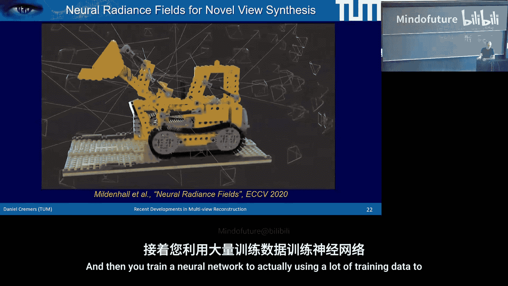

That you see of a given voxel from a given vantage point。

This is work 2019 by Vincent Ititzman is actually a bachelor student of mine who did baseline work。

 he's now a professor at MIT。And this is the neural radiance field。 And。

 and the argument of this paper is to show that they can do better。

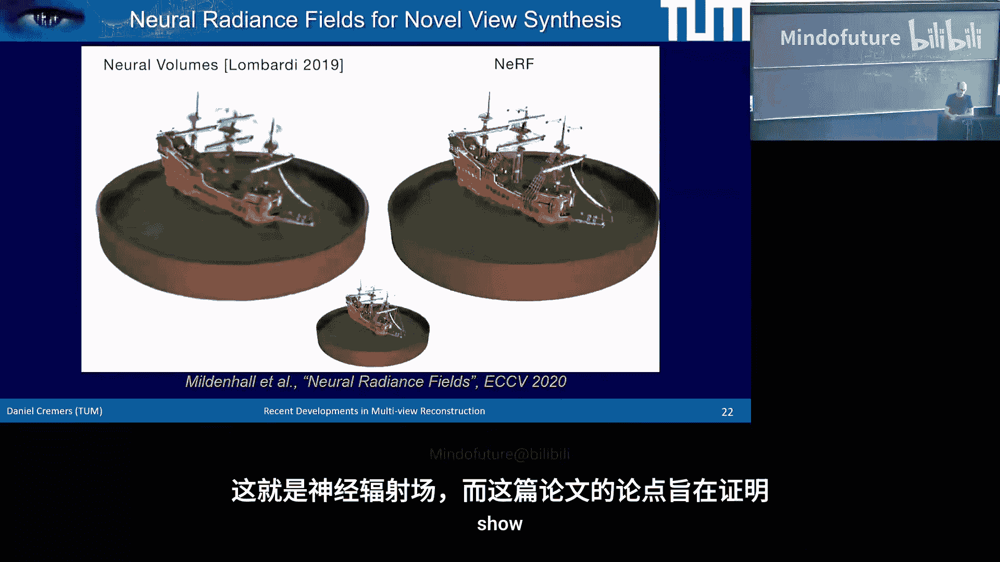

But you can see in the comparison， there is a whole zoo of neural approaches that people have proposed neural volumes。

 etc。

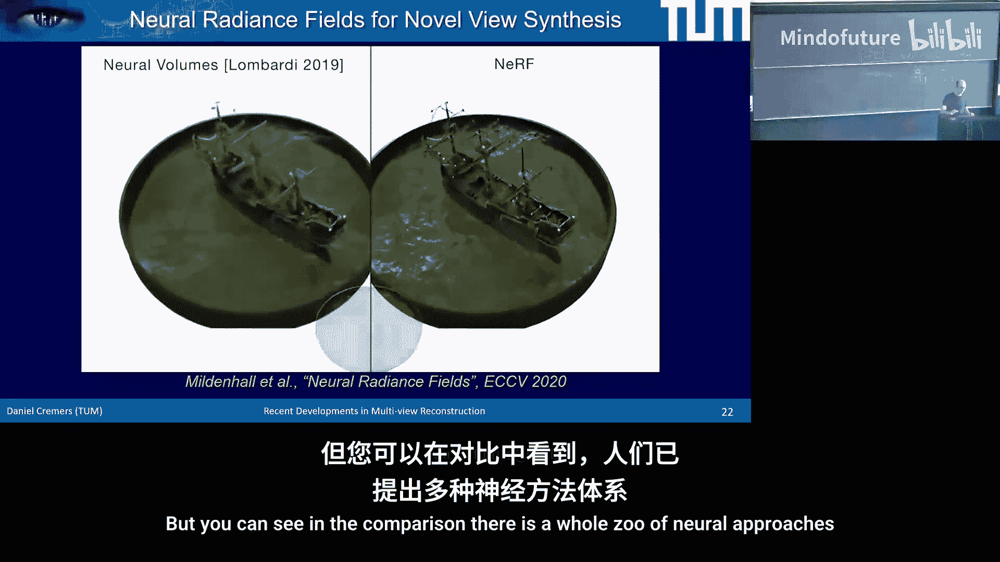

To do this， to solve this challenge。You can now one of the key drawbacks of nerves is that they are trained per instance right so you have an object。

 you take 100 images and then you train a neural network to predict what color do I see of a given voxel from a given angle。

😔，And its， it does a very clever kind of interpolation in the space of light fields， if you would。嗯。

But the key problem is that this neural network is trained per scene。

 and there is nothing it learns that would apply to a novel scene。

Meaning if you get a new object with new images， you have to train a new nerve from scratch。

 So even though it's a learning based approach， it's not like in the classical sense。

 learning something from examples that would then apply in a new setting。No， you have to just。

 so it's really just a function fitting to estimate this light field。

Whereas what you can do and this is what we set out to do in this work called Behind the scenes。

 we can train something like a density field in an egocentric perspective。

 and we can train it in a way that it generalizes to new environments。And so the way this works。

 it's a little bit inspired by neural radiance fields in that we all also use these rays and we try to estimate the density along the ray。

 the material density。And but the nice thing of this approach is it is trained on training data in a self supervised way。

 and you can be applied to new test data， and then you can predict the 3D world from a single image。

So it's single view reconstruction， and we use density fields， and we can train it。

 So how do we train it Well， we use consecutive images from a video。To。

 to figure out what the colors are in different positions and to determine the density that would predict this image。

And once we then apply it， we can apply it to a new image and it will predict the density。

 meaning for every pixel along this way， it will tell us not only where is the object at what distance that would be depth prediction。

 but we also predicts where does the object end something that we as humans can do if I see a car。

 I can not only tell you how far the cars but I can also tell you how big is the car because I know the car I've seen cars before。

 And if you can see behind the car， that's why we call this behind the scenes in the training data。

 you can learn from experience how big objects are typically。

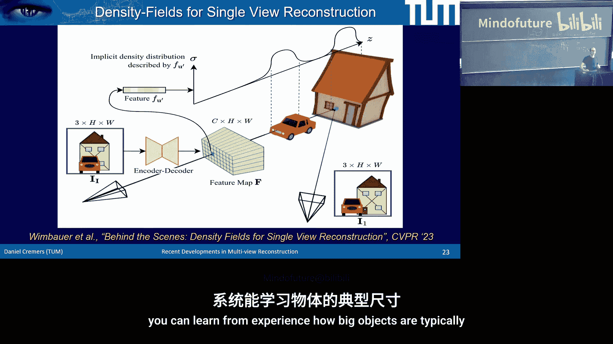

And so as a result， this is just frame by frame applying this method。On the top。

 you see the input image that goes into it always just one image。 On the bottom。

 you see the predictions。 And you see it shows where it ends compared to depths prediction networks that don't see the end of things。

 Our method can see the end。 Here' is a monods。 It shows you where things are， but。

There is only one dips per ray， whereas we， for the ray， have a whole density。

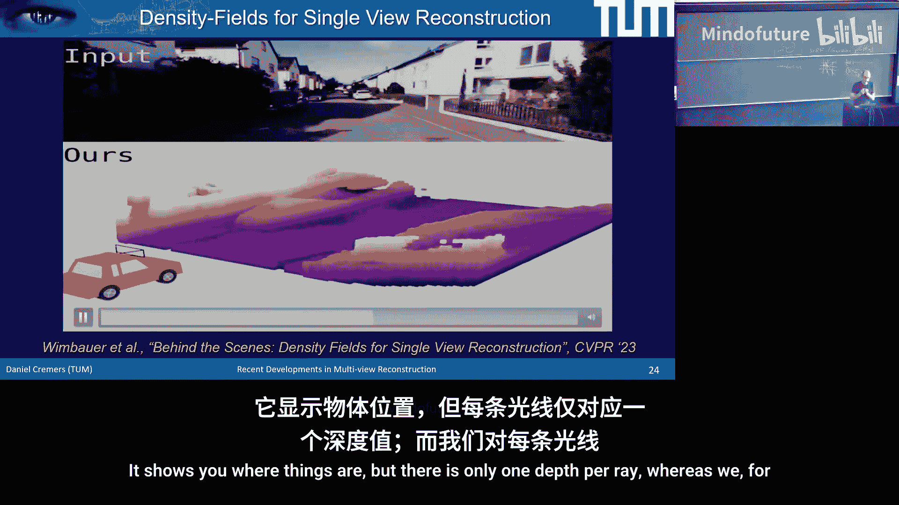

And once we binize threshold this density， we can give these 3D reconstructions that trigger it。

 even in a completely 90 degree view， you can see a fairly pleasing。

 slightly maybe overs reconstruction of the world。And once you have that and the density。

 you can do much like in nerves， you can do novel views synthesis。

 and then you get very pleasing novel views， as you see here from different vantage points。

And then you can ask， does this work only on self driving， the answer is no。

 so we can also show it works on random other environments。

 indoor or outdoor environments where we can do density predictions that give us 3D and we can generate novel views。

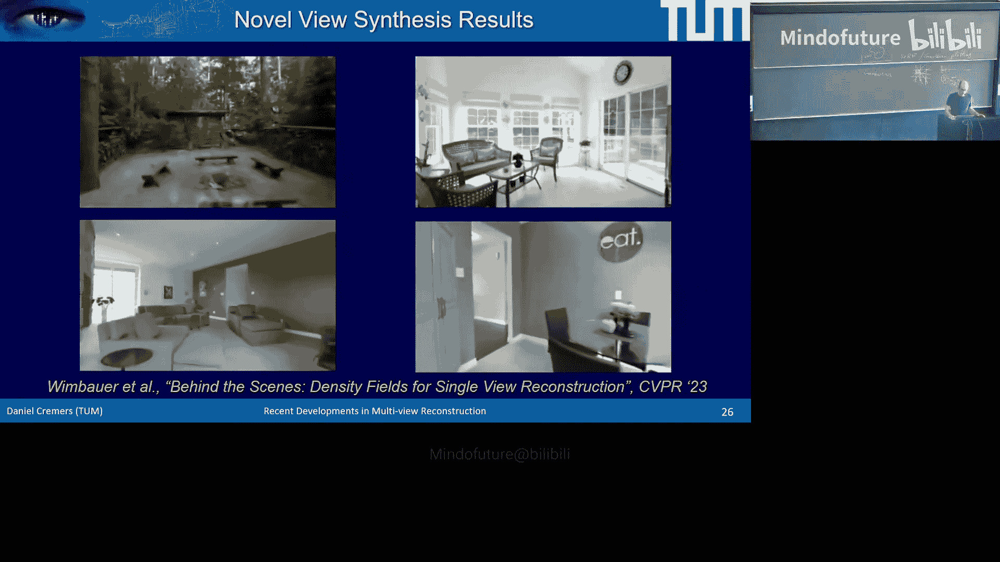

Maybe something that you'll hear more about tomorrow as well。

 according to plan is you can go further and do what's called semantic scene completion so you can take a color image and you can take a dips either from a dipPS prediction network or from a lighter scanner doesn't matter and then you can complete the scene。

So，That means you get a semantic field from a single image。 That's the idea。

 Just the image and the depths。 you get kind of a 3D semantic。Decomposition。

 and the key novelty in our case is that we can train it with only 2D losses。

 so we don't need a ground truth on 3D semantics。

And then we can generate semantically labeled 3D worlds， all computed from a single image and tips。

And here you can see the drivable area， the cars。And it's more accurate。 This is the ground truth。

 And you can see we actually have a better reconstruction。

 even compared to ground truth or a lot of other networks。Very often。

 one issue with training data is that ground truth in our world is practically never perfect。

And it's often， we often see what we just saw is that our reconstructions are actually more accurate than what is considered the ground truth for the given problem。

😔，Allright， I think in the interest of time， I'll stop here today。

 as I said tomorrow we'll get some research presentations from three of our students who will present what they're currently working on。

 Thank you very much and by the way next Wednesday there is no class because next Wednesday I'm organizing the Munich AI Day which is the annual AI event in Munich organized by the Munich Center for Machine learning that I'm running and so we have a lot of talks and keynote talks running all day pretty much and so there will be no class next Wednesday and tomorrow we'll have research presentations。

A good question。 Maybe you can go online if you look for the maybe the best look for the Munich AI Day。

A I day。There may be a way to register online。 Im I'm not sure myself how this how this works exactly。

 but do try to get in， might be exciting to get a glimpse into what's happening in AI。

 in Munich and the world。 So we have keynote speakers coming from Cambridge and many other places。

 So it should be quite exciting。

Thank you。