# 【慕尼黑工业大学】多视角几何 ｜ Multi View Geometry 2025 p21 P21_讲座_17_多视图重建的最新进展_第7部分 -BV1KgZEBrEXV_p21-

Okay welcome to class， I apologize upfront there was some confusion as to whether there would be a lecture today or not we first announced there wouldn't but actually I am here and I'm happy to give the lecture yesterday I was not here we were in downtown for the Munich AI day。

 that was a big success， a lot of young people， a lot things happening in the Munich ecosystem and the aim of that Munich AI Day is to showcase a little bit what's happening in the field of AI in Munich。

And I'm one of the directors of the Munich Center for Machine Learn。

 and this is one of six national AI Compnce centers and we're trying to bundle all the activities in AI that are happening in Munich and so there's at this point over 50 professors both from ToM and from LMU who are part of this Munich Center for Maine learning。

And lots of things happening， and so this was a great event we had yesterday。But back to the lecture。

 I think I left off with learning based so that this is the last chapter of the class and you might be wondering what's coming next because there' are still a few weeks of lectures。

 I should say I was a little bit faster this semester than the last semester， I think as I mentioned。

 it's partially because I did cut some material compared to the past。

 some stuff that I found a little bit outdated or obsolete or let's say。

 in a way theoretical that it doesn't really get applied much。

And so I cut some material and in turn what I'm bringing in now is more things on recent developments。

 so I expanded this last part on recent developments and what we'll showcase in the next two weeks is research activities that are happening in 3D computer vision。

And this should be of interest to many of you because it shows you first of all what's happening and secondly。

 it may offer you some possibilities for you know following up with a master thesis or something like that if you see topics that you find interesting。

 I deliberately decided to bring some of the young talents here， also last week already。

 but in the coming weeks as well so that you can see what they're doing and maybe even directly connect and hook up and see if there is a possibility to do a master thesis in this or that area。

There is a lot of things happening。 someone was saying， is 3D computer vision and slam still active。

 Yes， it is active more than ever actually。I would say if you look at the big conference CVPR。

 half of the best paper awards this year went to topics in the area of s。

 camera based reconstruction 3D computer vision。And part of that is that computer vision has many facets recognizing things in images。

 et， but there are two developments first of all， deep networks have revolutionized the field of computer vision for the last more than a decade and by now all the classical problems detecting objects and images。

 these are all solved in a way， obviously you can still do better。

 but people have shown with suitably trained neural networks even in 2012 they could get amazing performance on detecting objects。

To date， you know， the reconstruction of the 3D world with neural networks is still to some extent an open challenge。

 and that's what a lot of people are turning to。At the same time with the technologies that my lab and other labs around the globe have been developing。

 we're now in a time where we can reconstruct the 3D world from a moving camera with fairly decent precision and robustness。

And that paves the way for computer vision to move away from understanding images as we have been doing for decades to understanding the 3D world that we see in these images and that's what you really want if you have a humanoid robot that moves around the world or if you have a self-driving car。

 you don't care about what's in the image， you care about what's in front of the car in that 3D world。

 you need to understand things in 3D not in the image。

 if I say there is a you know a person in the image， that's great。

 but the car needs to know where is that person in the 3D world。

 how far is it etc where is it moving so you need to get understanding of things in the world。

And move away from just understanding the 2D image that the camera generates to understanding the 3D world that you move around in。

And so this is where things are hitting and with the 3D reconstruction stuff that we and others have been doing。

 we're paving the way for this to happen。So here's one such development work this actually was a master thesis as well。

 you know just to give you an example some of the things you can do well was it a master thesis I think it was before the master thesis I don't know it was a project that Felix did It's called Monre it built up on things we'd done before of tracking cameras with suitably trained deep networks but then going all the way to can we predict the dense world and it had two components one that aggregates images you know across time and checks for creates what's called a cost volume so you warp all the images and then based on the estimated camera motion and then you know you can you can tell how far things are from the camera based on the disparity that you see。

And you can assign different depths values that you know。

 the depths that would make the colors consistent， and so this brightness consistency is encoded in this cost volume。

And then you can find the right depth with a trained neural network。😔。

And you can also train based on you know color discrepancy。

 which objects do not follow the camera movement， so you have an object in 3D space。

 you have an estimated camera movement if you project in and back out to the other image if the colors don't coincide。

It is likely because the object moved and so you can identify independently moving object like in this example。

 the car here， and then you can filter them out。And you can then generate a dip that doesn't contain the moving object。

Because if otherwise if you aggregate depth information and objects moved then you can imagine the object will get smeared out over the 3D world。

 time one is here， time two is there， time three is there。

 what do you expect it's going you know if its kind of sums it up， there are two ways to go about it。

 one way is what we did here is you just ignore the moving object and filter it out。

And the next way is we're going to talk about that。

 and this is what's coming is that you start capturing not just the static 3D world。

 but also the moving objects and their motion and the 3D structure to go towards what's called dynamic reconstruction。

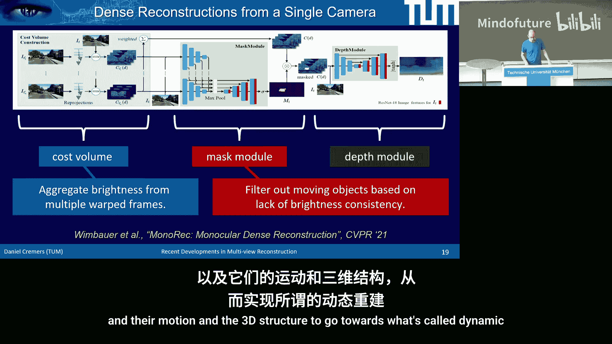

And this is one big challenge， so here you see the first part。

 this is a reconstruction of the world obtained from just one single camera driving through a world and whatever is moving is being filtered out and we have comparisons not in this video but in others where we show before the mask module and after and you just don't see the spurus blurred out objects anymore。

But it's a static world that this algorithm monoic generates。

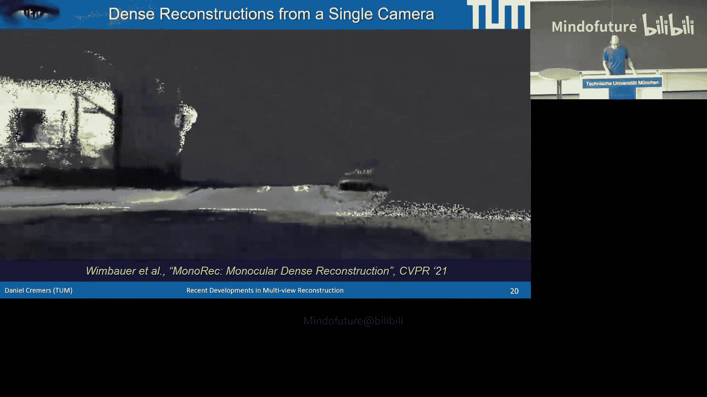

And the question is， how can we then go further， right？

How can we capture the dynamics of the world as well， not just ignore them， filter them out。

 but actually try to capture them more explicitly？😔，Maybe a word there's a lot of things happening。

 A big splash is is this work It's by Ben Mildenha and collaborators。

 It's called Neural Radiance Fields， who has heard of that。

Most people have heard of nerves or neural radiance fields they've become extremely popular。

 so this is often people con that they say neural radiance fields is a way to do 3D reconstruction。

 not really the camera pose estimation you have to do a 3D reconstruction algorithm upfront。

 but once you have the locations and positions of cameras。

 then what you can do and this is what nerves do is they allow to encode the light field that you get in a neural representation。

 so they train a neural network an MLP basically to predict for every voxel。

 X Yz in every viewing direction theta and phi， the color in that voxel and the density material density。

And this is important if you have the density， you can integrate up along the visual rays to get the color that you would see from a certain vantage point。

And so this is capturing what's called the light field。

or the radiance field and that allows you and this is one thing they showed it。

 allows you very nicely to do novel view synthesis because once you have fit this neural network to the image data。

 typically you have like 1 hundred images all around。

 then you can in principle visualize the object from any vantage point。

What's interesting is this is very different from what I showed earlier in my presentations。

 you remember this rope jumping girl there we actually reconstructed the physical surface of the object and the color on the surface here。

 you don't ever reconstruct the physical object in an earth。

 you reconstruct the light field and this is different so if you were to ask where is really the object in an earth。

 it's not really explicitly represented anywhere。And this could be a downside because as a robot if you want to grab the object。

 you should know what its extensions are， what the object boundaries is in an earth you continually beautiful novel views。

😊，But it's a very implicit representation of the 3D world。

It's not very explicit and there's obviously tons of follow up works that try to tackle these challenges。

But tape generates nice novel views， so this is a work that really emerged in the graphics。

A new method for representing complex scenes。Let me switch off the audio track。

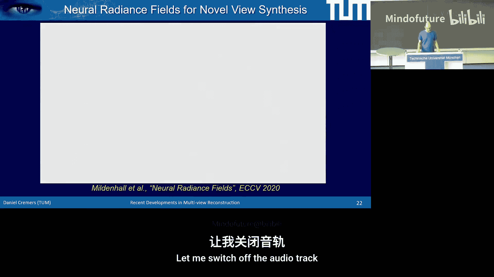

So you see you have to have about 100 cameras， this is another difference。

 the baseline nerve doesn't work like in the rope jumping girl we had 16 cameras only that worked but nerves would not work on a 16 camera setup。

 theres now versions that hopefully work with fewer images but the baseline version really needed a fairly dense sampling of space and if you want to do that for actions that's very costly and tedious to generate multiview video from hundreds of cameras。

But here's the idea that you have these rays of light and that you can model that integration process along the array。

 how the radiance field so these densities get integrated。

 and then you use all this data that you have， all the images to train this light field representation。

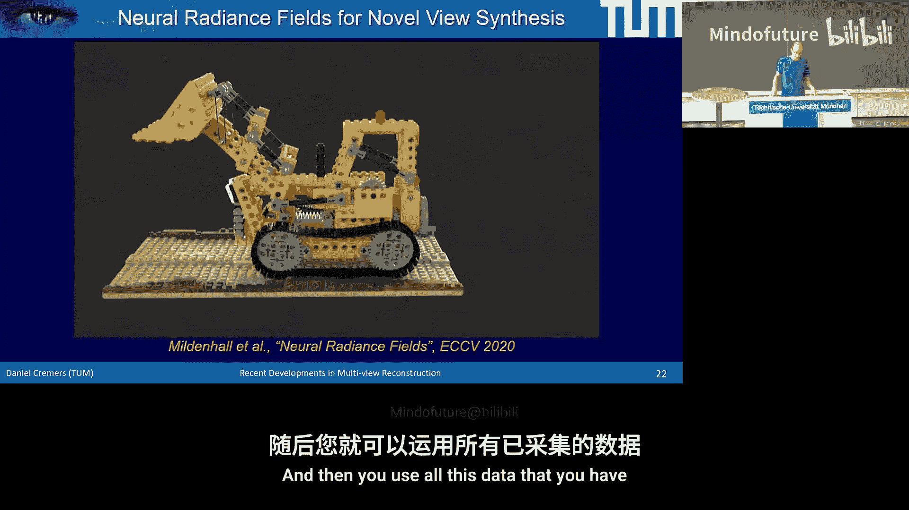

And then you can generate a lot of nice results， this is comparisons to work by Vincent Siitzman。

 a former student of mine who is now a professor at MIT。

And here's comparisons and the nerve ends up being more accurate than a lots of baseline methods。😔。

It's what you usually do when you publish a paper， you compare to baselines and hopefully can show that you get better results。

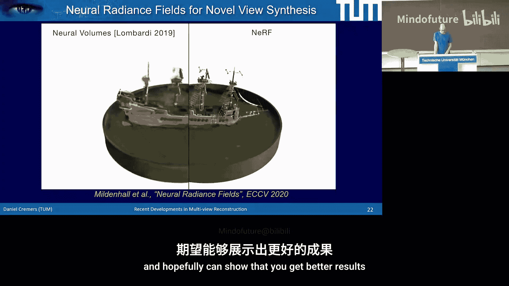

We adopted some of these ideas in a work that followed the monore， this is called Behind the scenes。

 and here the idea that we adopt is this idea of a。

That you have a material density that you want to know whether voxels are filled or not if there is material。

 and we developed a method that we call behindhi the scenes and as the title indicates the idea is that you have just one single image and you want to predict a full blown 3D world。

And so along each ray， each pixel， you know there is a visual ray。

 we want to know what is the material density along this ray。

 so it is more than a depth prediction I talked about depth prediction with networks here we predict for each ray。

 not the depths but as you can see up here the entire density along this ray。

 so it tells us where does an object start， but it also tells us where it ends right。

Now you'd say how can you do that you only see the front of the car how do you know where it ends right Well you train it right much like humans you see a car you typically know at what distance the car is and you know it what distance the car ends even though you don't see the back of the car but you have knowledge about what cars look like and what we addressed in this work is to ask can we train a neural network to do the same to tell us how big are things in the 3D world where are they what is there extent just you know by training and so this is very different from nerves in the sense that this is a method which is really more in the traditional sense of learning that you learn something from data that you can use in a new scenario。

Nerfs are not that， even though there is a neural network in nerves， right， the nerves。

 they train a network for one single scene。Which means if you take a new object and a new camera set up and everything new。

You cannot recycle anything， you have to start from scratch and train the network for that one scene。

 and then you have a network that can represent the light field of the scene。But it doesn't。

 you know， it doesn't learn from experience in a way that it would use it later on。

 So it's a very different notion of learning。 It's more like fitting this function to a given data set。

The function that predicts the light field right and you so it's a neural encoding of that function。

 nothing more it there's nothing that it generalizes to new scenes。

 whereas here we can train and in fact， in a selfsupervised way， we just use the video。

 we use later images from the video to tell us， you know about what is the likely density along this way that would explain in all these images。

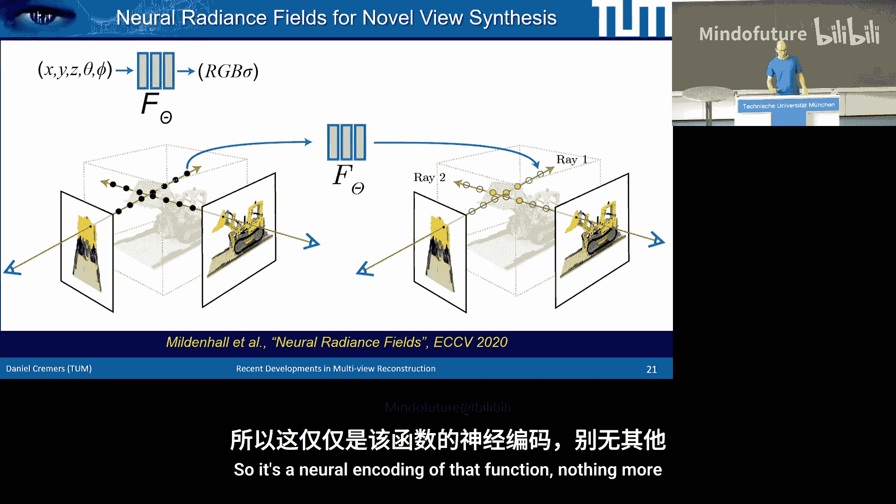

And then we can apply it and it can be applied really in a frame by frame based way。

 so this is a network that runs on a single image and predicts the density that you see on the bottom and if I stop this video here you see how we get these cars in the reconstruction and we get the front but we also get the back we can see you know where the car ends same here。

 you know we get these different cars here so this is you know quite impressive how much 3D you can get from just a single image。

In a method that is trained in a selfsupervised way and as you should see here applied to a completely new video in the test and compared to depths prediction。

 you know these are pixel nerve is kind of a variant of nerve or there's other methods like for example。

 there's one called monore monods or monodps is as the name indicates a depths prediction network so it will by definition only tell you where the object starts。

 it will not tell you and so for depths prediction networks， they don't have a full 3D。

 often people confuse depths prediction and 3D depths prediction is often in the literature called 2。

5D。That's often the term that people assign to Debury。 So there is something 3D。

 but only the beginning of the object， not the end。And 2。5 d means like that for every。

 if this is your image here and you're looking at the scene from here。

 then for every pixel it tells you where is the first object。

 it doesn't give you more depth values down the way。

So only the very first object in the scene will define the dips and so you get what's often called a 2。

5 d reconstruction of the world。The front of things， but if you compare now with our method。

 you see in comparison， the proposed behind the scenes。

 it actually tells you also where the object ends。And what's nice is you can see these reconstructions are fairly consistent over time。

 even though this is really frame by frame predictions。

 right there is no temporal integration that we do。

 but the fact that there is very little jitter over time tells you that the predictions are fairly consistent。

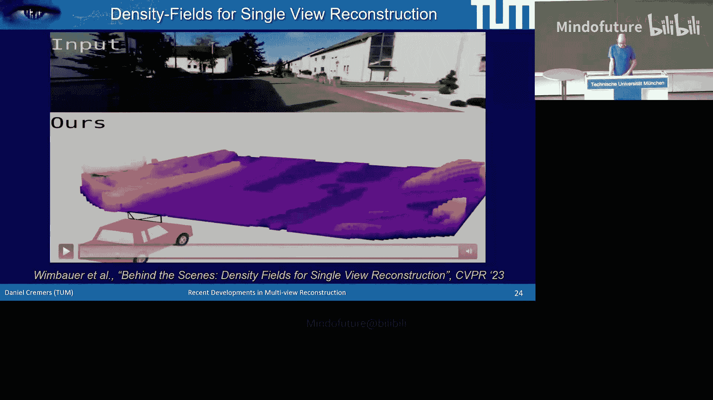

And then obviously once you have these densities， you can also create novel views like you see here。

 much like in the nerve setting， we can say what would the scene look like if we pan around a little bit right and left and we get fairly plausible kind of。

Novel views here。The question is very often in applications people love these novel views and nerves have a huge splash but the question is what are you really out for if youre in graphics then you care about having glossy。

 high resolution novel views， you care about being able to capture the reflection properties of materials。

But if you want to do self driving， then it's not the beauty of the views。

 but then you have to know where are the objects in 3D， how far are they， where do they start。

 where do they end all of that。And I think this work offers that more directly。

 we actually get a 3D representation of the world。😔。

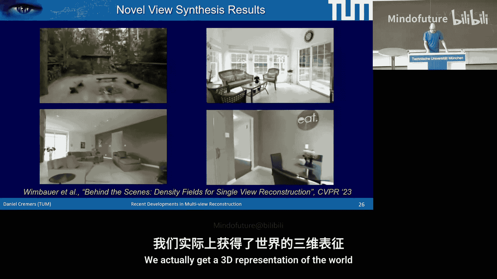

And another thing you care about in the context of self-driving is understanding the semantics。

 what am I looking at and as I said， we are in a time where everything moves from semantic analysis of images to actually understanding the 3D world and there is this work its line of work is called semantic scene completion so this is a challenge where what you're giving is a color image and then some depth map。

Spae De map。The depths map with spae may be given by a lidar or some stereo system or whatever。

 or some sM system can give you the depths like I just showed you and now the challenge is can we get a complete geometric reconstruction and the semantics in 3D？

And this is called semantic scene completion， and this is something that we developed and here is you know the method that we call S4C。

😔。

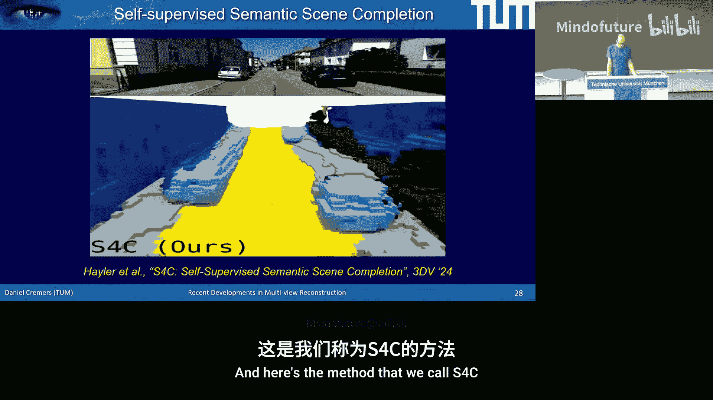

And as you can see， we can get these dense reconstructions of the world。

 but also the semantics of what's the drivable area， what are cars。

 and then again you compare to you see the ground truth is not actually very good and some baseline methods really fail to see the objects properly。

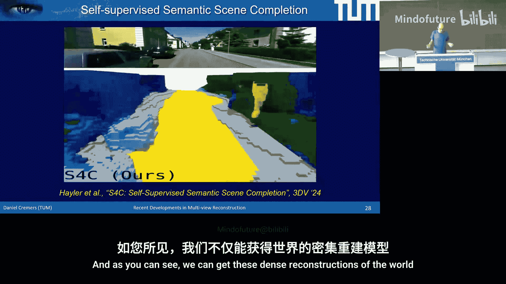

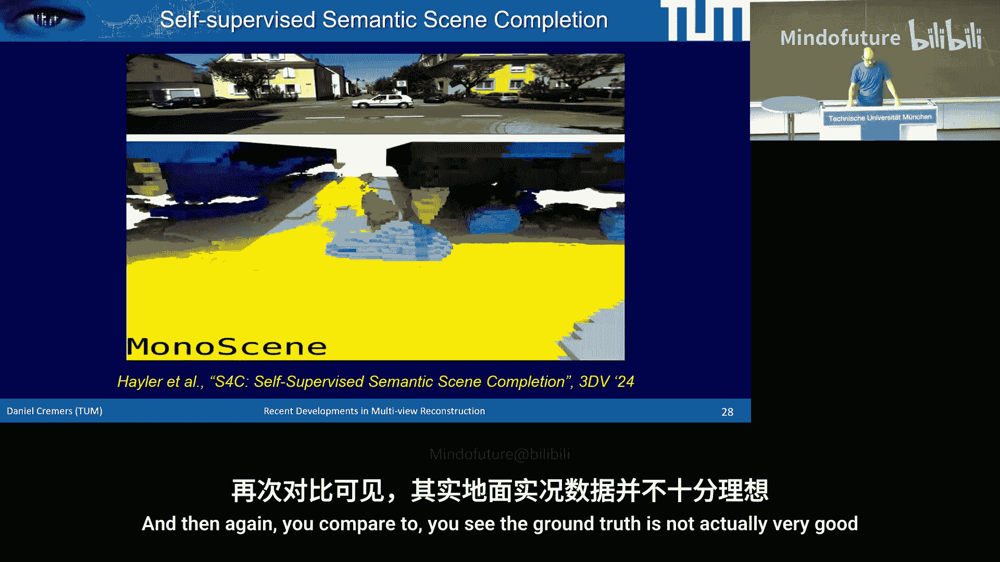

And here's our approach。😔。

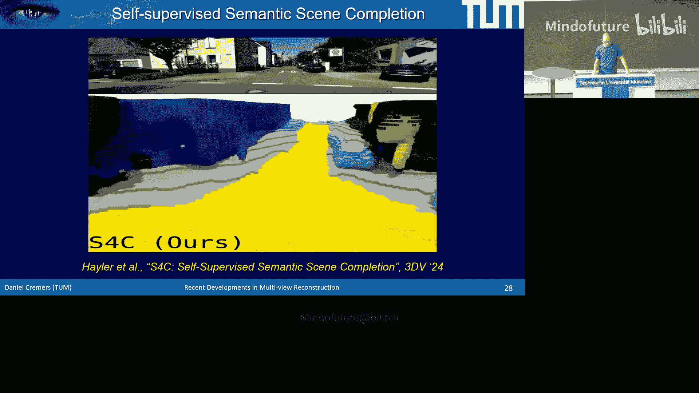

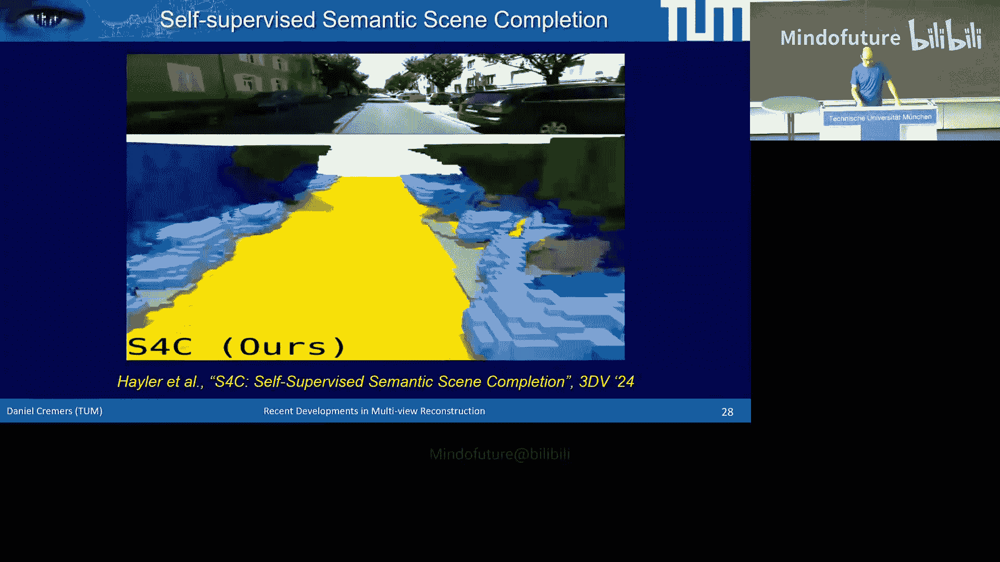

So this shows you a little bit how we can get a dense 3D semantic understanding of the world。

From moving cameras。

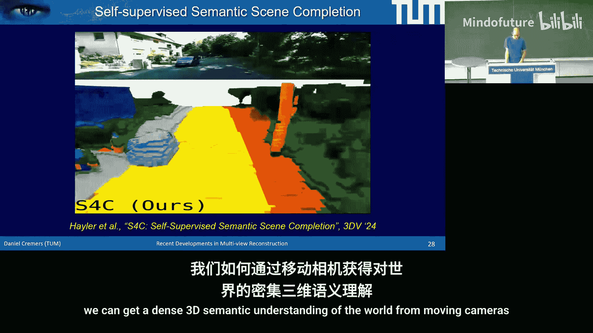

A little bit more about nerves， they made a huge splash。

 there is an alternative that people have been advocating and in fact is very old。

 it goes back to the early 90s by a work by Lee Allen Westover and others。

It's called Gaussian splating and so the idea is that you represent things with Gaussians in 3D space and then the splating is this operation of projecting that Gaussian into individual images and this is an operation that can be computed extremely fast。

Using GPUs and other techniques and so often Gaussian splating is being advocated as an alternative to neural radiance fields now if you ask me what is better nerves are Gaussian splaing。

It's hard to say it's a constant battle。 And you know， with every new， you know。

 there's these two rivaling communities competing。 you know。

 I'm typically not a fan of advocating one specific method， as you know。

 I think it depends on what you want， right。If you want speed， if you want accuracy。

 if you want to you know nice novel views， if you want to capture the material properties。

 or if you want a really more physical understanding of the world。

 and then often Gaussian's platings are better on that， but maybe the novel views don't look as nice。

 and then theres you know there's different metrics that you can look at。

 and this is a slide by John Barron，And this slide on the on the X axis， you have。The quality。

 so the PNR higher is better。 So how accurately can we generate the novel view and on the Y axis。

 you have the performance。How many frames per second， et cetera， we can process， so how fast。😔。

Higher is obviously better and what you see and then what's nice is he kind of drew these lines that correspond to the different years in research。

 2021， 22， 23 and on and what you observe is that things are moving to the top right corner meaning that。

Methods both get more accurate in terms of PNR values， but they also tend to get faster。

Now why was he showing this plot in this you know in this metrics。

 I think this was the work that advocated the zip nerve that you see on the right so you know what metrics you use and how you displays things often depends on what is the message you want to bring across and by default researchers obviously want to bring across that their method is the best and this is a very great example John is an amazing researcher but also very talented at。

Selling his research and this is a very good example， you know。

 how do you set the metrics so that your work really shines？

And this is something that I try to teach all my students how to do this， right？

So that whatever you developed， really that you bring out the strengths of your method。

And if you do a different plot with different metrics。

 you would get a completely different view of things。

 but the whole point is to choose the right way of broadcasting and sending a message。

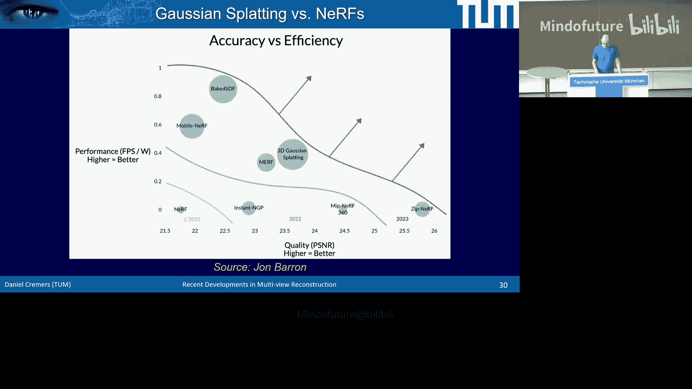

As I said， this is about reconstruction and often static worlds。

 but there are a lot of challenges in fact， that we live in a dynamic world where the camera moves。

 but typically objects also move。And sometimes in videos like this one。

 the moving object can be very large and it can be very complex in terms of the movements it does。

 and there can be multiple moving objects at the same time， right？

AndThe next challenge is that we have devised powerful reconstruction algorithms。

 but very often they work。In the lab。Or on a camera。

 that is your camera right because you develop the algorithm， you can calibrate the camera。

 you can do a photometric calibration， you can compute the intrinsics。

 you can do all sorts of things and you can control it in your demo and make the kinds of movements that you know your algorithm can handle。

A classical way to make lots of algorithms fail if you get access to the camera is just shake it like that real quick visual slam doesn't like that because you can imagine if you have a scene far away and you shake the camera。

 then you have a massive movement of structures from one frame to the next in a way that finding correspondence may not even be possible。

 right？😊，And most visual sa algorithms， you can get them to fail just by， you know。

Dropping the camera real quick， right。There was a time when。

 when they said there are three levels of performance of Islam and reconstruction algorithm。

The first one。Is。That the developer can demote。With his own camera， in his own hand。

The second one is that an expert can demo it， even if they didn't develop it with the right camera in their hand。

 and the third level of performance is if a random user with a random camera can use it。

And we're not quite there yet。But this is the goal， right。

 that you can download a video from YouTube， something like that。 random video and make it 3D。系。

And this is the big challenge that a lot of people are focusing on now。 So， for example。

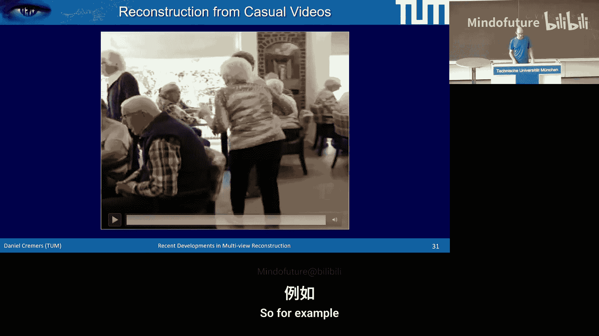

Just this year alone， 2025， there's been a surge of methods that do more or less that。

Methods called monster or megaam， or I think it's called。Catar are cuter。 I keep forgetting。

Andjo told me how to pronounce it。I think cuter， maybe。And then a liner。 and so as you can see。

 half of them appeared just at CBPR。 they year the big flagship conference。 and in fact。

 Megas was one of the paper award papers， right。They got an award。

 so they managed to devise a neural network， a feed forward network that can take these casual videos and create 3D and camera motion。

The key drawback with all of these methods is， actually。

And that even though the results are impressive， they are often supervised。

 You need ground truth for everything to train the network。

And this is a challenge because we have endless data。 YouTube is full of videos， right。

 but there is no ground truth。Not about the camera， Not about the intrinsics， not about the 3D world。

 There is no ground truth about anything， right。If you need ground truth。

 it means you have to do expensive data collection。

 and it means once you have a data set that collected invariably， it's limited。

 you will never have ground truth for all of YouTube。 It's just not scalable， right。

And then once you train on a certain data you get with a neural network， data set biases。

 it's going to work on that data， is it going to work on other data， maybe maybe not who knows right。

 and we all know it typically degrades once you transfer to different data。And then you can say， oh。

 I'm just going to simulate tons of data。 Yeah， good luck with that。

 but you'll have a sim to real gap because things that work in the simulation world don't work in the real world because the world is not a simulation。

😊，At least who knows， right。

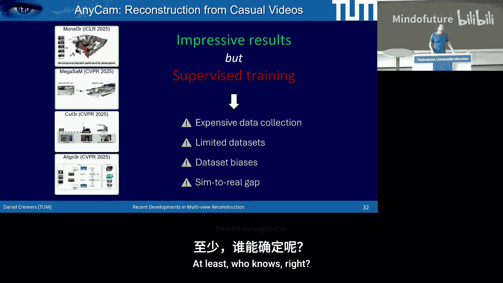

嗯。And so what we developed in parallel also at this CPR conference is a work that we called anyCm。

 again， Felix Wiimbaer is the lead author here。And it takes a casual video like the one on the net and it predicts dips optical flow and then all of this feeds into the anycam module and this anycam module is trained in a self-supervised way。

 meaning it doesn't need any additional ground truth so based on that input that's all it needs and then it can train in a self-supervised way。

 what's the idea well as always brightness consistency。

 can you you know generate an explanation can you generate camera poses。

 can you generate the intrinsics of the camera and even uncertainties is telling you which where the moving object right。

Can you do all of that in such a way that you can explain the brightness values in the video。

And we showed that you can do that and we showed with results like this one that it works really well。

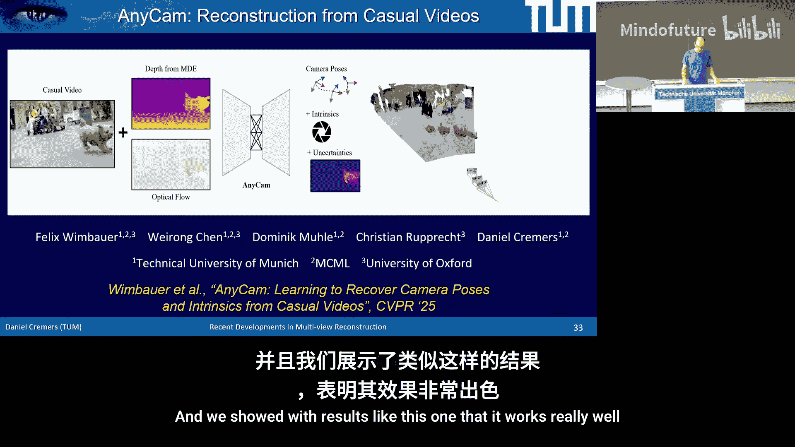

So this method in contrast to all the baselines I mentioned is selfsupervised。

 so all we need is tons of video and hey， that's what YouTube is there for right I mean there is so much video and so we took a lot of data sets。

Most of them are actually from YouTube， and all of them have no ground truth。

So it's data without ground truth。And we can train in a self-servised way and then for the video I started with。

 you can get these kinds of reconstructions where you see that in a pure feet forward network。

 we can estimate the movement of the camera， we can estimate the 3D structures of the world。

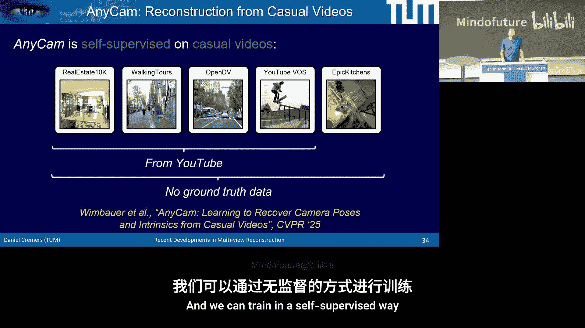

And obviously you can then go into checking you know how far does this work if you have a video like this one on the top left here where the camera pans around massively。

 it does a pretty much 180 degree rotation， right？

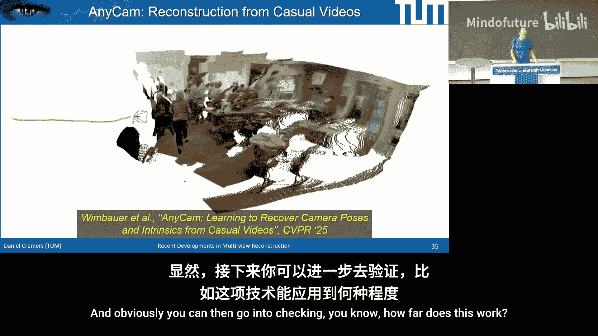

And then we try to visualize everything from a static viewpoint。

 you get what you see on the big screen here so you can capture the video and display it from a static perspective。

And as you can see is fairly good， it estimates also the trajectory of the camera here and the rotation of the camera。

It's not perfect， right？ So somehow the fences they go down with。

So but there's obviously still room for improvement， but you see where things are heading。

 where we can just take an off the shelf casual video and feed it into a feet forward network that is trained in a self-supervised way。

 and it generates the 3D world， the camera movement and everything。

And so I do hope that this is a step forward into being able to tap into all of YouTube and making it 3D。

I mentioned these reconstructions of the rope jumping girl。

One of the things that you find when you look at this work is you can ask yourself。

 how do we model time？Actions happen in time， right？ How do we model the evolution of shape in time。

 And what we did here is extremely naive。 It's just a little temporal smoothing。 In principle。

 we reconstruct this frame by frame independently。 And then we add a little bit temporal smoothing。

 saying each voxel， the occupancy shouldn't change too much over time。

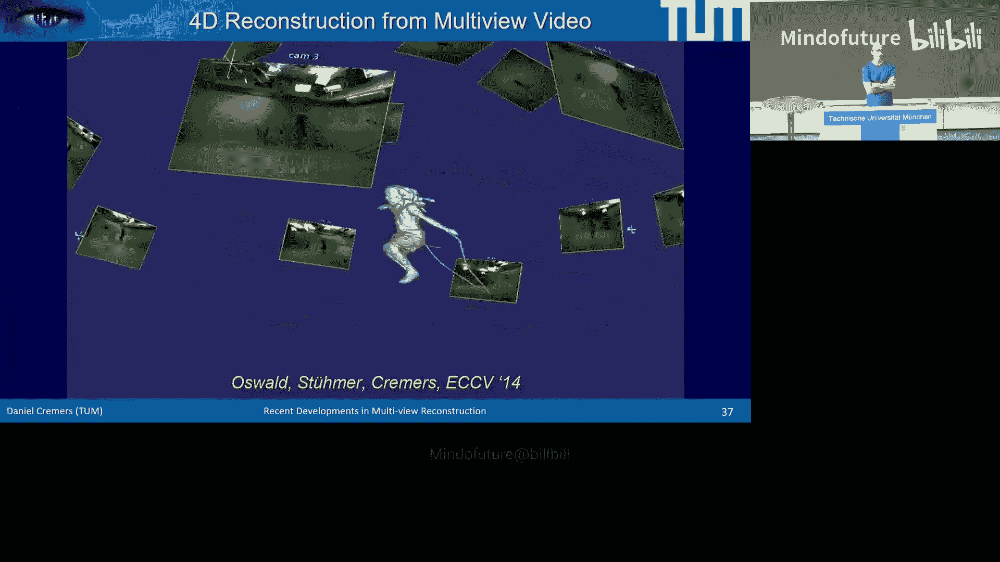

So in a way， this is a regularization。 It's called that， you know。

 acts a little bit like like putting everything into honey， right， It doesn't like things to change。

 right。I'm not sure this is for very fast movements。

 so we just added a little bit otherwise we would immediately lose the rope here right and we wanted to make sure the rope is recovered。

And then if you think about it and I spend years looking at this video， I've liked it。

 and often this is a perfect example how research results inspire the next research。

 I looked at it and I thought， well， what one should really do is bring in the knowledge about the physics of this world we all know how things move。

 they follow the Newtonian equations of motion right， you have masses， you have forces。

 you have accelerations， can we estimate these in a way that we can in a way even simulate the action。

😊，If we were able to do that， then we could get away with much less data。And whatever we don't see。

 we simulate based on a physical model of the world。

And this is the big differentiator between human 3D and Ma 3D。 Human can do that。😊，For example。

If I were to throw you a tennis ball， you could catch it。Well， maybe not all of you， but you know。

 and some people can do better than others right and this is by the way。

 something I've realized over the years， humanity is extremely fascinated with that capacity。 I mean。

 why would people spend half of their life watching soccer games and tennis games and basketball games why Because you want to see what the human brain can do in terms of。

😊，You know， understanding the dynamics of the world and anticipating things and predicting things。

 And I I was mesmerized when I was a kid， I spent half my youth playing different ball games， soccer。

 basketball， volleyball， whatever， right。 And if someone throws you a tennis ball， you can catch it。

😊，Many times， right？And then I try this， even once you close your eyes halfway through the trajectory。

 you can still 50， 50， let's say， catch it。And when that happened， I thought， what's going on。

 what is my brain doing when I'm doing that， right， I it actually computing the full trajectory。

 and mind you， you have to predict where the ball hits and you have to predict when exactly it hits。

 You can't close your eyes and wait for the ball to hit your hand and then close it。 That's too late。

 You need to know the exact time of impact and location of impact。

From a fraction of a second of the trajectory， the brain somehow recovers everything else。

Infrions of a second。How it does that is a complete mystery to me。But。

But there must be a way to reproduce that in a machine。

The capacity to understand not just the 3D world， but also the physics that govern it。

And so this is a project and much like I'm standing here in this class。

 I gave this lecture years back and I said， this is the challenge that you need to tackle。

 how can we infer the physics of the world from video？😊，And then I said。

 if someone wants to try this in a master thesis， let me know。

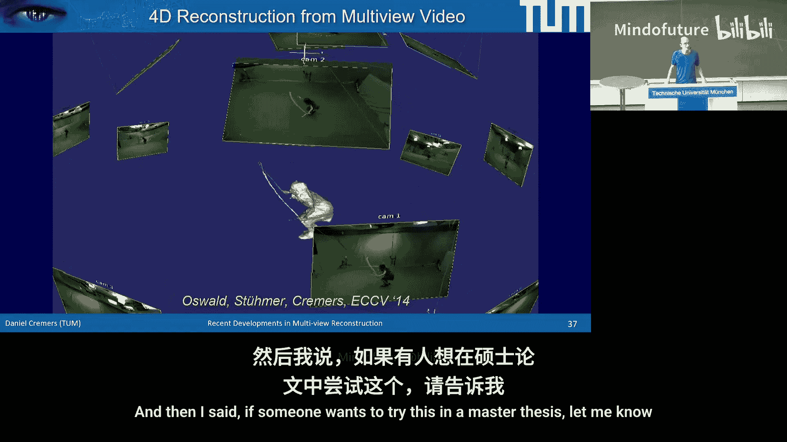

And there was a very talented student who was much like you sitting there attending my lecture。

 Sebastian vice。 And after class， he came up to me and said，That's exactly what I'd like to tackle。

And so we tackled it in this paper that was published in CVPR 2020。

 The idea is that you are getting a video。And to make things a little simpler。

 this is often what you need to do in in research。In order you know to make things solvable。

 you need to simplify it a little bit and so I suggested let's simplify it。

 let's not start from a random color camera， but let's take a dip senting camera so a camera that can measure dips and this is what goes into the video。

 these dip measurements over time that you see on the left side。

And then we applied a full blown numerical simulation of a deformable object。

And the aim was to take a deformable object and deform it physically to match the observations。

 so we really simulate the physics of a deformable object to match the observations that we have。

And then the idea is that you optimize the physical parameters of your simulation。

To maximize the consistency with the observation。And so here is an experiment that we did with simulated data often you start with simulations because there you can control things there you know the ground truth of the physical parameters you know if I take a real teddy bear and ask what is its elasticity well I don't know right I don't have the ground truth but in a simulation you can control everything you can set the parameters and then validate as your algorithm is it able just from looking at this video to infer the right parameters and so what you see on the left is the ground truth。

And on the right， in the middle is the initial simulation。

 and on the right is the optimized simulation。And so you see the initial simulation。

 we give it the right object but then the object is much more rigid。

 and so it oscillates much faster， whereas once we optimize the parameters of elasticity， etc。😊。

And then we can make sure that it coincides with what we see。

And so the reconstructed action is more consistent with the ground truth。

Thenhan the initial physical simulation。And so here you see very nicely how by you know optimizing the parameters of the simulation。

 numerically you can make it consistent。 That's obviously a simulated setting。

 It was much more challenging to get it to work on real world data。

 So here's the input video of a teddy bear falling down the initial configuration is again an object that is fairly rigid and bounces a lot。

 This is the optimized reconstruction。 It's much more kind of softer and bounces less than the initial one。

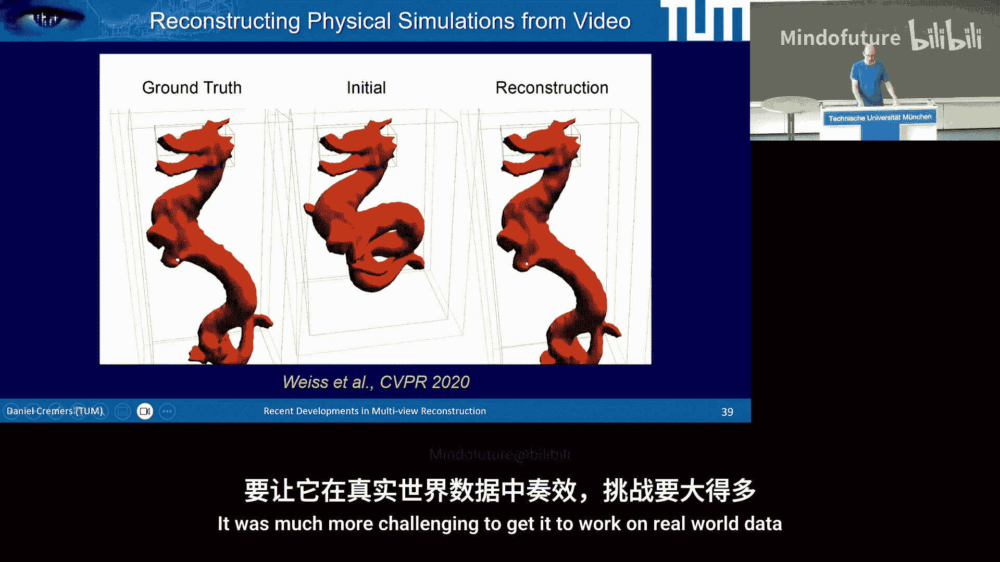

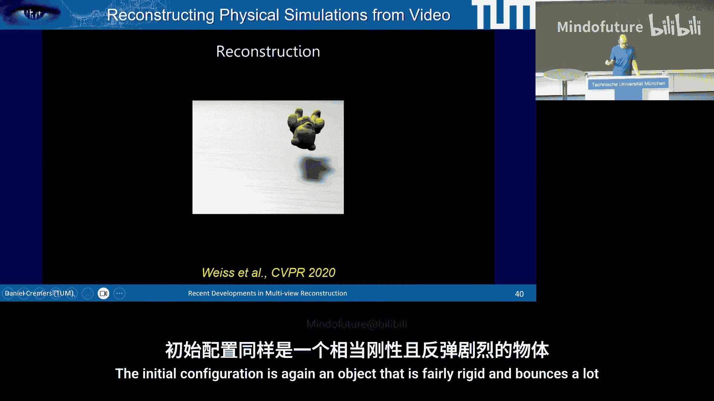

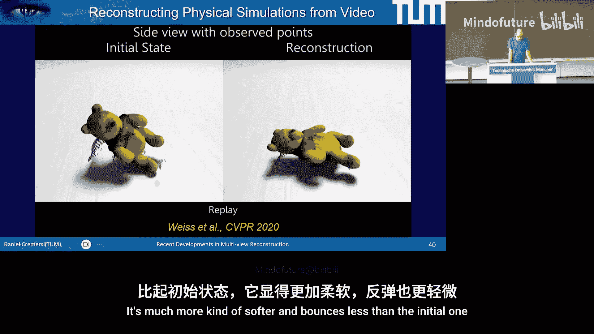

And so you can really have a side by side comparison left is the input video and middle and right are physical simulations。

 the middle one is just a base simulation with fixed physical parameters and the right side is this optimized simulation。

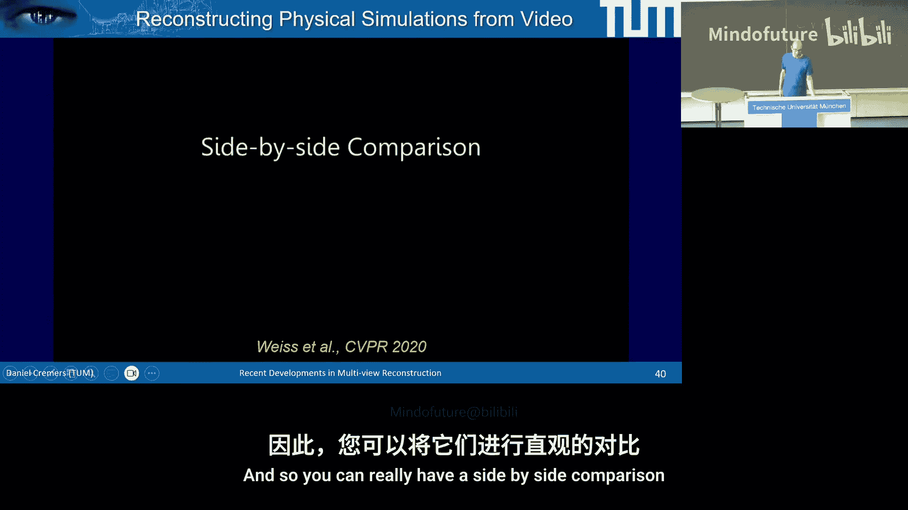

And so it goes to show that， yes， we can infer the physics of the world from video。

A little bit more about modeling the dynamics of things， reconstruction。

 it's often called 4D reconstruction， and the typical challenge is that we don't see things know from all vantage points over all time points and so the challenge is how do we model the deformation of objects in time。

And so what we developed， this is very recent work， it's called4Dform and appeared at CVPR as well。

 Lusang， she's the lead author on this。And it takes sparse input data， for example。

 point clouds or kine scans for two time steps where once the backpack is down once it's on the back and it creates as you can see a family of interpolations that allow to model the temporal evolution this is something we've been doing for years how to model temporal evolutions of shapes here's an example from 2019 where left and right you have two 3D objects in gray and the purple shapes they are synthesized so we ask。

 can you find a family of shapes that allow to go from one to the other。

And then obviously there's infinitely many possibilities of shape families that would interpolate and the challenge is to find the most plausible one and here's the results。

 and so you can create a whole family of moving shapes from just two shapes。The two extreme shapes。

 either for this human or let's say， for this armadillo。

So the first and the last shape in the sequence are given and the intermediate shapes are created by this algorithm。

And as I said， this is what Lusang has been developing how to apply these kinds of deformation representations in a neural network based 4D reconstruction。

And so you get spae keyframes and you generate a family of plausible， intermediate shapes from it。

 thereby reconstructing actions of deformable shapes from video。

And the way she does that is she uses a level set based representation。

 I think I mentioned that briefly that you can use level set or implicit sine distance functions to represent this shape and its evolution over time。

And there is a so called level set equation that you can derive that tells you how the embedding function phi that defines the shape。

 how it evolves over time。According to some velocity field V。

And the key idea is that we can basically train a neural network to predict both the velocity and this embedding function so we have two networks。

 one predicts the embedding function is called the implicit net and one predicts the velocity。

 the velocity net and then we can bring in a lot of constraints that make sure that you know that they are compatible with this level set equation that couples the velocity and the implicit net that we have a matching loss that make sure that the initial and the final shape are well approximate。

 and then we can bring in physics physics about you know we want theformations that preserve the volume of the object。

 we want deformations that minimize stretching and shrinking and distortions right so we can add all these and then we can create with the feed forward neural network。

 we can feed in two shapes， the left and right。And it will create intermediate shapes。

 Our method is the one on the bottom here that gives much more plausible shape interpolation than existing methods。

Even for partial shapes， so shape analysis in itself is a fascinating topic。

 we have several PhD students working on this on how to analyze shape， how to interpolate shape。

Because we're getting to a time where we can capture the 3D structure of the world。

 and then we need to have algorithms can process 3D structures。

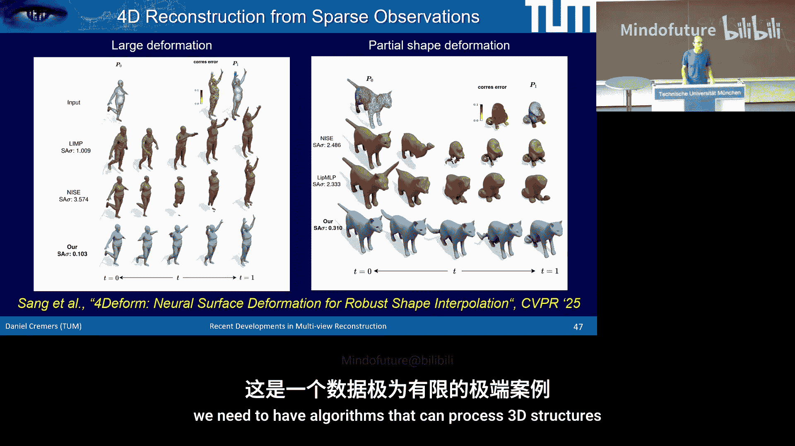

Here's a very extreme case of very limited data right so all I'm given is two input images of in this case。

 for example， a cat or some random object， and then you can ask。

 can I use generative AI techniques to create a 3D cat？😊。

That deforms over time in order to explain these two images。 so you know， at time1。

 the projection of the 3D shape should match image 1 at time T， it should match image 2。

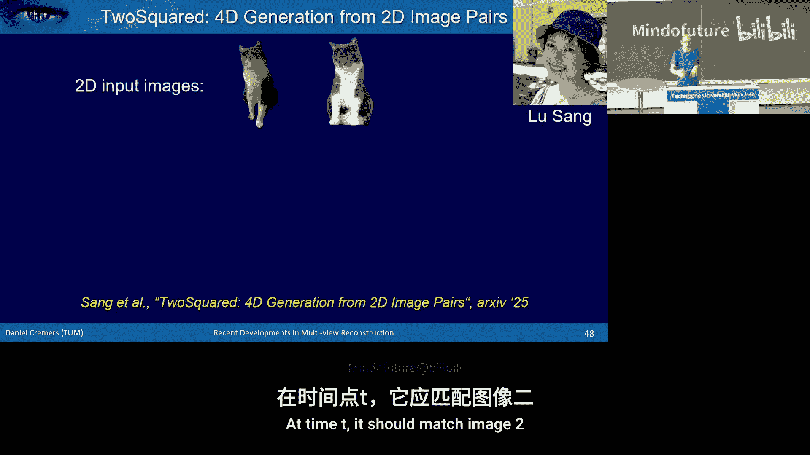

And here's what this algorithm does。 It creates a sitting 3D cat that basically moves the head down。

And that's fairly plausible。 And you get it from just two images。Here's another example same method。

 so we give it two images of a golfer， one with a club up， one with a club further down。

 and as you can see we can create a 3D golf player that moves the club。

 so this is how far we're getting in terms of generative AI and capturing deformable shapes over time。

So here's the input image， this is the 3D shape that we get generate from it from just one image and then we create this family of intermediate shapes that would allow it to predict the second image。

And so it goes to show that we can do 3D and 4D reconstruction from very little data by tapping into the power of neural networks and generative AI。

Now， if you look closely， you'll see， and I was quite disappointed at that what we use is we tap into a Gen AI that goes from an image to 3D。

 and it's very beautiful what you can do， but note。😊，That the projections don't match。

 there is a discrepancy。So this is a typical issue with generative AI today that it's not easy to control it。

And whereas classical methods， the simplest thing that you can assure is that the projection actually matches。

 right， Gen AI， you can't do that。😊，It feeds into some network， something come out。

 it looks loosely similar to the image， but you'd say， wait a second， you know。

 can't you make sure that it exactly matches。And turns out not so easy。

 So theres still need for better generative AI which you can fully control。

 And so in the field of Gen AI， this is one of the big challenges， how we can really control things。

All right， I'm already over time I'm stopping here and then the next two weeks is going to be research presentations from my students and then the week after I will close up on the recent developments and then we'll have some time for a Q&A session as well before the exam。

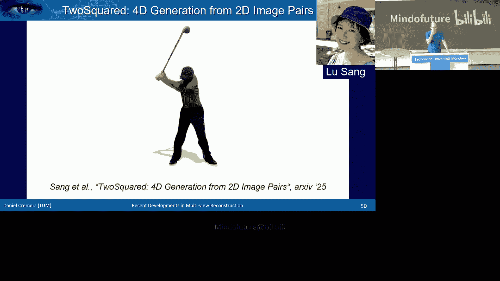

Thank you very much。