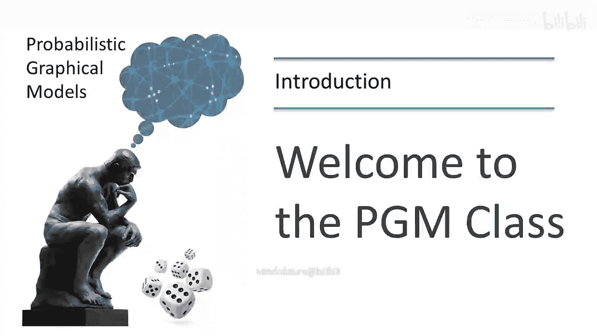
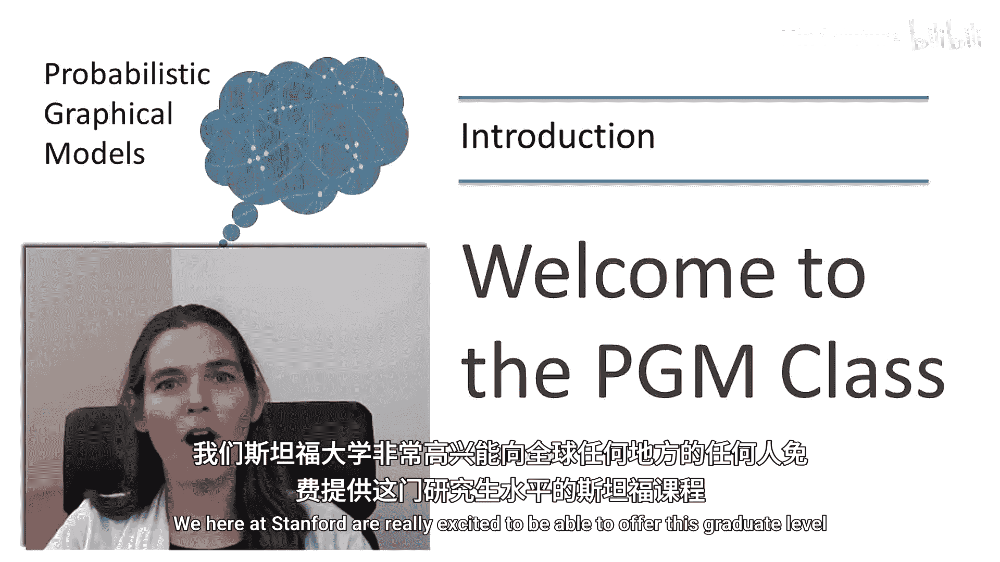
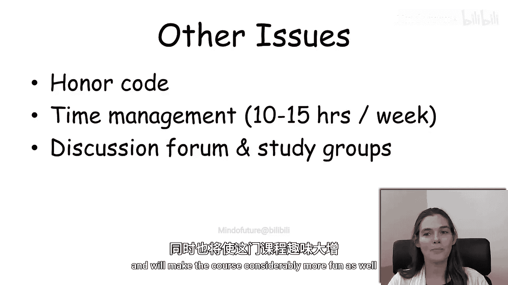
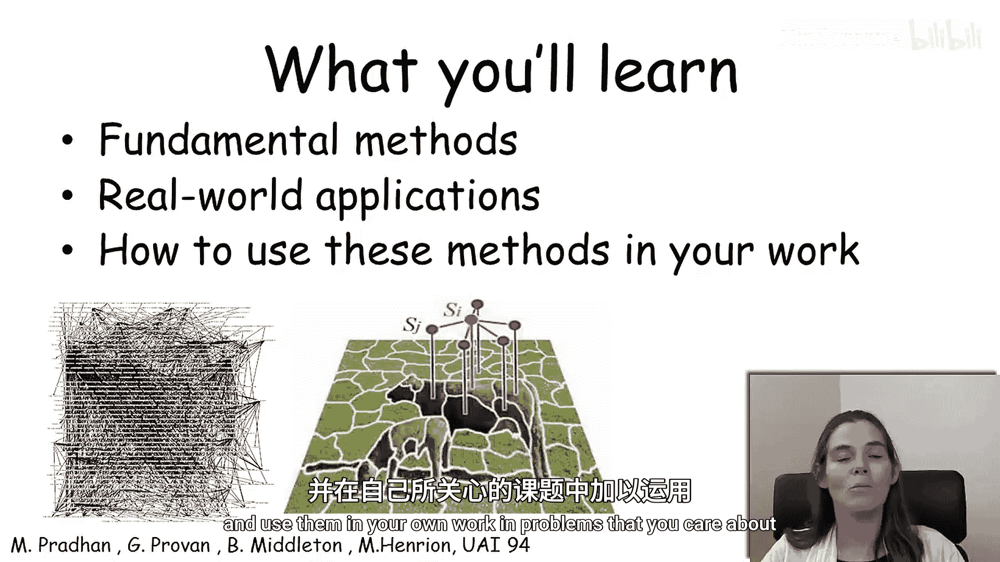

# 【斯坦福】概率图形模型1：表示法 ｜ Probabilistic Graphical Models p01 P01_欢迎_01_01_01 -BV1M76VBSEJ6_p1-

Hello， everyone， and welcome to the class on probabilistic graphical models。 My name is Daphne Coler。

 and I'm a professor at Stanford University。 We here at Stanford are really excited to be able to offer this graduate level Stanford class to anyone anywhere around the world for free。

😊。

So what are probabilto graphical models Well it's a bit complicated to explain and we're going to talk about that in an upcoming video but also throughout the entire class what background do you need for this class Well it's going to be really hard to do this class without some understanding of basic probability theory this doesn't have to be very advanced stuff we're talking about things like independence and base rule and just basics of discrete distributions and we also have a few introductory modules to refresh your memory about these basic concept。

The programming assignments will require that you've had some experience programming before because this is not a programming class。

 we don't teach you how to program。And because this class merges ideas from both probability theory and computer science。

 it's really important you have some background and algorithms and data structures。

Recommended but not strictly necessary and we certainly don't require it and we give you the background as we go is a little bit of experience perhaps in machine learning。

 maybe some simple optimization like gradient descent， nothing very sophisticated。

 and it would be helpful to have some experience programming in MatLb or OcTab。

 although here also we have some introductory modules that help you learn this programming language if you haven't played around with it before。

A few other issues that are worth noting。 This class has an honor code。 This is the norm。

 also for our local Stanford students when they're taking a Stanford class。

 The honor code here says that youre allowed to discuss the material， In fact。

 even encouraged to discuss the material with your fellow classmates。

 you can even ask clarifying questions about the problems that are the programming assignments。

 But what you turn in has to be your own work。Furthermore。

 we request that you do not post either the programming assignments or their solutions anywhere on the web so that future generations of students can do the problem sets in the programming assignments independently as well。

A second issue to keep in mind is that of time management。 This is a graduate level Stanford class。

 and it's considered a difficult one， Even at Stanford。

 A typical Stanford student can easily spend 10 to 15 hours a week on this class。

 And so we would suggest that you budget at least that amount of time for your own efforts on this class。

 If you don't want to find yourself running out of time when the submission deadline comes around。

 We've built in a little bit of slack into the submission deadlines so that if you don't manage to submit by the by the original deadline。

 You have a week's worth of grace period， but then that obviously starts to impinge on the next week's problem set。

 So we advise that you don't just keep a backlog of assignments throughout the throughout the course because it'll all end up coming back to bite you in the end。

Finally， part of the experience of this class is interacting with your fellow students。

 so for that purpose we have the discussion forum which has proven in other classes to be an invaluable resource for interacting with other students asking questions and obtaining a deeper understanding of the material。

 We're also encouraging you to form study groups these can be physical study groups with people in the same geographical region or online study groups where you can just discuss the material with each other。

 We believe that doing this will give you a much better understanding of material and will make the course considerably more fun as well。

😊。

So to summarize through all these different pieces of the content and the exercises。

 we think that you learn fundamental methods in this area of probabilisticographical models。

 you'll also get to see and play around with a range of real worldorld applications for which these methods have been applied and hopefully you will leave this class with an understanding of how to take these ideas and use them in your own work in problems that you care about We look forward to seeing you in this class。

