# 【斯坦福】概率图形模型1：表示法 ｜ Probabilistic Graphical Models p02 P02_概述与动机_01_01_02 -BV1M76VBSEJ6_p2-

Hello and welcome to the class in probabilistic graphical models。

 Probabilistic graphical models are a bit of a mouthful。 so before we define them。

 let's first figure out what they might be used for。

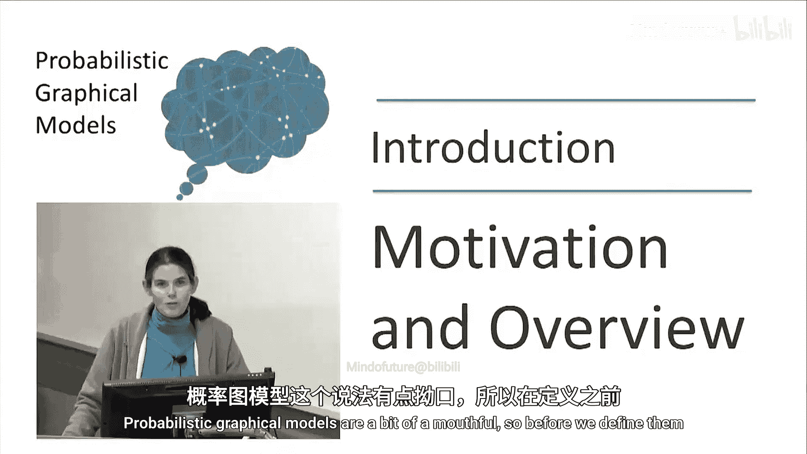

So one example application， which in fact is the one where probabilistic graphical models or PGMs as they're called first made its way into computer science and artificial intelligence is that of medical diagnosis。

 consider a doctor who's faced with a patient， the doctor has a fair amount of information at her disposal when she looks at the patient。

 predisposing factors， symptoms， the results of various tests。

 and from that she's supposed to figure out what diseases the patient might have and what the response to different treatments might be。

A very different application where PGMs have also been used is that of image segmentation here we might have an image such as this that has thousands or even hundreds of thousands of pixels and what we'd like to do is we'd like to figure out what each pixel corresponds to。

 for example， if we break up the image into these fairly larger regions to have less stuff the reason about we want to figure out which of these corresponds to grass。

 sky， cow or horse One of these two problems have in common。First。

 they have a very large number of variables that we have to reason about in the context of the doctor。

 it's all these predisposing factors， test results， possible diseases and so on。

 and in the context of the image segmentation the labels for these different pixels or these larger regions call superpixs the second thing that these applications have in common is that fundamentally there is going to be significant uncertainty about the right answer no matter how clever the algorithms that we design。

Good。So probabilistic graphical models are a framework for dealing with this kind of application。

 so let's first understand what each of these words mean in the context of this framework。

So first let's consider the word models so what is a model a model is a declarative representation of our understanding of the world。

 so it is a representation within the computer that captures our understanding of what these variables are and how they interact with each other and the fact that it's declarative means that the representation stands on its own。

 which means that we can look into it and makes sense of it aside from any algorithm that we might choose to apply on it。

😊，So why is that important， it's important because that same representation。

 that same model can then be used in the context of one algorithm that answers maybe one kind of question or other algorithms that might answer different kinds of questions or the same question in more efficient ways or that make different tradeoffs between accuracy and computational costs。

The other advantage of having a standalone model is that we can separate out the construction of the model from the algorithms that are used to reasonable work so we can construct methodologies that elicit these models from a human expert。

or ones that learn it from historical data using statistical machine learning techniques or a combination of the two and once again。

 the separation between the algorithm and the model and the learning in the model allows us to tackle each of these problems separately。

So that was the word mon， what about probabilistic？

The word probabilistic is in there because these models are designed to help us deal with large amounts of uncertainty。

So uncertainty comes in many forms and in for many different reasons。

 so first it comes because we just have partial knowledge of the state of the world， for example。

 the doctor doesn't get to measure every symptom or every test result and she's certainly uncertain about the diseases that the patient has。

Uncertainty comes because of noisy observations， so even when we get to observe certain things like blood pressure。

 those observations are often subject to significant amounts of noise。

There uncertainty also comes in because of modeling limitations。

 so we're going to have phenomena that are just not covered by our model。

 all sorts of different obscure diseases， for example， that might cause the same set of symptoms。

 it's impossible for us to write down a model that is so detailed that it includes every possible contingency in every possible factor。

 and so you're going to have uncertainty and variability that is simply due to modeling limitations。

And finally， some people would argue that the world is inherently stochastic。

 certainly if you go down to the quantum level that's true， but even at a higher level。

 the modeling limitations of complicated systems are such that one might as well view the world as inherently stochastic。

Probability theoryory is a framework that allows us to deal with uncertainty in ways that are principled and that bring to bear important and valuable tools。

So first probabilistic models provide us again this word declarative。

 a declarative representation that is standalone where you could look at a probability distribution and it has clear semantics that represent our uncertainty about different states that the world might be in。

It also provides us with a toolbox comprising powerful reasoning patterns that include， for example。

 conditioning on new forms of evidence or decision making under uncertainty。😊。

And because of the intricate connection between probability theory and statistics。

 we can bring to bear a range of powerful learning methodologies from statistical learning to allow us to learn these models effectively from historical data。

 avoiding the need for a humanlicit to specify every single aspect of the model by hand。😊，Finally。

 the word graphical， the word graphical is here from the perspective of computer science because probabilistic graphical models are a synthesis between ideas from probability theory and statistics and ideas from computer science and the idea here is to use techniques from computer science specifically that of graphs to allow us to represent systems that are very complicated that involve large numbers of variables and we've already seen those large number of variables in both of the applications that we use as driving examples。

 both in the medical examples as well as in the image segmentation example and so in order to capture probability distributions over spaces involving such a large number of factors。

 we need to have probability distributions over what are called random variables and so the focus of this class and what we'll do for most of it is to think about the world as represented by a set of random variables X1 up to XN each of which。

Cture is some facet of the world， so one symptom that may be present or absent or a test result that might have a continuous set of possible values or pixel that might have one of several labels so each of these is a random variable and our goal is to capture our uncertainty about the possible states of the world in terms of the probability distribution or what's called a joint distribution over the possible assignments to the set of random variables。

Now， the important thing to realize when're looking at this is that even in the simplest case where each of these is say binary valued。

 which is not often the case， but say for just the sake of argument。

 if you have N binary valued variables， then this is a distribution。Over。

Through to the N possible states of the world， one for each possible assignment。Of these under。

And so we have to deal with objects that are intrinsically exponentially large。

 and our only way to do that is by exploiting data structures encode that use ideas from computer science in this case to exploit the structure and distribution and represent and manipulate it in an effective way。

So what are graphical models let's look at a couple of very simple examples。

 so here is a toy Bayesian network， one that will accompany us through much of the first part of this course。

 a Bayesian network is one of the two main classes of probabilistic graphical models and it uses a directed graph。

As the intrinsic representation here， in this case， remember。

 we had a set of random variables X1 of the XN。The random variables are represented by nodes。

In the graph so to take a look at this very simple example which we'll discuss again later here we have a situation where we have a student who takes a course and gets a grade in the course and so that's one of our random variables。

 we have other random variables that are also related to that， for example。

 the intelligence of the students in the course， the difficulty of the course and other that others that might also be of interest。

 for example， the quality of the recommendation letter that the student gets in the course。

Which is dependent on in perhaps the student' grade and the score that the students might have received the on the SAP。

 So this is a representation of a probability distribution in this case。

 over these five random variables and the edges in this graph represent the probabilistic connections between those random variables in a way that is very formal。

 as we'll define later on。The other main class of probabilistic graphical models is what's called a Markov network and that uses an undirected graph。

And in this case， we have an undirected graph over four random variables， A， B， C and V。

 and we'll give an example of this type of network， maybe a little bit later on。

So these were toy examples。Here are some real examples of the same type of framework。

 so this is a real Bayesian network， it's a network that's actually called CTCS。

 it's a real medical diagnosis network， it was designed at Stanford University for the purpose of diagnosis of internal diseases。

And it has 480 some nodes and a little bit over 900 edges。

 and it was used for diagnosing internal diseases by physicians here。

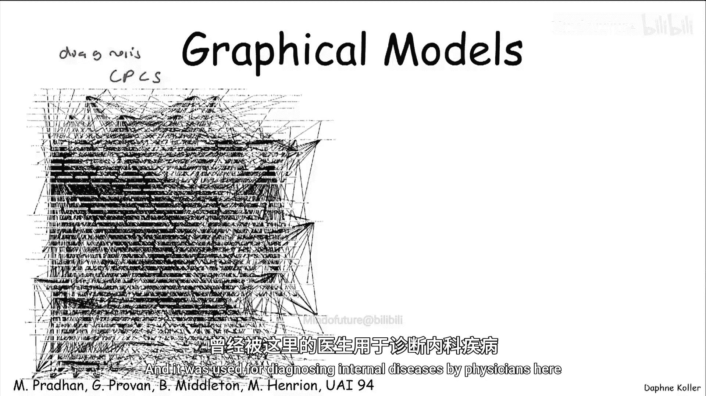

Another real graphical model in this case on the Markov network side is the one is one that's used for the image segmentation task that we talked about before here the random variables represent the labels。

Of pixels or superps。The one per each superpix say， and the edges represent， again。

 probabilistic relationships between the label of a pixel and the label of an adjacent pixel。

 since these are likely to be related to each other。

So to summarize the graphical representation gives us an intuitive and compact data structure for capturing these high dimensionional probability distributions。

 it provides us at the same time， as we'll see later in the course。

 a suite of methods for efficient reasoning using general purpose algorithms that exploit the graphical structure。

And because of the way in which the graph structure encodes the parameterization of the probability distribution。

 we can represent these high dimensionional probability distributions efficiently using a very small number of parameters。

 which allows us to both feasible elicitation by hand from an expert。

As well as automatically learning from Dana。 and in both cases。

 a reduction in the number of parameters is very valuable。

This framework is a very general one and has been applied to a very broad range of applications and I'm not going to list all of the ones on this slide and there's many others that I could have put on this slide had there been more space Let me just very briefly mention a few of them on subsequent slides。

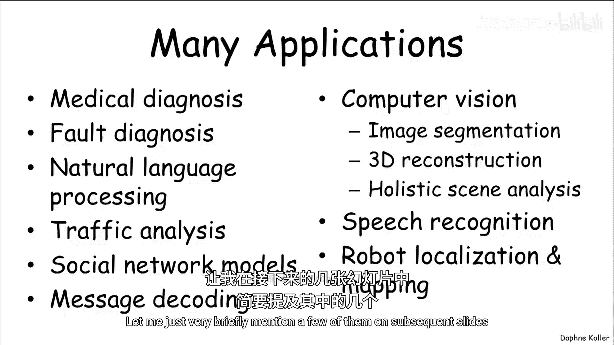

So we've already discussed the image segmentation， so just to motivate the benefits of the PGM framework in this context。

 let's look at these two images as an example， here is the original images。

 this is the division of these images into what I mentioned were called superps which are these sort of slightly larger coherent regions。

And this is what you get if you apply a state of the art machine learning framework。

Individual superfiels separately。So。Just trying to classify each superpixel separately and you can see that you get。

 especially in the case of the cow， a total mess with pixel different superpixs having drastically differently label that you can't even see the cow in this segmented image。

Whereas if you construct the probabilistic graphical models that captures the global structure of the scene and the correlations。

 the probabilistic relationships between these superpixs。

 you end up with a much more coherent segmentation that captures the structure of the scene beautifully。

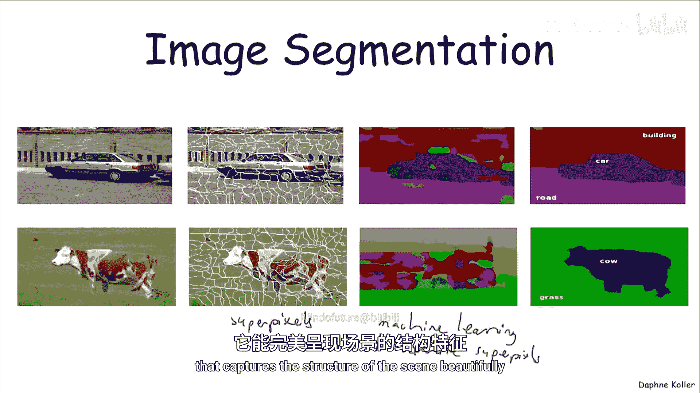

We've already discussed medical diagnosis as an example， so here is a real worldor application。

 this was something that was fielded on the Microsoft Network for helping parents figure out what was wrong with a sick child and the site was called on parenting and parents could enter the primary complaint and then were led through a series of questions that allowed the system to provide a probability distribution over the most likely diagnoses of what was ailing the child。

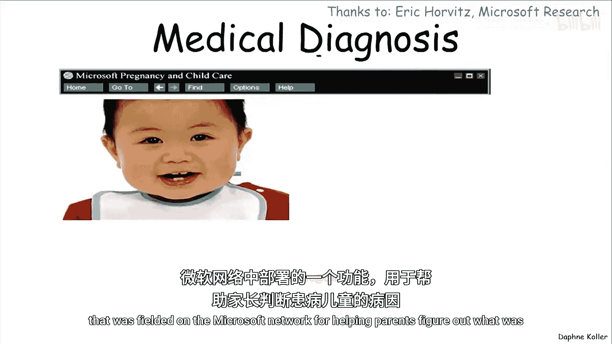

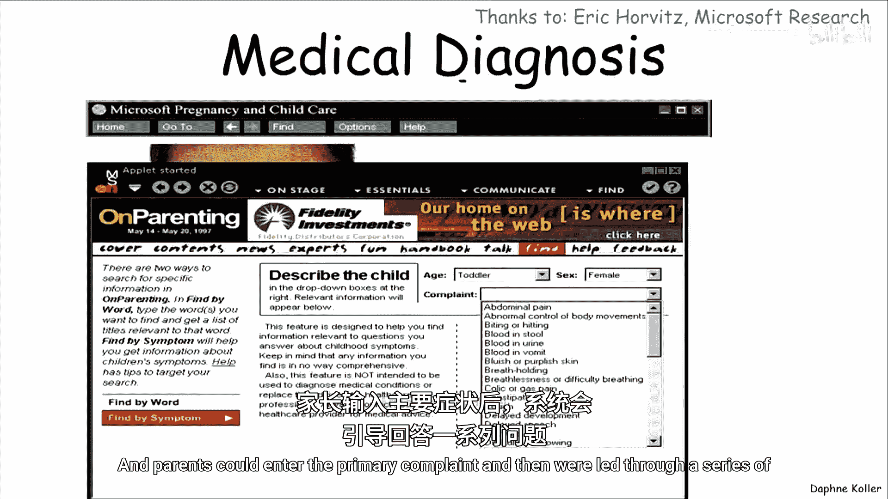

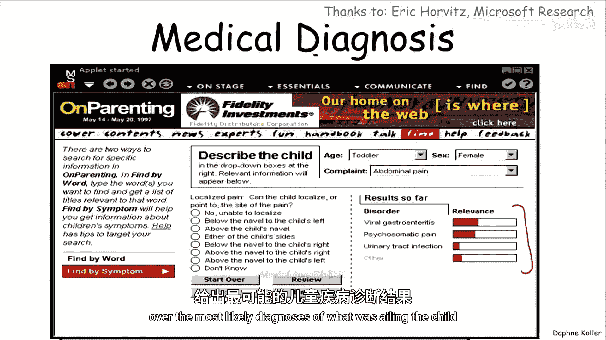

A very different application is one of textual information extraction where we might have an article from say in newspaper。

 and we'd like to take this unstructured data and convert it into a structured for we have some representation of the people in the sentences。

 locations， organizations and perhaps relationships So one such task might be to take this kind of sentence and recognize that these two words together form a person which might not be that hard be given the presence of the word misses。

 but this is a little bit harder because green is also a word。

 and yet we want to identify it as a person， might want to then infer that this is a location。

And perhaps the dis is an organization。It turns out that the state of the art methodology for solving this problem is as a probabilistic graphical model where we have a variable for each word that encodes the label for that word。

 for example， here we have the beginning of a person unit and an intermediate label for the person unit and here is another person unit。

 whereas here in this variable is we would like it to label it as a location。

 but we would like to capture importantly the correlations between both adjacent words。

 as well as between non-adjacent words。😊，By using this occurrence of the word green to infer that this occurrence of the word green is also a name。

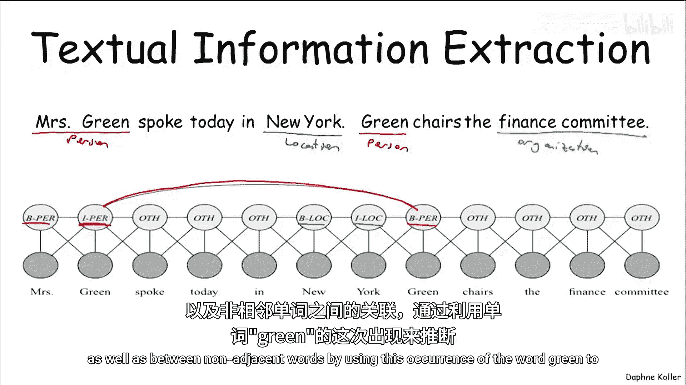

A very different example altogether is one that integrates data from multiple sensors。

 this occurs in many applications， one such is for integrating data related to traffic from both sensors。

That we might have in the road or on the top of bridges， whether。Information。

 incident reports that we might get in some form， and we'd like to take all this together and use a model that as it happens was learned from data。

And that model is then used to predict both current and future road speed。

 including not only on roads that where we have sensors that measure traffic。

 but even more interestingly on roads where traffic wasn't measured。

 and it turns out that this was a very successful application that was fielded in several large cities and with the very good result。

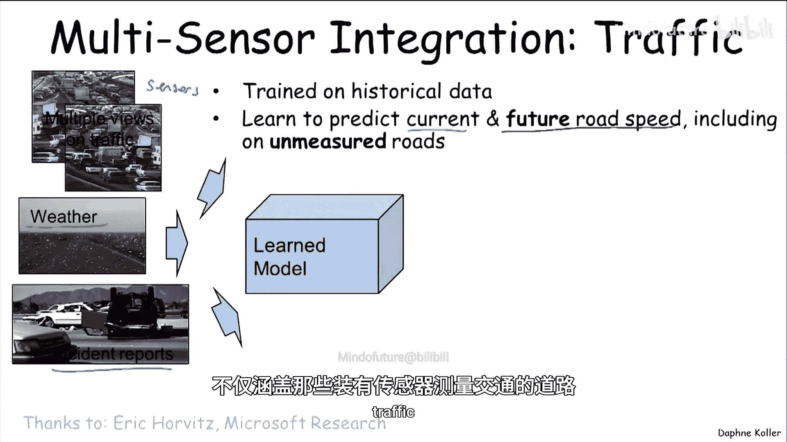

From a totally different application domain， probabilographical models have been used very successfully for discovering new knowledge that we didn't have before。

 in this case the application was biological network reconstruction where biologists measured protein levels of diverse set of proteins in different conditions under different perturbations and from that they learned the relationships between those proteins and discovered interactions between those proteins where one was controlling another。

 including that ones that were not known before。😊。

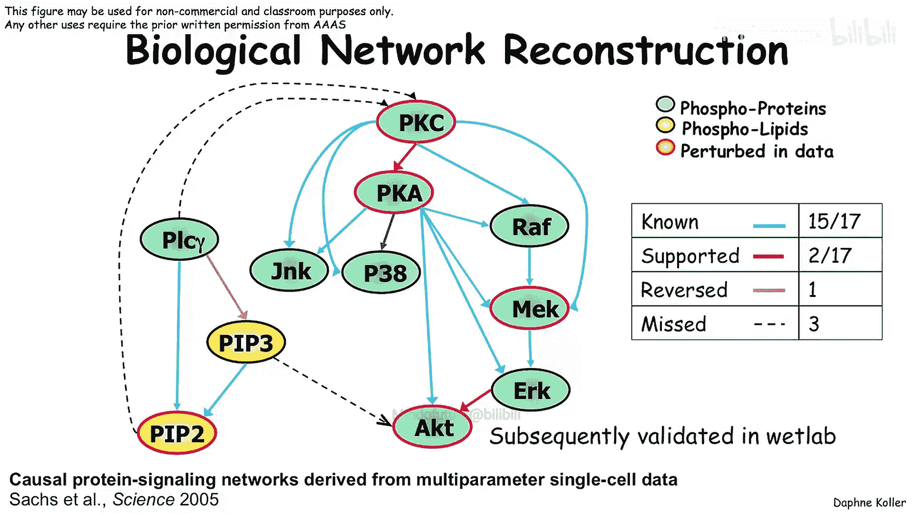

So let's conclude this introduction with an overview of what we'll learn in the class。

So we'll cover three main pieces related to probabilistic graphical models。

 we'll cover representations of PGMs， including both directed and undirected representations。

 wholl also talk about higher level structures that allows to encode more complicated scenarios including ones that involve temporal structure as well as ones that involve repeated or relational structure。

 specifically class models called plate models。We'll talk about inference or reasoning。

Using these models。covering both exact reasoning where exact probabilities are the output as well as approximate methods that provide a different tradeoff regarding accuracy and computation。

 and we'll also talk about how this class of models can be used for decision making under uncertainty。

And finally， we'll talk about how you might learn these models from historical statistical data。

 we'll talk about learning both parameters as well as structure of these models automatically and dealing with both the somewhat simpler scenario where we have complete data that is all of the variables are always observed as well as the more difficult case where some of the variables might not be observed all the time or perhaps not at all。

 and that introduces an interesting set of complications。

 but also a wealth of very exciting applications as we'll see。

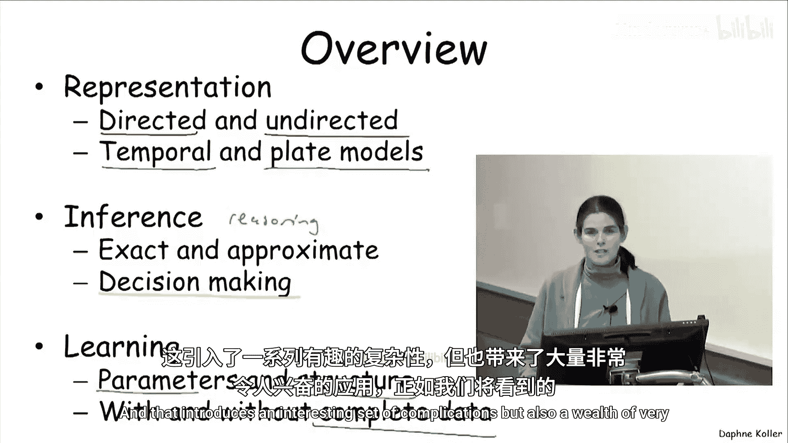