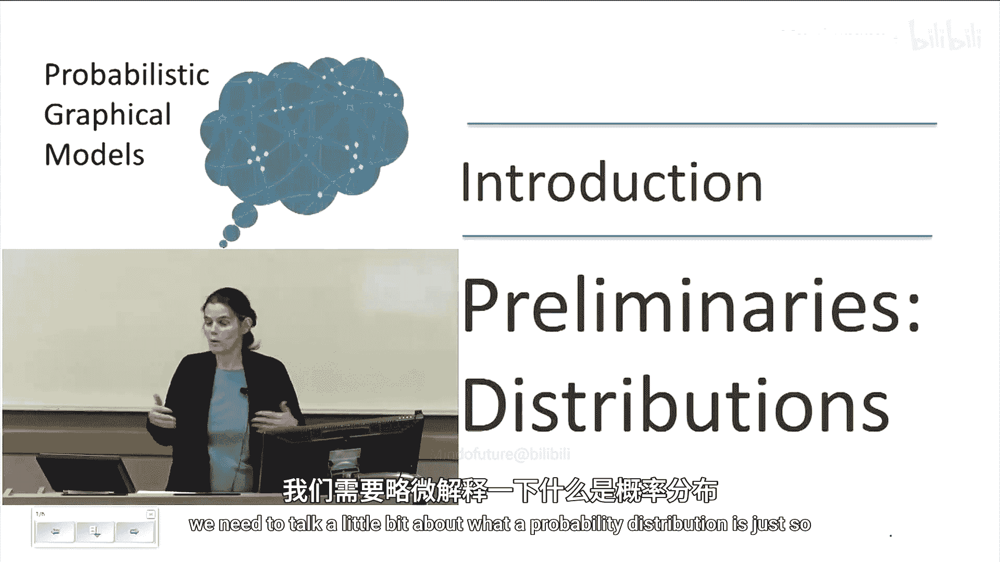
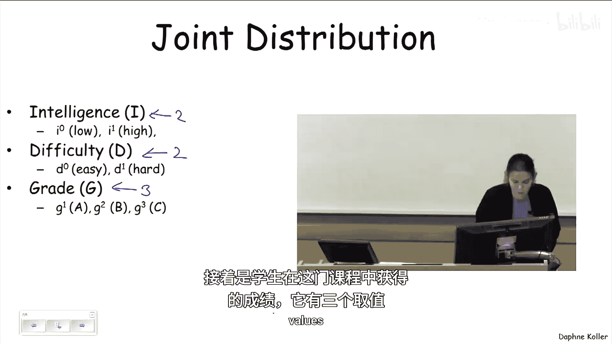
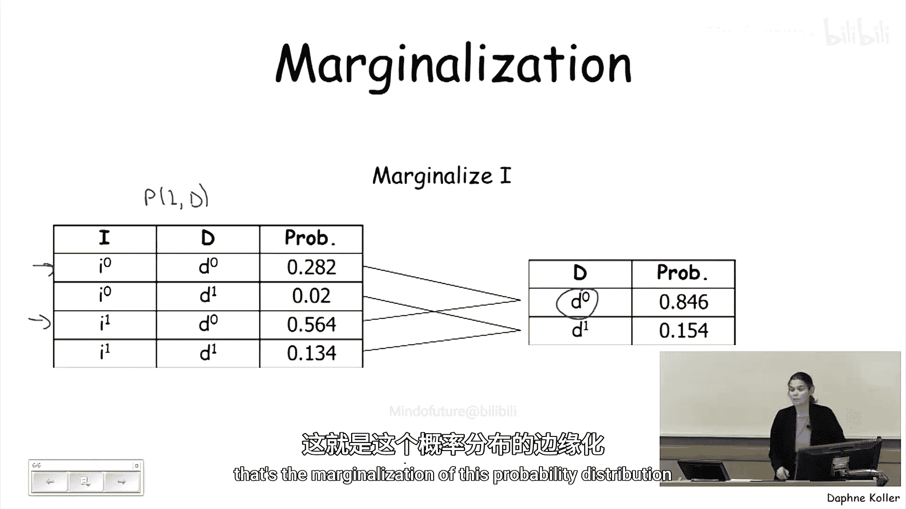

# 【斯坦福】概率图形模型1：表示法 ｜ Probabilistic Graphical Models p03 P03_分布_01_01_03 -BV1M76VBSEJ6_p3-

So before we get into the details of probabilistic graphical models。

 we need to talk a little bit about what a probability distribution is just so we all have a shared vocabulary。

So let's start with a very simple example of a joint distribution。

 one that is going to be extended in examples later on in other parts of the course and let's start with an example that involves just three random variables。

 this is what I call the student example and you have student who can be described in this case by a variable representing his intelligence and that could be high or low。

 the student is taking a class， the class might be difficult or not so this random variable B。

So the random variable I。Has two values， difficulty variable。 also has two values。

 and then there is the grade that the student gets in the course。 and that has three values。

 in this case， we're going to assume A B and C。

Now here is an example joint distribution over this set of three random variables。

 so this is an example of P of I comm D G it's a joint distribution and let's think about how many entries are in such a joint distribution well since we have three variables and we want to we need to represent the probability of every combination of values for each of these three variables and so we have two。

Times2 times three possible combinations for a total of 12 possible values that we need to assign a probability to。

 so there's 12 total parameters in this probability and I'm going to introduce a notion of independent parameters which we're going to talk about later as well independent parameters are parameters whose values is not completely determined by the values of other parameters so in this case because this things the probability distribution we know that all of the numbers here on the right have to sum to one。

And therefore， if you tell me 11 out of the 12， I know what the 12th is。

 and so the number of independent parameters is 11。

 and we'll see that that's a useful notion later on when we start evaluating the relative expressive power of different probability distributions。

😊，What are things that we can do with probability distributions。

 well one important thing that we can do is condition the probability distribution on a particular observation。

 so for example， assume that we observe that the student got an A and so we have now an assignment to the variable G which is G1 and that immediately eliminates。

All possible assignments that are not consistent with my observation。 So everything。But the G1。

Observations。ok。And so that gives me a reduced probability distribution and so this is an operation that's called reduction。

 I've taken the probability distribution I've reduced away stuff that is not consistent with what I observed now that by itself doesn't give me a probability distribution because notice that these numbers no longer sum to one because they sum to one before I throw out a bunch of stuff and so in order to get a probability distribution what I do is I take this。

😊，normalormalizes measure。An indication the word measure indicates that it's a form of distribution。

 but the fact that it's anmalized means that it doesn't sum to one。

 it doesn't normalizedize to one so this a normalizedmalized measure if we want to turn it into a probability distribution。

 the obvious thing to do is to normalize it and so what we're going to do is we're going to take all of these entries we're going to sum them up and that's going to give us a number which in this case is 0。

447 and we can now divide each of these by 0。447 and that's going to give us a normalized distribution which in this case corresponds to the probability of I comedy given G1 so that's a way of taking an unnormalized measure and turning it into a normalized probability distribution we'll see that this operation is one of the more important ones that we're using throughout the course。

Okay the final operation that I'm going to talk about regarding probability distribution is the operation of marginalization and that is an operation that takes a probability distribution over a larger subset of variables and produces a probability distribution over a subset of those so in this case we have a probability distribution over I and D and say we want to marginalize I which means we're going to basically sum up I'm going to throw away I andm going to restrict attention to D and so what that does is for example if I want to compute the probability of D0 I'm going to add up both of the entries that have d0 associated with them and that the one corresponding to I0 and the one corresponding to I1 and that's the marginalization of this probability distribution。

😊。

