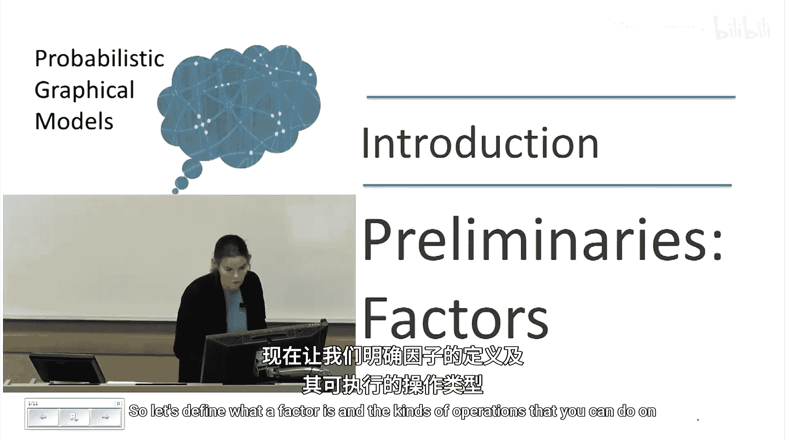
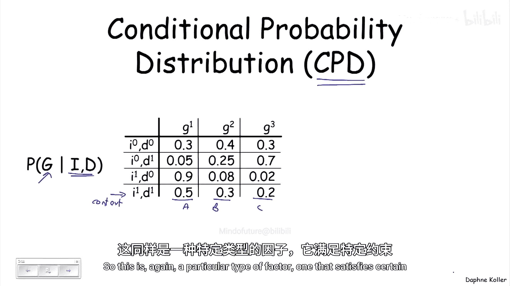
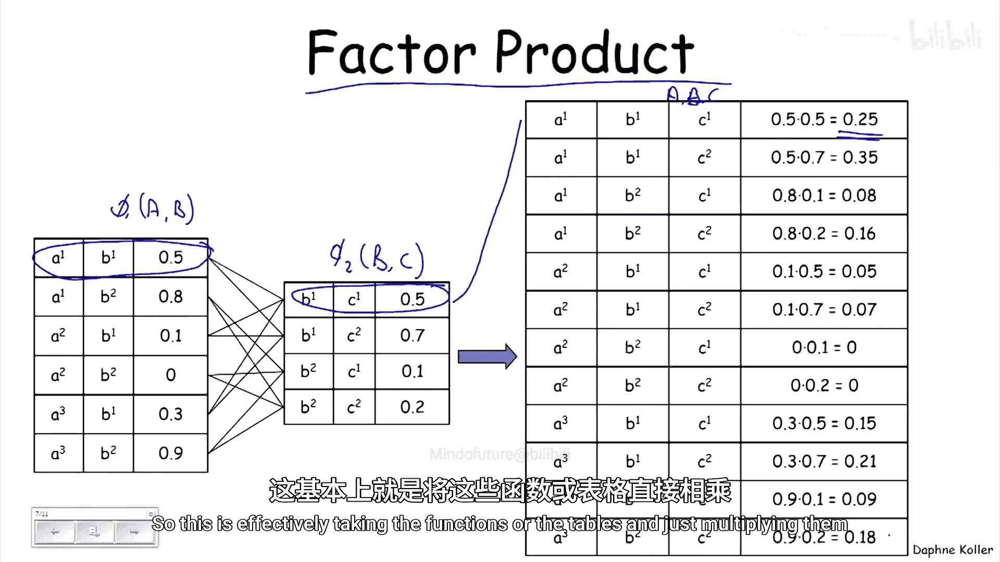
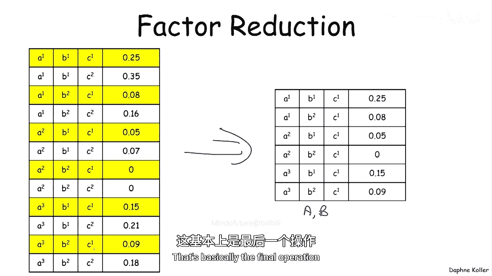
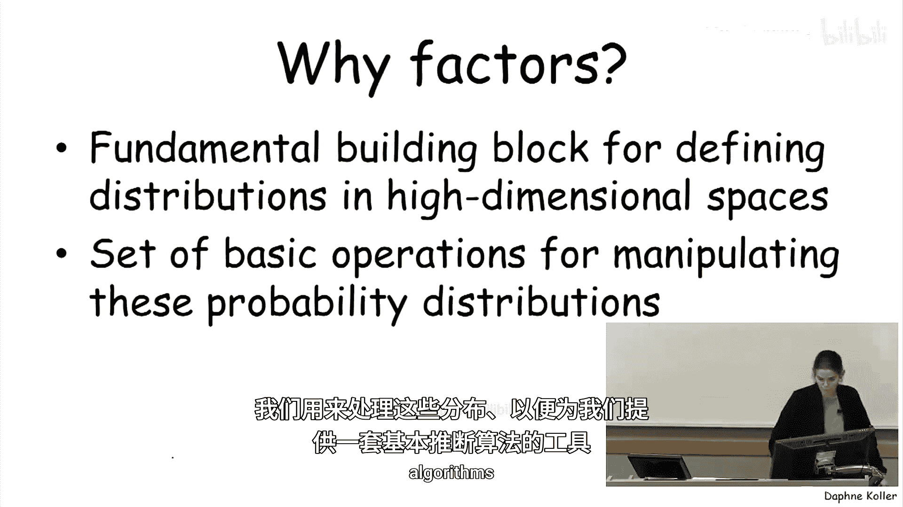

# 【斯坦福】概率图形模型1：表示法 ｜ Probabilistic Graphical Models p04 P04_因子_01_01_04 -BV1M76VBSEJ6_p4-

A critical building block in a lot of what we'll do both in terms of defining probability distributions and in terms of manipulating them for inference is the notion of a factor。

So let's define what a factor is and the kinds of operations that you can do on factors。

So a factor really is a function or a table， it takes a bunch of arguments in this case。

 a set of random variables， x1 up to Xk， and just like any function it gives us a value for every assignment to those random variables。

 so it takes all possible assignments in the cross-product space of x1 up to Xk that is all possible combinations of assignment and in this case it gives me a real value for each such combination and the set of variable of x1 up to Xk is called the scope of the factor that is it' the set of arguments that the factor takes。

Let's look at some examples of factors， we've already seen a joint distribution。

 a joint distribution is a factor for every combination， for example here of the variables IDDNG。

 it gives me a number as it happens， this number is a probability， as it happens it sum to one。

 but that doesn't matter， what's important is that for every value of IDDNG。

 a combination of values I get a number， that's why it's a factor。😊，Here is a different factor。

 an unormalized measure is a factor also in this case。

 we have a factor such as the probability of ID comma G1。And notice that in this case。

 the scope of the factor is actually I and D because there is no dependence of the factor on the value of the variable G。

 because the variable G in this case is constant。 So this is a factor whose scope。Is I andD。Finally。

 a type of factor that we will use extensively is what's called a conditional probability distribution typically abbreviated CPV This as it happens is a CPD that's written as a table。

 although that's not necessarily the case and this is a CPD that gives us the conditional probability of the variable D given I and D so what does that mean it means that for every combination of values to the variables I and D。

 we have a probability distribution over G so for example if I have an intelligent student in a difficult class。

 which is this last line over here， this tells us that the probability of getting an A is 0。5 B is 0。

3 and a C。Is 0。2。And as we can see， these numbers sum to one as they should。

 because this is a probability distribution over G for this particular conditioning context。😊。

And you can easily verify that this is true for all of the other lines in this table。

 so this is again a particular type of factor， one that satisfies certain constraints in this case that each row offs to one。

Now the factors that we're dealing with will not always correspond to probability。

 so here's an example of a general factor that really doesn't map in any way to probability because the numbers aren't even in the range 01。

As we'll see these kinds of factors are nonetheless useful， this is a factor whose scope。

Is the set of variables a comma B？And it still gives me a real valued number those for each assignment A and B。

Some operations that we're going to do on factors。One of the most common operations is what's called factor product。

It's taking two factors， say P phi1。And Phi2。And multiplying them together。

 So let's think what that means。 Here we have a factor Phi1。It has a scope of AB。

PI 2 has a scope of BC。And what we're doing is we're kind of like multiplying a function F of xy times g of Yz。

 you're going to get a function that is of all three arguments， X， Y， Z。

 so in this case we have a factor whose scope is A， B and C。😊，And if we want to figure out。

ops come out good， if we want to figure out， for example， the value of the row A1， B1， C1。

 it's going to come by taking the A1， B1 row from here。

 the B1 C1 row from here and multiplying them together。 So we're going to get 0。25。

 So this is effectively taking the functions or the tables and just multiplying them together。

Another important operation is factor marginalization factor marginalization is very similar to in fact identical to the marginalization of probability distributions。

 so here we accept that it doesn't have to be a probability distribution， so for example。

 if we have a factor here whose scope is A B and C。😊。

And we want to marginalize out B to get a factor whose scope is AC。 What we're going to be doing is。

 again， taking both possible。Values of B in this case because B is binary。

 there's only two values and we add them up in order to get the entry for a 1 c1， so 0。25 plus 0。

08 and the same all the other rows in this table are acquired are computed exactly the same way from the corresponding rows in the original larger factor。

Finally， factor reduction， again very similar to the context of probability distributions。

 we want to reduce， for example， to the context C1。

 so we're going to only focus on the rows that have the value c equal C1。

And that's going to give us a reduced factor。Which only has C1 and once again。

 the scope of this factor is A B， because there is no longer any dependence on C。

 that's basically the final operation now。

Why factors？It turns out that factors are the fundamental building block in defining these distributions in high dimensional spaces。

 that is the way in which we're going to define an exponentially large probability distribution over N random variables is by taking a bunch of little pieces and putting them together by multiplying factors in order to define this high- dimensionional probability distributions。

 it turns out also that the same set of basic operations that we use to define the probability distributions in these high- dimensional spaces are also what we use for manipulating them in order to give us a set of basic inference algorithms。

