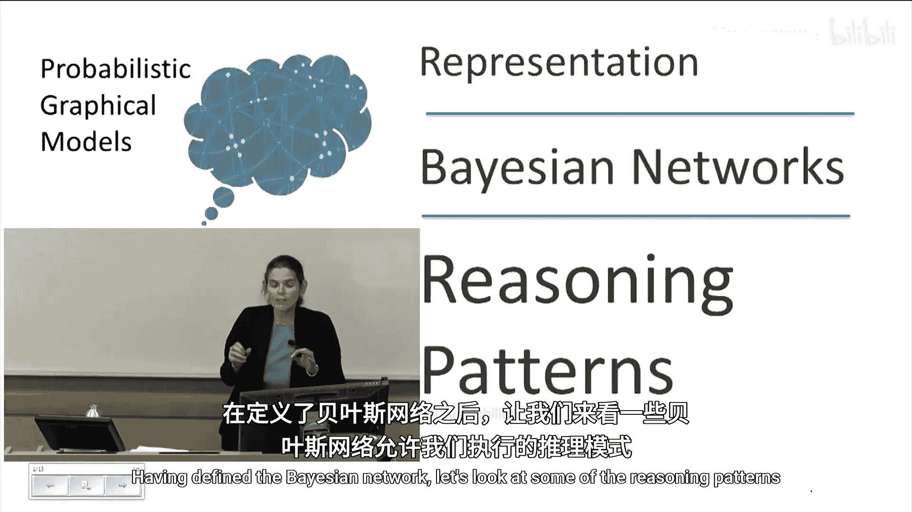
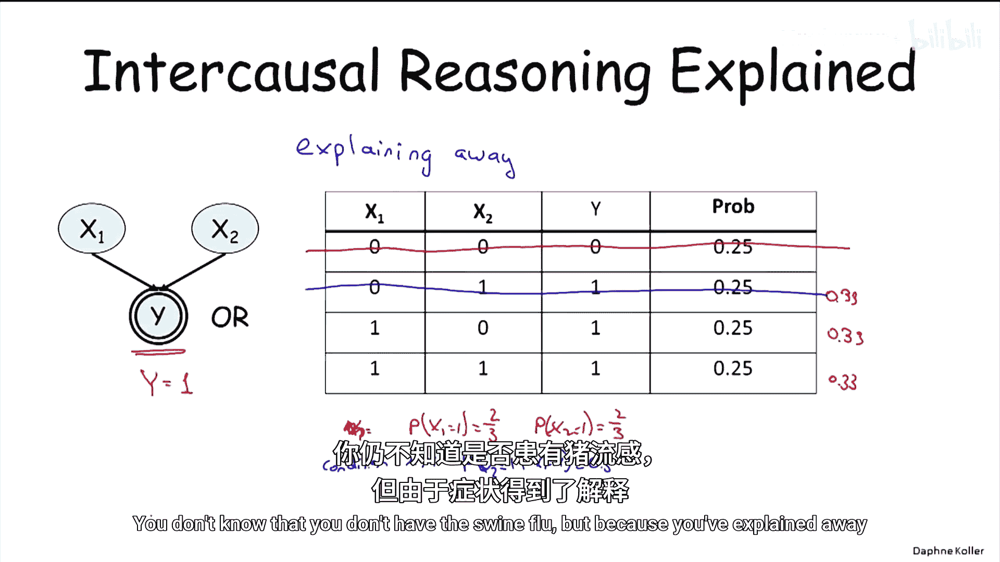
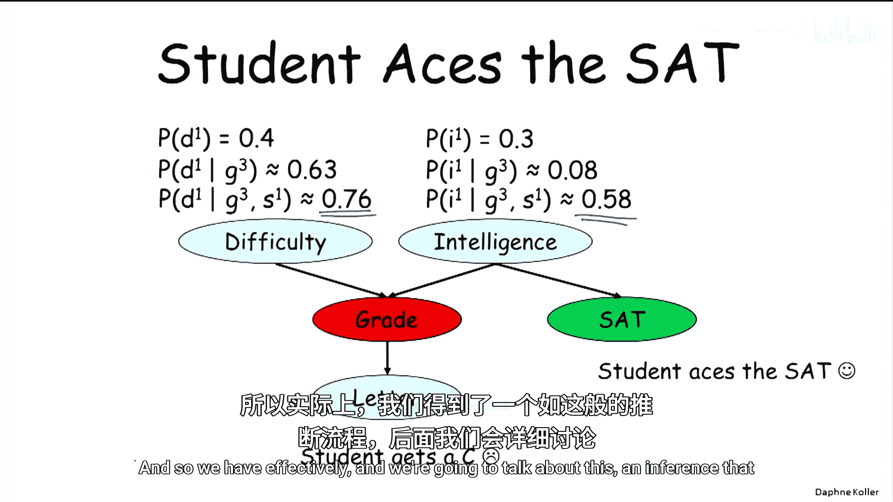

# 【斯坦福】概率图形模型1：表示法 ｜ Probabilistic Graphical Models p06 P06_推理模式_02_01_02 -BV1M76VBSEJ6_p6-

Having defined the Bayesian network， let's look at some of the reasoning patterns that work allows us to perform。

So let's go back to our good old student network with the following CPs， we've already seen those。

 so we're not going to dwell on it and let's look at some of the probabilities that one would get if you took this Bayesian network produced the joint distribution using the chain rule for Bayesian network and now computed say the values of different marginal probabilities so for example。

 now we're asking what is the probability。Getting a strong water。

 And we're not going to go through the calculation because it's going to be pedeious to sum up all these numbers。

 And I can just tell you that the probability of。The of L1 is 0。5。

But we can do more interesting queries。So we can now condition on one variable。

 remember we talked about conditioning a probability distribution and ask how that changes this probability。

 so for example， if we're going to condition on low intelligence。

 we're going to use red to denote the false value and it's going to turn out that the probability not surprisingly goes down。

 it goes down to 0。39 because if the intelligence goes down。

 the probability of getting a good grade goes down and so does the probability of getting a strong letter。

So this is an example of causal reasoning because intuitively the reasoning goes in the causal direction。

😊，tops the bottom。We could also make things more interesting so we can ask what happens if we make the difficulty of the course。

L， and in this case， we have the probability of L1。

given I0 and D0 and what do you expect the probability to do well， if it's an easy course。

 one would expect the grade to go up and sure enough the probability goes back up and we're back to 50-50 more or less。

So this is another example of causal reasoning in this case with a little bit more evidence。

You can also do evidential reasoning， evidential goes from the bottom up。So we can， in this case。

 condition on the grade and ask what happens to the probability of variables that are parents or in general。

 ancestors of the grade。So let's just imagine that this poor student takes the class and he gets a C。

Initially the probability that the class was difficult is 0。

4 and the probability that the student was intelligent is 0。3， but now with this additional evidence。

 again， this is not surprising， the probability that the student is intelligent goes down。

Like a fair amount， but the other alternative hypothesis that the class is difficult。

 also the probability of that goes up as well。嗯。走。Now， however。

 there is an interesting type of reasoning that is not quite as standard。

 and that is reasoning that is called inter causalal because effectively it's。

Flow of information between two causes of a single effect。So remember。

 we had the we're going to continue with a scenario before where our poor student gets to see。

 but now I'm going to tell you， wait a minute， this class really is difficult。

 so I'm going to condition。on。On D1。And notice that the probability that the student is intelligent has gone up。

 it went up from 0。08 to 0。11， so that's not a huge increase and as you'll see when you play around with Bayesian networks that often the changes in probability are somewhat subtle。

And the reason is that you have to， I mean， even in a hard class， if you go back and look at the CPD。

 it's kind of hard to get a C。According to this model。Which is that the student gets a B。

And so now we have that the probability of high intelligence still goes down， goes down from 0。

3 to 0。175。But now if I tell you that the class is hard。The probability goes up， in fact。

 it goes up even higher than this。So this is an illustration where this intercasal reasoning can actually make a fairly significant difference in the probabilities。

So intercosal reasoning is a little hard to understand。

 I mean it seems a little bit mysterious because after all these are， I mean look at these。

 you look at difficulty， look at intelligence， there's no edge between them。

 how would one cause affect another so let's drill down into a concrete scenario which is this one and just to sort of really understand the mechanism。

 so this is the most sort of purest form of intercosal reasoning。Here we have two random variables。

 and x1 and x2， we're going to assume that they're distributed uniformly。

 so each of them is one with probability 50% and0 with probability 50%， and we have one effect。

 one joint effect which is simply the deterministic or of those two parents。

 and in general when we have the deterministic variable。

 we're going to denote it with these double lines。So in this case。

 there's only four assignments that have nonzero probability because the value of y is completely determined by the values of x1 and x2。

 and so we have these four distributions over here and now I'm going to condition on the evidence。

Y equals one？Now let's look at what happened before I condition on this evidence。

 x2 were independent of each other right I mean look at this or independent of each other What happens when I condition on y equals1 Well we talked about conditioning。

This one goes away。And we have 0。33， 0。33。0。3 feet， rather one third， one third， one third。哎。In this。

Probability distribution， X1 and x2 are no longer independent of each other。Okay。Why is that。

 Because if I now condition on， say， x1 equals。0。Then。Okay， so actually before we do that。

 so in this probability distribution， the probability of x1 equals 1 is equal to23。

And the probability of x2 equals 1。Is also equal to23。诶。And now if I condition on x1 equals 1。

So now we're going to condition on。Condition。Excellent。So that means we're going to remove this line。

And all of a sudden。The probability of x2。Equals1 given x1 equals1 is back to being 50%。

So it was 50% before it went up to two3s and then if we condition on x1 equals 1。

 it goes back to 50% and the reason for this is the following you think about it intuitively if I know that y is equal to 1。

 there's two possible things that could have made y equal to 1， either x1 was1 or x2 was1。

If I've told you that x1 was1， I've completely explained the way the evidence that y equals 1。

 I've given you a complete explanation of what happened。

 and so now x1 is back to being the way it was before because there's no longer anything to suggest that it should be anything other than 50。

50。So this particular type of interval name， because it's so common。

 it's called explaining away and it's when one cause。

Explains the way reason that made me suspect a different cause。 And if you think about it。

 it's something that people do all the time when they're reasoning about， for example。

 in a medical setting， you。You're very sick， you think you're very worried。

 you don't know if you have the swine flu。He go to the doctor， doctor said， oh， don't worry。

 it's a common cold。You don't know that you don't have the swine flu。

 but because you've explained the way your symptoms， you're not worried as much anymore。

Finally， let's go back to our example and look at an interesting reasoning pattern is not that involves even longer sort of paths in the graph。

 so let's imagine that we have the the student got to see but now we have this additional piece of information that the student actually aced the SAT。

 so let's leave what happens there， remember that when we just had the evidence regarding the grade we had the probability that the student being intelligence was only 0。

08， but now we have this additional conflicting piece of evidence and all of a sudden the probability went up very dramatically to 0。

58。😊，Okay。What do you think is going to happen to difficulty。

So now it's explaining a way in action going in a different direction， right。

 because if it's not the fact that the student， I mean。

 the student didn't get a C because he wasn't very bright， probably。

The reason is that the class is very difficult and so that probability goes up and so we have effectively。

 and we're going to talk about this and inference this flow like that。

