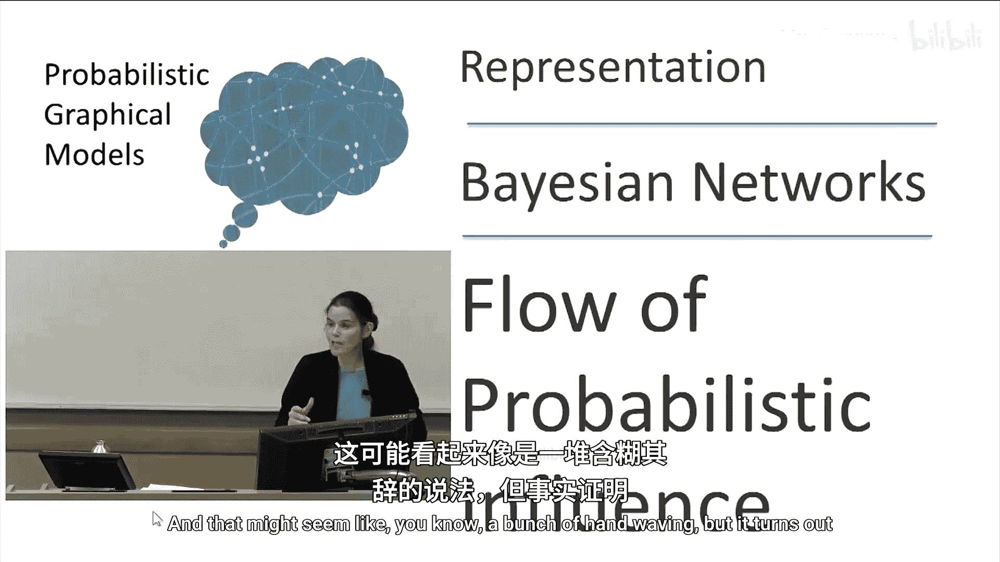
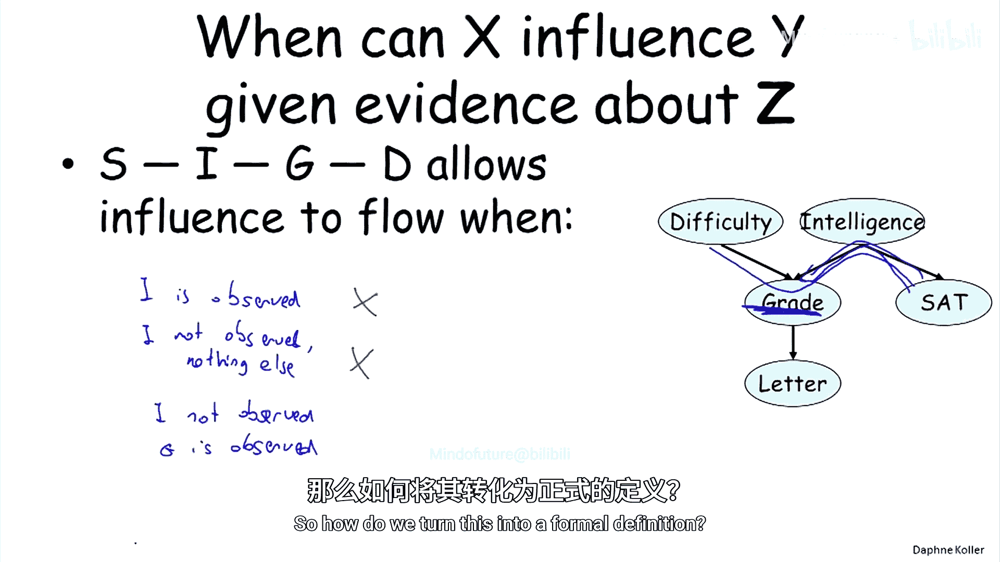
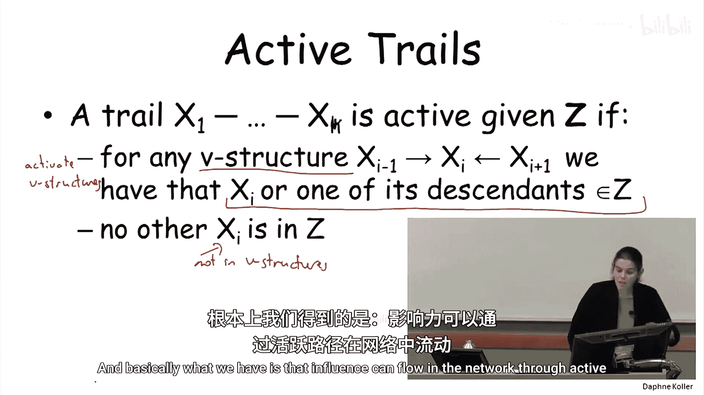

# 【斯坦福】概率图形模型1：表示法 ｜ Probabilistic Graphical Models p07 P07_概率影响的流动_02_01_03 -BV1M76VBSEJ6_p7-

So we've seen reasoning patterns where intuitively。

 at least that's how we argued probabilistic influence kind of starts in one node and flows through the graph to another node。

 and that might seem like a bunch of hand waving， but it turns out that this is actually exactly what goes on in a Bayesian network。

So what we're going to do now is going to make this argument much more rigorous by trying to understand exactly when one variable x can influence another variable y。

 and we're going to start with a case where there is no evidence going on and we're just asking can variable x influence y and let's look at a few simple cases so first if x and y are connected so x say is parent of y。

 then yep， pretty much。It's pretty clear cut that x can influence y。If y is a child of X？

We already talked about evidential reasoning。 We also saw this case。

 X can influence Y in the sense that observing x can change my probability distribution of Y。

 That's what I mean by influence。 influence means。Beliefs in why。Or about why？Yeah。

More interesting are the cases where we have indirect influence between x and y。

 so let's consider a case where there is an intervening variable W and let's think about can x influence y via W and the first case is a causal chain。

 for example， such for example， the one going from difficulty to letter via grade and we've already seen that in this case。

X can influence y via W in the examples that we saw。

This is exactly the same idea except that we're going evidential， and as we'll see in general。

 probabilistic influence is symmetrical， that is if x can influence y， y can influence x。

And so that's。So here also。We have probabilistic influence line。Okay。😊，The third is。

A structure that looks like this。So we have a common cause W that has to effect x and Y。And again。

 it seems to make sense that if we observe the value of the SAT。

 then that changes my beliefs in the student's intelligence and subsequently my probability distribution over their grade。

诶。So the last。And most interesting one。Is the case。

 which is the case of two causes that have a joint effect。This case is also called a V structure。

For obvious reasons， because it's shaped like ha。And this。Remember。

 I haven't given you any information， the question is if I tell you that a student took a class and the class is difficult。

 does that tell me anything about the student's intelligence？And the answer is no。And so this is。

 in this case， the one and only exception in this particular case。

So now let's define this notion of active trail in the context of no evidence。

 so a trail in general is a sequence of nodes that are connected to each other by single edges in the graph。

 so x1 up to actually we should make this xk。So's not too confusedfuse with a set of variables and the fact that these edges are undirected means that they can go in either direction。

 so I'm not stipulating that it goes up or down。So basically we saw that influence can flow from one variable to another variable in the graph and what this definition basically says is that is that this influence can continue to flow。

 so if it flows from one variable to the next to the next to the next to the next that still defines an active trail。

 the only thing that blocks an active trail is a V structure because that is the one case where we have that no influence flows as in the example that we showed before。

So this is a block。In the trail。Now let's look at a more interesting case。

 now we have some set of observations going which we're going to denote by a set of variables Z。

So now we have this set of variables Z， and the question is when can x influence y given evidence about Z？

So the first two cases are fairly straightforward， having evidence about Z that's not related that's not either X or y doesn't change the ability of a variable to influence ones to which is directly connected so here also。

If x is directly connected to y， either the causal or the evidential direction。

 if you tell me something about one of them， it can change my beliefs about the other。

Now let's look at these four cases。That are are the cases that are the most interesting ones。

 that is when can x influence y via intervening no W？now is really two cases。Either W。

Is in my evidence said Z Oh sorry， either it's in my evidence said Z or it's not。

So let's start with a case where W is not in my evidence case， in the evidence set。Z。Well。

 in this case， I didn't get to observe W。So I'm asking whether x can influence y via W。

 and there is really no difference between this case and the previous one that is， for example。

 difficulty can still influence letter via grade if a grade is not observed。So here。

Here and here we have exactly the same behavior as before。

 That is the intermediate variable through which the influence flow was not observed。

 and therefore there's no reason why。Why observing X can't change things。

Before we go down to the final case， let's contrast this for these three cases with a case where W is observed。

 W is evidence。So now let's consider， for example， this trail over here where difficulty influences the letter via grade。

 so this is not an edge in the Bayesian network， this is just demonstrating the flow of influence。

 I mean draw double line。So now the question is， we know that observing difficulty can change my distribution in the value of the letter。

 but what if I tell you the grade， that is， I know the student got an A in the class。

Now I'm telling you that the class is really hard， does that change the probability distribution of the letter No。

 because we already know that the student got an A， the letter only depends on the grade。

 and so in this case， influence can't flow through grade if grade is observed so in this case we have this situation。

嗯。What about？The evidential case， well we've already talked about the fact that evident that probabilistic influence is symmetrical。

 so if difficulty can't influence letter where grade is observed。

 letter can't influence difficulty when grade is observed and so once again we haven't no influence。

Finally， well， not finally， but the third case is the one where we have a common cause that has two effects。

 so in this case， for example， the SAT。Changing my beliefs in grade via intelligence。And again。

 we know we've already seen examples， in fact， that the SAT can change the probability distribution in grade。

 but if I tell you that the student is intelligent，And then。

There's no way for the SAP to change my probability distribution in grade。Now。

 I'm giving you this as sort of a high levell intuitive argument。

 but it's possible and we'll actually go through an argument to demonstrate that this is really what's going on here and that these probabilistic influences or lackor will really do hold in a graph such as this。

Okay， so let's talk about the last and most interesting case。

 which is the case where we have a V structure， so this is this case over here， X。

 and so for example， difficulty can difficulty influence intelligence。By grade。

And if grade is observed， this is exactly the case that we've seen before。

 this is the case of intercasable reasoning or that we demonstrated earlier， so in this case。

 if w is in Z actually we're in the case where influence can flow。

 so this case is working in exactly the opposite to the previous three cases。😊。

Now we have one tricky thing left。Which is what happens if W is non and Z？Now。

 the naive conclusion might be to say， well， if W is not observed。

 then it's exactly the same as before and influence can't flow。

 so I'm tempted to put an X right over here。Except that this is not quite ripe。

Because what happens if I don't observe grade， but I actually observe。Lettter。

I don't observe the grade directly， but I observe something that gives me a strong indication of what value the grade took。

In this case， this too activates the V structure， that is it gives me an evidence that needs to be explained that I can explain it via difficulty or via intelligence and so at that point it establishes the connection。

 the correlation between them so that observing one does influence the other and so this one。

Is not actually quite right， but you'd actually like to say is that if W。So that there'。So， this is。

X， if。W you。And all。Of its descendants。Are not。Observed。

Or conversely that this influence can flow either。If W。Or。Os。4。One of its descendants。Is observed。

So this tells us a taxonomy of when influence can flow through an intervening variable。

And now we can take that， and we can put it together to define an overall model of a more general flow of influence。

😊，So， for example， when can influence flow from。S。Ruai。Uji。Into D。Well。😮。

Let's look at a couple cases， what if I is observed？Well， if eye is observed。

 then it blocks the trail。And if it blocks the trail， there's no more opportunity for it to flow。

 So that's a no。What about if I is not observed， but nothing else is observed？I not observe。

And there is anything else。Well， what happens then？Well， you can climb up through eye。

But you kind of fall down the river when you hit the grade。

And you can't climb back up because there's nothing stopping you。And so that too。

 doesn't allow influence to flow。On the other hand， if I is not observed。And G is observed。Well。

 now you can climb up here， continue through here great is observed so the water can kind of go back up the hill into difficulty so you can think of it as a sort of a flow of water except that different nodes behave differently in terms of the valve structure so here if you observe a variable it closes valves that go like this。

But if you have a V structure closing this valve actually let the water climb back upstream。

 so that's kind of an analogy。So how do we turn this into a formal definition？

We have that a trail x1 up to xn， and this should have been a K here as well。

Is active given thee if we have two cases？First， every V structure needs to be activated。

And the only way we can activate a each structure is if Xi or one of its descendants is observed。

So this is activate。V structures。Now。All the other valves have to be open。

 so no other Xs that are not in V structures， so X not。In。whereby V not in V structures。

 I mean not at the sort of the nexus， the bottom of the V and the V structure。

 no other Xi can be observed。And that's the definition of an active trail。

 and basically what we have is that influence can flow in the network through active trails。

