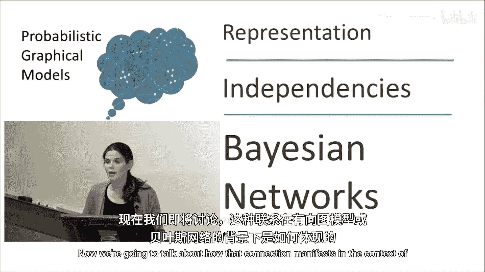
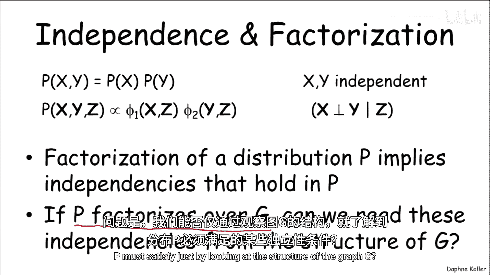
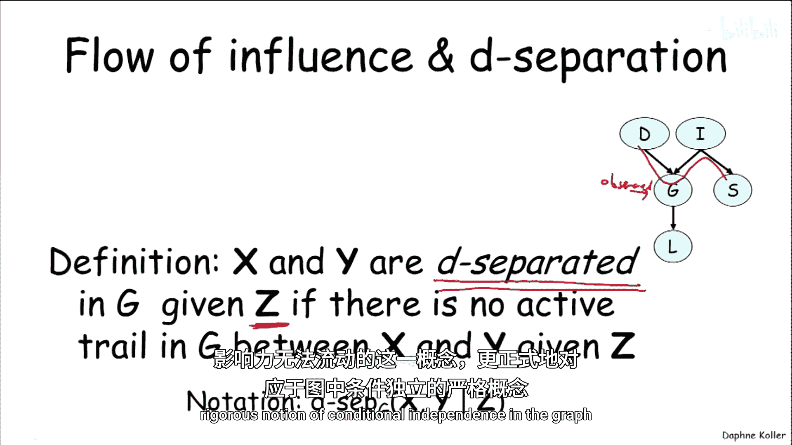
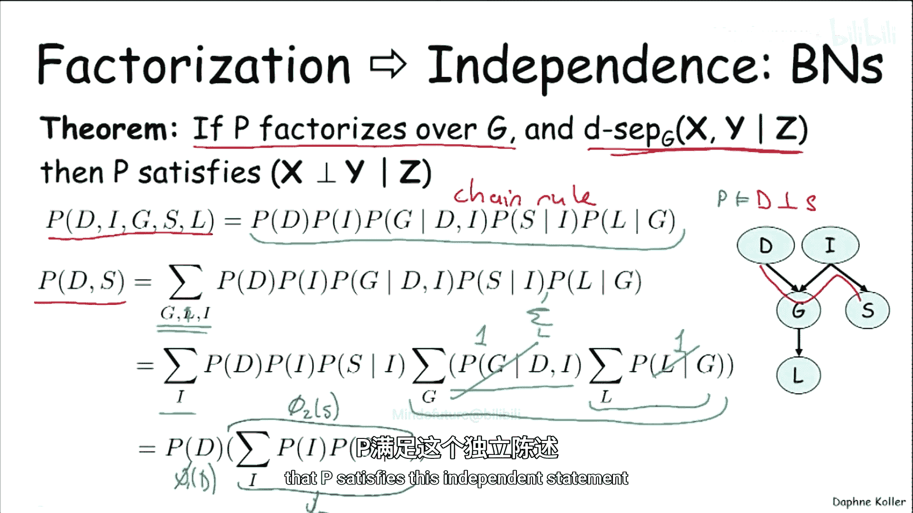
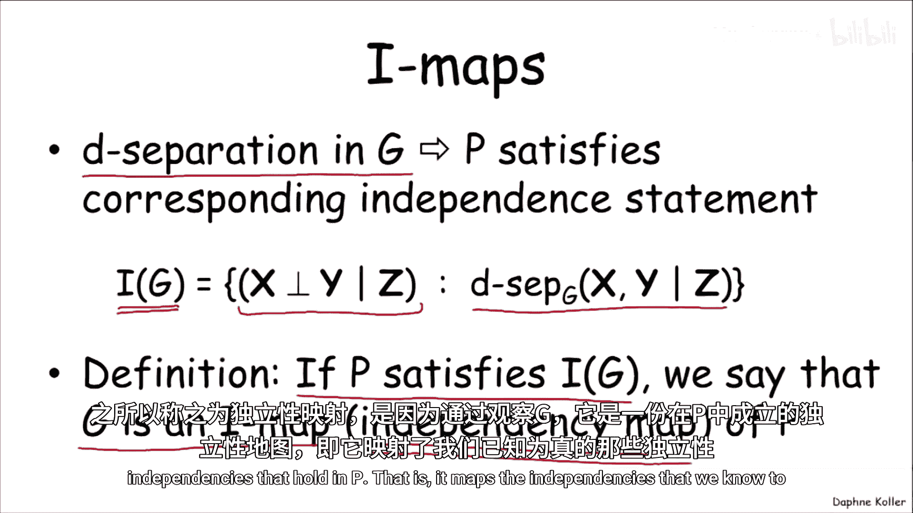
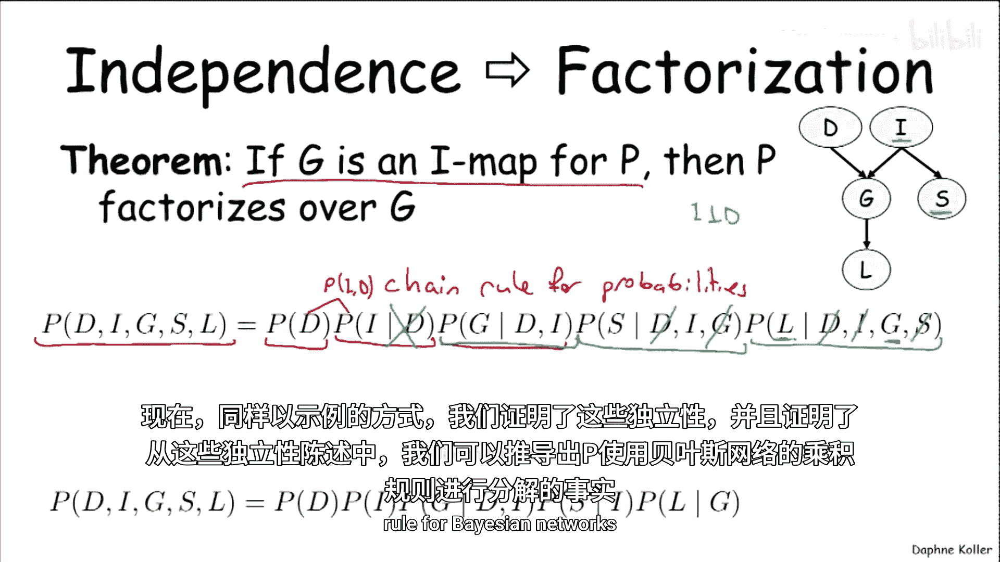
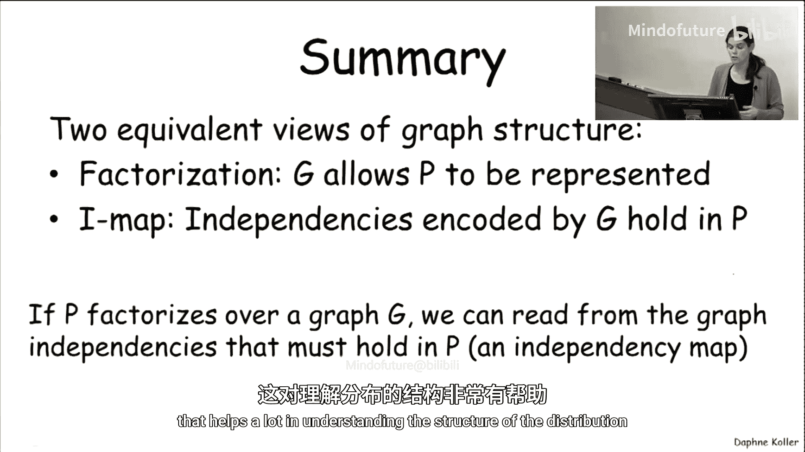

# 【斯坦福】概率图形模型1：表示法 ｜ Probabilistic Graphical Models p09 P09_贝叶斯网络中的独立性_02_02_02 -BV1M76VBSEJ6_p9-

One of the most elegant properties of probabilistic graphical models is the intricate connection between the factorization of the distribution as a product of factors and the independence properties that it needs to satisfy。

Now we're going to talk about how that connection manifests in the context of directed graphical models or Bayese networks。

So let's first remind ourselves about why independence and factorization are related to each other。

 so for example， the independence definition that P of x comma y is the product of two factors。

 p of x and P of y is the definition of independence and at the same time it's a factorization of the joint distribution as a product of two factors。

Similarly， one of the definitions that we gave for conditional independence。

 which is that the joint distribution over x， y and z is a factor over x and z times a factor over y and z is the definition of conditional independence。

 so once again independence and factorization。So we see that factorization of the distribution corresponds to dependencies that hold in that distribution。

 and the question is have that so if we know now that a distribution P factorizes over G。

 the question is can we know something about the inencies that the distribution P must satisfy just by looking at the structure of the graph G？

So what are inencies that need that might hold in a probabilistic graphical model。

 So we talked about the notion of flow of influence in a probabilistic graphical model where we have。

 for example， the notion of an active trail that goes through as。Up through I。

 down through G and up through D， if， for example， we have the G is observed， that is in Z。

And that gave us an intuition about which one probabilistic influence might flow。

 We can now turn this notion on its head and ask the question， well。

 what happens when we tell you that there are no active trails on the graph。

 that is influence can't flow。So we're going to make that notion formal using the notion of de separation。

And we're going to say that X and Y are d separated in a graph G， given a set of observations Z。

 if there is an active trail between them。And the intuition that we'd like to demonstrate in this context is that this notion of influence can't flow corresponds much more formally to the rigorous notion of conditional independence in the graph。

So let's actually prove that that's， in fact， the case。

 So the theorem that we'd like to state that if P factorizes over the graph。

So if P factorizes over G， and we have a de separationparation property that holds in the graph。

 so x and y are dese in the graph， there's no active trails between them。

 then P satisfies the conditional independence statement， x' is independent of y given z。

 so de separation implies independence。If the probability distribution sa rises over G。

So we're not going to prove the theorem in its full glory。

 we're going to prove it by example because that example just really does illustrate the main points of the derivation。

So the assumption- so here's our graph G and here's the factorization of the distribution。

 so according to the chain rule。Of Bayesian networks。

And this is a factorization that we've seen before。

 and so now we'd like to prove that a de separation statement follows from from this assumption and the de separationation statement that we'd like to prove follows as an independence is one that says that B is independent of S。

First let's convince ourselves that DNS are in fact dese in this graph。

 and so we see that there is only one possible trail between DNS in this graph it goes like that。

 and since G is not observed in this case， and neither is L we have that the trail is not activated and so the two nodes are de separated and so we'd like to prove that this independence holds。

So what is the joint probability distribution？Of the and F。Well。

 it's the sum over this joint distribution over here。

Marginalizing out the three variables that are not the and S so GL and I。

 so we have the sum over GL and I of this big product that's defined by the channel。

And as we've previously seen when we have a summation like that。

 one of the things that we can do is we can push in summations into the product so long as we don't push them through terms that involve the variable。

 so here， for example， we might have a summation over L。

And we can push in that summation because the only term that involves L is probability of L given G。

So if we push in the summations in this way， we end up with a following expression and we see that we have this summation over L here。

 a summation over G， and then finally the summation over I at the very beginning。

And when we know about the summation over L of a P of L given G。

 we know that this is a probability distribution over L。

 and therefore it necessarily sums to1 because we're summing up over all of the possible values of L。

Once this term is one， we can look at the next term。

 which is this one and we can ask ourselves well one is canceled out in so probability。

 what is the sum over G of the probability of G given DNAI and that two is one and by the time we're done we end up with a following expression and the important thing to notice about this expression is that this is。

Phi 1 of D。 And this is。5hi，2 oops。i2 of s， and therefore because we partition this joint distribution as a product of two factors。

 we end up with something that corresponds directly to the definition of marginal dependence。

 therefore proving that P satisfies this independent statement。

But having convinced ourselves that de separationparation is an interesting notion。

 let's look at some other de separationation statements that might hold in a graph。

So one general statement that we can show is that any node in the graph is desepar。

From its non descendants， given its parents。 So let's look at the variable letter。

And let's see what non nondesants it has that are not its parents。 So it only has two descendants。

 Let's mark those in blue。 It's this one and that one。 And what are the nondesants。

 So these are the descendants。What about the non descendendants？Well， here's one on descendant。

Here is another， another and another。 So those are the four non descendants in the graph that are not parents。

So now let's convince ourselves that letter is desepar from all of its nondescendants given as parents and let's take just an arbitrary one of those。

 let's take SAT for example， and let's see if we can find an active trail from SAT to letter that is active given the parents。

 which in this case is just a variable grade。 so what's one potential trail so we can go this way？Up。

And then back down through water。 But is that trail active？No。

 it's not active because grade is observed and so it blocks the trail。

 as in fact it will block any trail that comes in from the top。

 so any trail into letter that comes in through its parent grade is going to be blocked via the fact that grade is observed。

So that means we have to come through the bo。 So let's look at that。

 So let's look at the trail from SAT through job。And up again through letter。

 Well is that trail active。 No， the reason it's not active is because only grade is observed and job since it's not。

 it can't be parent of a letter because it's a descendant is necessarily not observed。

 And so neither job nor happy are observed。 And so we cannot activate this V structure over here cannot be activated。

 And so trails that come in from the bottom don't work either。And so we again。

 this is approved by demonstration， but it shows again that。

It shows the general property in a very simple way。

So that tells us by the theorem that we proved on the previous slide that FP factorizes。Over G。

 then we know that any variable is independent of its non descendants given its parents。

Wwhichch is kind of a nice intuition when you think about it because when we motivated the structure of Bayesian networks。

 we basically said that what makes us pick the parents for a node is the set of variables that are the only ones that this variable depends on so the parents of X are the variables on which X depends directly and this gives a formal semantics to that intuition that is we now have that the variable is depending only on its parents。

😊，So now that we've defined a set of inencies that hold for any distribution that factorizes over graph。

 we're now going to define a general notion， which is just a term for this。U。

So we defined de separationation in a graph G， and we showed that when you have the de separationation property。

 that P satisfies the corresponding independent statement。

And so now we can basically look at the dependencies that are implied by the graph G， so I of G。

 which is the set of inencies that are implicit in a graph G， are all of the independent statements。

 X independent of y given Z that correspond to de separationation statements in the graph。

 so this is the set of all independentencies that are derived from de separation statements。

 and those are the ones that the graph implies hold for distribution P as we just showed in the previous theem。

So now we can give this a name， we're going to say that P， if P satisfies all of the inencies in G。

 then G is an IMap of P， and IMap stands for Independency map。

And the reason it's an Inency map is by looking at G， it's a map of independencies at Hol in P。

 that is， it maps dependdependencies that we know to be true。

So let's look at an example of an imMAP。So let's look at two distributions。

 here is one distribution P1。And here's a second distribution， P2。

And let's look at two possible graphs。One is G1 that has D&I being separate variables and the other。

Is is G2 that has an edge between D andI？So what dependencies does G1 imply。

 What's an I of G1 Well I of G1？Is。The independence that says D is independent of I。

 because there's no edges between them。What's I of G2？

I ofG2 implies no dependencies are because D and I are connected by an edge and there's no other inencies that can be implied。

 and so I ofG2 is the empty set。So what does that tell us。

 Let's look at the connection between these graphs and these two distributions is G1 and IMap of P1。

Well， if you look at P1， you can convince yourselves that P1 satisfies。These independent of I。

G1 is an imMap。Of P1。What about G is G1 an imM of P2 Well， if we look at P2。

 we can again convince ourselves by examination that P2 doesn't satisfy？D is independent of I。

 So the answer is no， this G1 is not an imAT for P2。What about the other direction， what about G2？

Well G2 has no independence assumptions and so it satisfies and so both P1 and P2 satis the empty set of independence assumptions as it happens。

 P1 also satisfies additional independence assumptions。

 but the definition of IM didn't require G that a graph exactly represent the independenceencies in。

In a distribution， only that any independence that's implied by the graph holds for the distribution。

 And so we have。The G2 is actually an IMAT for both P1 and P2。

So now we can restate the theorem that we stated before。

Before we talked about de separationation properties。

 so now we can just give it a one concise statement， we can say if P factorizes over G。

 that is if it's representable as a Bayesian network over G， then G is an imMap for P。

 which means I can read from G。Independencies that hold in P。Regardless of the parameters。

That's by knowing that P factorizes over G。Interestingly， the converse of this theorem holds also。

 So this version of the theorem says that if G is an Iap for P。Then P factorizes over G。

 So what does that mean， It means that if the graph。

 if the distribution satisfies the independence assumptions that are implicit in the graph。

 then we can take that distribution and represent it as a Bayesian network over that graph。

So once again， let's do the proof by example。😊，So now here we have the little graph that we're going to use and so now what do we know？

We're going to write down the probability of the joint distribution over these five random variables using this expression。

 which is the chain rule for probabilities， not the chain rule for Bayesian networks because。

We don't know yet that this is representable as a Bayesian network。

 we're going to write the chain rule for probabilities and that has us writing it as P of D times P of I given D。

 which if you multiply it two together using the definition of conditional probability。

 these two together give us probability of eye comedy。If we multiply that by G given I and D。

 then we end up with a probability of G comma I comma D and so on we can construct this telescoping product and altogether we by multiplying all these conditional probabilities。

 we have a。We have we can reconstruct the original joint probability distribution。Great， now what？

So we haven't used any notions of independence yet so where do we use that Well we're going to look at each one of these terms and we're going to see how we can simplify it so P of these is already as simple as it gets。

 so now let's look at on the next term which is probability of I given D and let's look at this graph and we can see that I and D are non-descendants。

And we're not conditioning on any parents， and so we have that in this graph and we've already shown this that I is independent of D。

 and so we can using one of the definitions that we have with conditional dependence。

 we can erase this from the right hand side of the conditioning bar and just get P of I。

The next term is actually already in the form that we want it。

 so we don't need to do anything with it， but now let's look at the probability of S given D I and G。

 So here we have the probability of a variable S， given one of its parent I and two nondescendants。

 D and G and we know that S is independent of its nondescendant。

 given a nondescendants given its parent I， and so we can erase both D and G and just end up with probability of S given I。

Finally， we have the last term probability of L given D I G and S。

 and here again we have the probability of a variable L， given its parent G and a bunch of nondeants。

 so we can arrange erase the non descendants。And so altogether that gives us exactly the expression that we wanted。

 and so now again， by example， we proved this we proved that from these independent statements。

 we can derive the fact that P factorizes using the product rule for Bayesian networks。

To summarize， we've provided two equivalent views of the graph structure。

The first is the graph as a factorization as a data structure that tells us how the distribution P can be broken up into pieces。

So in this case， the fact that G allows P to be represented as a set of factors or CPDs over the network。

The second is the IMab view， the fact the definition that the structure of G encode dependencies that necessarily hold in P。

 and what we've shown is that each of these actually implies the other。

Which means that if we have a distribution P that we know is represented as a Bayesian network over a certain graph。

 we can just look at the graph without even delving into the parameters。

 know certain dependencies that have to hold in the distribution P and inencies is a really valuable thing because it tells you something about what influences what。

 and if I observe something， what else might change。

 and that helps a lot in understanding the structure of the distribution and consequences of different types of observations。

