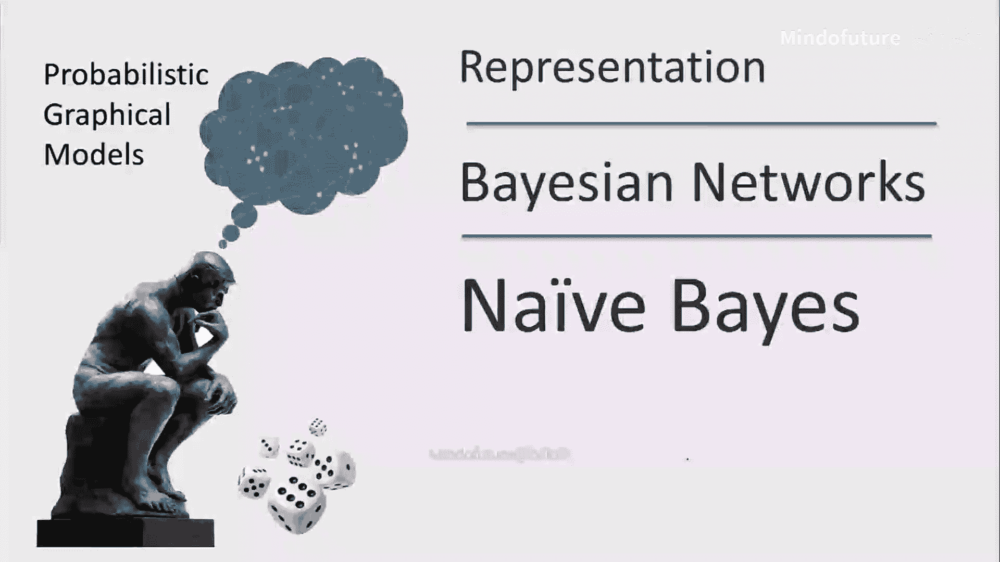
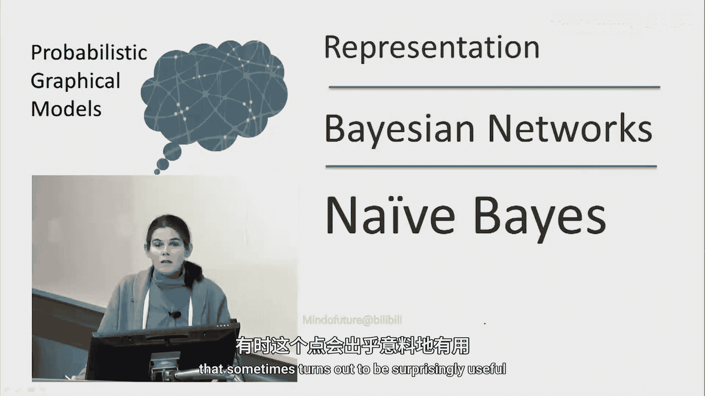
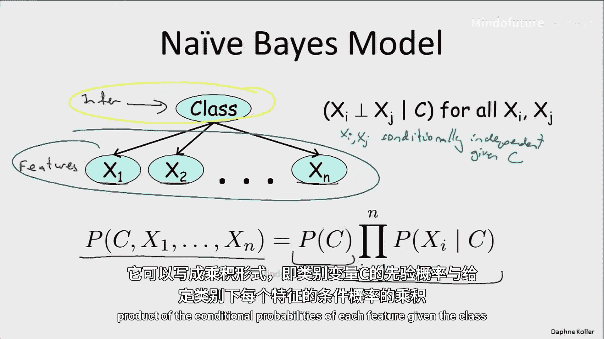
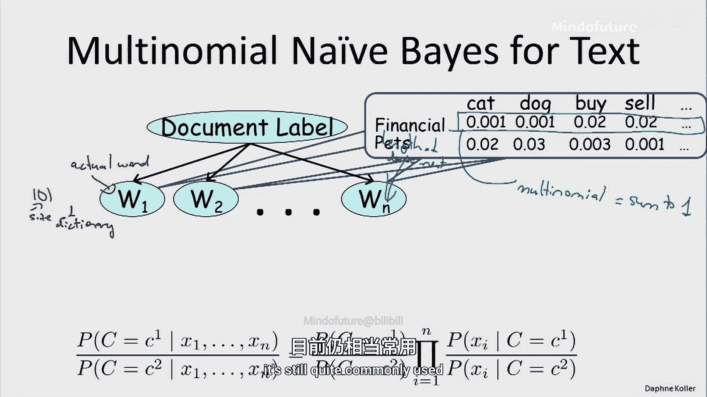
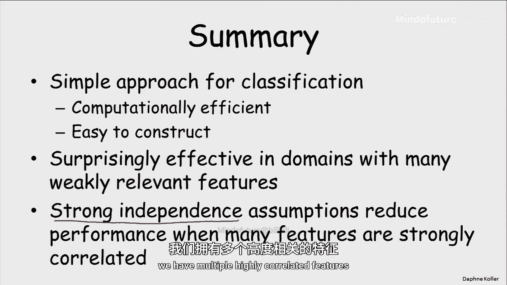

# 【斯坦福】概率图形模型1：表示法 ｜ Probabilistic Graphical Models p10 P10_朴素贝叶斯_02_02_03 -BV1M76VBSEJ6_p10-

One subclass of Bayesian networks is the class called as naive Bays or sometimes even more derogatory idiot Bay。

 as we'll see naive Bays models are called that way because they make independence assumptions that indeed are very naive and orally simplistic。

 and yet they provide an interesting point on the tradeoff curve of model complexity that sometimes turns out to be surprisingly useful。

So here is a naive base model， this model is typically used for classification that is taking an instance where we have effectively observed a bunch of features and in most cases。

 although not necessarily we're assuming that all of these features are observed for each of the for a given instance。

 and our goal is to infer，😊，To which class among a limited set of classes。

 a particular instance belongs， so these are observed。These ones here observed。

And this one in general， is hidden。Now， if you look at the assumptions made by this model。

 this model makes the assumption that every pair of features。

 Xi and Xj are conditionally independent。Given。The cloth。So every Xine Xj give us no information。

 one gives no information about the other once the class variable is observed。

Which reduces this whole model into one where we only have to encode individual pairwise interactions between the class variable and single features。

So if we look at the chain rule for Bayesian networks as applied in this context。

 we see that we have a join distribution P of C comma X1 of the Xn。

 which can be written using a product form as a prior over the class variable C。

 and a product of the conditional probabilities of each feature given the class。

To understand this model a little bit better， it helps us to look at the ratio between the probabilities of two different classes。

 given a particular observation， that is a particular assignment X1 of the XN to the observed features。

So if we look at this ratio， we can see that it can be broken down as a product of two terms。

 The first is just the ratio of the prior probabilities of the two classes。

 so that's the green term here。 and the second is this blue term， which is a product of odds ratios。

 as it's called。That is the probability of seeing a particular observation， X I。

In the context of one class， relative to the context of the other class。

So let's look at an application of the naive Bay model in one of the places where it's actually very commonly used。

 which is the context of text classification。 So imagine that we're trying to take a document and figure out。

For that document to which category belong， we have some set of categories in mind。 So， for example。

 is this a document about pets， is it about finance， iss it about vacations。

 We have some set of categories， and we'd like to assign a document to one of those。

It turns out that one can use two different naive based models for tackling this problem。

 The first of those is called the Berulli naive B model for text and it treats every word in a dictionary。

So you open your dictionary and there's several， you know maybe 10000 words in that dictionary。

 and so you have a random variable for every one of those words or at least the ones that occur in the kind of document that you're interested in thinking about and for each word。

In the dictionary， we have a binary random variable。Which is one。If the word appears in the document。

And zero otherwise。So if we have， say 5，000 words that we're interested， amazing about。

 we would have 5，000 of these binary variables。And so the probability associated the CPD associated with each variable is in this case。

 the probability that the word appears， say the probability that the cat。

 the word cat appears given the label of the document。So for example。

 if we had two categories that we're looking at right now。

 say documents about finances versus document about a document about pets。

 you would expect that in a document about pets， the word cat is quite likely to appear。

 and so I'm only showing the probability of cat appearing。

 the probability of cat not appearing would be 0。7， the probability that dog appears might be 0。

4 and so on。Whereas for a document about finances， we're much less likely to see the wordca and dog but are more likely to have the words buy and sell so the probability that buy appearss might be considerably higher in this case。

So this is a Bernoulli naive Bay model because first it's a Bernoulli model because each of these is a binary variable with subject to a Bernoulli distribution。

 so this is a Bernoulli distribution and it's naive based because it makes very strong independence assumptions that the probability of one word appearing is independent of sorry the event of one word appearing is independent of the event of a different word appearing。

 given that we know the class and obviously that assumption is。

Are too strong to be representative of a reality， but it turns out to be a not bad approximation in terms of actual performance。

A second model for the same problem is what's called the multinomial naive base model for text。

In this case， the variables that represent the features are not the words in the dictionary。

 but rather words in the document。 So here N is the length of the document。

If you have a document that has 737 words， you're going to have 737 random variables and the value of each of these random variables is the actual word。

That is in the first second up to the end position in the document。

And so if we have say that same dictionary of 5，000 possible words。

 this is no longer a binary random variable， but rather one that has thevalue where this is the size of the dictionary。

They 5000。Now this might seem like a very complicated model because the CPD now needs to specify the probability distribution over words in the dictionary for every possible very possible position in the document。

 so we need to have a probability distribution over the words in position1 in position2 and in position N。

 but we're going to address that by assuming that these probability distributions are all the same。

 and so the probability distribution over words in position one is the same as for words in position2。

3 and so on。Now this is a multinoial naive base model because notice that the parameterization for each of these words is a multinoial distribution。

 so what we see here is not the same as what we saw in the previous slide where we had a bunch of binary random variables here this is a multinomial。

Which means that all of these entries sum to one。And it's a naive base model because it makes。

 again a strong independence assumption， a different independence assumption。

 in this case it makes the assumption that the word in position one is independent of the word in position two given the class variable and once again。

 if you think about say two word phrases that are common。

 this assumption is clearly overly strong and yet it appears to be a good approximation in a variety of practical applications and most notably in the case of this kind of document classification where it's still quite commonly used。

😊。

So to summarize， naive Base actually provides us with a very simple approach for classification problems。

 it's computationally very efficient and the models are easy to construct whether by hand or by machine learning techniques。

 it turns out to be a surprisingly effective method in domains that have a large number of weekly relevant features such as the text domains that we talked about。

😊，On the other hand， the strong independence assumptions that we talked about。

 the conditional independence of the different features given in the class。

 reduce the performance of these models， especially in cases where we have multiple highly correlated features。

