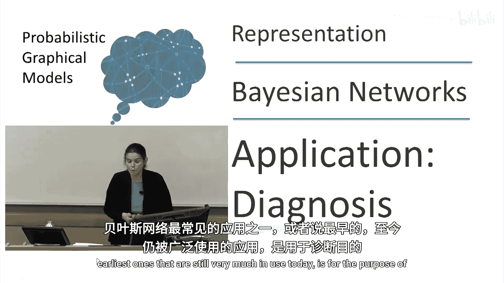
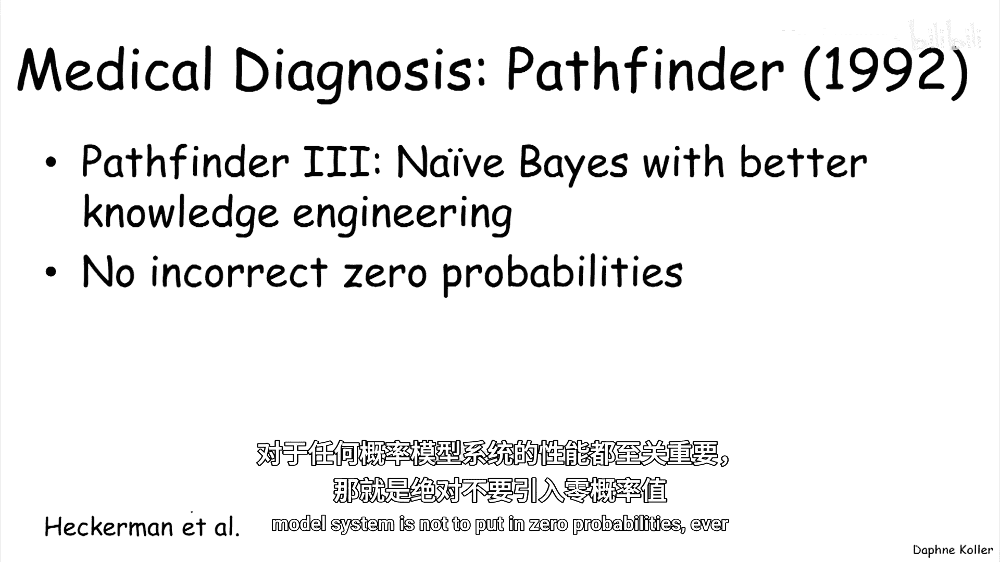
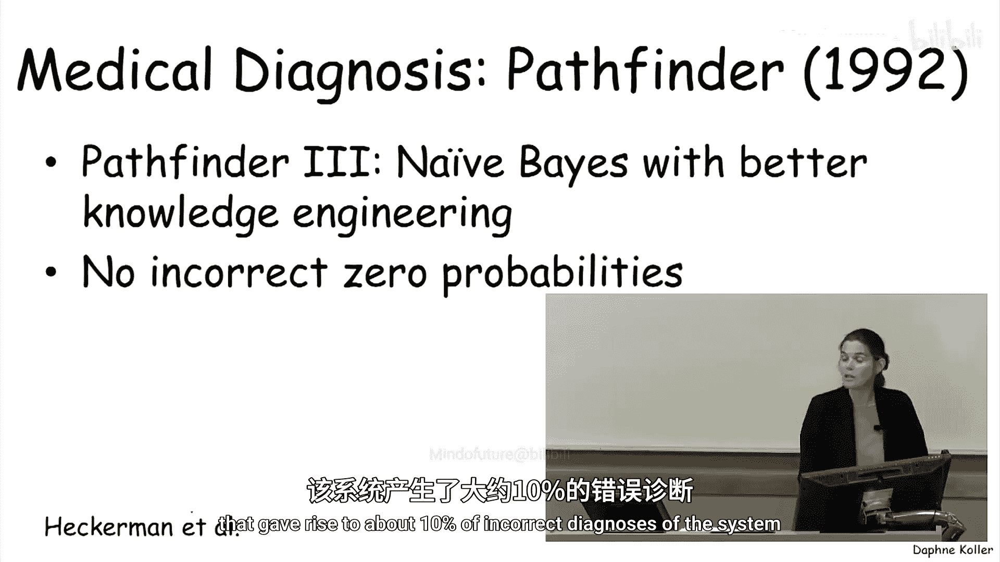
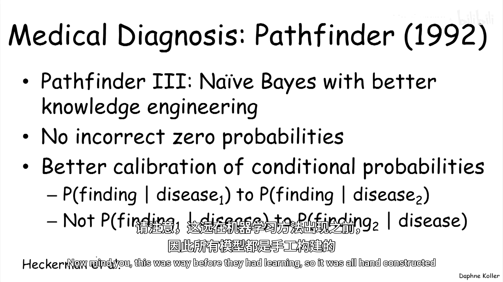
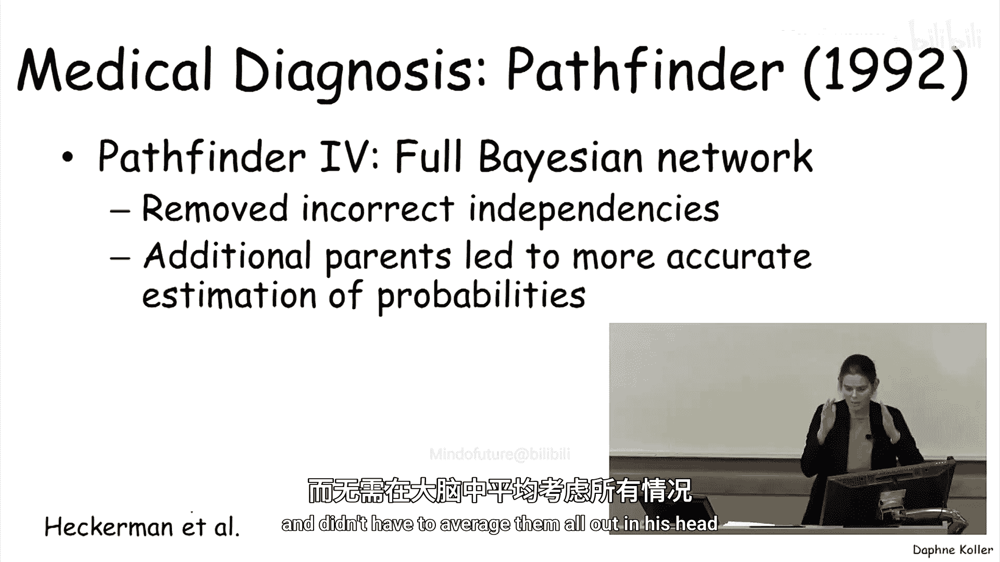
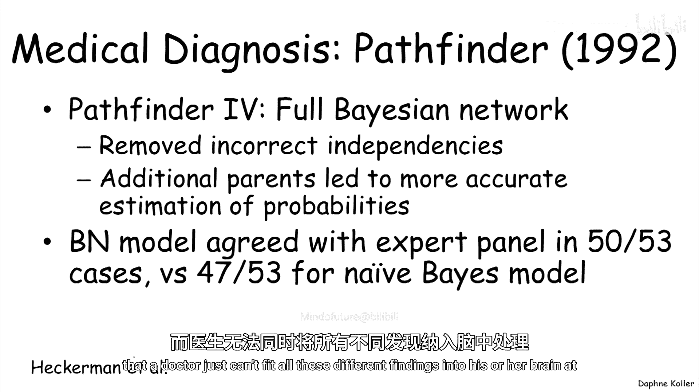
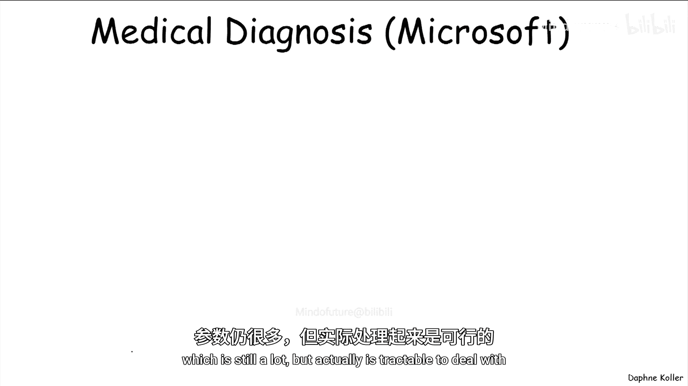
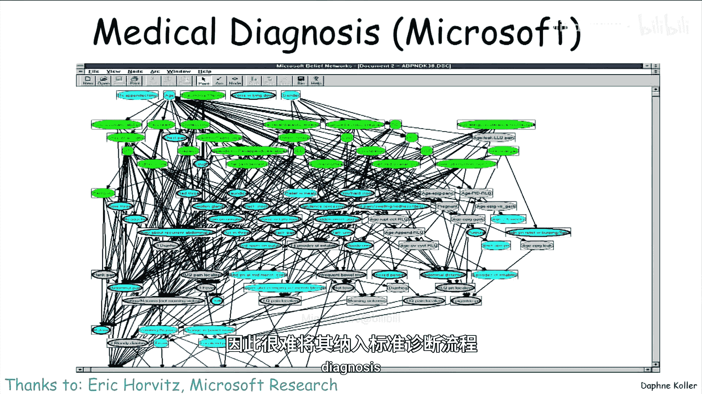
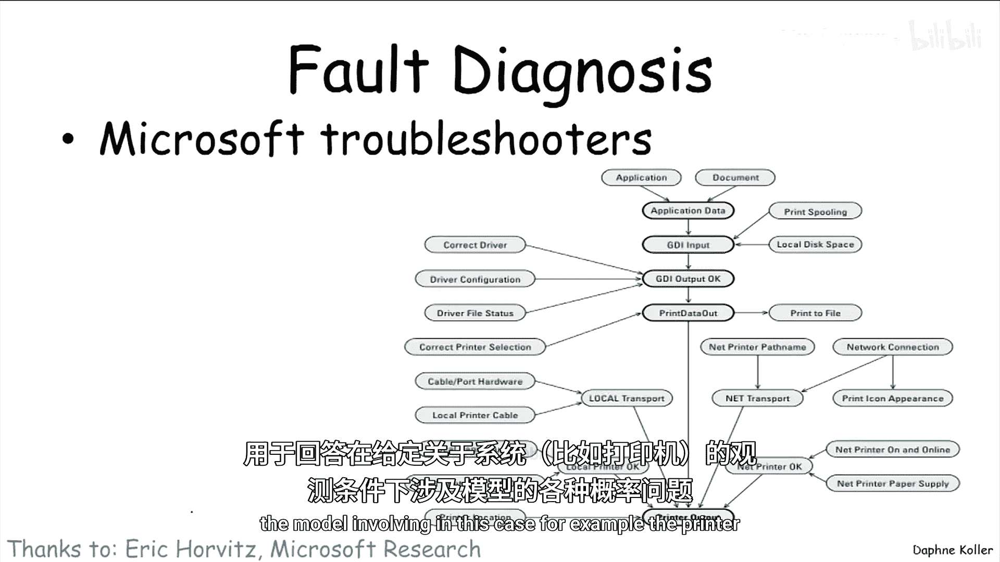
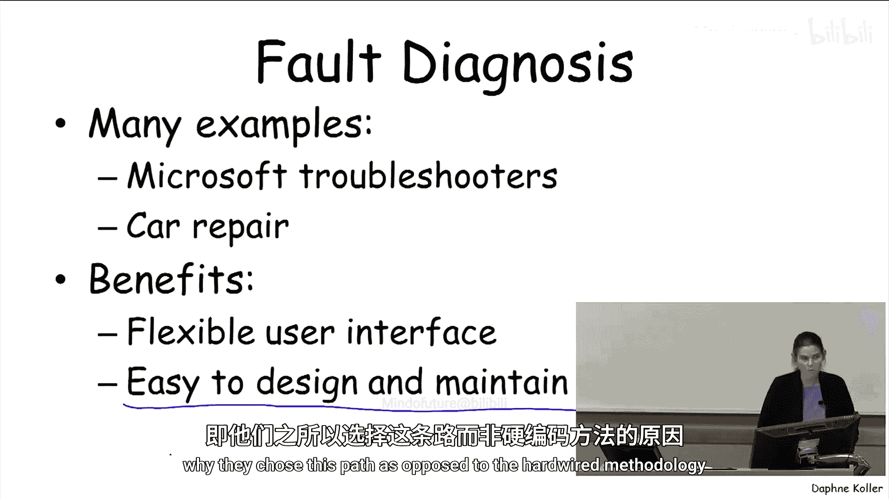

# 【斯坦福】概率图形模型1：表示法 ｜ Probabilistic Graphical Models p11 P11_应用-医学诊断_02_03_01 -BV1M76VBSEJ6_p11-

One of the most common applications of Bayesian networks or rather one of the earliest ones that are still very much in use today is for the purpose of diagnosis and by diagnosis。

 I mean both medical as well as fault diagnosis Now this date back into the early 90s in the PhD thesis of Heckerman at all won the ACM dissertation award in a system called Pathfinder which looked at a range of different pieces of evidence in order to help a doctor diagnose a set of diseases and specifically it was focused initially at least on lymph node pathologies。

 so 60 different diseases， all sorts of different symptom and they tried out a bunch of different rule a bunch of different methods for solving this problems So the first one they actually tried this was way back in the early days of artificial intelligence before Bayesian networks were in common and they tried to rule-based system and it didn't work really well。

The second version of Pathfinder used the naive B model。

 which assumes that all of the symptoms are independent given the disease。

 And even that really simple model got superior performance to the roll based system that they initially tried。

Pathfinder 3 still use naive Bay， but it used naive Bay with better knowledge engineering。

 That is they actually， they actually understood some of the issues behind what makes a system like this work well and what and they fixed it。

 So specifically， one of the things that turns out to be really fundamental for the performance of any probabilistic modelbilist system is not to put in zero probabilities。

 ever except for things that are definitions， because once you put in a zero。

 no matter how much evidence in the country you have， you will never ever be able to get rid of it。

 because anything。

Time 0 is still0。 And so here in the initial pathfinder2。

 they put in some incorrect zero probabilities for things that were very unlikely。

 but not impossible。 And it turns out that that gave rise to about 10% of incorrect diagnoses of the system。

They also did better calibration of conditional probabilities。

 which turns out to be important for knowledge engineering of a Baysian network。 So for example。

 it turns out that it's a lot easier to compare physician to compare the probability of a finding a piece of evidence between two diseases as opposed to the probability of two different findings within a single disease it's much easier to say。

 oh， this is much more likely in this context than in that context and it turns out that when they asked the physician to calibrate this way。

 they got much better estimates of the probabilities。

 Now mind you this was way before they had learning so it was all hand constructed。

And then finally， Pathfinder 4 was the full Bayesian network in all of its full glory。

 It no longer made incorrect assumptions about independencies between different。

 say symptoms given a disease and that gave us and that both allowed them to make the model more correct。

 and also it turns out it is an unexpected side effect by allowing。

 say a a symptom variable to have more parents than just a single disease variable。

 it actually gave rise to considerably more accurate estimation of the probabilities because the doctor could kind of think about different cases and didn't have to average them all out in his head。

And this is one of the I think， really compelling aspects of Bayesian network models。

 which is that the Bayesian network model actually turned out to agree with the expert in an expert panel of physicians in 50 out of the 53 cases and these were hard cases。

 these were ones that you really needed the expert opinions on。

 it wasn't one that that just an average doctor could necessarily diagnose correctly。

 and this is compared to 47 out of 53 for the naive Bay model and significantly less than out for the rolebased system。

 Min you， and this is an interesting and important aspect is that the Bayesian network actually outperformed the physician who designed the model and I mean。

 it didn't outperformed the expert panel， but it performed the physician who designed it become it was better at putting together all these different numbers in a way that a doctor just can't fit all these different。

And findings into his or her brain at the same time。

So we talked about the CPCS network， it's one of my favorite networks because it's kind of big inherent hair and sort of kind of scary to look at。

 but anyway the actual number of variables in this network is about 500。And each of them has。

 on average， about four values。 So the total number of parameters。

 If you were to specify a full joint distribution is 4 500。

 So that's about it's about 4 to the 500 or two to the power of 100。

 which is more than the number of in the universe。 So obviously。

 one couldn't specify this is a complete joint distribution。

 not to mention that the probability of each and every one of these is about this is close to  zeros makes no difference because it's the probability of you know。

500 different。 It means， it's an event involving 500 variables。

If were if you were to actually construct a CPD for each one for each of these variables。

 the parameters would be about 133 million。Which is terribly better than2 to the 1000。

 but still much too large。And so it turns out that they made additional simplifying assumptions that we'll talk about later on that allowed them to avoid a complete table representation of the CPDs and rather do a more compact one。

 and that gave rise to about 8000。Pimeterters。Which is still a lot， not。

 but actually is tractable to deal with。

So we already talked about the fact that these medical diagnosis systems have emerged from research and Microsoft built a medical diagnosis systems various other people have built on as well。

This has been a little bit slow on the uptake in the medical field because it doesn't fit naturally into a physician's pipeline maybe now with the advent of medical of electronic health records。

 therell be more data entered into the computer so these systems will be in more common use but until very recently most doctors just wrote stuff down on paper and so it was very difficult to put this into the standard production pipeline for diagnosis and then finally fall diagnosis has been a much more direct application of these systems because we don't have an issue of you know how doctors typically do their diagnostic pipeline so within the Windows operating systems。

 there's thousands of these little troublehootters that help you diagnose problems with your printer with Excel with your email and each of these has a little Bay and network inside that answers probability。

Questions given observations about what the system about the model involving in this case。

 for example， the printer。

And there's also a big website out there that does car repair and you put in the make and model of and year of the car and what are the main problems with it in it figures it out tells you what to look at and what the most likely complaint is。

And the reason behind the benefits of this， people don't use Bayesian networks for this just because Bayesian networks are cool。

 even though they are they use this because it provides a very flexible user interface for for the user you instantiate the evidence in the Bayesian network outcomes of probability you don't want to answer the question right now。

 that's okay you can answer it later， it just means that it's an observation that you didn't get the condition on and then for the designer。

 this type of system is really easy to design and maintain because if for example。

 something changes a little bit in your printer structure。

 If you were design a standard menubased system， you would have to go and rebuild the entire tree that asks that decides what is the first question to ask and what is the second question to ask and what is the most likely diagnosis here in the Bayesian network。

 you change one probability， maybe add an edge。Everything just emerges from that in a very straightforward way。

 so it's much more modular and more maintainable than a hardwired menu based system and that's what the people who use these systems will tell you is that's why they chose this path as opposed to the hardwired methodology。

