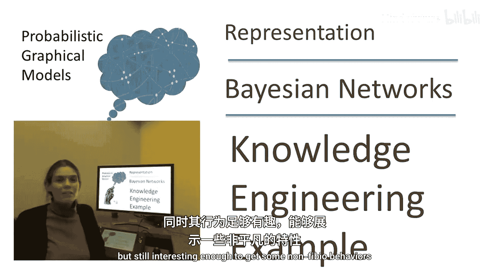
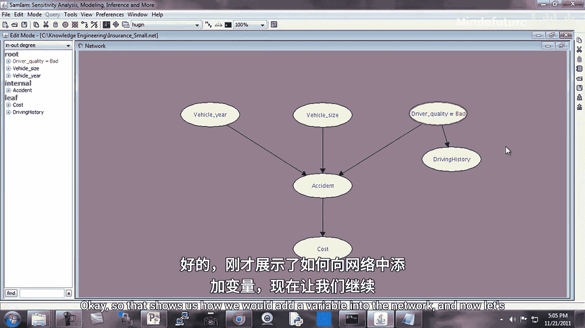
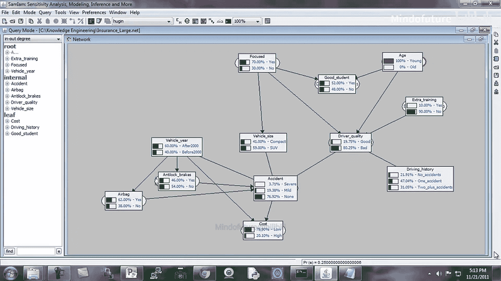

# 【斯坦福】概率图形模型1：表示法 ｜ Probabilistic Graphical Models p12 P12_知识工程示例-SAMIAM_02_03_02 -BV1M76VBSEJ6_p12-

So now let's look at an example of an actual network and try to see what the CPDs look like。

 what behavior we get， and how we might augment the network to include additional things now let me warn you right up front that this is a baby network。

 it's not a real network but it's one that's useful to it's compact enough to look at。

 but still interesting enough to get some non foral behaviors。

So to explore the network we're going to use a system called SA Iam。

 it was produced by Aman Darwish and his group at UCLA and it's nice because it actually works on all sorts of different platforms so it's usable by pretty much everyone so let's look at a particular problem imagine that we're an insurance company and we're trying to decide for a person who comes into the door whether to give them insurance or not。

So the operative aspect of making that decision is how much the policy is going to cost us that is how much we're going to have to pay over the course of a year to ensuresure this person let's so there is a variable called cost let's click on that to see what properties that variable have and we can see that in this case we've decided to only give two values to the cost variable low and high this is clearly a very coargra approximation and not one that we would use in practice in reality we would probably have this be a continuous variable whose mean depends on various aspects of the model but for the purposes of illustration we're going to use this discrete distribution that only has two values low and high。

Okay so now let's build up this network using the the technique of expanding the conversation that we've discussed before and so what is the most important determining factor as to the cost of the insurance company has to pay well probably whether the person has accidents and how severe they are so here we have a network that has two variables。

 one is accident and one is cost and in this case we've decided to select three possible values for the accident variable none。

Mild and severe。 And with the percentages that you see with the probabilities that you see listed。

 And what you see down below is the cost variable and let's open the CPD of the cost variable given。

The accident variable and we can see that in this case we have a conditional probability table of accident given sorry of cost given accident。

 note that this is actually inverted from the notation that we've used in the class before because here are the conditioning cases are columns whereas in the examples that we've given there have been rows。

 but that's okay， the same thing， it's the same thing just inverted。And so we see， for example。

 that if the person has no accident， the costs are very likely to be very low。

 mild accidents incur different distribution over costs and severe accidents have a probability of 0。

9 of having high cost and 0。1 of having low cost。So now let's continue extending the conversation and ask what accident depends on and it seems that one of the obvious factors is whether the person is a good driver or not。

 and so we would expect driver quality to be a parent of accident。

 but there's other things that also affect not just the presence of an accident but also the severity of the accident。

 so for example， vehicle size would affect both the severity of an accident because if you're driving a large SUV then chances are you're not likely to be in an accident is as severe but it might also perhaps increase the chance of having an accident overall because maybe driving a large car is harder to handle。

And then vehicle year might affect the chances of an accident because of the presence or absence of certain safety features like anti brakes and airbs。

 so let's open the CPD of accidents and see what that looks like now that we have all these parents for it。

 and we can see here that we have these in this case， eight conditioning cases。

 after it would correspond to the three variables to values each and so here just to look at one of the sample just as an example distribution。

 for example， so if this is a fairly new vehicle after 2000 and it's an SUV。

 the probability of having a severe accident is quite low。

 the probability of having a mild accident is moderate。

 and the probability of having no accident is 0。85 whereas if you compare that to the corresponding entry when we keep everything fixed except that now it's a compact car。

嗯。We see that。The probability of having a mild accident is lower。

 but the probability of having no accident is higher， representing different driving patterns。

 for example。Okay， so with this network， we can now start asking simple questions。

So let's do some examples of causal inference， let's instantiate， for example。

 driving quality to be good。And bad， and we can see that for a bad driver。

 the probability of cost is  low cost is 81%。And for a good driver。

 the probability of low cost is 87%。If we look at the accident。

 we can see that for a good driver there is a probability of 87 and half percent of no accident and 10% of mild accident and the probability of no accident goes down for a bad driver and mild accident goes up in severe accident also goes way up Now know that many of these differences are quite subtle。

 theres a difference of a couple of percent when we're at the other and you might think if you were designing a network that you'd like these really sort of extreme probability changes when you instantiate values。

 but in many cases that's not actually true and these subtle differences are actually quite significant for an insurance company that ensures hundreds of thousands of people。

 a couple of percentage points in the probability of an accident can make a very big difference to once profitability。

So now let's think about how we would expand this network even further vehicle size and vehicle year are things that we're likely to observe in the insurance form。

 but driver quality is something that's very difficult to observe you can't go ask somebody or you a good driver because everyone's going to say sure I'm the best driver ever and so that's not going to be a very useful question so what evidence that we have that we can observe that might indicate to us the value of the driver quality well one obvious one is is the person's driving record that is whether it had previous accidents or previous moving violations。

So let's think about adding a variable that represents driving history。

 and so let's go ahead and introduce that variable so you can click on this button that allows us to create a node。

 the node is now called variable one， so we have to give it a name。

 so for example we're going to call it driving history。

And that's his identifier and we also have the name of the variable， which is usually the same。

 and let's make that two values， say previous accident no previous accidents。Now。

Where will we place they steable in the network？One might initially think that the right thing to do is use to place driving history as a parent of driver quality if we observe because driving history can influence our beliefs about driver quality now it's true that observing driving history changes are probably in driver quality but if you think about the actual causal structure of this scenario but we actually have is that driver quality is a causal factor of both a previous accident as well as a subsequent accident and so if we want to maintain the intuitive causal structure of the domain。

 a more appropriate thing is to add driving history as a child rather than a parent of driver quality they might question why it matters and in this very simple example the two models are in some sense equivalent and we could have placed it either way except that the CPD for driver quality given driving history might be a little bit less intuitive。

But if we had other indicators of driver quality， for example， previous moving violations。

 then it actually makes a lot more sense to have all of these be children of driver quality as opposed to parents of driver quality。

Okay so so that shows us how we would add a variable into the network and now let's go and open up a much larger network that includes these variables as well as others so let's look now at this larger network。

 and we can see that we've added several different variables to the network we've added attributes of the vehicle。

 for example， whether the vehicle has anti brakes in an airbag which is going to allow us to give more informative probabilities regarding the accident。

 we've also introduced aspects of the driver， for example。

 whether they've had extra training which is going to increase driving quality。

 whether they're younger old where the presumption is that younger people tend to be more reckless drivers and whether the driver is focused or more easily distracted which again is going to affect driving quality。

Nowve since personality types is hard to observe we added another variable which is a good student which might indicate one's personality type。

 so let's open the CPD for that one。And so we can see here that for example， if you。Are a focused。

Person who's young。 you're much more likely to be a good student。

 much more so than if you are not a focused person who's young。 If you're old。

 you're just not very likely to be a student。 And so this probability is。

Basically says that if you're old， you're just not very likely to be a student and therefore not likely to be a good student。

So now that we've added all these variables to the network。

 let's go ahead and run a few queries to see what happens。

 and let's start by looking at the prior probability of accident before we observe anything。

 so we can see that the probability of no accident is about 79 and a5%。

 the probability of severe accident is about 3%。Now let's go ahead and tell the system that we have a good student in hand。

 so we're going to observe that the student is a good student and let's see what happens。

We can see surprisingly that even though we observed as somebody's a good student。

 the probability of no accident went down from 79 and a half to 78% and the probability of severe accidents went up to three and/ half to 3。

67% it might say well， but I told you that it's a good student shouldn't the probability of accidents go down so let's look at some active trails in this graph one active trail goes from good student to focused on。

To driver quality， the accident and sure enough that trail if we consider that trail in isolation is probably going to make the probability of no accident be higher。

 but we have another active trail we have the active trail that goes from good students up to age and then back down through driver quality so to see that let's unclick good students and see what happens note that the probability initially that the driver is young was 25%。

 but then when I observed good students it went up to9 to close to 95% and that was enough to counteract the influence along along this more obvious active trail。

So to demonstrate that this is indeed what's going on， let's。

Let's click on the fact and instantiate the fact that the student is young and we can see that the probability of severe accident went up to 3。

7% and no accident went down to a little bit shy of 77% and now let's observe good student and see what happens so now we observe good student。

And。The probability of no accident went down to 78。Percent。As opposed to before when it was 77。

Percent。Now that and the reason for that is that we've now blocked this trail that goes from good student through age to driver quality by observing this variable which blocks the trail。

So we can see the reasoning patterns in a Bayesian network are sometimes subtle and there are different trails that can affect things and interact with each other in different ways。

 and so it's useful to take the model and play around with different queries in different combinations of evidence to understand the behavior of a network and especially if you're designing such a network for a particular application。

 it's useful to try out these different queries in C it' the behavior that you get is the behavior that you want to get and if not。

 then you need to think back about how do I modify this network to get behavior that's more analogous to the desired behavior。

This network is available for you to play with and you can try out different things and see what behaviors you get。

