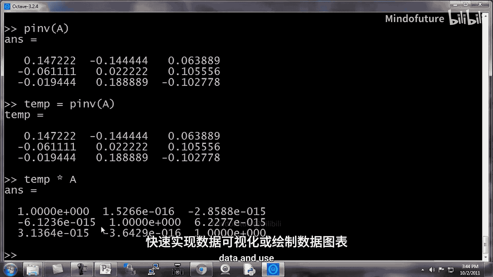

# 【斯坦福】概率图形模型1：表示法 ｜ Probabilistic Graphical Models p15 P15_数据运算_02_04_09 -BV1M76VBSEJ6_p15-

Now that you know how to load and save data and al put your data into matrices and so on。

 in this video I'd like to show you how to do computational operations on data and later on we'll be using these sort of computational operations to implement our learning algorithms。

Let's get started。Here's my octave window， let me just quickly initialize some variables to use for examples instead a to be a3 by2 matrix。

And set B to a3 by2 matrix， and that set C to a2 by2 matrix like so。

Now let's say I want to multiply two of my matrices。

 so let's say I want to compute a times C I just type a times C。

 so it's a 3 by2 matrix times a2 by 2 matrix， this gives me this three by2 matrix。

You can also do elementwise operations and do a dot times B。

 and what this will do is they'll take each element of A and multiply it by the corresponding element of B。

 so that's a， does B， that's a dot times B。So for example。

 the first element gives1 times 11 which gives 11， the second element gives2 times 12 which gives 24 and so on。

 so there is the elementwise multiification of two matrices and in general the period tend is usually used to denote element wise operations in octave。

😊，So here is a matrix A。 and if I do a dot carry2， this gives me the multi the elementwise squaring of a。

 So you， one squared is 1，2 squared is 4 and so on。Let's set V to a vector， and let's say V is one，2。

3， is's a column vector。You can also do one dot over V to do the element wise is reciprocal of V。

 So this gives me one over 1，1 over 2 and1 over3。 This works to from H C。

 So one dot over a gives me that element wise inverse of a。And once again。

 the period here gives us a clue that this is an elements wise operation。

You can also do things like log V。 This is an element wise log rhythm of the element of the V E to the V is B E exponentialonation of V's element。

 So this is E。 This is E squared E Q， because this was V， So。

And I can also do apps V to take the element wise absolute value of V。 So here， you know。

 V was all positive。 But it did apps， say -1，2-3。 the element wise absolute value， just me back。

 These are non negative values。And。Negative v gives me the minus of V。

 This is the same as negative1 times V， but usually you just write negative v instead of negative1 times V。

And。What else can you do， Here's another neat trick。 So let's see。

 let's say I want to take V and increment each of those elements by one。 Well。

 one way to do it is by constructing。诶。3 by one。Vectctor， there's all ones and adding that to V。

 So if I do that， this increments V by from 12，3 to 2，3，4。 The way I did that was length。A V is V。

So once。Life of V by one。 This is like one of three by one。 So that's once 3 by one。On the right。

 and what I did was v plus ones v by1， which is adding this vector of all ones to v。

 and so this increments v by1。And another simpler way to do is actually to type V plus one right。

 so here has V and V plus one also means to add one element wise to each of my elements of V。Now。

 let's talk about more operations。 So here's my matrix A。 If you want to write a transfers。

 the way to do that is the write a prime。 That's the aprocpy symbol is the left quote。

 So in on your keyboard， you probably have a left quote and a right quote。

 So this is excuse this is actually the standard quotation mark。This type a transpose。

 this gives me the you transpose of my matrix A， and of course a transpose if I transpose that again。

 then I should get back my matrix a。Some more useful functions， let's say low case A is 1152 0。5。

 So it's a1 by4 matrix。Let's say said t equals max of a。 This returns the maximum value of a。

 which in this case is 15。 and I can do t in。Max a。 and this returns thou an end。

 which are going to be the maximum value of a， which is 15， as was the index。

 So is the element number two of a that was 15。 So ins is my index into this。Just as a warning。

 if you do max a where a is a matrix， what this does is this actually does the column wise maximum。

But'll say a little bit more about this in a second。

Still using this example of the variable lowercase A， if I do a less than3。

 this does the element wise operation， element wise comparison。

 So the first element of a is less than 3。 So gives one second element of a is not less than 3。

 So this values is 0 because that's false。 the third and fourth elements of a are I mean less than3。

 third and fourth elements are less than3。 So this gives11。

 So this does the element wise comparison of all four elements of the variable lowercase A to3。

 and it returns true or false， depending on whether or not this less than 3。Now。

 if I do find a less than3， this will tell me which are the elements of a。

 the the variable a the less than 3。 And in this case， the first。

 third and fourth elements are less than 3。For my next example， let me set a to B equal to magicic3。

The magic function returns on this type health magic。

 The magic function returns functions called magic returns these matrices called magic squares。

 They have this。😊，You， mathematical property that all of their rows and columns and diagonals sum up to the same thing so you know is not actually useful for machine learning as far as I know。

 but I'm just using this as a convenient way you know to generate a three by three matrix and and these magic experience anyway have the property that each row。

 each column and the diagonals all add up to the same thing。

 So it's kind of a mathematical construct I use magic I use this magic function only when I'm doing demos so when I'm teaching octave like this and I don't actually use it for any you know useful machine learning application。

😊，But let's see if I type RC equals find a greater than a equals 7。

 Thiss all the elements of a that are greater than equal to 7。 And so RRC sensor of rowing column。

 So the1，1 element is greater than 7， the3，2 elements is greater than 7 and the two。

3 elements is greater than 7。 So let's see the two，3 element， for example， is a 2。

3 is 7 is this element out here， and that is indeed greater than equals 7。By the way。

 I actually don't even memorize myself what these fine functions do and what all of these things do myself and whenever I use the fine function。

 sometimes I forget myself exactly what it does and you know I would type help fine to lock up the document。

😊，Okay， just two more things。 and I'll quickly show you。 One is the sum function。 So here's my a。

 and then type sum A， this adds up all the elements of a。 And if I will multiply them together。

 I type pro a pro sensor product， and this returns the product of these four elements of a。

F a rounds down these elements of a。 So 0。5 gets rounded down to 0 and seal or ceiling a gets rounded up。

 So 0。5 rounded up to the nearest integer。 So 0。5 gets rounded up to1。You can also let's see。

 let me type roundand3 that generates a 3 by3 matrix。 If I type max round3 round3。

 what this does is it takes the element wise maximum of two random3 by3 matrices。

 So you notice all of these numbers tend to be a bit on the large side because each of these is actually the max of a randomly of a elementwise max of two randomly generate emerge。

This this is my magic number。 This was my magic square3 by 3 A。 Let's say I type max a。😊。

And then this we open close square bracket is comma 1。

 What this does is this takes the column Y maximum。 So the max in the first column is8。

 max of second column is 9。 the maximum in the third column is 7。

 This one means to take the max along the first dimension of a。In contrast。

 if I were to type max this funny notation2， then this takes the per row maximum。

 so the max of the first row is8 max of second row is 7 max of the third row is9。

 and so this allows you to take maxes either per row or per column。

And if you want to remember a defaults to a column wise element。

 so if you want to find the maximum element in the entire matrix A， you can type max of max of a。

Like so， which is nine， or you can turn a into vector and type max of a。

ColonlyO and this treats this as a vector and takes the max element of that vector。Finally。

Let's set a to be a 9 by9 magic square。 So remember。

 the magic square has this property that every column in every row sums the same thing and also the diagonal。

 So here's a 9 by9 matrix magic square。 So let me do sum a1。 So this does a per column sum。

 So I'm going to take each column of a and add them up and this let's verify that indeed for9 by9 magic square。

 every column adds up to 369 adds up the same thing。 Now let's do the row wide sum。

 So thats sum a comm2。😊，And this sums up each row of a and indeed each row of a also sums up to 36，9。

Now let's sum the diagonal elements of a and make sure that a that that also sums up to the same thing。

 so what I'm going to do is construct a  nine by9 identity matrix that's I9 and I'm going to take a and construct。

You， multiply a elements wise。 So here's my matrix A。 I'm going to do a dot times I 9。

 And what this will do is take the element wise product of these two matrices。

 And so this should wipe out everything in a， except for the diagonal entries。

And now I'm going to do some， sum of a of that。 And this gives me the。

Some of these diagonal elements and indeed is 369 you can sum up the other diagonal as well So instead instead of top left to bottom right。

 you can sum up the opposite diagonal from bottom left to top right the commands for this is somewhat more cryptic you don't really need to know this I'm just showing you this in case any of you are curious but。

Let's see。th UD stands to flip up down， but if you do that that turns out to sum up the elements and the opposite at the other diagonal of a and then also sums up to 36。

9 here， let me show you， whereas I9 is this matrix。Flip up down of I 9。You know。

 takes the identity matrix and flips it vertically， so you end up with excuse me， flip UD。

 end up with ones on this opposite diagonal as well。Just one last command。

 and that's it then then that for this video。 Let's say a to be the magic3 by3 magic square game。

 If you want to invert a matrix， you type P in a， this is technically called the pseudo inverse。

 but it doesn matter。 just think of this basically the inverse of a and that's the inverse of a。

 And so I can set temp equals P in of a and if I take temp times a this is indeed the identity matrix with essentially ones on the diagonals and zeros on the off diagonals up to a numerical roundoff。

😊，So that's it for how to do different computational operations on the data emergerices and after running a learning algorithm。

 often one of the most useful things is to be able to look at your results or to plot or visualize your results and in the next video I'm going to very quickly show you how again with one or two lines of code usingoctave。

 you can quickly visualize your data or plot your data and use that to better understand what your learning algorithms are doing。

