# 【斯坦福】概率图形模型1：表示法 ｜ Probabilistic Graphical Models p16 P16_数据绘图_02_04_10 -BV1M76VBSEJ6_p16-

When developing learning algorithms， very often， a few simple plots can give you a better sense of what the algorithm is doing and just sanity check that everythings going okay。

 And the algorithm is doing what is supposed to。 For example， in an earlier video。

 I talked about how plotting the cost function J of theta can help you make sure that gradient descent is converging。

Often， plus of the data or of the learning algorithm outputs will also give you ideas for how to improve your learning algorithm。

Fortunately， Otave has very simple tools to generate lots of different plots and when I use learning algorithms I find that plotting the data。

 plotting the learning algorithm， and so on are often an important part of how I get ideas for improving the algorithms and in this video I like to show you some of these octave tools for plotting and visualizing your data。

Here's my octave window。 Let's quickly generate some data。First the plots。

 I'm going set T to be equal to， you know this array of numbers。

 here T set of numbers going from a 0 up to a 。98。 Let's say y 1 equals sine of 2 pi 4 T。

And if I want a plot。The s function is very easier。 just type plot T comma Y 1 and hit enter。

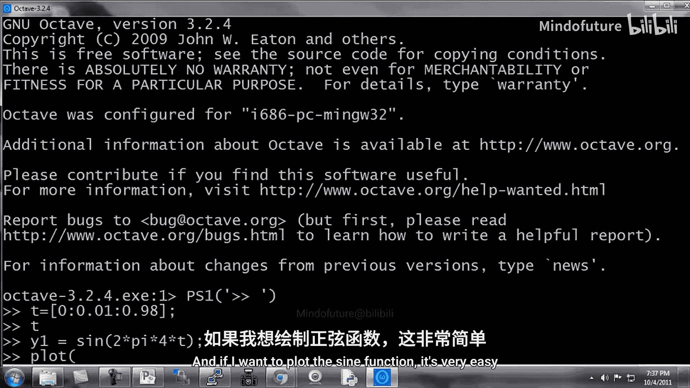

And up this plot where the horizontal axis is the T variable and the vertical axis is y1。

 which is the sort of sinus solid function that we just computed。

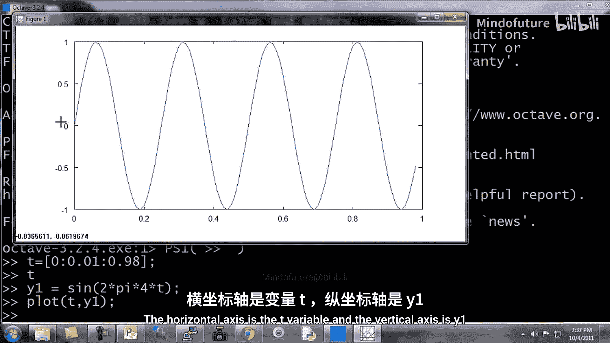

Let's set y 2 to be equal to。The cosine of 2 pi4 T， like so。And if I plot。

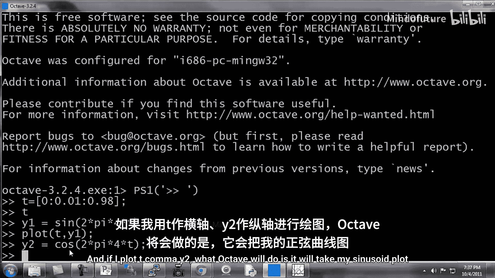

T comma Y2， what octave will do is it'll take my sinusoid plot and it will replace it with this cosine function that now。

 you know， cosine of xs are 1 right。

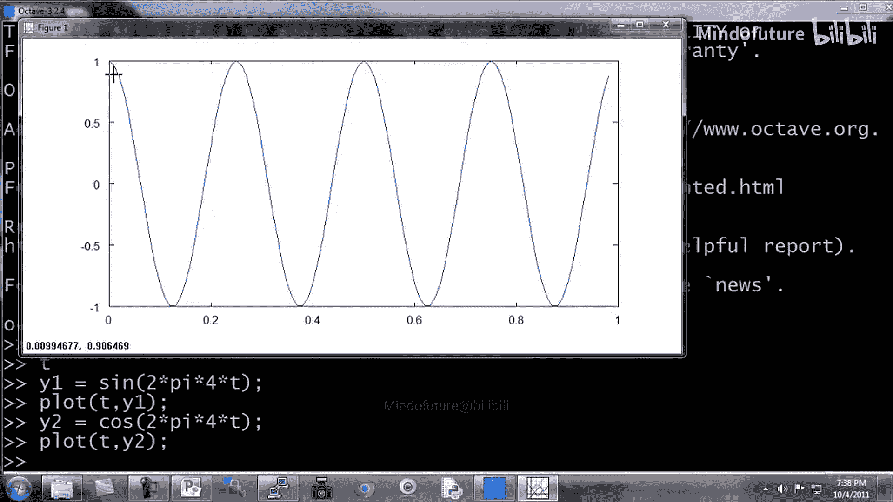

Now， what if I want to have both the in the cosine plots on top of each other。

 What I'm going to do is I'm going to type plot t comma y1。 So here's my sine function。

 and then I'm going to use the function hold on and what hold on does is it causes octave to now plot new figures on top of the old one and let me now plot T Y2。

 I'm plot the cosine function in a different color。 So let me。

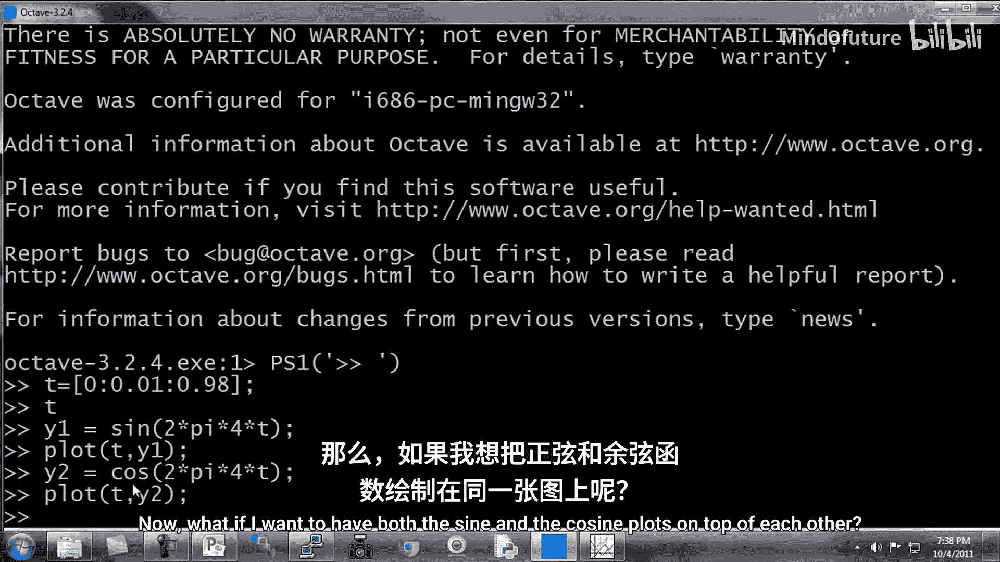

嗯。Put the R in quotation mouse there。 And instead of replacing the current figure。

 plot the cosine function on top。 and the R indicates that one does invent color。And。

Here are additional commands， x label time， say to label the x axis or the horizontal axis and Y label value。

 say， to label the vertical axis value。And I can also。嗯。

And I can also label my two lines with this command， legend sign。Cosine。

 and this puts this legend up on the upper right， showing what the two lines are。 And finally， title。

My plot puts a title at the top of this figure。Lastly， if you want to save this figure。

 you type print and D D P， N G。My plot。Thought P， N G。 So P， N G is a graphics file format。

 And if you do this， this will actually save this as a file。 If I do that。

 let me actually change thectory to。Let's see。Like that。 And then I will print that out。

 So this will。Take a while， depending on how your octave configuration set up。

 This may take a few seconds。But change directly to my desktop。

 And octave is now taking a few seconds to save this。If I now go to my desktop。

 let's hide these windows， here's myplot do PNng， which octave is saved and you that's the figure saved as a PG file。

octave can save files other formats as well， so you can type help plot if you want to see the other file formats rather than PNG that it can save figures in。

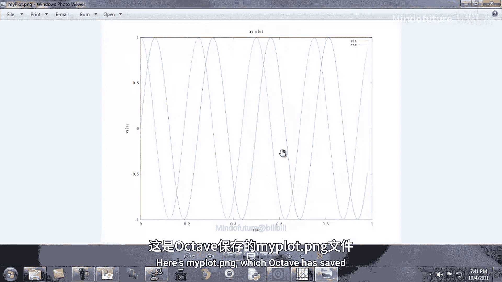

And loss thee， if you want to get rid of a plot， the close command。嗯。Causes a figure to go away。

 So that's that figure。 if I type close， you know， that figure just disappeared from my just disappeared from my desktop。

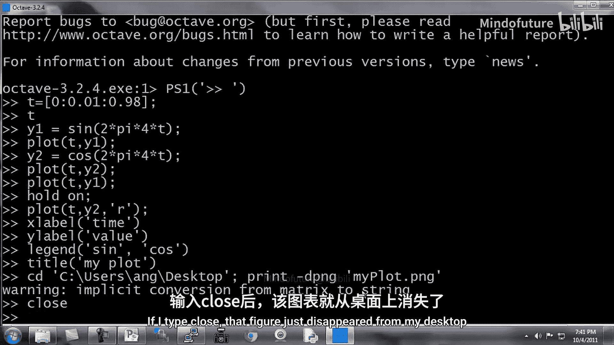

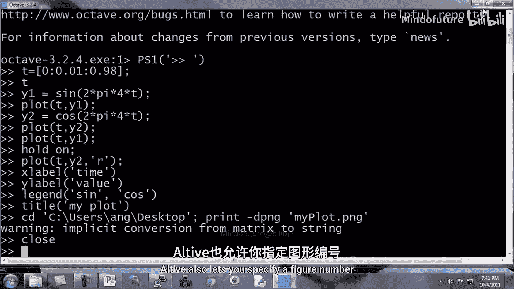

Alttave also lets you specify a figure number。 So you type figure 1。

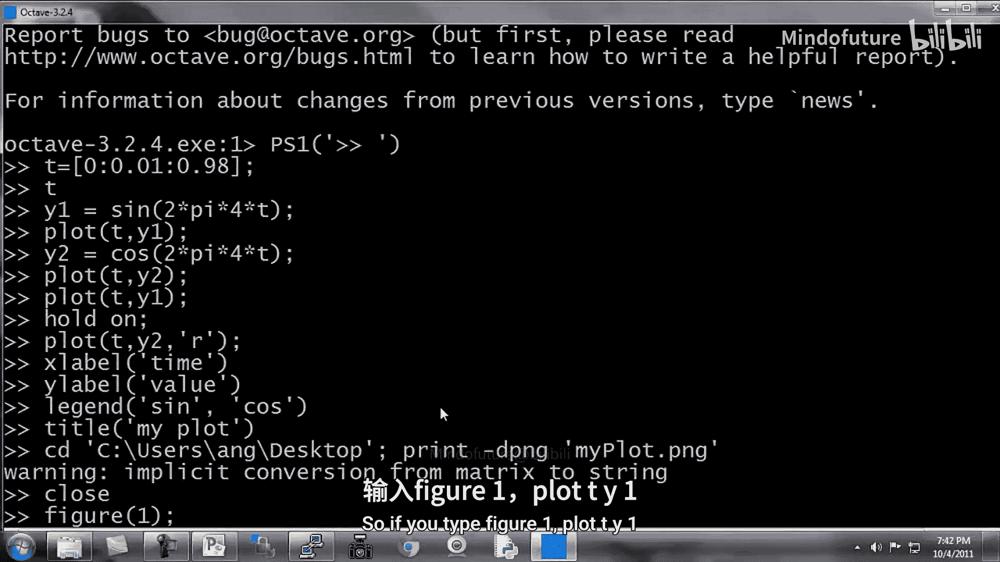

Ploot T， Y 1。That starts up first figure and that plus T Y 1。 And then if you want a second figure。

 you specify a different figure number。 So figure 2 plot T。

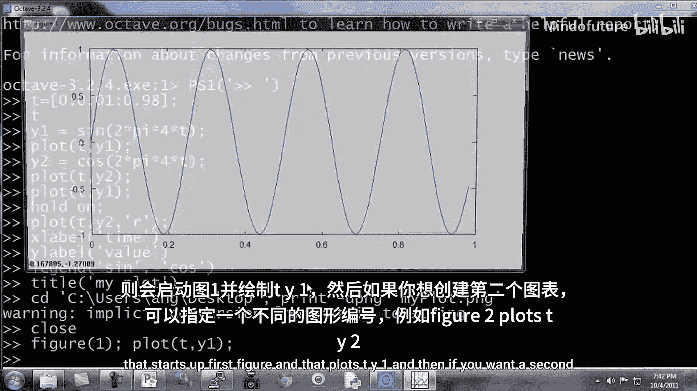

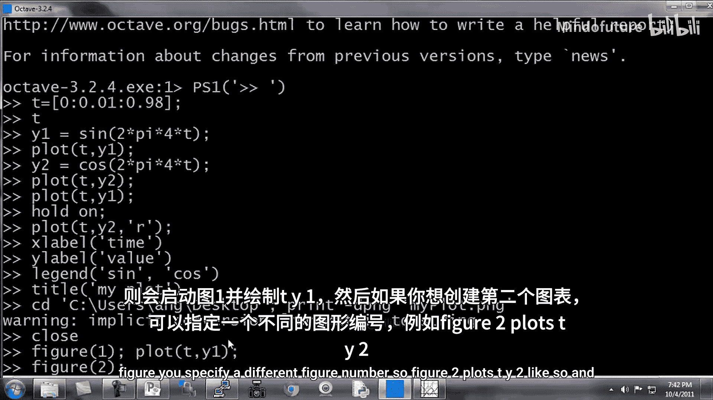

怀超。Like so。 And now on my desktop， I actually have two figures。 figure1 and figure 2。

 thus one plotting the sine function，1 plotting the cosine function。

 Here's one other E command that I often use， which is the subplot commands。

 I'm gonna use sub plot 1，2，1。 What that does， is it divide， subdise the plot。

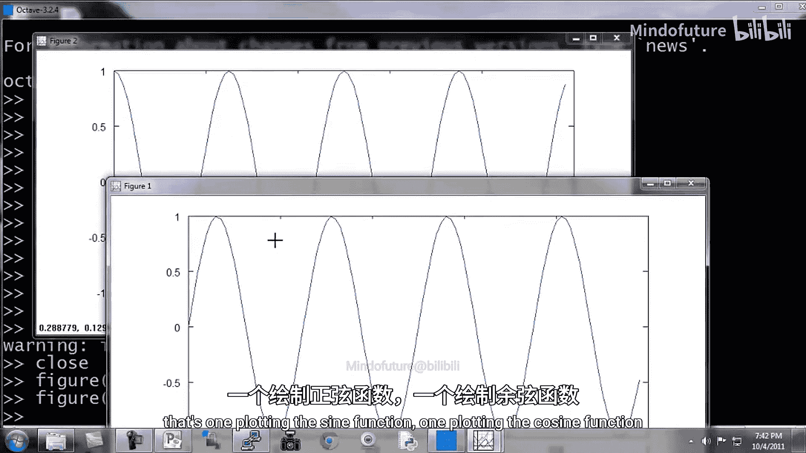

Into。A one by two grid。 That's what the first two parameters are。

 And it starts to access the first element。That's what the final parameter1 is right so does divide my figure into one by two grid and I want to access the first element right now。

 And so if I type that in， it's brought up this figure that is on the left。

 and if I plot T Y 1 it now fills up this you know first element and if I now do subplot1，22。

 I'm going to start access a second element and plot T Y2。

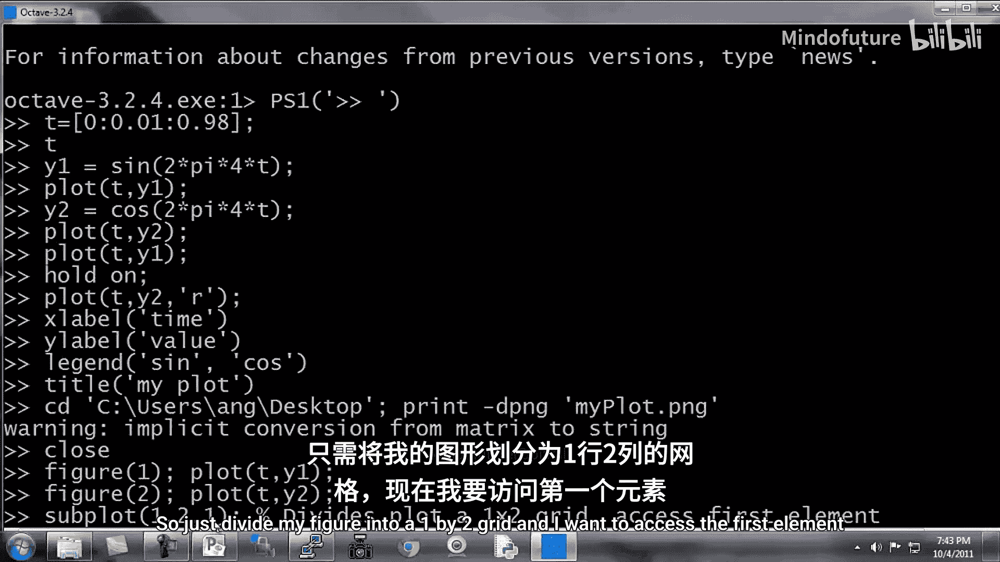

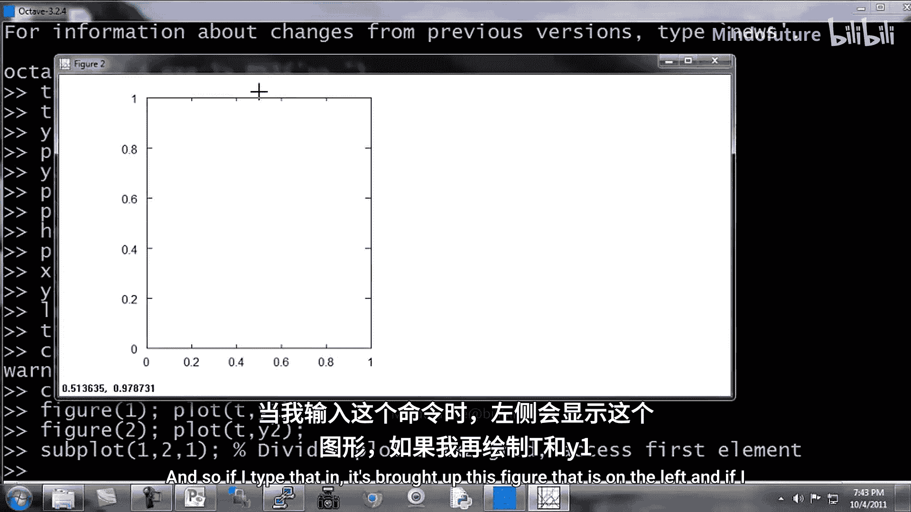

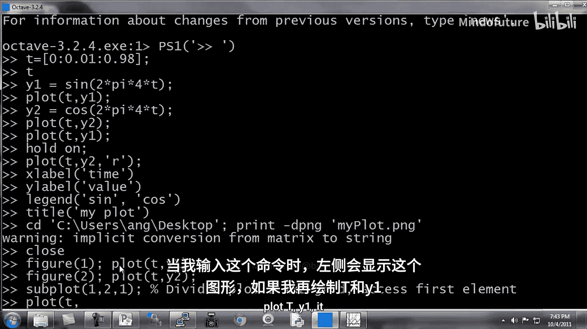

Will throw in Y2 in the right hand side or in the second element。And loss command。

 you can also change the axis scales and change xs to 0。

51 minus11 and this sets the x range and y range for the figure on the right and concrete it sets the horizontal range of values and figure on the right to range from 0。

5 to 1 and the vertical axis values to range from minus1 to 1 and you know you don't need to memorize all these commands if you ever need to change the xs all you need to know is that you know there's an axis command and you can really get the details from the usual octave help command。

Finally， just a couple last commands， C， OF clear is a figure。And here's one more neat trick。

 Let's set a to be equal to a5 by 5 magic squares A。 So a is now this。5 by5 matrix。

There's a neat trick that I sometimes use to visualize a matrix， which is I can use image S C。Of a。

And what this will do is this will plot a 5 by 5 matrix。 So take my matrix。

 So I'll plot this as a 5 by 5 grid of colors where the different colors correspond to the different values in the a matrix。

 So concretely， I can also do color bar。Let me use a more sophisticated command in which I see A color bar。

Color。Map， gray。This is actually running three commands at the time。

 I' running image SC C then running color bar then running color map gray。

 And what this does is it sets a color map to a gray color map and on the right。

 it also puts in this color bar。 And so this color bar shows what the different shades of color correspond to concretely the upper left element of the a matrix of 17。

 And so that corresponds to kind of a mid shade of gray。Whereas in contrast。

 the second element of a So of the 1，2 element of a is 24。 right， So it's a 1，2 is 24。

 So that corresponds to this square up here， which is a， know， nearly a shade of white。

And the small values， say a， what is that a45 you know is the value 3 over here that corresponds。

 you can see on my color bar that corresponds to much darker shade in this image。

So here's an another example， I can plot a larger， you know。

 he has a magic 15 that gives me a 15 by 15 magic square and this gives me a plot of what my 15 by 15 magic squares values look like。

And finally， to wrap up this video。What you've seen me do here is use a comma chaining of function calls。

 Here's how you actually do this。 If I type as 1 B equals 2 C equals 3 and hit enter。

 then this is actually carrying out three commands at the same time or really carrying out three commands one after another。

And it prints out all three results。 And this is a lot like equals 1 b equals 2 c equals3。

 except that if I use semicolonence instead of a comma， it doesn't print out anything。 So this。

 you know this thing here we call comma chaining of commands or comma chaining of function calls and it's just another convenient way in octave to put multiple commands like MHSC color bar color map to put multiple commands on the same line。

So that's it。 You now know how to plot different figures inoctave。 And in the next video， the。

 the next main piece I want to tell you about is how to write control statements like if while4 statements in octave。

 as well as how to define and use functions。

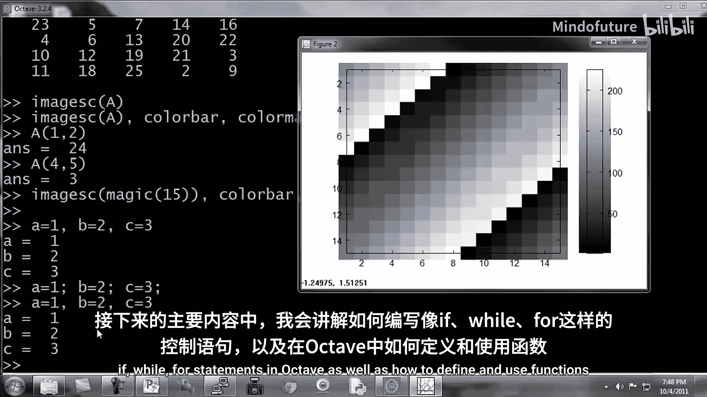