# 【斯坦福】概率图形模型1：表示法 ｜ Probabilistic Graphical Models p17 P17_控制语句-for-while-if语句_02_04_11 -BV1M76VBSEJ6_p17-

In this video， I'd like to tell you how to write control statements for your Otre programs。

 So things like for while and if statements， and also how to define and use functions。

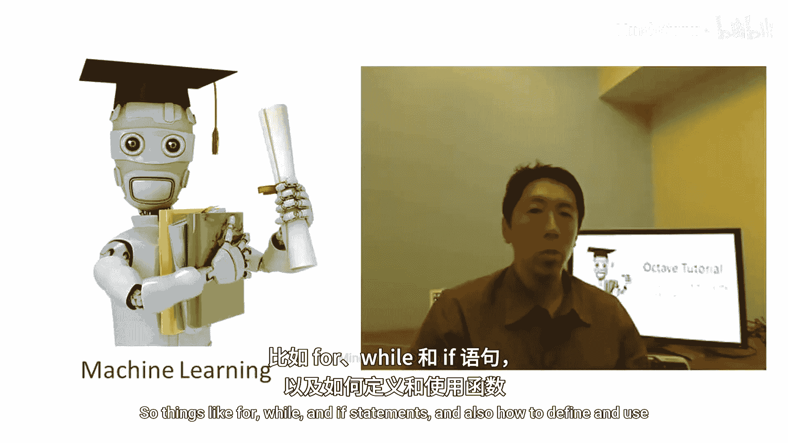

Here's my octave window。 Let me first show you how to use a for loop。

 I'm gonna to start by setting V to be a 10 by 1 vector of0 zeros。 Now。

 here's how I write a for loop for I equals 1 to 10。That's for I equals 1 colon 10 and。Let's see。

 I'm going to set V of I equals 2 to the power of I。And， finally。And the white space doesn't matter。

 So I'm putting the spaces just to make it look nicely indented。 But you know。

 the spacing doesn't matter。 But if I do this， then the result is that V gets set to， you know。

 to the power 1 to the power 2 and so on。 So this is syntax for I equals1 colon in 10 that makes I loop through the values 1 through 10。

And by the way， you can also do this by setting your indices equals  one to 10。

And let's look at indices。 This is in array from 1 to 10。 You can also write for I equals indices。

And this is actually the same as if for I equals one through1 to display I。And。

And this will do the same thing。So that was a full loop。

 if you're familiar with break and continue that break and continue statements。

 you can also use those inside loops in octave。 The first， let me show you how a while loop works。So。

 here's a。My vector V， let's write the value I equals 1。While I is less than or equal to 5。Let's set。

V， I equals 100。And increment I by one。And so this is I starts off equal to 1。

 And then I'm going to set V I equals 100 then increment I by 1 until I is know greater than 5。

 And as a result of that， whereas previously V was this powers of two vector。

 I've now taken the first five elements of my vector and overwritten them with this value 100。

 So that's the syntax for a y loop。Let's do another example。 I equals one while true。

And here I want to show you how to use a break statement。 Let's say V R equals 9，9，9。

And I equals I plus1。If。I equals 6。Break。And。And this is also our first use of an if statement。

 So I hope the logic of this makes sense sense for I equals I equals1 and you know， infinite loop。

While repeatedly set V equals1 and increment i by 1， and then once I gets up to6。

 do a break which breaks you out of the wire loop， and so the effect of this should be to take the first five elements of this vector V and set them to 999 and yes indeed。

 we've taken V and overwritten the first five elements with 999。

So this is the syntax for if statement and for a while statement and notice the end。

 the we have two ends here。 This end here ends the if statement and the second end here ends the while statement。

Now， let me show you the more general syntax for how the user if else statement， so。Let's see。

 V1 is equal to 9，9，9。 Let's say V1 equals to 2， for this example。So let me type if V1 equals1。

Display the value is one。Here's how you write an L statement。 Or rather here's an else if V。

1 equals 2。This is going to be the true case that's true in our example。 Display the value is 2。Else。

Display。The value is not one or two。Okay， so that's a。If else， if else statement hit end。

 and of course， here， we've just said V1 equals 2。 So hopefully yep， it displays that the value is 2。

And finally， I don't think I talked about this earlier， but if you ever need to exit octave。

 if you can type the exit command and you hit enter， that will cause octave to quit。

 or thequi command also works。Finally， let's talk about functions and how to define them and how to use them。

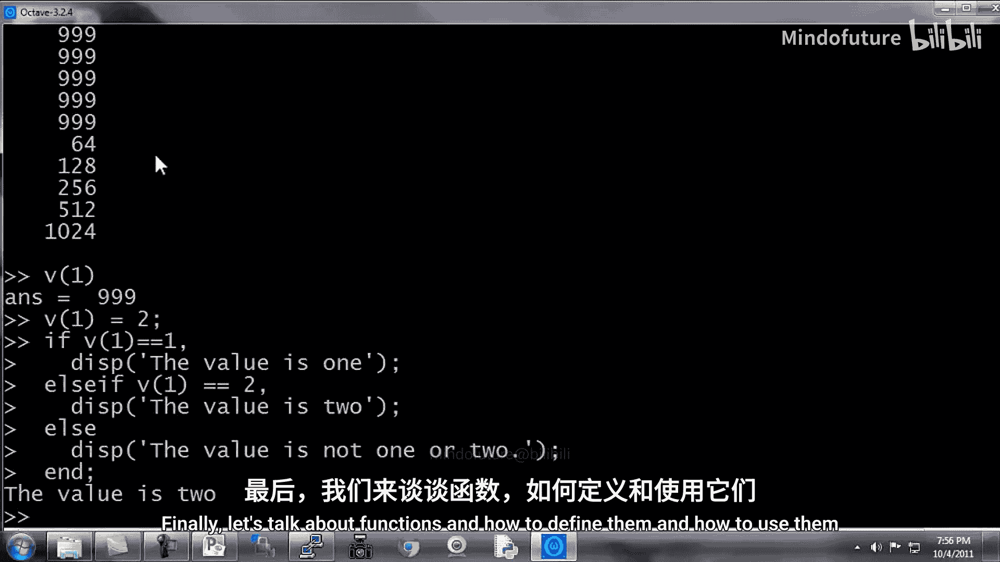

Here's my desktop and I have predefined a file or pre saved on my desktop a file called square this number do M。

 This is how you define functions inoctave。 you create a file called know with your function name and then ending in dot M and whenoctave finds this file it knows that this is where it should look for the definition of the function square this number do M。

Let's open up this file。 Notice that I'm using the Microsoft program Wordpa to open up this file。

 I want to encourage you if you're using Microsoft to Microsoft Windows to use Wordpa rather than noad to open up these files if you have a different text editor that's fine to but noad sometimes messes up the spacing。

 if you only have noad that should work to that could work too but if you have Wordpa as well。

 would I would rather use that or some other text editor if you have a different text editor for editing your functions。

So here's how you define the function in octave。 and I just zoom in a little bit。

And this file has just three lines in it。 The first line says function y equals squared is number x。

 This tells occtave that I'm going to return the value Y and I'm going to return one value and that that value is going to be saved in the variable y。

 and moreover， it tells octave that this function has one argument， which is the argument X。

 and the way the function body is defined if y equals x squared。

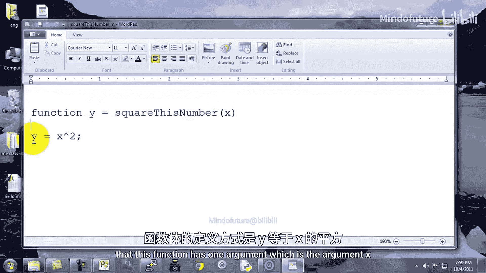

So let's try to call this functions square this number。5， and this actually isn't gonna work。

 Andoctave says squareest number is unde。 That's because octave doesn't know where to find the find this file。

 So as usual， let's use Pw D。 Oh not in the right directory。

 So let's C D users A And G slash desktop。 That's where my desktop is。Oops。

 little typo there uses AG desktop。 And if I now type squared as number 5， it returns the answer 25。

As kind of an advanced feature， this is only for those of you that know what the term search path means。

 but so if you want to modify the octave search path and you could just think of this next part as a advanced or optional material。

 only for those of you that are familiar with the concept of search paths in programming languages。

 but you can use the term ad path， say tco in。Slash users， slash A G， slash desktop。

To add that directory to the octave search path so that even if I go to some other directory。

 I can still octave still notes to look in the user' A And G desktop directory。For functions。

 So that even though I'm in a different directory now。

 it still knows where to find the square this number function。 Okay， but if， if。

 if you're not familiar with the concept of search path， don't worry about it。

 Just make sure to use the C command to go to the directory of your function before you run it。

 And that should work just fine。One concept that octave has that many other programmingan languages don't is that it can also define let you define functions that return multiple values or multiple arguments。

 So here's an example of that。 define the function called square and cubed this number X and what this says is this dysfunction returns two values Y1 and y2 I'm going to set them as follows as y1 is squared Y2 is x cubed。

 and what this does is this really returns you know two numbers So some of you。

 depending on what proing language you use if you' are familiar with you C plus often we think of a function as returning just one value。

 but this all the syntax and octave that's it return multiple values。

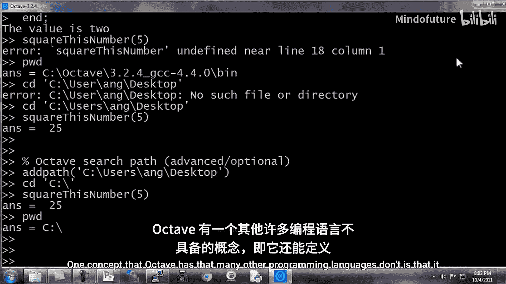

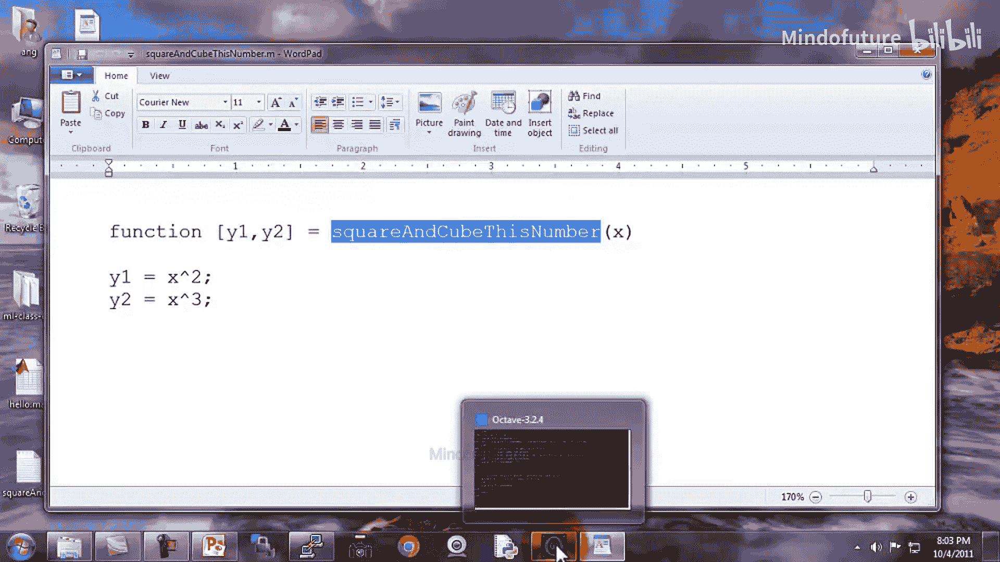

Now， back in the  alttave window， if I type， you know， A B equals square and cube。This number。5。

Then a is now equal to 25， and B is equal to the cube of 5 equal to 1，25。

 So this is often convenient。 If you need to define a function that returns multiple values。Finally。

 I'm going to show you just one more sophisticated example of a function。

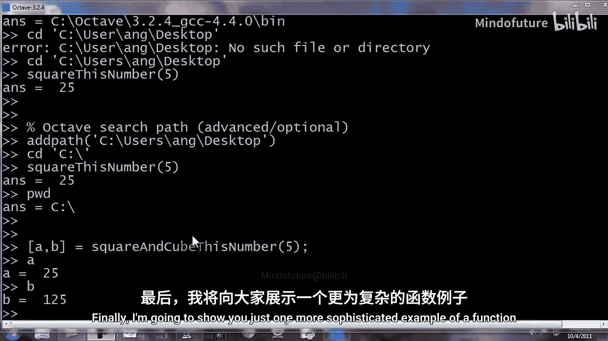

Let's say I have a data set that looks like this。 with data points at 1，1，2，23，3。

 and what I'd like to do is to define anoctave function to compute the cost function J of data for different values of data。

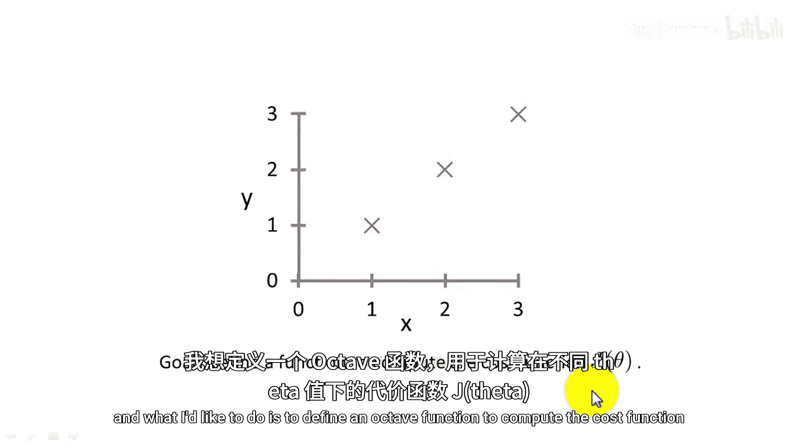

First， let's put the data into octave。 So it design put set my design matrix to be 1，1，1，2，1，3。

 So this is。My design matrix x with x0， the first column being the intercept term and the second term being my know the x values of my three training examples。

 and let me say y to be 1，2，3 as follows， which were the y x's values。

So let's say theta is equal to 0， semicolon 1。

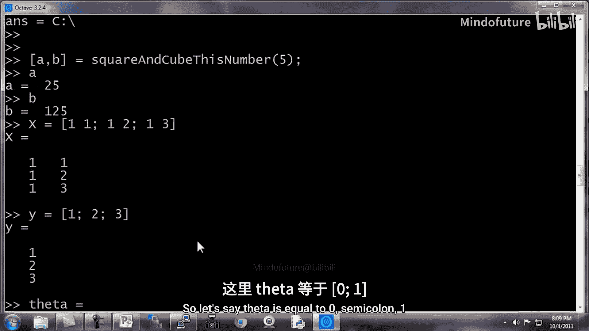

Here on my desktop， I predefined this cost function J。

 and if I bring up the definition of that function， it looks as follows。

 So function J equals co function J inputs X， Y theta， some comments specifying the inputs。

 and then very a few steps。 set M to be the number training examples。 That's a number of rows in X。

Computer predictions， predictions equals x times theta。

And this is a kind comment that's wrapped around。 So this is part the preceding comment line。

Computer the squared errors by taking the difference between predictions and the y values and taking element y squaring。

 and then finally computing the cost function J and octave knows that J is the value I want to return because J appeared here in the function definition。

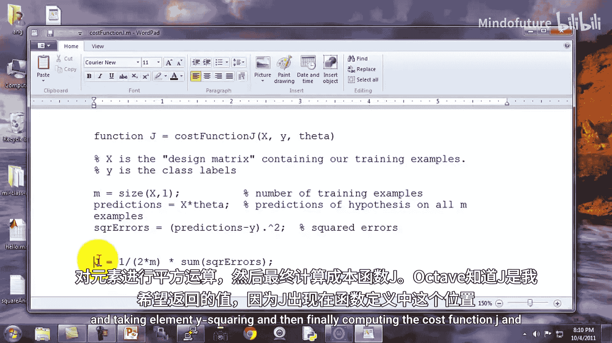

Feel free， by the way， to pause this video if you want to look at this function definition for longer and kind of make sure that you understand the different steps。

But when I run it in octave， I run J equals cos function。 J， X， Y， theta， its computes。Oops。

 made the typo there should have been capital x。 It computes J equals 0 because。

If my data was you know， of1，2，3，1，2，3， then setting right， theta 0 equals0， theta 1 equals1。

 this gives me exactly the 45 degree line that fits my data perfectly。Whereas in contrast。

 if I set theta equals， say0，0， then this hypothesis is predicting zeros on everything just saying theta 0 equals 0。

 theta 1 equals 0 in a computer cost function， then is 2。333。 and that actually equal to 1 squared。

Which is my square error on the first example plus two squared。Plus， three squared。And then。

 divided by2。Which is two times number training examples， which is oops which is indeed 2。33。

 And so that sanity checks that this function here is you know， computing the correct cost function。

 at least in the couple examples we tried out on on our simple training example。

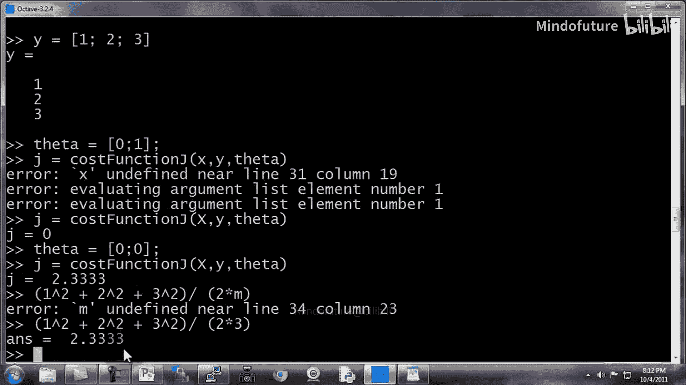

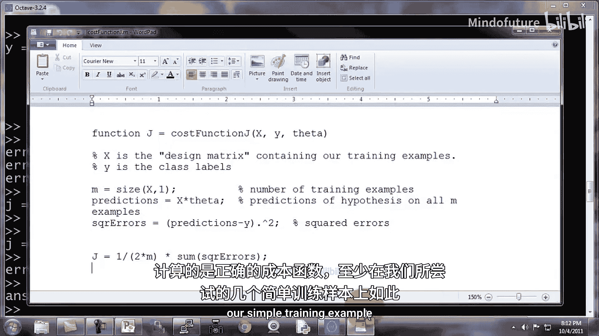

And so that sanity checks that the cost function J as， as defined here， that it is indeed， you know。

 Seeing to compute the correct cost function， at least on our simple training set。

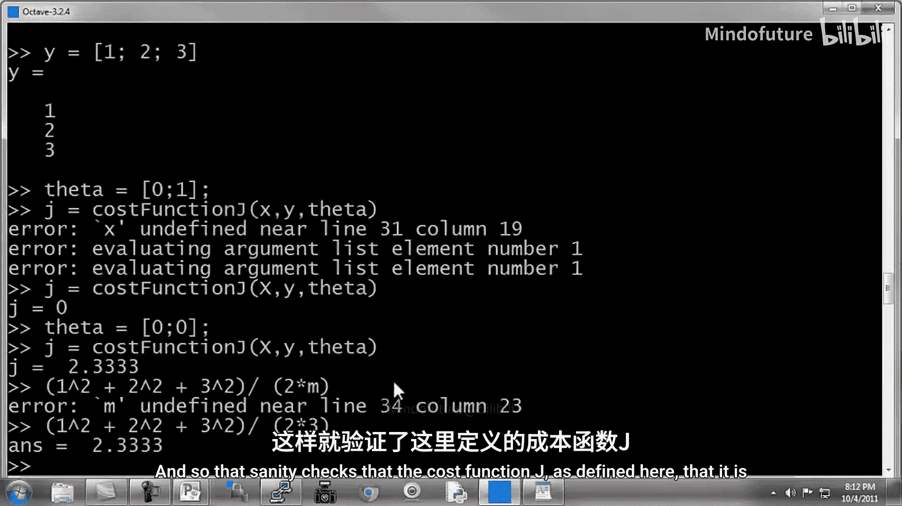

That we had here with X and Y being the simple training example that we saw。

So now you know how to write control statements like full loops while loop and if statements inoctave as well as how to define and use functions In the next video。

 I'm going to just very quickly step you through the logistics of working on and submitting problem sets for this clause and how to use our submission system and finally after that in the final octave deter video I want to tell you about vectorization which is an idea for how to make your octave programs run much faster。

