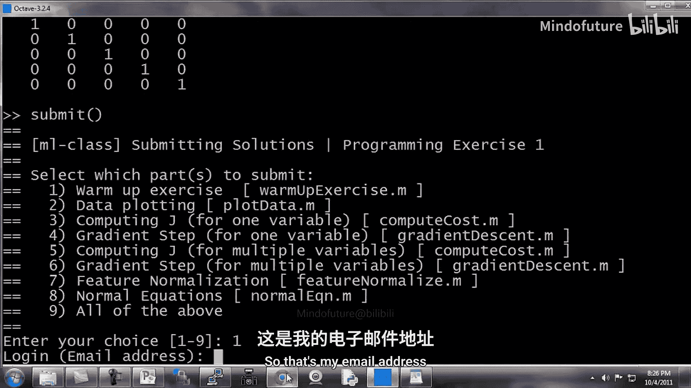
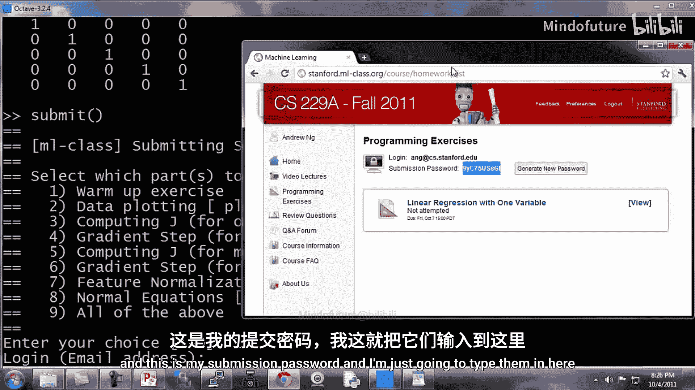
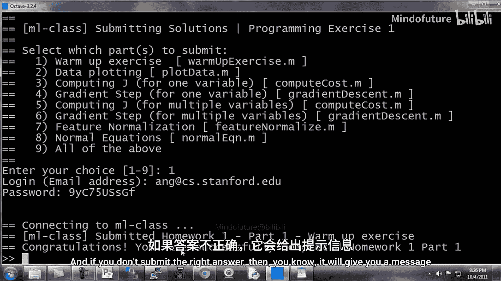
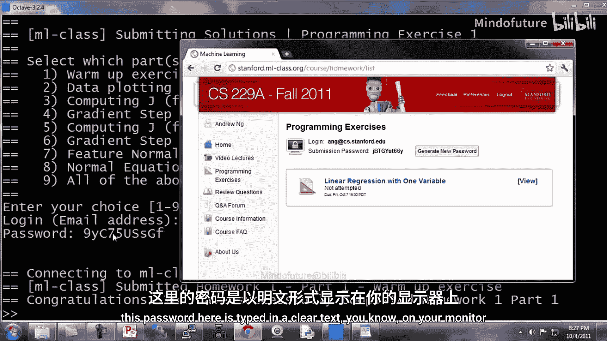

# 【斯坦福】概率图形模型1：表示法 ｜ Probabilistic Graphical Models p19 P19_编程练习操作与提交_02_04_13 -BV1M76VBSEJ6_p19-

In this video， I want to just quickly step you through the logistics of how to work on homeworks in this class and how to use the submission system。

 which will let you verify right away that you got the right answer for your machine learning programming exercise。

Here's my octave window。 and let's first go to my desktop。 I save the files for my first exercise。

 some of the files on my desktop in this director Ml class Ex1。

 And we provide a number of files and ask you to edit some of them。

 So the first file you should read the detail Pdf file for this pro exercise to get the details。

 But one of the files we edit is this file called warmup exercise where you know the exercise is really just to make sure that you're familiar with the submission system and all you need to do is return the 5 by5 identity matrix。

 So the solution to this exercise I just show you is the right a equals I5 right So that modifies this function to generate the5 by5 identity matrix and this function warm up exercise。

 Now returns know the5 by5 identity matrix and'm gonna save it。

So I've done the first part of this homework。Going back to my octave window。

 let's now go to my directory user slash A G slash desktop slash Ml class slash E X 1。

 And if I want to make sure that I've you know implemented this in warm up exercise。Like so。

 And the update returns that's the 5 by5 entity matrix that we just wrote the code to create。

 And I can now submit the code as follows。 I'm going type submit from this directory。

 and I'm ready to submit part one when I enter your choice1。So ask me for my email address。

 I'm going to go to the course website and you know， this list my， this is an internal testing site。

 So your your version of the website may look a little bit different， but there's my email address。

 and this is my submission password。 And I'm just going to type them in here。

So I have A G@ c S。cent UDu， and my submission password is 9 Y C，7，5。USS G F and a hit enter。

 it connects to the server and submits it。 And right away， it tells you， you know。

 this says congratulations， you have success complete in part1。

 And this gives you a verification that you you got this part right。

 And if you don't send me the right answer， then you know。

 it'll give you a message indicating that you haven't quite gotten it right yet。

And by the way， can also you can use this submission password and you can generate new passwords doesn't matter。

 but you can also use your regular website login password。

 but because this password here is typed in in a clear text on your monitor we gave you this extra submission password in case you don't want to type in your website's normal password onto a window that depending on your operating system。

 this password may or may not appear as text when you type it into the octave submission script。

So that's how you submit the homework after you've done it good luck and I hope you get when you get around the homeworks。

 I hope you get all of them right and finally in the next and finaloctave tutorial video。

 I want to tell you about vectorization， which is a way to get youroctave code to run much more efficiently。

