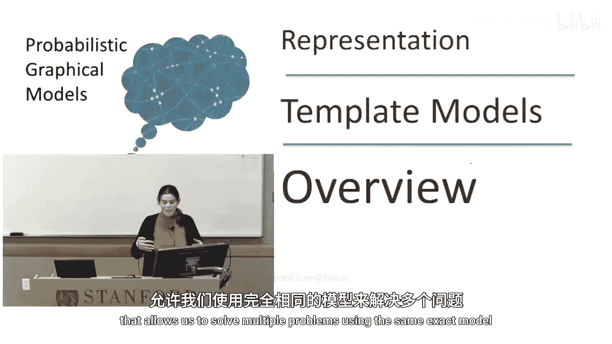
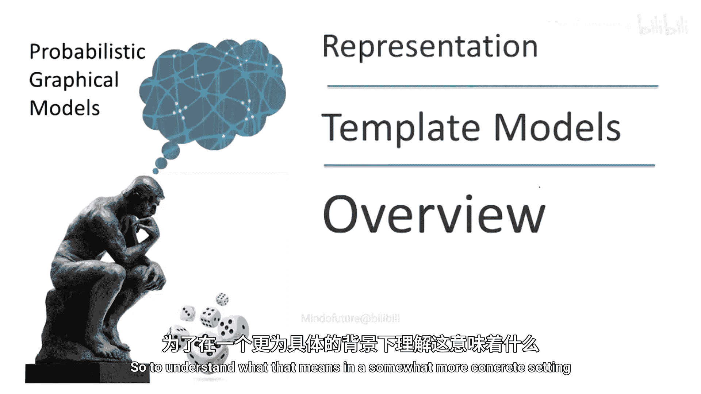
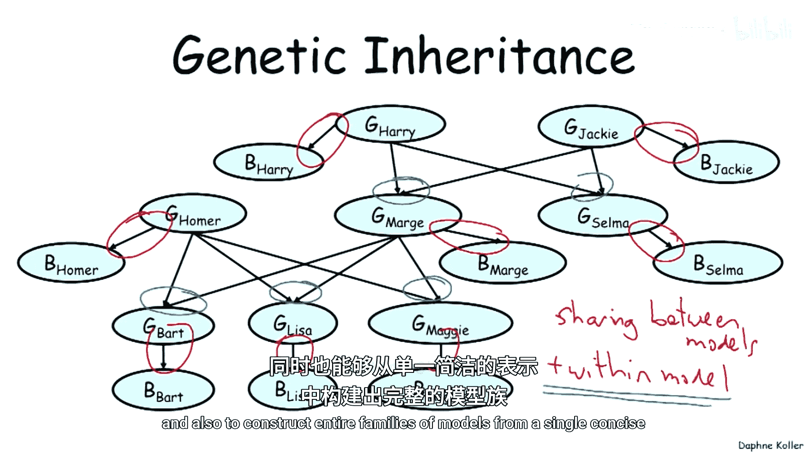
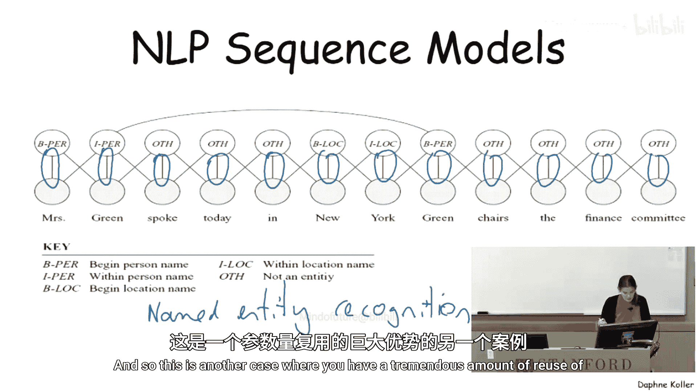
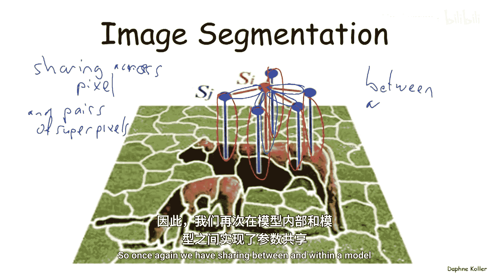
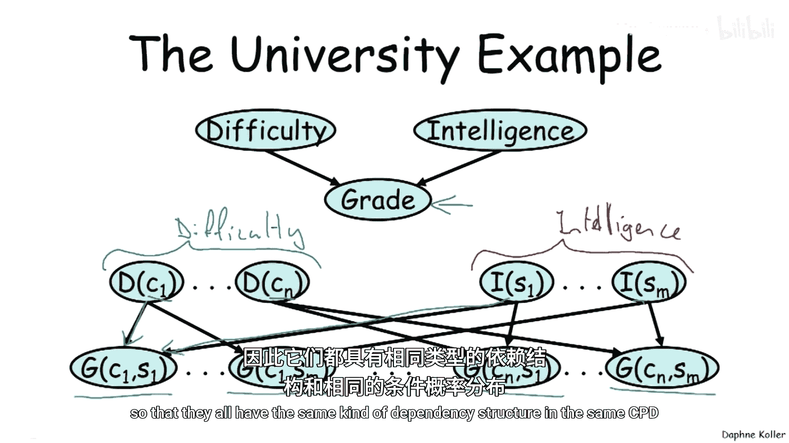
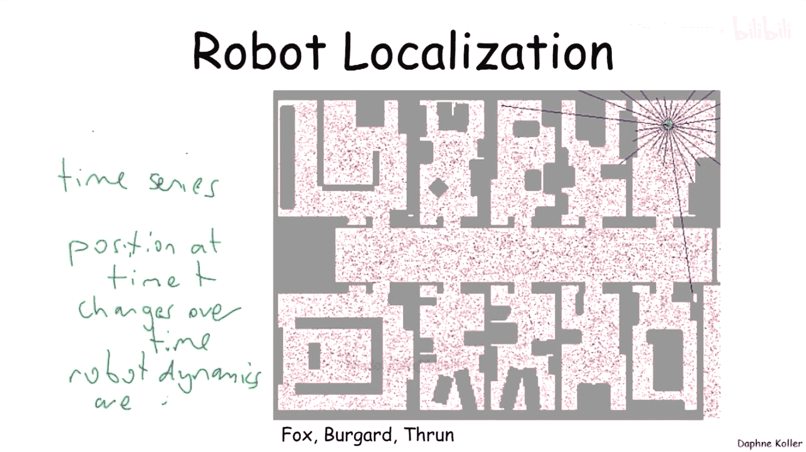
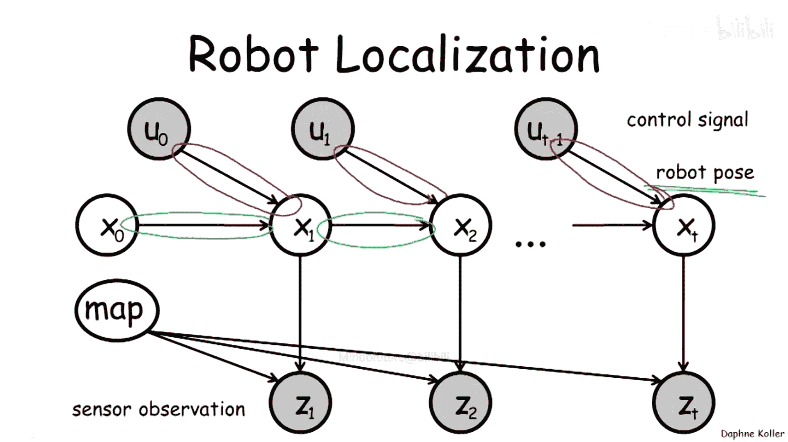
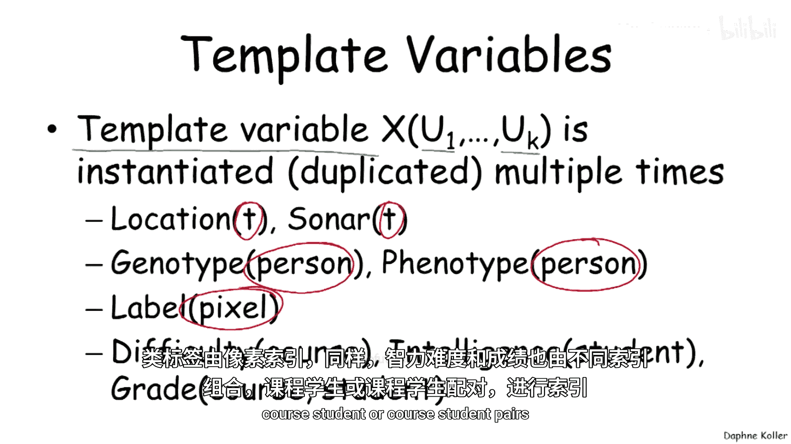
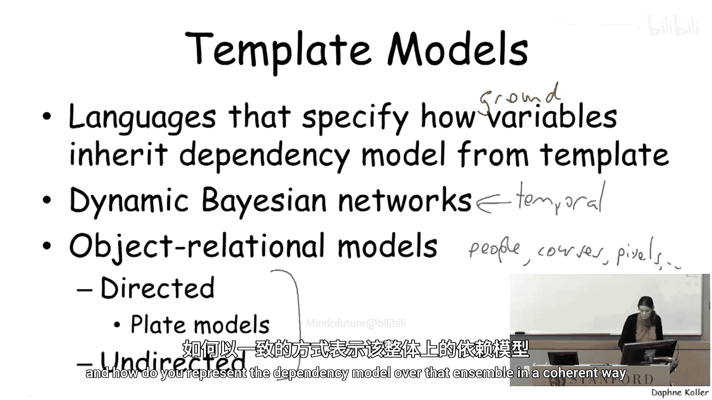

# 【斯坦福】概率图形模型1：表示法 ｜ Probabilistic Graphical Models p20 P20_模板模型概述_03_01_01 -BV1M76VBSEJ6_p20-

Oh。Today's topic is an important extension on the language of graphical models and it's intended to deal with the very large class of cases where what we'd like to do is not just write down one time graphical model for a particular application but rather come up with something that is a general purpose representation that allows us to solve multiple problems using the same exact model so to understand what that means in a somewhat more concrete setting。

 let's go back to example of genetic inheritance that we've discussed previously。

 it's arguably the earliest example of Bayesian network reasoning even before Bayesian networks were invented and here we have as input a pedigree。

😊。

Wwhich is a family tree， and we're interested in reasoning about a particular trait。

 and for each pedigree， each trait， we can construct a Bayesian network and the Bayesian network might look like this。

But clearly， if you had a somewhat different family tree。

 so suddenly you had another three cousins and a great grandfather join the family tree or if you had a different family altogether。

 you would still want to use the same sort of ideas。

 the same pieces of what we used in the first network to construct this other network because there's clearly a lot of commonalities between them so we have what you might call sharing between models。

But， in addition to that。You also have in this example， as a fairly obvious sharing within the model。

 So， for example。This CPD that tells us how Sela's genotype affects Selma's blood type。

 presumably is the same process by which Marge's genotype affects Marge's blood type and the same for Maggie and Lisa and Bard and Homer and everybody。

So so we have this tremendous amount of sharing of both dependency models and parameters Similarlyly you might looking at this。

 realize that the genetic inheritance model by which bart genotype is determined by the genotype of his two parents is the same inheritance model that applies to Lisa to Maggie to Marge the Selma and so on。

 so once again we have a lot of parameters that are shared not just between。

 but also within the model， so we'd like to have some way of constructing models that have this large amounts of shared structure that allows us to both construct very large models from a sparse parameterization and also to construct entire families of models from a single concise representation。

This is not the only such application， this is probably the most commonly used type of graphical models are those that have shared structure and shared parameters。

 so here is another example that we've seen previously this is for natural language processing a sequence model for in this case trying to identify name entity recognition so。

A very common。Tasks for which graphical models have been used？

And here also we have a sequence model and we have， again， shared pieces， for example。

 the parameters that relate the latent variable in this case， what type what type of variable。

 what type of entity it is is that a person is at a location and so on。

 there is a set of parameters here， and they're going to be independent of the place in a sequence。

In which we find the word because not because that's necessarily an exactly correct model。 I mean。

 one could clearly imagine cases where the position in the sequence might make a difference。

 but because it's often a very useful simplifying assumption。

 specifically because it allows us to A use parameters reuse parameters and B allow us to apply the same model to sequences of varying length without having to worry about what is my 15 word model versus what's my8 word model。

 And so this is another case where you have where you have a tremendous amount of。

Reuse of parameters。We've already seen similarly the example of image segmentation clearly we don't want to have a separate model for every super pixel within the image there is hundreds of super pixels。

 so we have sharing。Yeah。Across。O。Uer pixels or pixels。So for example， the model here that relates。

The class label of a superpel to the image features of that superpixel is generally going to be shared。

 as are the parameters。That involve adjacent superps。

 So these edge potentials are also going to be shared across， in this case， pairs of superps。嗯。

These pairs of adjacent superpixels。And once again， we have sharing across models as well。

 because we are going to have one such model for image A。 And obviously。

 we don't want to construct a separate model for every image。 So once again。

 we have sharing between and。Within。

Okay。干么了吧。So let's look at one example a little bit more concretely because it's an example that we're going to use in some of the later analysis so good now let's return to our university example where we have a student who takes a class and gets a grade and that a grade depends on the students's difficulty I'm sorry the difficulty of the course among the intelligence of the student now this is all fine if we're interested in reading just about an individual student but now let's imagine that we want to think about an entire university so now we have a difficulty variable so these are all difficulty variables。

For different courses， in this case， C1 up to CN are different courses that exist in our university。

 and conversely on the other side， we have multiple students。And this is a set of intelligence。

Variables that are indexed by different students so we have the intelligence of student one up to the intelligence of student M Now note that these are different random variables they can and generally will take different values from each other but they all share a probabilistic model and that's sort of the kind of sharing that we have in mind and what we see here is that the grade of a student within a course which are these variables down here depend on the difficulty of the relevant course and the intelligence of the relevant student so for example the grade of student one in course one depends on the difficulty of course one and on the intelligence。

Of student one and once again， we have sharing of the both the structure and the parameters across these different grade variables so that they all have the same kind of dependency structure and the same CPD。

Another example is that of robot localization。 And this is another example of， in this case。

 a time series。The robot moves through time from one position to the other。

 and although the position。好的。At time T is different。Changes over time。

We expect the dynamics of the robot。Are fixed。Oh。

And we'll talk more about that later。So that gives us a graphical model that again looks a little bit。

 this is one example of such a graphical model where we see that the position that the robot posed over here。

 these x variables depend on， for example， the previous pose and on whatever control action the robot took and we're assuming that once again we have sharing。

😊，Of these parameters。For each instantiation of the variable。

So what that gives rise to is a class of models that are represented in terms of template variables where template variable is something that we end up replicating in many cases again and again。

 within a single model as well as across models and so the replication is indexed by the fact that the variable you can think of it as a function that takes arguments and the arguments for example。

 might be time points as in this example over here。

So here we have a location variable that's indexed by a time point or sonar reading that's indexed by time point。

 we have in this case， a genotype variable and a phenotype variable that's indexed by a particular person。

 a label， a class label that's indexed by a pixel and similarly the difficulty of the intelligence in a grade that are indexed in this case by different combinations of indices。

 course student or course student peers。

And a template model is a language that tells us how template variables can be the dependency models for template variables and how concrete instantis of those variables。

 what are called ground variables。😊，Like the ones that are actually indexed by a particular time point or person。

 how they inherit the dependency molecule， and there is a whole range of such languages that have been developed in a special purpose way for different applications。

 so dynamic Bayesian networks，Are intended for dealing with temporal processes， for example？

Where we have replication over time。We have a whole range of languages for object relational models。

 both directed models and undirected models where you have multiple objects such as people or students and horses or pixels。

 so people。Horses。Pixels and lots of other things that can be related to each other in different ways。

 and how do you represent a dependency model over that ensemble in a coherent way？

