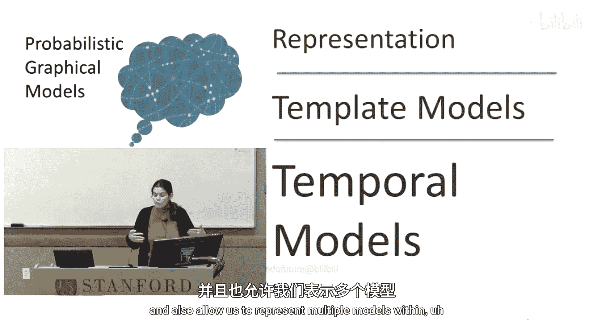
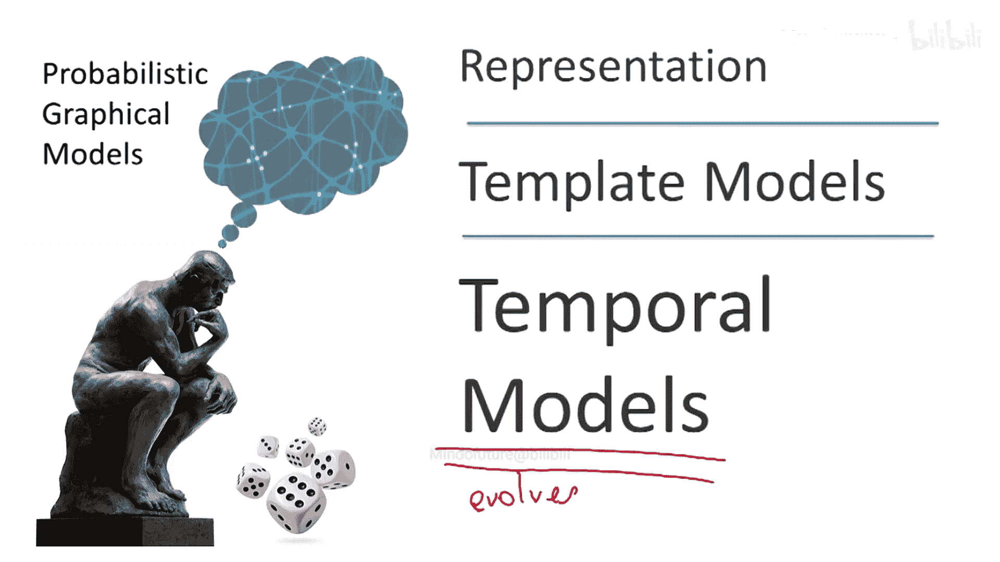
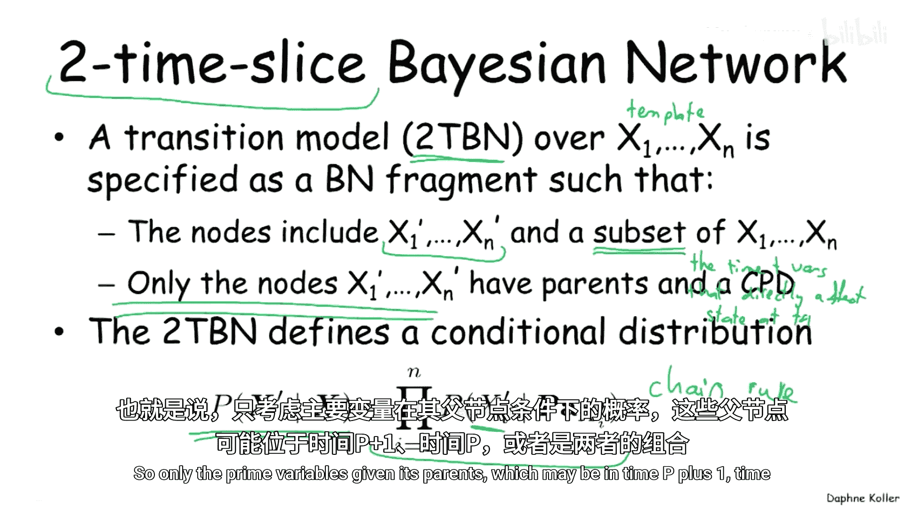
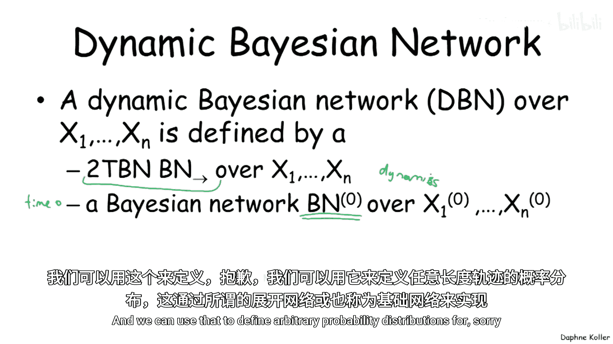
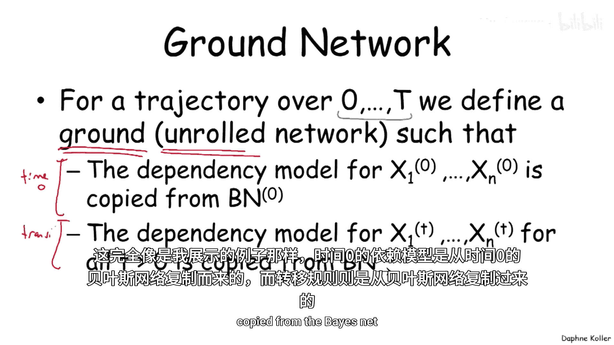
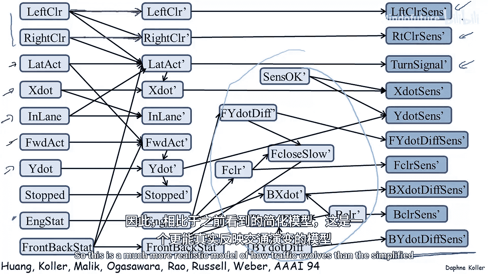
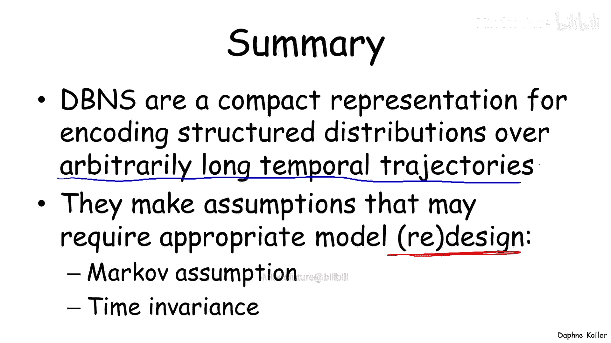

# 【斯坦福】概率图形模型1：表示法 ｜ Probabilistic Graphical Models p21 P21_时序模型-DBNs_03_01_02 -BV1M76VBSEJ6_p21-

So there are many classes of models that allow us to represent in a single concise representation。

 a template over rich models that incorporate multiple copies of the same variable and also allows us to represent multiple models within as a byproduct of a single representation。

 but one of the most commonly used among those is for reasoning about temporal models where we have a system that evolves over time。

So。So let's look at what we have we represent a distribution over temporal trajectories。

So the first thing we want to do when representing a distribution over continuous time is in most cases。

 not always， is to try and forget the time is actually continuous because continuous quantities are harder to deal with。

 so we're going to discretize。😊，Fine。And specifically。F is trained。

And specifically we're going to do that by picking a particular time granularity delta。

 which is the time granularity at which we're going to measure time now in many cases this is something that we already is given to us by the granularity of our sensor so in many cases for example。

 when we have a video or a robot there is a certain time granularity at which we obtain measurements and so that's usually the granularity that we'll pick but in other cases we might want to have a different granularity so there is a choice here。

So here's our time granularity， for example。And now we have a set of template random variables。

And x of T denotes the value of a particular variable x variable x being a template variable。

 x of T being a particular instantiation of that variable at time point T delta。

 so that we have multiple copies， one for each time point。😊，Now。

 here is some notation that we're going to end up using later on。

 so introduce it where x of T denotes the variable x at time T。Xt column T prime denote the set。

between T and T prime， so a discrete in this case because we've discretized time。

 so a finite set of random variables that spans these two time points inclusive。

Now our goal is that we would like to be able to have a concise representation that allows us to represent this probability distribution over the over trajectory of the system of any duration。

 so we want to start at a particular time point usually this is going to be zero。

 and then how what is the probability distribution over trajectories of arbitrary length。😊。

So how do we represent what is a， first of all， an infinite family of probability distributions because you could look at trajectories of duration 2。

5，10 a million， so that's an infinite family of distributions and each of these is a distribution over an unbounded number of random variables because if you have a distribution over a trajectory of length a million you have to represent a million dimensional distribution so how do we。

😊，Compactified that。 How do we make that a much more concise representation。

 So there's different pieces to this。 The first of those is what's typically called the Markov assumption。

And the Markov assumption goes is effectively a type of conditional independence assumptions。

 it's the same building block that we use to compactify general purposepo graphical models we're going to use here in the context of time course data so here we're saying that the probability of the variable X。

 sorry the set of variables expanding the time from zero all the way to capital T so I haven't made any assumptions yet in the statement so I'm just writing this down I'm reexpressing it in terms of the chain rule for probabilities there's no chain rule for Bayesian networks yet here。

 and this is just the chain rule for probabilities。😊。

And the chain room for probabilities in this context basically says that that probability is equal to the probability of x at time0。

Times the probability of each consecutive time point， T plus1， given， so this is the state at T+1。

Given the state。At all previous time points，0 up toity。So this is not in any way an assumption。

 this is just a way of reexpressing this probability distribution in the way the time flows forward。

But it's not an assumption you can represent any probability distribution over these random variables in this way。

But now we're going to add this assumption， and this is an assumption。

 this is an independence assumption， and this independence assumption tells me that x of t plus1。

That is the state of time P plus one， the next step。 so this is the next step。

Is independent of the past。Given the present。So this is a forgetting assumption。

 once you know the current state。You don't care anymore about your past。嗯。If you do that。

 we can now go back to this chain rule over here and simplify it because whereas before we conditioned on x up to from time0 to time t。

 now everything up to t minus1 is conditionally independent。

 given so all this is conditionally independent of t plus1 given x of t。

 which means that I've allowed myself to move x of t here as the only thing that I'm conditioned on。

 conditioning on in order to determine the probability distribution back to t1。

To what extent is this assumption warranted？So is this true？And let's take as an example。

X equals the location， or pose。Of a robot or an object that's moving。

Is it the case that the location of the robot at T plus1， so LT plus1？

Plus 1 is independent of say L of t minus1 just to simplify our lies given L of T。

Is this a reasonable assumption？Well。😮，In most cases， probably not。

And the reason is that it completely ignores the issue of velocity。

 which direction are you moving and how fast？And so this is a classical example of where the Markov assumption for this particular model is probably too strong of an assumption。

😊，So what do we do to fix it？The one way to fix it is to enrich the state description。

So as to make the Markov assumption a better approximation， just like any independence assumption。

 the Markov assumption is always going to be an approximation。

 but the question is how good of an approximation， and if we add， for example， V of T，😊。

Which is the velocity of time T and maybe the exp of time T。

 maybe the robot's in1th where its goal is， I mean， all sorts of additional stuff into the state。

Then at that point。The Markov assumption becomes much more warranted。Okay。

And so that's one way of getting the Markov assumption true。An alternative strategy。

 which we're not going to talk about right now， is to move away from the Markov assumption by adding dependencies。

They go further back in time。Back in time。And that's called a semi Markov model。

And we're not going to talk about that right now。The second big assumption that we are going to have to make in order to simplify the model is intended to deal with the question of。

 well， fine。 So we've reduced the model to encoding。嗯。A probability of x of t plus1 given x of T。

 but it's still an unbounded number of conditional probabilities now at least each of them is compact。

 but there is still a probabilistic models for every t。

 and this is where we're going to end up with with a template based model。

 we're going to stipulate that there is a probabilistic model P of x prime given x x prime denotes the next。

Time point。And externals the current time point。And we're going to assume that that model is replicated。

For every single time。That is， when you're moving from time  zero to time 1， you use this model。

 when you're moving from time1 to time two， you also use this model。

And that assumption for obvious reasons is called time invariance。

 because it assumes that the dynamics of the system， not the actual position of the robot。

 rather the dynamics that move it from state to state or the dynamics of the system don't depend on the current time point T。

😊，And once again， this is an assumption and is an assumption that's warranted in certain cases and not in others。

 so let's imagine that this represents now the traffic。😊，On some road。Well， does that traffic。

 does the dynamics of that traffic depend on say the current time point of the system on most roads。

 the answer is probably yes， it might depend on the time of day。On the the week。

On whether there is a big football match。On all sorts of things that might affect the dynamics of traffic。

The point being that just like in the previous example。

 we can correct inaccuracies in our assumption by enriching the model。

 so once again we can enrich the model。Buying， including。These variables。And once we have that。

 then again， the model becomes a much better reflection of reality。

So now how do we represent this probabilistic model in the context of a graphical model like we had before。

 so let's now assume that our state description is composed of a set of random variables。

 we have a little baby traffic system where have the weather at the current time point。

 the location of say a vehicle， the velocity of the vehicle， we also have a sensor。

 whose observation we get at each of those time points and the sensor may or may not be failing at the current time point。

And what we've done here is we've encoded the probabilistic model of this next state， so W prime。

 v prime， L prime， F prime and O prime， given the previous state， so given W VL and F。

Why is O not here on the right hand side， it's not here on the right hand side because it doesn't affect any of the next state variables。

 so it would be kind of hanging down here if we included it。

 but since it doesn't affect anything we don't choose to represent it。

So this model represents a conditional distribution。Now we have a little network fragment。

 so this is a network fragment。And it doesn't represent a joint distribution。

It represents distribution。The conditional distribution of the T plus1。Giveantty。But我不。

In order to represent that， we still use the same tools that we had in the context of graphical models。

 and so we can write that as the same kind of chain rule that we used before。

 so this would be the probability of W prime given W based on this edge over here。

Times the probability of V prime， the velocity so this says that the weather the first one says that the weather at time T plus one depends on the weather at time T。

 the second one that the velocity at time T plus1 depends on the weather at time T and the velocity at time T。

 which indicates a certain persistence in the velocity as well as the fact that if it's raining。

 you might slip sideways so the velocity might change。

 also if you're careful you might slow down if it's raining and so again there might be an effect of the weather and the velocity。

The probability of the location at time T plus1， given the location a time T and the velocity at time T。

The probability of the sensor failure time P plus1。

 given the failure and at the previous time and the weather。

 which indicates that once the sensors failed， it's probably more likely to stay failed but maybe rain can make the sensor behave badly and then finally the probability of the observation of time T plus1 given。

The location of time people swamp and the failure of time people swar。

So there are several important things to note about this diagram that are worth highlighting。

First of all， we have dependencies both within and across time。

 so here we have a dependency that goes from T to T plus1。

And here we have a dependency that is within T plus1 alone。

What induces us to make a modeling choice like this go one way versus the other？

The assumption here is that this is a fairly wood。Reacting dependency。

So that the observation is relatively instantaneous compared to our time granularity。

 and so we don't want that to go across time， but rather we want it to be within a time slice because it's a better reflection for which variable is it that actually influences the observation。

 is it the current location or the previous location？So these kinds of edges。

 let's just give the names， these are called In。I slicee。Edges。

And these are called Inter or between time slice。And the model can include a combination of both of these。

Another kind of particular type of inter time slice edge that's worth highlighting specifically are edges that go from a variable at one time point to the value of that variable at the next time point。

 these are often called persistence。just because they indicate the tendency of a variable to persist in state from one time point to another。

Finally， let's just go back and look at the parameterization that we have in this model。

 so what CPDs did we actually need to include in this model and we can see that we have CPDs for the variables on the righthand side。

 the prime variables， but there's no CPDs for the variables that are unprimed。

 the variables on the left。And this is because the model doesn't actually try and represent the distribution O over W VL and F。

 it doesn't try and do that， it tries to represent the probability of the next time slice given the previous one。

 so as we can see this graphical model only has CPDs for a subset of the variables in it。

 the ones that represent the next time point。So that represents the transition dynamics。

 if we want to represent the probability distribution of our entire system。

 we also need to provide a distribution over the initial state。

 and this is just a standard generic Bayesian network which represents the probability over the state at time zero using some appropriate chain rule。

So nothing very fancy here。With those two pieces， we can now represent probability distributions over arbitrarily long trajectories。

 so we represent this by taking for time slice zero and copying。The Time zero Bayesian network。

Which represents the probability distribution over the time zero variables。

 and now we have a bunch of copies。That represents the probability distribution at time1， given。

Timeine 0。And here we have another copy of exactly the same set of parameters that represents time two。

 given time one。And we can continue。Copying this indefinitely and each copy gives us the probability distribution of next time slice given the one that we just had。

 and so we can construct arbitrarily long Bayesian networks。

So to make this definition slightly more formal， we define the notion of a two times sliced Bayesian network also known as a2 TVM。

And a 2 TbN over a set of template variable x1 up to XN is specified as a Bayesian network fragment along exactly the same lines that we used in the example。

 the nodes have two copies， the next time state variable。primerime up to X and prime and some subset。

Of x1 of the xn， which are variables， the time T variables。That effect。Directly。

The state is equalless one。Okay。And because we want this to represent a conditional probability distribution only。

The time T plus one nodes have parents and a CPD because we don't really want to model the distribution over the variables of time T。

And the TTDN defines a conditional distribution using the chain rule。

Using something that looks exactly like the chain rule。

So the probability of x prime given x is the product。Of each variable in time P plus1。

 so only the prime variables given its parents， which may be in time P plus1。

 time P or a combination of both。

A dynamic Bayesian network is now basically defined by a 2 TBN。

Which we just defined and a Bayesian network over time zero。So this is the dynamics。

 and this is the initial state。And。

We can use that to define arbitrary probability distributions for probability distribution over arbitrarily long trajectories using what's called the unrolled。

Network or also called the ground Network。And this is exactly as in the example that I showed。

 the dependency model for time zero。Is copied from the Baysnet for time zero。

 and this is the transition is copied。

From the bayesne of the nodes， the conditional probability for transitions。

 So before we conclude this lecture， let's look at an example of a dynamic Bayesian network that is a more realistic one in the simple examples that we've shown before。

 This is a network that was actually designed for tracking vehicles in a traffic situation。

 and so we can see that there are multiple variables here that represent both the position and velocity of the vehicle。

 both in an absolute sense， for example， this is Xdot and Y dot are the velocities。

 as well as various more semantic notions of location， like whether you're in the lane。

 There are contextual variables such as left clear and right clear。The engine status， for example。

 as well as what the driver is currently doing， for example。

 the forward action and the lateral action。We can see that there are persistence edges。

That denote the persistence of various forms of the state from time t to time t plus 1。

 as well as a variety of these intermediate variables over here that allow us to represent the probability distribution in a more compact way by incorporating variables that do not persist。

 or at least in the simplified model do not persist。 And finally。

 we see that there are a large number of sensor observations such as turn signal。

 whether the cars clear on the right and on the left。

 or appears to be clear on the right and the left and so on。

 So this is a much more realistic model of how traffic evolves than the simplified one that we saw before。

To summarize。Bynamic Bayesian networks provide us with a language for encoting structure distributions over time。

 and by making the assumptions of a Markovvian evolution as well as time invariance。

 we can use a single compact network to allow us to encode arbitrarily long transitions over arbitrarily long time sequences。

But these assumptions that we made， the Marovviian assumption and the time andvariance assumption are not immediately correct and might require that we redesign the model so enforce so as to make these assumptions a better approximation to the true underlying distribution by。

 for example， adding variables as we showed。

