# 【斯坦福】概率图形模型1：表示法 ｜ Probabilistic Graphical Models p22 P22_时序模型-HMMs_03_01_03 -BV1M76VBSEJ6_p22-

One simple， yet extraordinarily useful class of probabilistic temporal models is the class of hidden Markov models。

 although these models can be viewed as a subclass of dynamic Bayesian networks will' see that they have their own type of structure that makes them particularly useful for a broad range of applications。

😊。

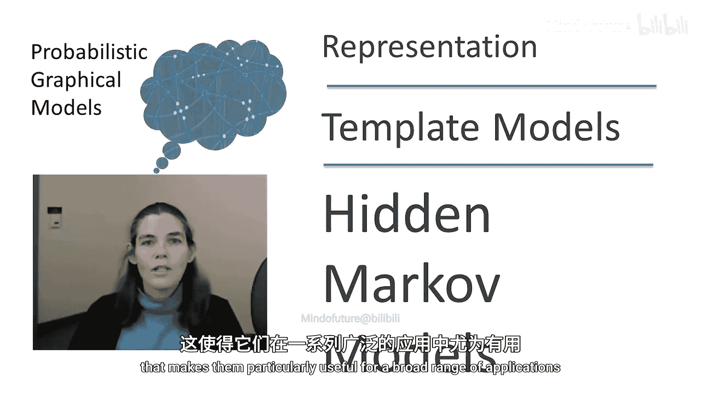

So a hidden Markov model in its simplest form can be viewed as a probabilistic model that has a single state variable S and a single observation variable O。

 And so the model really has only two probabilistic pieces。 There is the transition model。

That tells us the transition from one state to the next over time。

 and then there is the observation model that tells us in a given state how likely we are to see different observations。

Now you can unroll this simple 2 TBN。 So if this is our 2 TBN。

 you can unroll that to produce an unrolled network。

Wwhich has the same repeated structure of you start the state at time zero。

 move to the state of time1 and so on， and at each state we make an appropriate observation。

But what's interesting about Hid Markov models is that they often have a lot of internal structure that manifests most notably here in the transition model。

 but sometimes also in the observation model， so here is an example of what a structured transition model would look like and this entire model is actually is peering into the CPD of the probability of the state at time of the next state given the current state。

 so each of these nodes in here is not a random variable rather it is a particular assignment to the state variable state that the model might be in and what you see here is the structure of the transition matrix that tells us that from S1 for example。

 the model is likely to transition to S2 with probability 0。7 or stay in S1 with probability 0。

3 and so these two outgoing probabilitybabilities have to sum to1 because it's a probability。

diistribution over the next state， given that in the current time point。

 the model is in state S1 and we similarly have that for all other states， so here from S4。

 for example， there is the probability of 0。9 of going to S2 and 0。1 of staying at S4。

So here the structure is actually a sparsity in the transition model as opposed to something that manifests at the level of the 2 TBBN structure。

 which is actually fairly simple。😊。

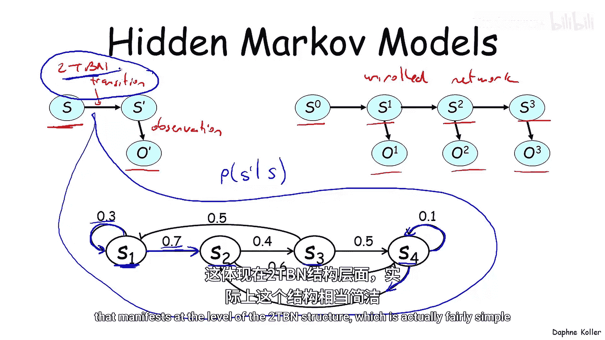

Turs out that this kind of structure is useful for broad range of applications， robot localization。

 speech recognition where HMMs are really the method of choice for all current speech recognition systems。

 biological sequence analysis， for example annotating a DNA sequence with elements that are functionally important and other elements that are not of importance。

 and similarly annotating a text sequence with particular annotating words with the role in the sentence for example。

 all of these are methods where hidden Markov models have been used with great success。

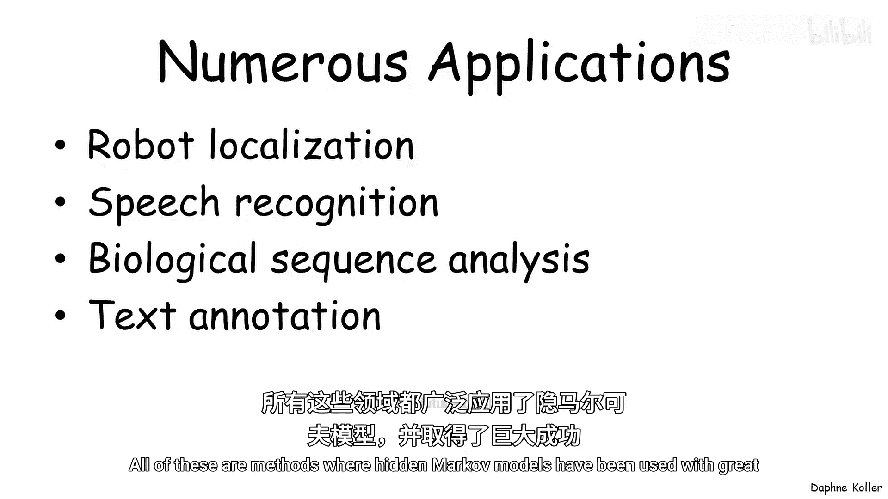

So let's look for example， what the HMM would look like for robot localization This might not look exactly like an HM to begin with because it has some additional variables so let's talk about what each of these variables means here what we have is a state variable that represents the robot pose that is the position and potentially orientation of the robot within a map at each point in time。

We also have an external control signal U， which is the guidance that the robot is told to move left。

 move right， turn around， since these variables are observed and externally imposed。

 they're not really stochastic random variables， they're just inputs to the system if you will。

 and then we have， in addition， the observation variables。

 which is what the robot observed at each point in the process。

 which depends on both their position and of course on the map。

Position so that the robot observations depend on the overall architecture of the space that they're in and the state of the building。

Now， since in many of the applications that we'll be considering the map is observed。

 which is why I just gray it out， then you can effectively think of this as something where the basic structure。

Over which we're reasoning is just the set of variables that represent the s's and the Os。

 which is why this is really a slight elaboration of a standard HM model and here also we're going to have sparsity in the transition model because the robot can jump around from one state to the other so within a single step and so there is only going to be a limited set of positions at time T plus one given where the robot is at time T。

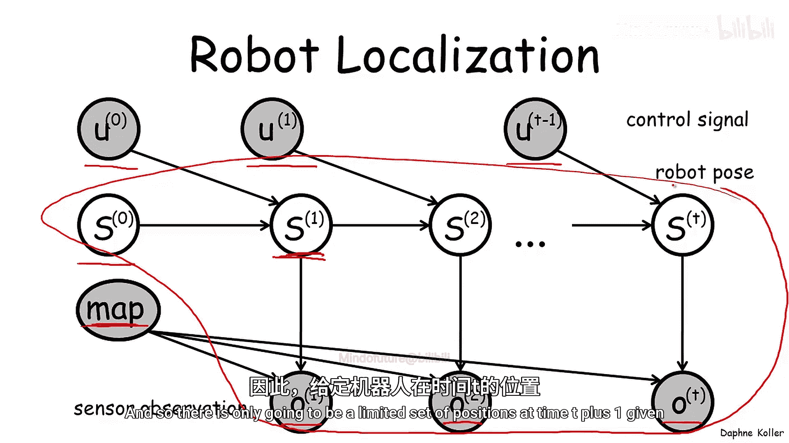

Sppeeech recognition as I mentioned， is perhaps the prototypical HMM success story because it's so much in common use The speech recognition problem is to take a sentence such as Dorothy lived in whatever and imagine somebody is saying that and what is given as input to the probabilistic reasoning system is this very noisy acoustic signal that represents the values of the different frequencies of speech in different acoustic frequencies at each point in time and what we would like to do is we would like to take that input and put it into a decoder that is going to evaluate different possible sentences and hopefully guess what the source sentence is and be able to predict it with reason accuracyacy。

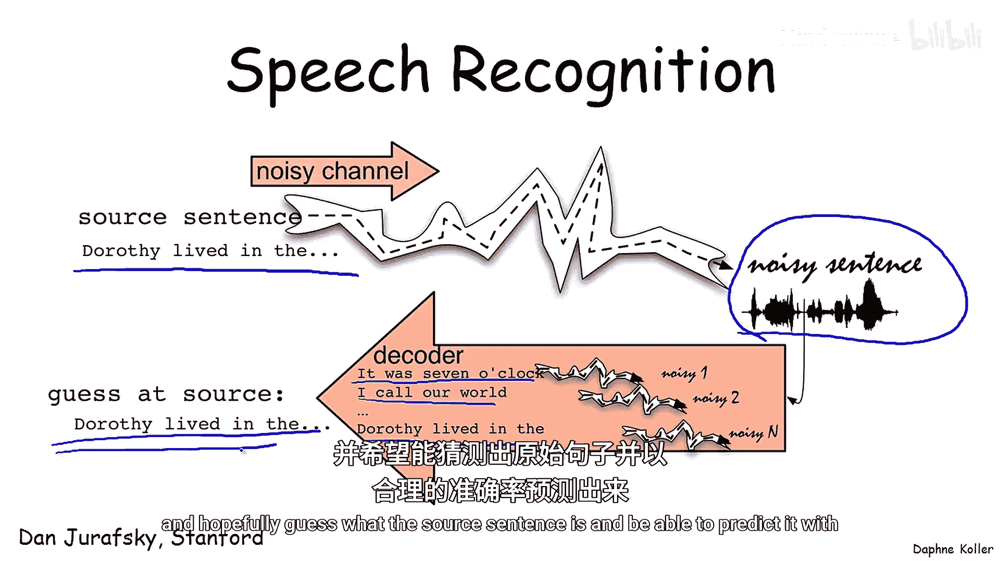

So how does speech recognition work？So this is what an acoustic signal looks like。

 we can see that over here where at each point in time we have these frequencies and we can convert that to the frequency spectrum。

By using a Fourier transform。And what we would like to do is wed like to break up this continuous signal into these pieces that correspond to words and recognize for each piece that which word it corresponds to so this is a twofold problem because in general and continuous speech we have to both identify the boundaries between words as we are also trying to identify the words and it turns out that the way to do this is not to think about words as the basic unit but rather think about these smaller entities that are called phones or phonemes as the basic units from which words are comprised and then as we recognize phones we can put them together to figure out what the words mean。

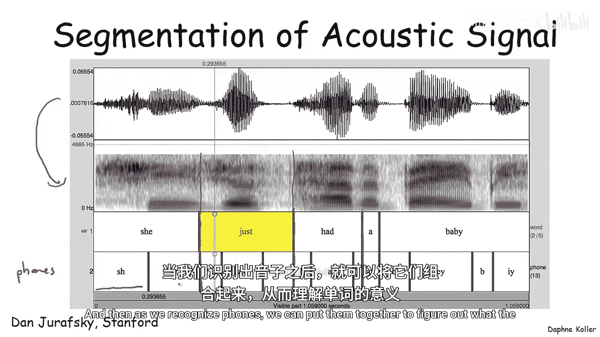

So here is a phonetic alphabet， one of several that break that is used to define how words are broken up into these little pieces and so you can see that these don't line up exactly with characters in the alphabet because the same characters can actually be pronounced in different ways giving rise to different phones and vice versa sometimes the same phone can come from different letters and so what we see here are for example。

 the phone called E calleder in is pronounced in the same way as theer andH and so this is a phonetic alphabet and as I said there is many of those that one can consider。

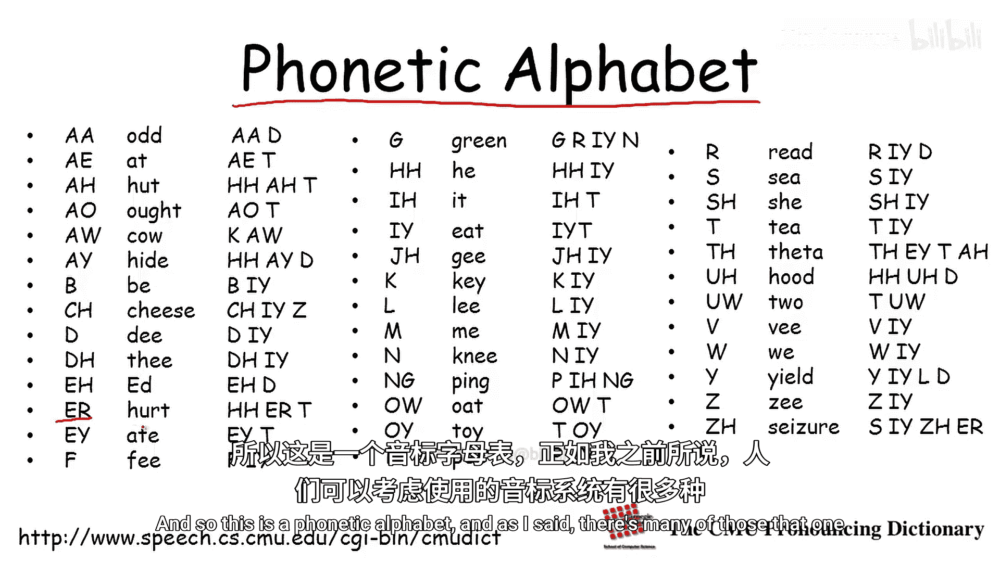

So。Once we have the phonetic alphabet， we can look at a word in this case， is the this is the。

Pnetic alphabet， the phonetic breakdown of the word 9，9。

 And so you can see that this is an HMM structure。 This is not the DN。

 This is the H M M of that tells us at each point in time， whether you're within the phone。

I wouldn't and so there is a self transition loop because you can stay in the same phone for more than one time unit and then eventually you transition to the next phone and the next phone and this is a typical HM for a word。

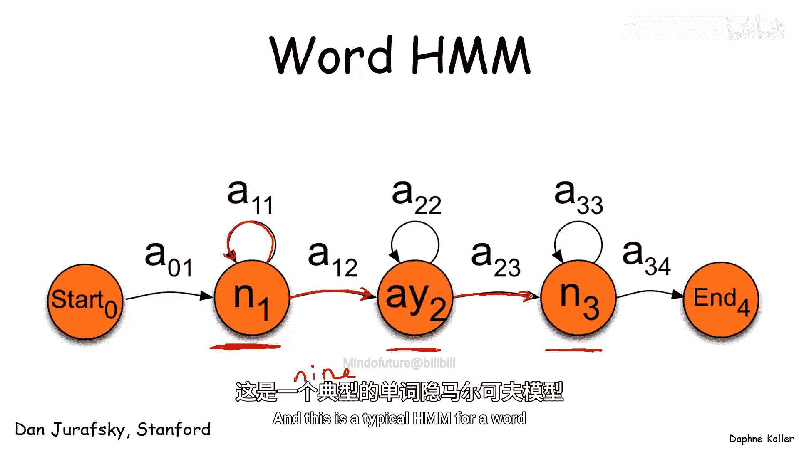

Now within a phone， a phone also lasts a certain unit of time and so what we have here is the within the phone for within a given phone there is a transition model。

 in this case the a phone and it has， in this case three states， the beginning B。

 the middle and the final， and this is a fairly standard breakdown for most phone that have the beginning of the phone the middle and the end。

 and each of these typically corresponds to a different distribution over the acoustic signal that you see at that stage in the phone。

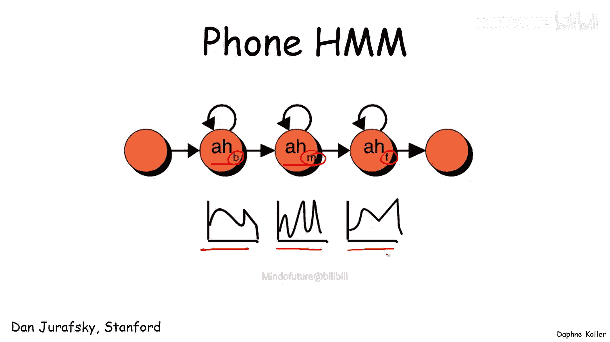

So if you put all these together， if you're trying to do speech recognition， then and this is。

 for the moment， speech recognition for isolated words， so there is a start date。

And then there is a transition model from the start state that tells us how likely we are in the current state to go into one of many words and that would be a language model that tells us how likely different words are to occur at this point and then assuming and then given that the model has transition to say the one word。

 the word one， and we can see that we now have across different points in time that the model transitions to the w。

 and then ultimately to the a and then finally to the。And then at the end of it。

 it transitions to the end of the word at which point the process circles back and we move on to the next word。

And the self and the transition back to the start state is what allows us to do continuous speech recognition。

 so this is a probabilistic model that tells us how speech might be constructed of first words。

 then phones within words， and then finally pieces。

 little bits of the phone that we see this in the phone HMM that we saw previously。And。

This is a generative model of speech， but what happens is that as you feed in evidence about the observed acoustic signal over here and you run probabilistic inference over this model what you get out is the most likely set of words that gave rise to the observed speech signal。

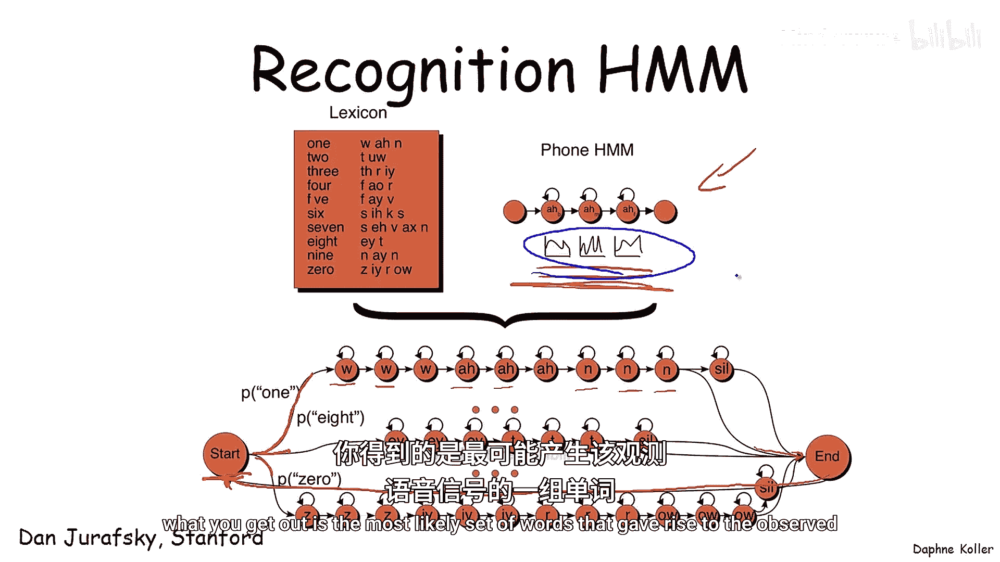

So to summarize， HMMs in some simplistic way can be viewed as a subclass of the framework of dynamic Bayesian networks and while they seem unstructured when we observe them at that level when we think of structure at the level of random variables。

 there is a lot of structure that manifests in the sparsity structure of the conditional probabilities and also in terms of repeated elements as we saw in the previous slide。

 the phoning the phone model can occur in multiple words and we replicate that structure across the different places where the same phone can be used in the language and so that gives a lot of structure in the transition model that really doesn't manifest in any way at the level of random variables。

And we've seen that HMs are used in a wide variety of applications for sequence modeling。

 and they're probably one of the most used forms of probabilistic graphical models out there。

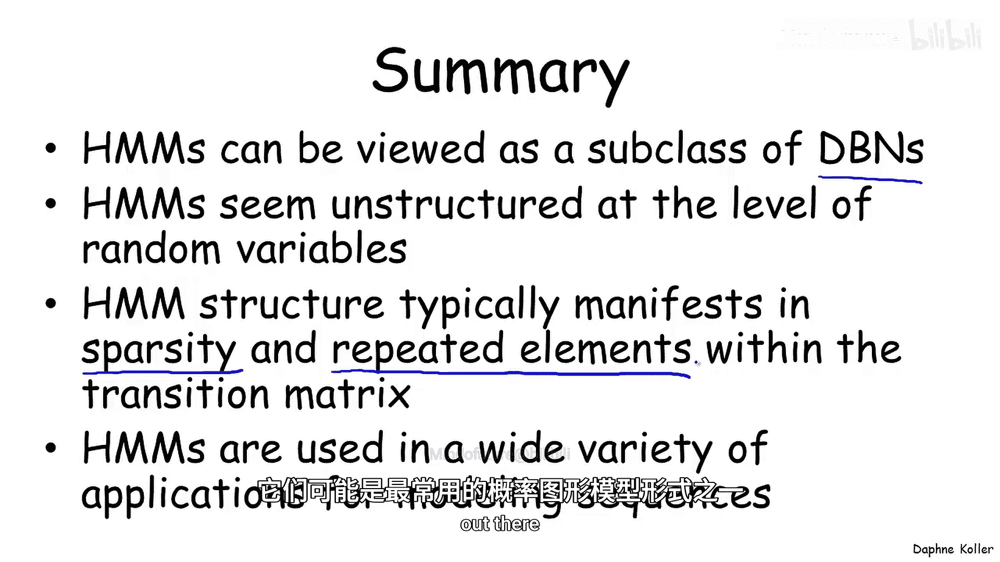