# 【斯坦福】概率图形模型1：表示法 ｜ Probabilistic Graphical Models p23 P23_板模型_03_01_04 -BV1M76VBSEJ6_p23-

One very common kind of repeated structure occurs when we have multiple objects of the same type。

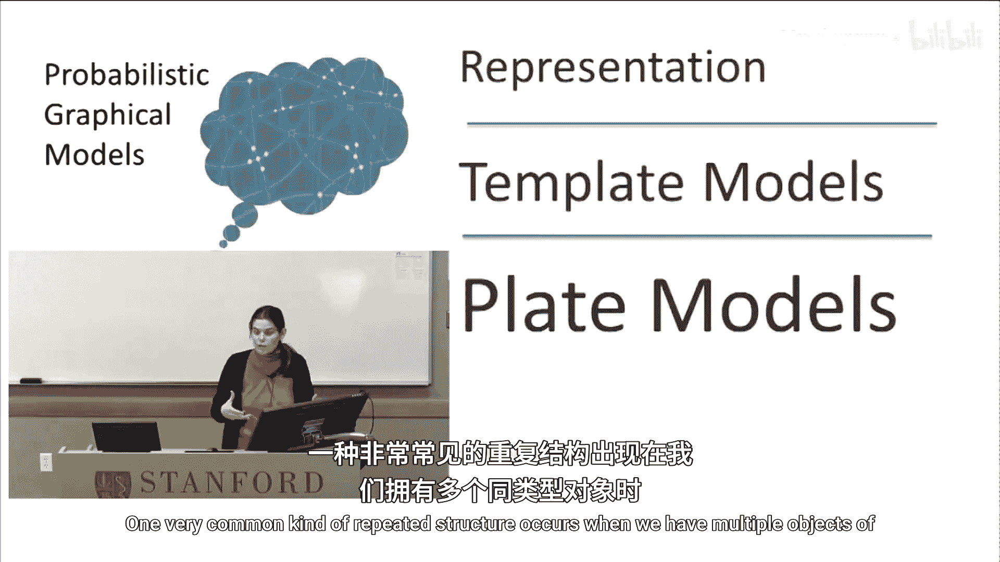

That where we want to have all these different copies of the object， it's not copies of the objects。

 but objects of the same type all have a similar or in fact， the same probabilistic model。

For reasons that we'll talk about momentarily， one of the most common type of such models is called the plate model。

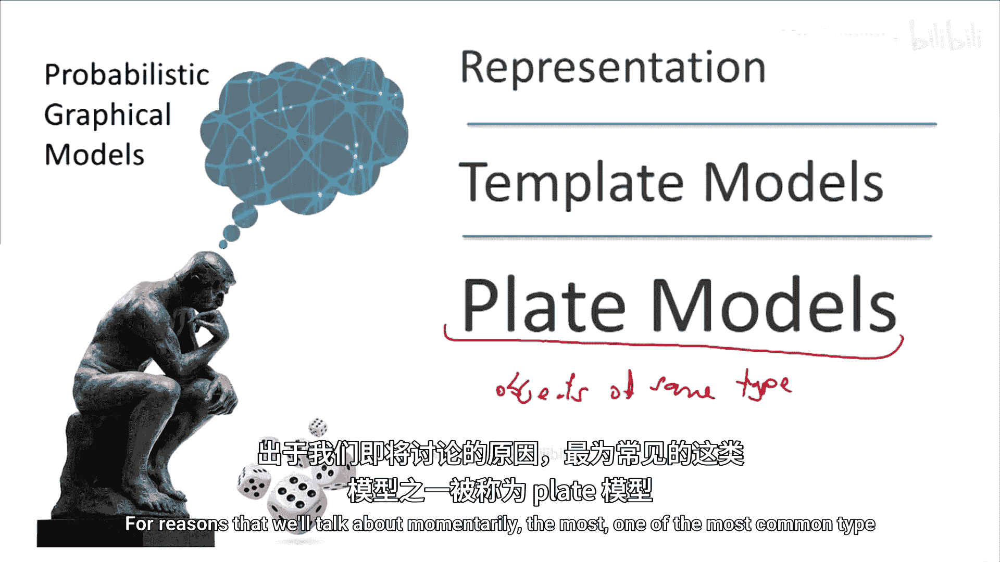

So let's start by modeling repetition。So in this case。

 imagine that we're repeatedly tossing the same coin again and again。

 so we have an outcome variable and what we'd like to model is the repetition of multiple tosses and so we're going to put a little box around that outcome variable and this box which is called a plate。

Is a way of denoting that the outcome variable is indexed。😊。

Which we usually don't denote explicitly the notion by different tosses of the coin tea。

And the reason for calling it a plate is because the intuition is that this is a stack of identical plates that's kind of where the idea comes from for a plate model。

And looking at what that model denotes is if we have a set of coins of coin tosses T1 up to TK。

It basically says that we have a set of random variables， outcome of T1 up to outcome of TK。

 so we've just reproduced the outcome variable in its multiple copies。Now。

 what does that explicitly correspond to I'm now going to do something that we're going to do a lot of times later on in the course when we talk about learning。

 which is I'm going to put the parameters。Of the CPD。Explicitly into the model。

 so this random variable Theta is the actual CPD parameterization。

 and I'm putting it explicitly so that I can show how different variables depend on that。😊。

And so if we have the parameters here， we can see that Thena is outside of the plate。

Which means that it's not。Not indexed。Like he。Which means it's the same for all values of P。

So what that means is that we have。This。C this parameter theta over here。

And we have all of these outcomes depend on the exact same parameterization。

 and the CPD of the outcome of T1 is copied。From this parameterization theta。

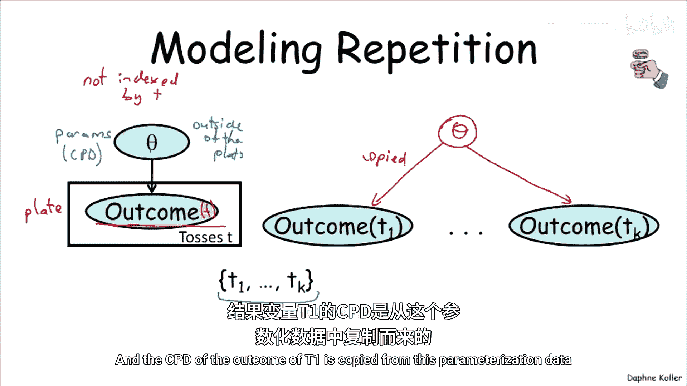

Let's look at a slightly more interesting example。Going back to our university with multiple students。

 we now have a two variable model where we have intelligence in grade and we now index that by different students S。

 which again indicates that we have a repetition a copying of this template model。

 in this case I only made two copies for one for student one and the other one for student two。

And once again， if we wanted to encode dependence on the parameters， so we might have theta I。

Whi represents the CPD for I， and we might have theta G， which represents the CPD for G。

 and we would have exactly the same idea of theta I。And theta G。

 where theta I influences the two i variables and theta G influences the two variables， and again。

 they're out of the plate。The important sometimes in many models。

 we will include those parameters explicitly within the model。

 but often when you have a parameter that's outside of all plates。We won't denote it explicitly。

So we just omit it as we did in this original diagram before I annotated it。

Now just repeating the exact same model multiple times is not particularly interesting。

 so now let's talk about how you can overlap different plates or in different words。

 think about how different types of objects in the model overlap with each other。

 so in this case we have two kinds of objects in our universe discourse we have courses。

And we have students。And courses we're going to call little C and students we're going to call little S。

 and so now let's think about how you might replicate variables that correspond to properties of courses and variables that correspond to properties of students。

So the difficulty variable。Belongs in the course plate because it's the property of a course。

 so it's going to be difficulty of a course。 And now's think about how we're going to put students in。

 One possibility is that we're going to nest。The students plate inside the course plate。Now。

 what that means is that the student that each variable here， both of these variables。Our indexed。

By both S and C， because when a variable is nested in a plate。

It means that it has the indices of all plates that it's nested in。

 so if the intelligence variable is in both the S plate and the C plate。

 it's going to be indexed by both。So let's build that model and see what it looks like when we sort of unravel the courses and unravel the students。

It's going to look like that。So we're going to have the difficulty of let's say this is a two course model and a two student model。

 so we have a difficulty of course one and the difficulty of course two and now we have the variables in an nested plate I and G and we can see that they're both。

We're amateurized by both student and course。Let's think about the implications of this model。

The implications are that the intelligence is now a property。Of both a student。Intelligence。

Of students。In course。And that the intelligence of a student in a particular course influences the grade of the student。

In math course。And you can see that by having this dependency model over here。No。

What is that- let's think about the implications of this。

This tells us that there is a course specific intelligence for every student。

For every student in every course。And that may or may not be what we want。

If you're taking radically different courses and one is an art class and one is a math class。

 and you could say that there is an art intelligence that're representing skill， if you will。

 in art and you have a math skill where math intelligence。

 then you might actually want to have two different kinds of intelligence and not assume that they're necessarily the same thing。

Of course that kind of complicates the model and if you have a bunch of courses that are in some ways similar to each other and take a similar set of skills。

 you might not want to have a bunch of independent， look independent。Random variables。啊，sorry， this是。

These ones。We're assuming that the student has two independent intelligences representing their intelligence in the two different courses。

And in that case， you don't want the intelligence variable to be part of the course plate。

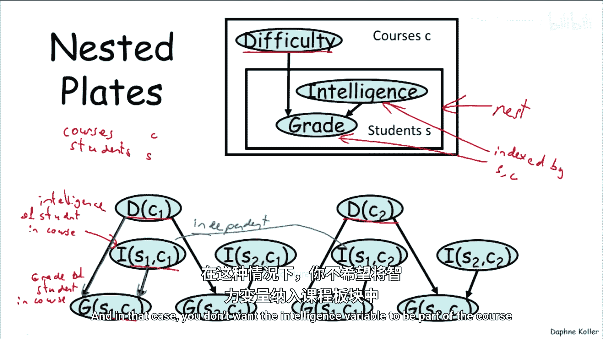

And so that gives us an alternative representation。

 which is what's called plates that are not the same。

 but overlap that are not necessarily that overlap with each other。

 so in this case we have the coarse plate。Which is this plate over here。

And we have the student plate。Which is this one over here。And the assumption is that。

His difficulty is a property only of the course？So this is a difficulty。

The intelligence is a property of the student， and only the grade is a property that depends on both。

And when we unravel this one。What we end up with a model is a model like this， so we have。

 in this case， the we only have a single。We have a difficulty for the course。

We have an intelligence for the student and over here let's denote things in the intersection in green。

 we have the grade of the student in the course depends on the difficulty of the course and on the intelligence of the student。

And so now we only have a single intelligence per student。And that is an alternative modeling。

 it's not that one of these is right and the other is wrong， they're just different。

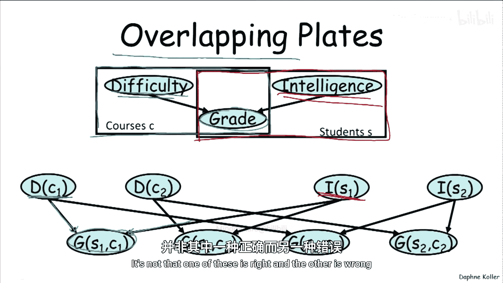

And once again， just to demonstrate exclusive parameter sharing。

 I just wanted to highlight again that this notion of parameter sharing also applies to models such as this。

 so here we have a parameter theta D， we have a parameter theta I。

 and we have a in parameter theta G which which influences the grade CP， and that's shared model。

All of the different grade variables。

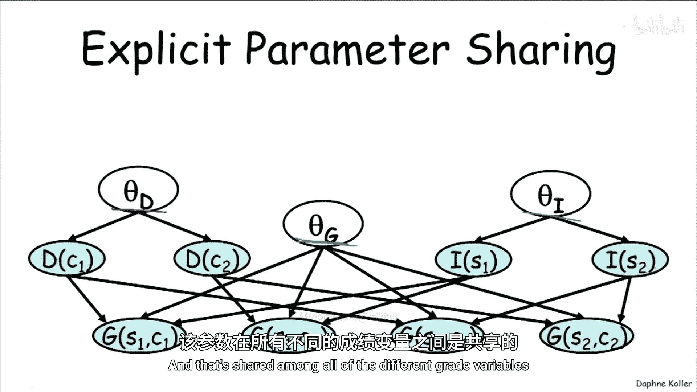

哦。So why are these kinds of plate models useful so let's look at an example to convince ourselves that by building these richly structured models that involve multiple entities。

 you can actually get much more interesting conclusions so let's look at this example over here。

 imagine that we have this first quarter freshman came into our university and we'd like to figure out what we can determine about him。

So let's say that in this particular university， a priori。

 we believe that most students have high intelligence and so this is the intelligence distribution。

And 80%。Now the student who we're going to call George， took two classes。

 he took geology 101 and got an A。So probability that he's intelligent goes up。

He took CS101 didn't do so well， got to see。 well， the probability goes down。

It doesn't go down to a very low number and that's because we know from the CPD for grade that we've seen previously。

 that we have there may be maybe multiple reasons why students might not do well in a class。

 for example it was a really hard class and so maybe everybody did badly and so you shouldn't take this too seriously。

If these are the only two courses that George took， we're kind of stuck。

But now let's think about this in a more holistic context or collective inference where we're going to think about a number of students taking a number of classes and let's imagine that we have a bunch of grades for all of those students so what we see here are the green ones。

😊。

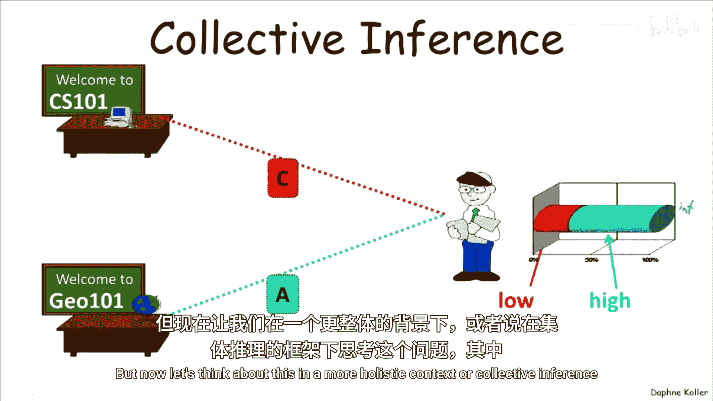

A As。The yellow ones。Our bees。And the red ones are C's。

 and what you see here is a shorthand for a bunch of observed grade variables。

 so I didn't put in all the little dots that represent all little ovals that represent the grade variables I just put in these lines to indicate what they are so you can think of this as the induced Markov network。

 if you will。Okay， so so now let's think about what kind of conclusions we can reach from this network and what seems even looking at this by I。

 we can see that a bunch of people took CS101 and they all aced it except for our friend George。

And furthermore， even if you look at this guy over here。

 who got a see in every other class that he took he still managed to AC CS 101。

 so if we do the probabilistic inference over this holistic model， what we're going to get。

Is that we are pretty sure that CS101 is an easy class。And if we're pretty sure about that。

 we're also pretty sure。In this case， the intelligence is low。

And so we can reach much more informed conclusions in this setting than we can by reasoning about individuals in isolation。

Now this is a toy example but we'll see later on examples of collective inference that where we have multiple interrelated entities。

 it could be related pixels in an image， it can be related web pages in in a website that web pages point to each other that if we try and label each entity in isolation。

 we just don't get very informed conclusion， but by thinking about how they all relate to each other。

 we get much stronger results that are much more informed。

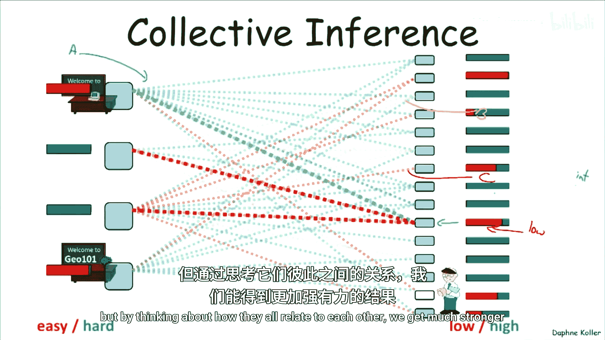

So just to then summarize the plate dependency model。

The plate dependency model has the following characteristics。

 it defines a dependency model for a template variable that is indexed。By a bunch of object types。

 so for example students in courses or anything else。

 and we have for each of those template variables we have a set of template parents。

And what we have interment is that each of these has to be a subset。Of this so what does that mean。

 it means for example， that for the template variable G of S comma C。

 so this is the G corresponds to the variable A， S and C correspond to the indices in this case u1 and U2 and what we have is we have two template pairs。

We have I of。Yes。And D of C and the stipulation that U I。Is a subset。This is the set UI。

Is a subset of the variable of the indices you1 up to UK tells us， for example。

That we cannot have an index in the parent that doesn't appear in the child， so for example。

 we cannot have in this model because after reasons that I'll describe in a minute， the notion of。

 for example， honors，For student S， depending on the grade of the student in multiple courses。

And the reason for that is that this is not a CPD。You have the honors variable depending on a potentially unbounded。

Number。Of parents。Which are all of。The grades in which the student participated。

And it's not to say that one can't define such a dependency model， and in fact。

 there are richer languages than plates for which people have defined this notion of an aggregator CPD。

But it's not within。The standard paradigm of what are traditionally called plate models。

So by preventing that， we now have effectively a traditional model where you have a random variable with a finite fixed set of parents。

 and so we can define a template。PPD， which we can then reuse in a model for any copy of this template variable where a copy is obtained for different instantis of these indiceU。

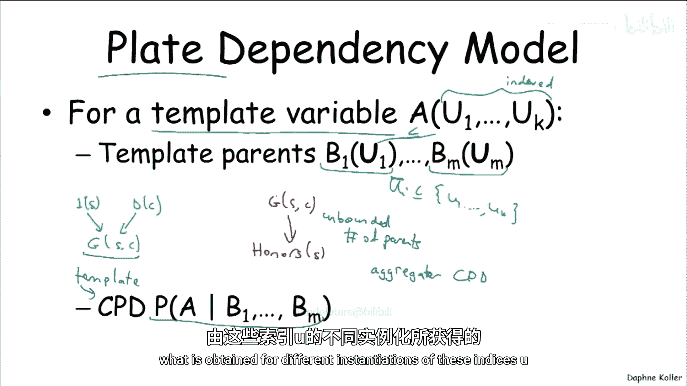

So for example， so specifically， if we have this model， if we have this variable a of U1 up to UK。

 then for any instantiation， little U1 up to UK， which are concrete instantiations of the indices。

 we would have the following model， we would have the variable A of little U1。a little UK。

 depending on。The specific。Whi is potentially confusing notation because the sets are a little bit hard to understand。

 but this really just think concretely of the example。

 this exactly says that the grade of a particular student in a particular course depends on the difficulty of that course and on the intelligence of that student。

 that's all it says。So it's just a general way of saying that。

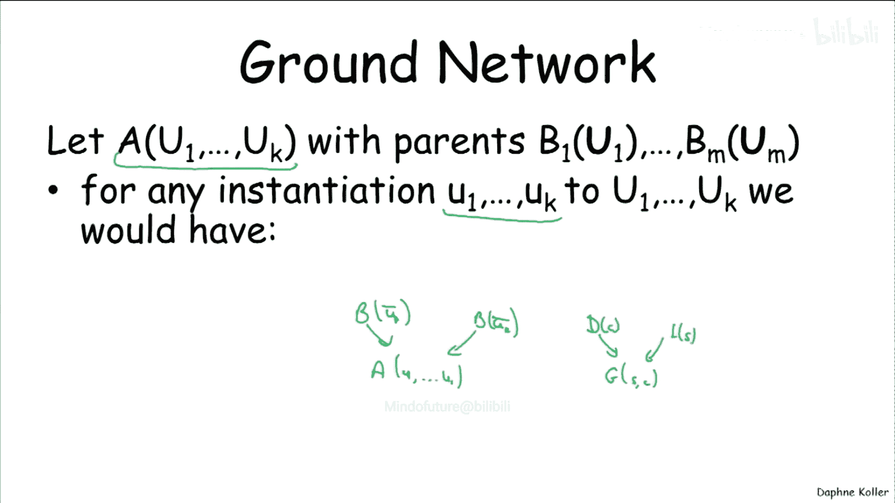

And this is just the formal version of the statement that I made earlier that requires。

The parents not to have variables that are not explicitly instantiated in the child so that we don't have a free floating variable that can be instantiated in arbitrarily in many ways。

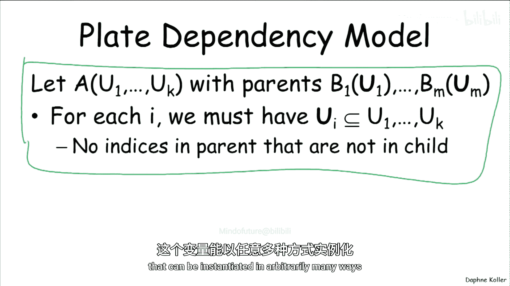

So to summarize。😊，PP models are a language which allows us to define a template for an infinite set of Bayesian networks。

 why infinite because you can have three students， 1 students， a00 students。

 a million students an unbounded number of students。

 so there is an infinite set of Bayesian networks that we can use this language to encode。

 and each is induced by a different combination of domain objects in our example。

 for instance students and courses。The parameters and the structure are reused。😮，In both within。

The BaysNe and across the different Bs Ne， so for example， within our university example。

 we reuse the same parameters and if we have a different university with a different set of students and courses。

 we would still use the same parameters。These models。

 by allowing us to represent an intricate network of dependencies。

 allow us to capture very richly correlated structures in a concise way。

 which allows us to do this kind of collective inference。

 which is potentially a very powerful source for informed conclusions。

Now I've presented plate models， which are the perhaps earliest and one of the simplest of these languages。

Wwhich allow us to represent template structures， this is a simple one， for example。

 it has this restriction on the parents not having variables that are not instantiated in the child and so for example you can't represent temporal models here because。

X of t -1 is not instantd in the variable x of T， so you can't have x of t minus-1 as a parent of x of T。

 not in a p model。 I mean， obviously we have languages that can do that， but not this one。

 Similarlyly， you can't have the genotype。And the genotype of the father。

Affect the genotype of the child because once again， the child doesn't instantiate。

The mother and the father， these are separate indices and so this is a limited language but there's many other languages that expand on it in different ways and they each have different tradeoffs in terms of what they express easily and what they don't and there is an entire literature on this that we're not going to go into but has provided a number of very useful languages representing these kinds of richly structured models。

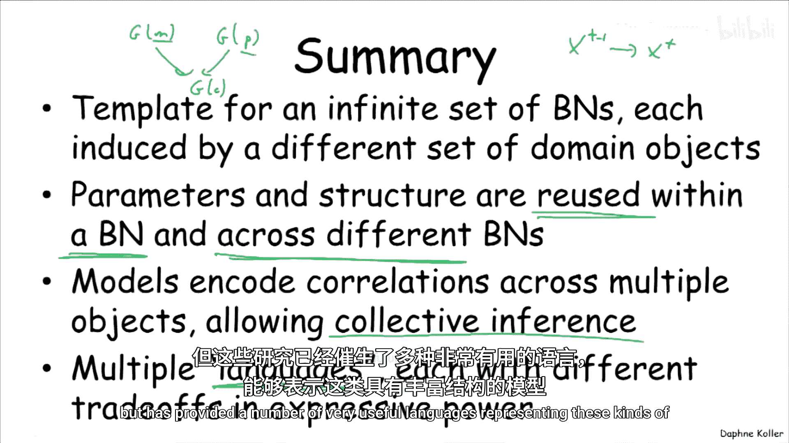