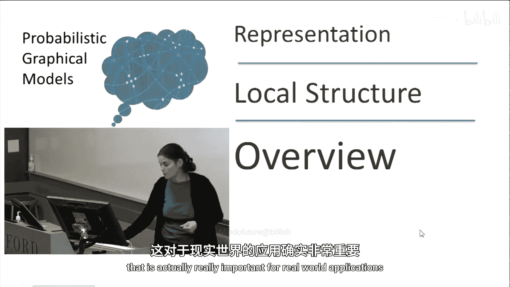
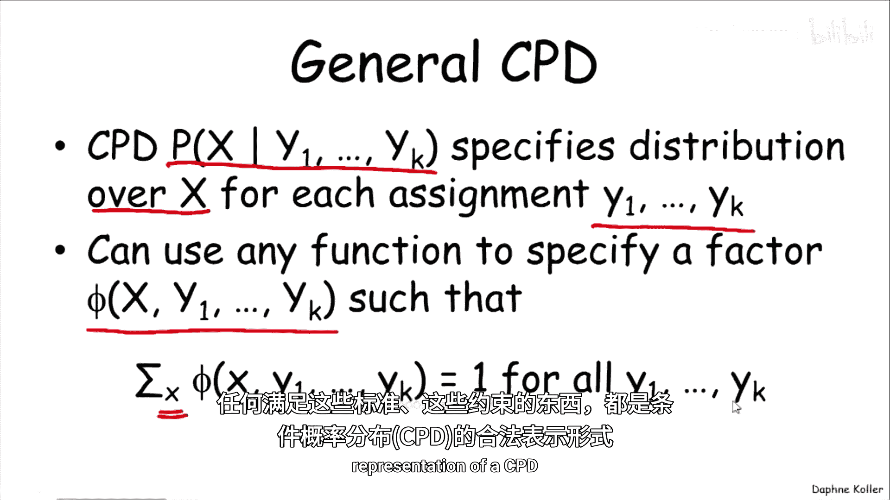
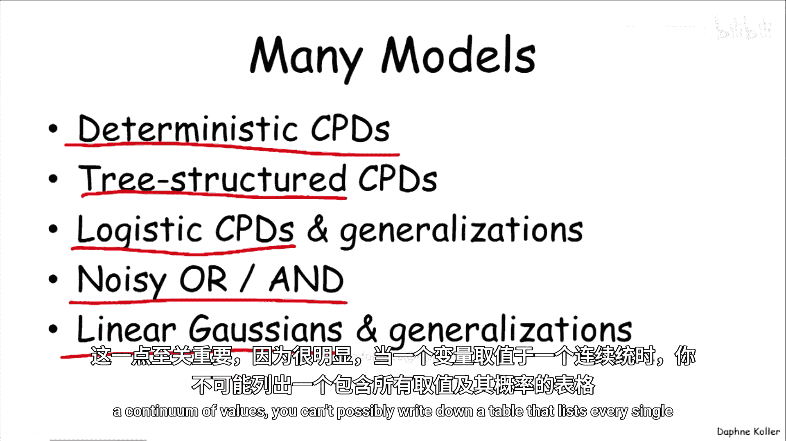
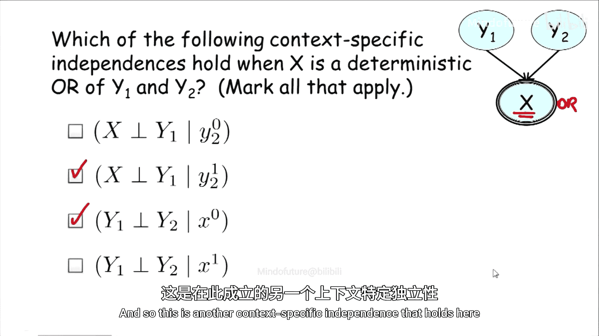
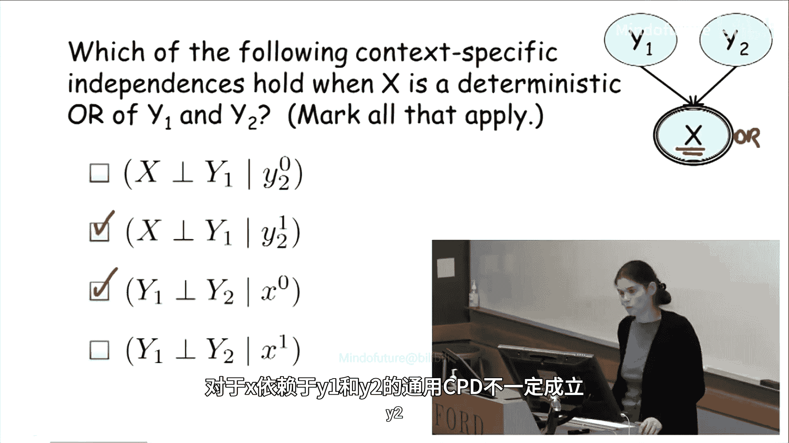

# 【斯坦福】概率图形模型1：表示法 ｜ Probabilistic Graphical Models p24 P24_结构化条件概率分布概述_04_01_01 -BV1M76VBSEJ6_p24-

So far， we focus solely on the global structure of the distribution。

 the fact that you can take it and factorize it as a product of factors that correspond to subsets of variables。

 but it turns out that you also have other types of structure that you might want to encode。

 and that is actually really important for real worldor applications。 So to motivate that。

 let's look at the tabular representation of conditional probability distributions。

 which is what we've used universally until now in the examples that we've given。

 So a tabular representation is one of these examples where we have you know a row for each assignment。

 So this is just a reminder this is G with parents I and the。

And here we have a row for each assignment of the parents that gives us explicitly enumerating all of the entries that correspond to the probabilities of the variable G。

So this is great and you can say well what's the problem。

 I mean it sounds like a perfectly reasonable and very understandable representation Well。

 that's great， but now let's consider a more realistic example， for instance。

 in a medical application where we might have a variable corresponding to cough。😊。

Well there's lots and lots of things that might make you cough。

 you might have pneumonia or the flu or tuberculosis or bronchitis or just a common cold and by the time you finish enumerating all of the many things that might make you cough。

 you realize that the variable usually might have as many as 10 or 15 or even 20 parents for variable such as fever so that's so when you think about what the implications of that are relative to a tabular CPD。

 you realize that if we have K parents。And let's assume for the moment that they're all binary just for simplicity。

 that the number of entries in the CPD grows as to decay K。Or of to decay K。

 depending on the number of variable values of the child。So unfortunately。

 these situations are more common than not， and that means that tabular representations are really not suitable for a lot of real world applications。

 so we have to think beyond that。😊，So fortunately， there is nothing in the definition of a Bayesian network that imposes on us a fully specified table as the only representation of a conditional probability distribution the only thing we need is that the CPDp of x given y1 up to YK needs to specify a distribution over x for each assignment y1 to YK and it can do that completely implicitly it can do that as a little piece of C code that looks at y1 up to Yk and prints out a distribution over x Now fortunately we don't usually have to or sorry or in fact we can use any function parameterized or as a C routine or anything to specify a factor over the scope X y1 up to Yk such that well it has to be a probability distribution over x so it has sum so when you sum up all the values of x。

😊，For a given assignment to y1 of to YK it has to sum to one， anything that satisfies these criteria。

 these constraints is a legitimate representation of a CPD。

So like I said， fortunately we don't usually have to resort to C code to specify CPDs。

 the theory that the framework of statistics has defined for us a multitude of different representations of conditional probability distribution given a set of conditioning variables so some examples include deterministic CPDs where x is a is a deterministic function of y1 up to YK we've already seen a couple of examples of that you we can define and we will define CPDs that have the form of what's called a decision tree or regression tree framework that some of you have seen before you can think of CPDs that are logistic functions or more generally log linear models we're going to talk about things that are noisy or noisy and which are noisy versions of the deterministic CPs and then in the continuous case we also have frameworks that allow us to represent。

Probability distribution of a continuous variable on a set of continuous or discrete parents。

 and that is really critical because obviously when you have a variable that takes on a continuum of values。

 you can't possibly write down a table that lists every single one of them。😊。

Now， one of the things that are intertwined with the notion of。

Structure within a CPD is a useful notion called context specific independence。

 and it turns out that this notion arises in some of the representations of CPDs that we're going to talk about。

Cont specific independence is a type of independence that where we have a set of variables x。

 a set of variables Y， a set of variables Z， and then we have a particular assignment， C。

 which is an assignment to some set of variables。Bigie。So this is conditioning。

 this is an independent statement that only holds for particular values of the conditioning variable C as opposed to all values of the conditioning variable C。

Now the definition of this is exactly as we have seen before。

 so except that if you remember before we had Z stays。

 when we were doing conditional independence given Z。

 we had the Z stays on the right hand side of the conditioning bar everywhere， well now Z and C。

Stay on the right hand side of the conditioning bar in all of these forms of the independent state。

So let's look at why context specific independence might arise when we have particular internal structure within a CPD。

So let's imagine， let's consider the case that x。Is a deterministic or。Of Y1 and Y2。

And the question is。What。😮，Form of context specific independence hold when we have X being a determin X being this deterministic or。

Okay so let's look at these statements one at a time。And here we have that Y 2 is。False。

And when what happens when y2 is false？Well when y is false， x is the same as y1。In which case。

 obviously they're not going to be independent。On the other hand， what if Y2 is true？Y2 is true。

 I don't care about y1 anymore， because if y2 is true， x is true。

 and so here we have a notion of context specific independence。What about this one？

I'm now asking about why one。Being independent of Y2 given two possible values of x。

What happens when x is false？What do I know。About Y1 and Y2。We're both false。Well。

 if they're both false when they're independent of each other。

 because if you tell me that one of them is false， I already know the other ones false。

 so they're independent。 And so this is another context specific independence。

The hold here。Does it hold if I tell you that x is true？No。

 because I don't know which of Y women Y2 made X true， and so this last one doesn't hold。

And so here are two context specific dependencies that hold in the context of deter deterministic CPD that wouldn't hold neither of these would hold for general purpose CPD。

 wouldn't necessarily hold for general purpose CPD of x， depending on y1 and y2。

