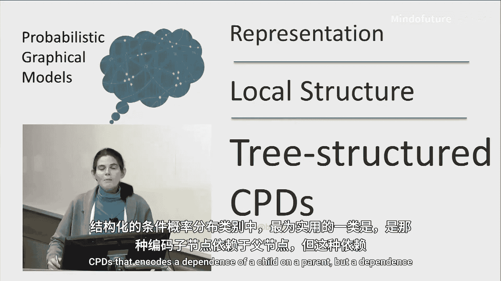
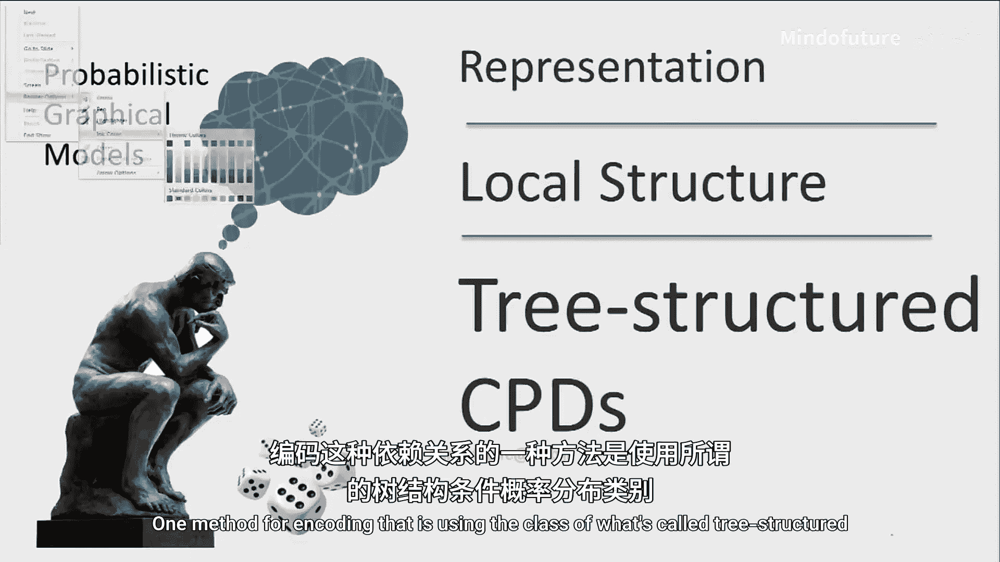
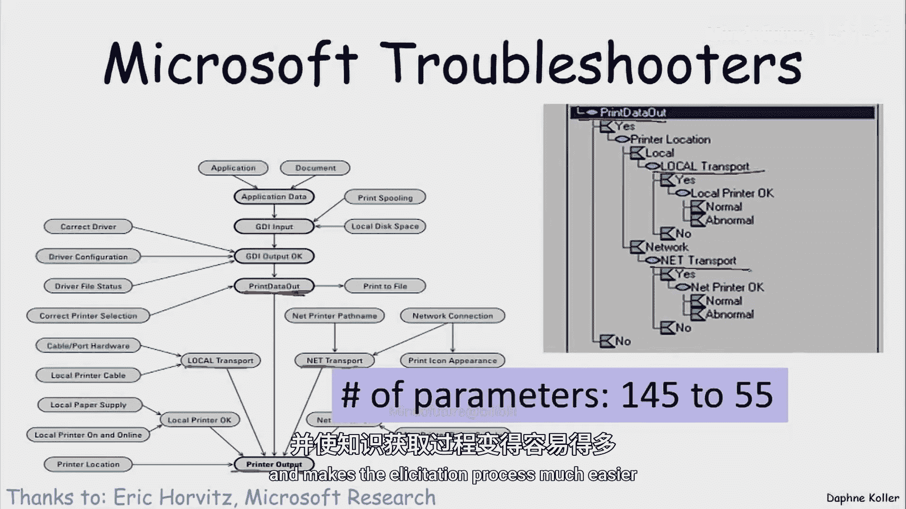
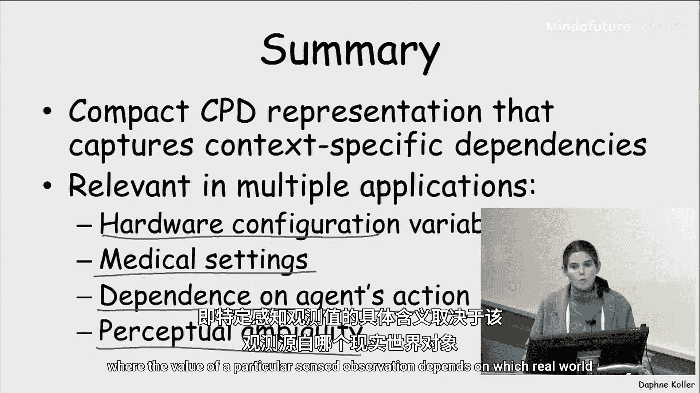

# 【斯坦福】概率图形模型1：表示法 ｜ Probabilistic Graphical Models p25 P25_树结构条件概率分布_04_01_02 -BV1M76VBSEJ6_p25-

So we've argued that table CPDs are problematic because of their exponential growth in the number of parents。

 one of the classes of structured CPDs that is most useful is the class of CPDs that encodes a dependence of a child on a parent。

 but a dependence that is only happening in certain contexts。

One method for encoding that is using the class of what's called tree structured CPDs。

So to understand what treestructured CPDs are， let's look at this simple example。

 imagine that we have our student and the student is applying for a job and the prospects of the students to get the job depends on three variables depends on the quality of the recommendation letter that they get from a faculty member。

 their SAT scores and whether the student chooses to apply for the job in the first place。

So let's think about one possible CPD for this model。

So here we have a tree structure that you can think of it as a branching process where the distribution over job looks at some variables and then decides what the distribution might look like。

 so for example。Initially， the。The dependence is on whether the student chooses to apply for the job or not。

What happens if the student doesn't apply for the job Well。

 you might say in that case the student doesn't get the job but it turns out to be not the case in the heydays of Silicon Valley。

 for example， we have the different Internet bubbles。

 students were getting job offers without of applying for jobs and so it might actually happen that the student's probability of getting a job is nonzero even in this case and notice that the student not having applied for the job didn't submit either recommendation letter or the SAT scores。

 which means that the students' job prospects don't depend in this scenario on either of these two variables and so in all possible configurations of the S and L variable。

 the S andL variables， the probability of the student getting a job is 0。2。

What if the student did choose to apply for the job？Well， in this case。

 we can imagine a recruiter who's primary interested in the student's SAT scores。

 they don't really believe recommendation letters is all that much。

 and so next so the recruiter first looks at the student's SAT score。

 and if the student got a good score on the SAT S1。

 then regardless of the recommendation letter with the recruiter doesn't even choose to look at the student's probability of getting a job at 0。

9。Only in the case where the student's SAT scores are not as strong。

 does the recruiter go back and look at the letter， in which case there is a certain probability。

 say 60% of getting a job if the letter is strong。And 10%， if the letter is weak。

So we can see that we have a CPD that in this case depends on three binary variables。

 and so really we would need to represent in principle eight different probability distributions over the J variable。

 but we've only represented four because in certain contexts， some of the variables don't matter。

So in fact， this notion of a variable not mattering is related to the notion of context specific independence。

 which we've defined previously， so one can formalize this。

 in fact as a context specific independence。So let's look at this tree and think about which context specific inencies arise in the context of this tree structured CPD。

So' looking at the first one， does J， the variable that we care about， depend on L in the context？

A 1。S1。Well， we can see that in the context A1 S1， the recruiter never looks at the letter。

 so in fact， J is independent of L in this context， so the answer to this one is yes。A。

 what about the next one， J is independent of L given a1 alone？Well， in this case。

We have we're going down here and now there's two scenarios， one in which s is equal to S1。

 but the other s is equal to S0， and in this case the recruiter does look at the letter。

 and so this one in fact is natural。What about the next one， J is independent of L and S given a 0。

 So let's look at the a 0 case。 And sure enough。In the a0 case。

 there's no dependence on either L or S。 So this one is also true。

The last one is a little bit interesting because it's a mix of con specific and nonconfit specific independence。

 So we're asking whether J is independent of L in the context S1。For both values of the variable a。

And so to answer this question， we actually need to do a case analysis because this reduces to two different independent statements。

J is independent of L given S1 and A1， and J is independent of L given S1 and a0。

 So let's evaluate each of these two separately。 J is independent of L given S1 A1 is exactly this assertion。

 so this one's true。J is independent of L given S1 and a0。Is。Represents this。Which， in fact。

 is a special case of this scenario。And so both of these， in fact， are true independent statements。

And so since both cases hold， we have another conditional independent statement that holds here。

Let's look at another example that turns out to be representative of a large class of examples in this context。

 so here the student when applying for the job needs to submit a recommendation letter but has a choice between the two letters that they might elect to provide one from one course and another from a second course so letter one and letter two Now the student's job prospect depend on the quality of the letter that's actually provided because of course the recruiter doesn't have access to the letter that was not provided。

So if we look at this in the context of the3 CPD it would look like this。

 the first variable at the top corresponds to student choice and it has two branches， C1 and C2。

 and in the C1 case，There is dependence only on the quality of letter1， and in the C2 case。

 there is dependence only on the quality of letter 2。So this is an example of what it's well。

Related to something called a multiplexer CPD， because effectively。

 the choice variable determines the dependence on one set of circumstances or another set of circumstances。

Now it turns out that this example has some interesting ramifications because not only do we have context specific inencies that arise because of the three structure。

 it turns out that this also implies noncont specific independences that are quite useful。

 as we'll see later in the course。Specifically， we have that letter 1 is independent of letter 2。

 given J。And C。Now， if you think about this from purely the perspective of the deseparation structure。

 the flow of influence in this graph， we can see that the job actually activates。

The structure between letter1 and letter2， so you wouldn't actually expect letter1 and letter2 to be conditionally independent。

 that is we have a flow of influence because of intercosal reasoning。

But now let's think about this in more detail。And let's do a case analysis just like we did before。

 so we're now going to ask if letter 1 is independent of letter 2 given J and C1 but what happens in the context C equals C1 Well in this case。

 there's no longer dependence between job and letter2 because the recruiter is never given the second letter and so in the context C1 the graph really looks like this where there's no edge from L2 to J。

Conversely looking at the other case analysis where c equals C2， in this case。

 this other edge is going to disappear and once again there's no V structure and so there's no active trail between these two variables L1 and L2 so effectively in both of these cases the active trail disappears and so that implies the independence assumption。

As I mentioned， this example is related to a more general class of models called a multiplex or CPD。

The multiplexer CPD in this case actually has the following structure。

 we have a set of random variables z1 up to ZK， all of which take on some value in some particular space and the variable Y is a copy。

😊，Of one of the Zs。The variable A over here。Is the multiplexor or the selector variable？

And the selector variable takes on values in the space1 to K。

 and it select which of the ZI's the y copies， and notice that the y here is deterministic。

 as we can see by the fact that we have these two lines surrounding it。

 which is our way of indicating deterministic dependencies。

And so what is the CPD of the variable Y given the selector A and the parent Z went up to ZK？

We can think about this as members， we need to specify probability distribution。

This probability distribution is one。If。Y is equal to Z sub a。 So what does that mean。

 It means that and zero otherwise。 So what does that mean。

It means that if a say is equal to little a， then deterministically y is equal to z sub the a。

With probability 1。And that's just a formal way of saying that。

 So a tells us which of the variables Z Y needs to copy。

This turns out to be an extremely useful concept in a variety of applications， so for example。

 when we have perceptual uncertainty when you have noisy sensors， where we observe。

 say we have say a sensor observation of one of several airplanes。

 but we don't know which airplane it is that we're observing。

 and so the position of the observation represents the position of the airplane that we're observing。

 but the variable A here is the one that tells us which airplane it is。

 which we might also be uncertain about。And this gives rise to a whole set of problems known as registration or correspondence or data association problems。

 which are very common in many applications。Different type of application for this type of structured CPD comes up in physical hardware configuration settings。

 So this is an actual example from a troublehoooter for printers used at Microsoft。

 And it turns out that all of the troublehooters that are part of the Microsoft operating system are。

buuilt on top of a Bayesian network technology， so here the task is to try and figure out why a printer isn't printing。

 so we have a variable here that tells us whether the printer is producing output and that depends on a variety of factors but one of the factors that it depends on is where the printer input is coming from。

 is it coming from local transport。Or not worth transport。

And depending on which of those it's coming from， there's a different set of failures that might occur。

So the variable here that serves the goal of the selector variable is this variable print data out and that's the root of the tree that's used here and depending on whether the print location is local or not。

 then you depend either on properties of the local transport or in properties of the network transport。

And it turns out that even in this very， very simple network。

 the use of3 CPDs reduces the number of parameters from 145 to about 55 and makes the elicitation process much easier。

So to summarize3 CPDs provide us with a compact representation that captures effectively this notion of dependence in a context specificific way。

 and as we've mentioned it's relevant in a broad range of applications of which we've only given some examples。

 hardware configuration， medical settings where depending on the kind of situation that you're in you might depend on one set of predisposing factors say or another。

 dependence on an agent's action as we've seen， for example。

 in the student's decision on whether to apply for a job or not or which letter to submit。

 and we've also discussed perceptual ambiguity where the value of a particular sensed observation depends on which real- worldor object that observation comes from。

