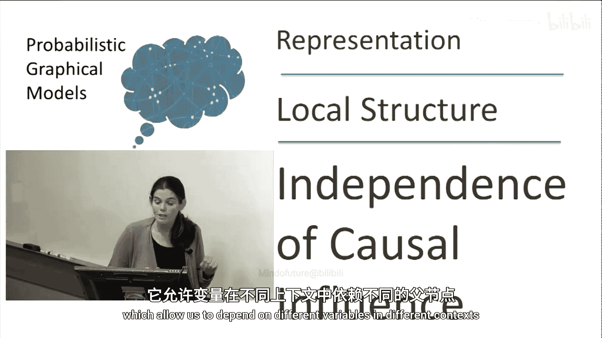
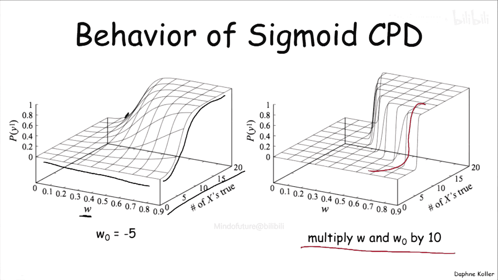

# 【斯坦福】概率图形模型1：表示法 ｜ Probabilistic Graphical Models p26 P26_因果影响独立性_04_01_03 -BV1M76VBSEJ6_p26-

Now we've previously talked about the importance of allowing CPD representations that encode additional structure in the local dependency model of a variable on its parents。

 and we talked about the case of tree CPDs which allow us to depend on different variables in different contexts。

 but none of that helps us deal with the situation that we use as a motivation for this。

 which is where we have a variable such as， for example。

 cough that depends on multiple different factors， pneumonia， flu， tuberculosis。

 bronchitis and so on and so forth， this doesn't lend itself。

 say to a tree CPD because it's not the case that you depend on one only in certain contexts and not and not in others。

 really you depend on all of them， and all of them sort of contribute something to the probability of exhibiting a cough。

So one way for capturing that kind of interaction is a model called the noisy ore。

CPD and the noisy ore is best understood by simply considering a slightly larger graphical model have where we' trying where we break down the dependency of y on its parents x1 up to XK by introducing a bunch of intervening variables so let's imagine that this is again like cough variable。

And this is different diseases， for example。And what we're doing here is we're introducing an intermediate variable that captures the event that this disease X1。

 if present， causes a cough by itself， so this is X1 by itself。Causes。Or causes why。

You can think of it each of these as a noisy transmitter， if you have the disease， say if x1 is true。

 then Z1 sort of says fine， X1 succeeded in its intent to make it y true。

X2 has its own little filter called Z2， and Z2 makes that same decision relative to x2。

And so ultimately， why is true？So why is true？If。Someone succeeded in making it true。

Which means that y is a deterministic or of its parents， Z1 up to ZK？Z0 up to Zk。

So now let's make this a little bit more precise， so the probability of Z being true， given Xi。

 there's two cases， if Xi equals0， well all Xi isn't even trying to make ZI true。

 so in this case the probability of Z equals1 is 0。If XI is not true， ZI doesn't get turned on ever。

If XI is true， then there's some probability for Z to get turned on and that probability is something called lambmbda I。

And lambda I is in the interval 01， and you can think of it as defining some kind of penetrance of how good is Xi at turning y on。

So if we actually write this down as a probability， and we just consider the CPD of y equals 0。

 so y doesn't get turned on given some set of cases x1 up to xk。So now we're asking。

 what is the probability that all of these guys fail to turn on the variable Y。

 So what I forgot to say is that Z0 is what's called a leak。

Probability and that's the probability that y gets turned on just itself。And that's his。

And that happens with probability Lada 0。 So when does y fail to get turned on？First of all。

 when it doesn't get turned on by the leak。 So that's 1 minus lambda 0 times the probability that none of the causes that are on。

 So none of causes。That are on。Which are the x sizes that are equal to one turn。Why on。

And so that's a product of1 minus lambda i for all of the X's that are on。

So that gives us the probability of y equals zero on， obviously the probability。Of y equals one。

Is just the complement of that one minus。Sorry， this should be。🎼Yeah。Yeah。Good。

 so that's the noisy or CPD。And you can generalize this to a much broader notion of independence of causal influence。

This is called independence of causal influence because it assumes that you have a bunch of causes for variable and each of them act independently to affect the truth of that variable。

 and so there's no interactions between the different causes。

 they each have their own separate mechanism and ultimately it's all aggregated together in a single in a single variable Z from which the truth of Y is is then determined from this aggregate effect of all of the。

All of the effects the eyess of the different causes so one example of this is we've already seen the noisy ore。

 but you can easily generalize this to a broad range of other cases。

 there's noisy ands where the aggregation function is an and， there's noisy maxes。

 which apply in the non-binary case when causes might not just be turned on or off but rather they have different sort of extent of being turned on and then Z is actually sort of the maximal extent of the independent effect of each cause and so on so theres a large range of different models。

 all of which fit into this family noisy or is probably the one that's most commonly used but the other ones have also been used in other settings as well。

One。A model that might not immediately be seen to fit into this framework。

 but actually does is a model that corresponds to the sigmoid。CPD， so what's a sigmoid CPD。

A sigmoid CPD says。😊，That each X induces a continuous variable， which represents W X。

 so imagine if each X is discrete。Then ZI is just a continuous value WI。

 which parameterizes this edge。And it tells us sort of how much force Xi is going to exert on making y true。

So if WI is zero， it tells us that XI exerts no influence whatsoever， if WI is positive。

 XI is going to make y more likely to be true， and if WI is negative。

 it's going to make y less likely to be true。All of these influences are aggregated together in this expression for the variable Z。

 which effectively adds up all of these different influences plus an additional bias term。W0。

And now we need to turn this ultimately into the probability of the variable Y。

 which is the variable that we care about。😊，And in order to do that。

 what we're going to do is we're going to pass this continuous quantity Z。

 which is a real number between negative infinity and infinity through a sigmoid function。

The sigmoid function is defined as follows and it's a function that some of you have seen before in the context of machine learning。

 for example， so sigmoid takes the value， the continuous value Z exponentiates it。

 and then divides by one plus that exponent of z and。Since e to the power of z is a positive number。

 this gives us a number that is always in the interval 01。

And if we look at what this function looks like。It looks like this。 So this is the sigmoid function。

The x axis here is the value Z， and the y axis is the sigmoid function。

And you can see that as z gets very negative， the probability goes to zero， as z gets very high。

 the probability gets co， and there is this interval in the middle where intermediate values are taken。

YouSo this is kind of like a squelching function that。

That sort of squashes the function on both ends。Let's look at the behavior of the sigmoid CPD as a function of different parameters。

So here is a case where all of the Xs have the same parameter W。

And so what we see here is the value of this parameter W。

 and over here is the number of Xs that are true。So let's look at first this axis over here。

 the more parents that are true。The more parents that are on， the higher。

The probability of why to be true。And this holds for any value of WV because these are all positive influences。

So the more parents are true， the more things are pushing why to take the value true。

This axis over here。Is the axis of the weight， and we can see that for low weights。

 you need an awful lot of x's。To get why to be true。 But as W increases。

Why becomes true with a lot fewer positive influences。This graph on the right now。

Is what we get when we basically just increase the amplitude of the whole system。

 we multiply both W and W0 by a factor of 10， and what happens is that that means that the exponent gets pushed up to extreme values much quicker。

Z gets effectively multiplied by a factor of 10， and that means that the transition becomes considerably sharper。

That gives us a little bit of an intuition on how the sigmoid function and how the sigmoid CPD behaves。

So what are some examples of this kind of an application of this。

 so I showed this network in an earlier part of this course into the CPCS network and it's used it was developed here at Stanford Medical School for diagnosisgnos of internal diseaseses and so up here we have things that represent prediposing factors。

And there's actually a fairly eclectic range here， so for example。

 one prediposing factor is intimate contact with small rodents because that's a contributing factor to Htavirus。

And so there's a whole range of predisposing factors down here in the middle， we have diseases。😊。

And down at the bottom， we have symptoms and test results。Now， as I previously mentioned。

 there is approximately 500 variables in this network， and they take on average about four values。

 so the total number of entries in a joint distribution。Over this space would be。

Approximately four to the 500 different parameters， which is clearly an intractable number。

If we were to take this network and just if we take this distribution we presented using the network shown in this diagram。

 we get considerable sparsification and the factorized form。As approximately 134 million。

Prameterters， which is still much too many。That have a human estimate。By using， as in this case。

 they used a noisy max。E PDD。They brought the number of parameters to about 8。

000 total parameters for this network， which is a much more tractable number to deal with。

