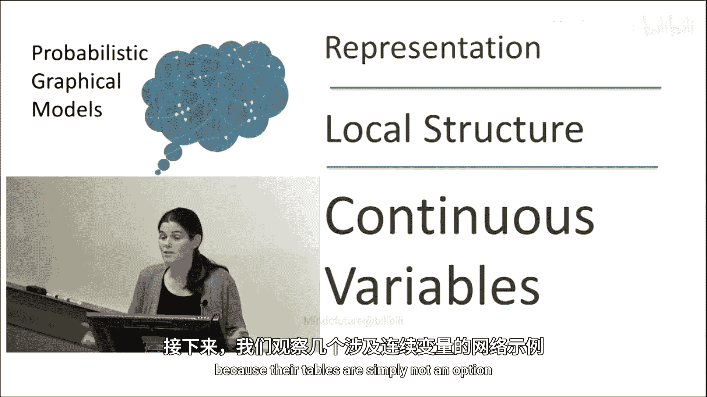
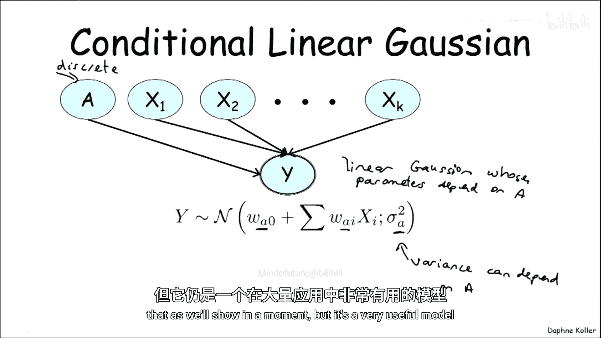
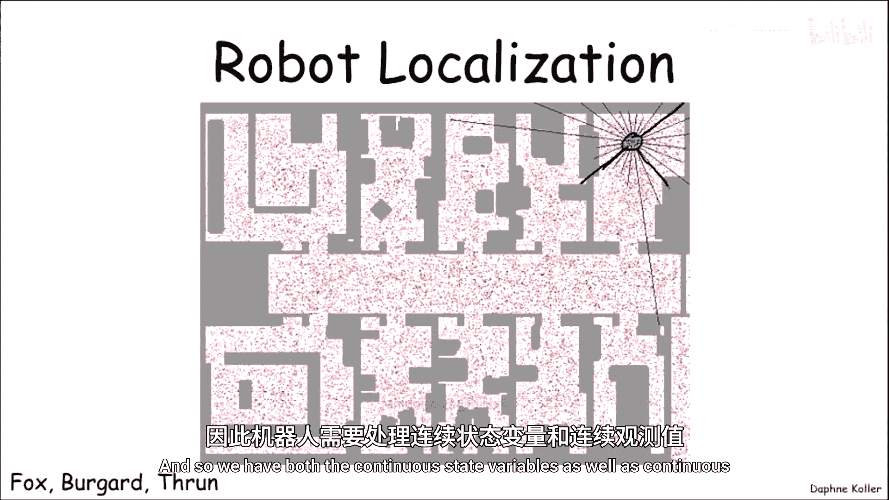
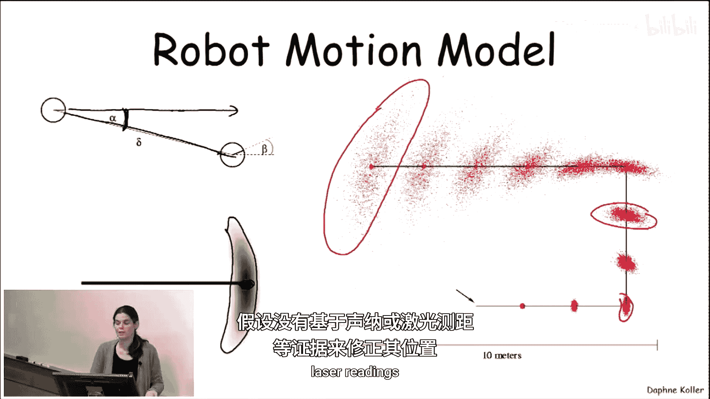

# 【斯坦福】概率图形模型1：表示法 ｜ Probabilistic Graphical Models p27 P27_连续变量_04_01_04 -BV1M76VBSEJ6_p27-

PPDs that exploit additional forms of local structure。

 some kind of parametric form are extremely valuable in the general context of graphical models because they allow us to provide a much sparser representation。

 but they're absolutely essential when we have a network that involves continuous variables because their tables are simply not an option。

So let's look at some examples of networks that involve continuous variables and see what kind of representations we might want to incorporate here。

 so now let's imagine that we have a continuous temperature variable。

 say the temperature in a room and we have a sensor。

 a thermometer that mentions that measures the temperature a thermometers aren't perfect and so what we would expect is that the sensor is around the right temperature but not quite and so one way to capture that is by saying that the sensor S is a normal distribution。

So here's a normal distribution。Around。The true temperature T with some standard deviation sigma S。

So this defines for every value of T。A distribution over S。

In a very compact parametric form that has just really。

The parameter sigma S and we just say the s is Gaussian variable around the value of the variable T。

Now let's make the situation a little bit more interesting。This is the temperature now。😡。

And this is the temperature soon。So we have T and T prime。Now， if P prime now depend。

 the temperature soon depends on the current temperature as well as on the outside temperature because of some equalization of temperatures from the inside to the outside。

So what model might we have for the prime as a function of its two parents temperature。

 the current temperature and the outside temperature？Well。

 so one model might be just some kind of diffusion model that says the T。

Is equal to some weighted combination sorry T prime is a Gaussian around a mean that's defined as a combination of the current temperature and the outside temperature。

 So you kind of combine the two and because theres stochasticity and noise in the process we're going to say that T prime isn't exactly equal to this。

 but rather is a Gaussian。Around this mean。With some standard deviation sy。

To be distinguished from the standard deviation Sigma S， which was the sensor variance。

Let let's make life even more interesting， let's imagine that there is a door in the room。

 the door can be open or closed， so it's a discrete variable。

 takes two values and clearly the extent of the diffusion is going to depend on whether the door is open and we would expect different parameters to the system in the case of the two values of a discrete variable。

And so if we write。The model now， we're going to have that the temperature time。

 the temperature soon T prime。嗯。Is going to be a Gaussian that whose parameters。

 alpha and sigma depend on the value of the door variable。 So if d equals0。

 we're going to have parameters alpha 0 and sigma 0 t。And if d equals one。

 we have a different set of parameters that reflect the different diffusion process。Yeah。

So just to give all these things names。This model that we had over here。Was called a linear Gaussian。

AndWe'll define that more formally in the next slide， and this model is called a conditional。

Linear Gaussian。Because it's a linear Gaussian whose parameters are conditioned。

On the discrete variable door。So to generalize these models to a broader setting where where we have a general variable。

 Y and why has。Herear's x1 up to xk， the linear Gaussian model has the following form。

 It says that y is a Gaussian。 So that's what the n stands for， whose mean。Is a linear function。

 and that's why it's called a linear Gaussian。Is a linear function。Of the parent' Xi。And importantly。

 whose variance。Doesn't depend at all。On the parents。So the variance is fixed。

That's the definition of a linear Gaussian CP， and obviously it's restricted。

It doesn't capture every situation， but it's a useful model and a useful first approximation in many cases。

Conditional linear Gaussian introduces into the mix the possibility of one or more discrete parents。

 in this case we just drew one for simplicity but you could have more than one。

 and this is just a linear Gaussian whose parameters。Can depend on the value of a。So。Writing it down。

 It looks exactly like this。 We now have for every one of the parameters we have。

The ability for the parameters to depend on A and in this case， the variance。

Can depend continue on the discretere parents。But not on the continuous ones。

And this is the conditional linear Gaussian model and again。

 similarly it's a restricted model and one can certainly generalize beyond that as we'll show in a moment。

 but it's a very useful model that's used in a large number of applications。

One example application that we've seen that involves continuous variables is the task of robot localization。

 I'm not going to show this video again now we're going to see it again when we talk about temporal models。

 but just as a reminder what we have here is a robot whose location is a continuous quantity。

So are the sensor observations that give a noisy version of how far away the robot is from an obstacle looking in each one of the different directions。

Okay， and so we have both a continuous state variable as well as continuous observations that the robot needs to deal with。

😊。

So what kind of observation model makes sense in this setting， so here。

 let's imagine that this line over here。Represents the true。Distance。From。

The robot's current location from a given location。ToAn obstacle。

So if the robot is looking in if we're conditioning on the robot's current location and we're asking if I look in this direction。

 how far is it before I hit an obstacle in this case that。Distance is 200 and I don't know，20。

Centimters？And what this tells us is that a sonar is a Gaussian， you can see this is the sonar。

 the red is the sonar。Is a Gaussian around that true distance。Now。The laser。

 which is a different sensing modality for the same robot， is also a Gaussian around that distance。

 but because the laser is a more accurate sensor， the standard deviation。Is lower。

For the laser than for the sonar。And that reflects the accuracy of these two different sensor modalities。

Now， this is an idealized version， but surprisingly corresponds in useful ways to the real model。

 So let's actually look at some of the。Let's look first at the model that was used in the system which is the red line。

 and then we can look at the blue line。The red line。Actually involves three different components。

 so this is the actual sensor model。Used by the robot， and we can see that it has three components。

 It has this peak。Which is this Gaussian around the true distance。

The next most obvious phenomenon is this。Ridiculous peak over here。

This corresponds to a max range reading。This is what you get if there isn't an obstacle in that direction within a reasonable distance for the laser or the sonar to return any signal。

 and so that's why there is a very large peak beyond a certain distance。

 that's the entire rest of the probability mass。The final most more subtle aspect of this probability distribution is that you see that this is higher than that。

😊，So theres more probability mass。For the density before the obstacle and after the obstacle。

 And why is that。Because once you get to the obstacle。The the beam returns。

 but before you get to the obstacle， there might be some other like transient things like a person walking in front of the obstacle and that's going to return the beam in a way that doesn't represent the actual structure of the map。

 And so that's why we have a certain probability of having the of having the beam return sooner than the obstacle and that probability doesn't exist on the downside once the obstacle has been reached。

 So the actual probability distribution is an aggregation of these three signals。

 The sensor model around the obstacle in given direction。 This uniform。

Problem distribution before the obstacle， which for just a spurious return and the max range reading at the end。

The red line is the model that was used and the blue line is the actual measure distances in different settings to sort of show whether this really does。

 the model that was used really represents reality。

 and the answer is that it does to a surprising extent。

So this is an example of how continuous distributions are going to be used in a real world application。

The next example of that is actually in the robot motion model。

So here is a robot and the robot is heading in a given direction， alpha。

Okay sorry' heading in this direction， that's where it thinks it's going。And the question is。

 if it moves a certain distance， it thinks it's moving a certain distance in a given direction。

What is the actual distribution over its next location？

And the answer is it's a little bit tricky because robots actually have a heading and there is a certain uncertainty。

Alpha over， which is a difference between where they think they're going and where they're actually going。

And then there's also noise。On the distance delta that they think they moved。

 and so when you put all these together， the actual cloud on the distribution of where the robot's going to be following the move is this weird banana shape distribution。

Which is centered around。This area where the robot thinks it is。

 but has a sort of banana shape where the banana shape is induced by the uncertainty about the angular trajectory。

And if you actually run this for a while， you can see that the banana shape gets more and more and more diffuse。

 So here is the first banana shape。 And now the robot turns。

 and there's more uncertainty over the heading。 And so you get。😊。

A larger and larger banana shape distribution on the robot's position。

 assuming that there's no evidence to correct the position based on say clinar or laser readings。

