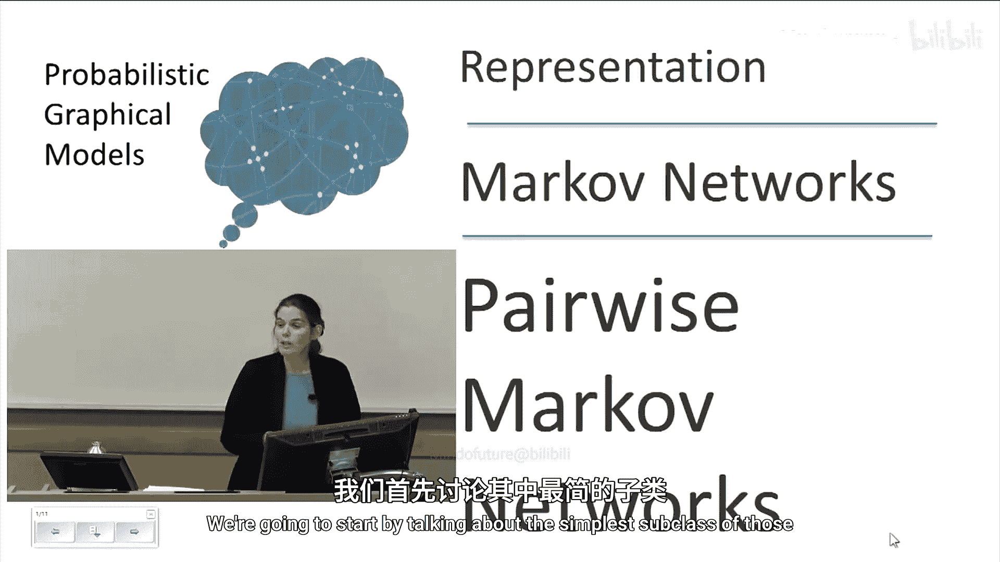
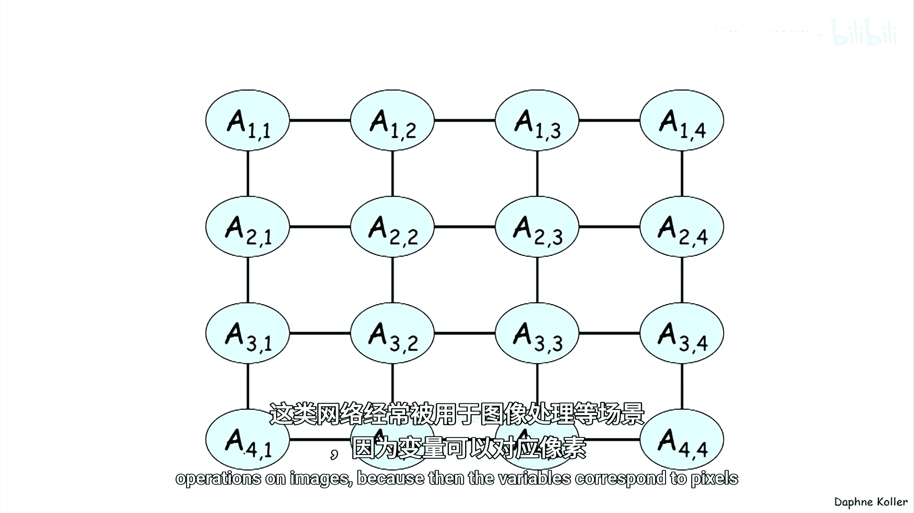
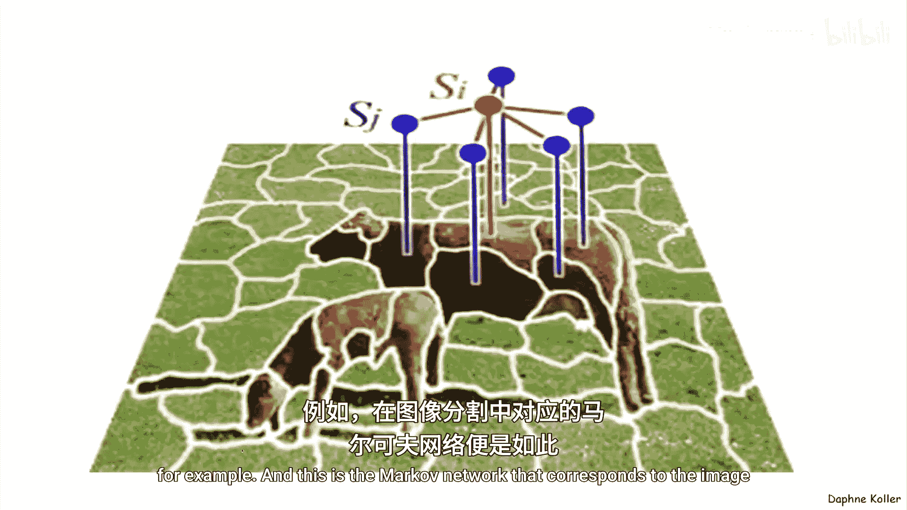

# 【斯坦福】概率图形模型1：表示法 ｜ Probabilistic Graphical Models p28 P28_成对马尔可夫网络_05_01_01 -BV1M76VBSEJ6_p28-

So as we said at the very beginning， there's two main families of graphical models。

 there's those that are based on directed graphs， basicallycycl graphs and those that are based on undirected graphs。

 The undirected graphical models are typically called Markov networks。

 they're also called Markov random fields， we're going to start by talking about the simplest subclass of those which is pairwise Markov networks and then we're going to generalize it。

So let's look again at a toy example just to illustrate what's going on。

 this is an example of four people who are studying together in study pairs and notice that Alice and Charles don't get along and you know Bob and Debbie had a bad breakup so they don't talk to each other either and so really we only have the study pairs that are marked by the edges on this diagram。

And the random variables here indicate whether the students have a particular misconception because the material was a little confusing。

 so the random variable says does the student have a misconception or not？😊。

This particular misconception and the intuition here says that if two students study together。

 then they kind of influence each other and so we have so for example。

 if Alice and Bob study together， then this edge indicates，😊。

That if one of them has the misconception， the other one is likely to have the misconception。 Now。

 this doesn't fit neatly into the purview of a directed graph because the influence flows in both directions。

 And so you can't really point an arrow from Alice to Bob or from Bob to Alice。

 And so we're going to use an undirected graph to represent this。So that's great。

 but how do you parameterize an undirected graph because you no longer have the notion of a conditional probability distribution because there's no variable that's conditioning in one that you condition on and so how do we do this so we're going to use the general notion of a factor which we defined previously and notice that this really is a general factor in that the numbers don't even are not even within the range 01。

😊，Now， what do these factors mean？These factors have many names。

 they're called affinity functions or compatibility functions。They're also called soft constraints。

In different settings。So what these numbers mean is the local happiness of the variables A and B to take a particular joint assignment。

So here we have that， you know， we can see that the happiest assignments as far as A and B are concerned in isolation of everything else。

Is a0 B0。Okay， this is the case where neither student has the misconception。

 that's the happy assignment。We see that the second happiest assignment。I isA1 B1 where again。

 the students agree， and in this case they both have the misconception。And finally。

 the other two in the middle。are the least happy of all。

Now this is a local happiness and we have similar notions of happiness for the other pairs in the graph。

 so in this case we see not only that there is a strong sentiment in favor of agreement。

 it's much stronger than in the AB case， so B and C really like to agree with each other。

 they you know it's very difficult for them to have opposing opinions。Okay。On the other hand。

 Charles and Debbie like to argue with each other all the time。

And so if one of them says that it's going to rain today。

 the other one's going to say that it's sunny today and so really you can see that the preferred assignments for their local opinion is the ones that they disagree with each other and again A and D like to agree。

😊，So this is sort of you describing the overall state by a bunch of little pieces and how we're going to put these pieces together to define a joint probability distribution。

 we are going to use the notion of productive factors。😊，And so here we are。

 and we're going to take all these factors and we're going to multiply them together。That's great。

 except that this is in no way shape or form， a probability distribution because those numbers aren't even in the interval 01。

 which is why you'll notice there's a little tilda on top of the peak。This pillar formal。Meeasure。

Okay。So how do we turn an unormalized measure into a probability distribution， Well， we normalize it。

actually sorry， before that here is the unormalized measure so you can see it here just to sort of highlight the point how do we turn this unormalized measure into a probability distribution。

 we normalize it and thats normalization here。Has a name。

 it's called the partition function for historical reasons that come from its origins in statistical physics and I'm not even going to describe why it's called that。

 but that's what it's called， but you can think of it simply as the normalizing constant that is going to make all of these sum to1 so we're going to get it by simply summing up all these entries and that's going to give us the value Z and if we divide all of these entries by Z。

 we get a normalized probability distribution and that is the probability distribution that's defined by this graph。

So now let's think about what these factors mean。And let's think about this factor Phi 1 of AB。

 which is this local happiness between A and B， and let's think about how it relates to the probability distribution。

So we might think that this is the marginal probability of A and B in the joint distribution。

 or maybe it's the conditional distribution of A given B， or maybe B given A。

Or maybe it's a joint probability of A and B given CRD。The answer is。It's none of the above。

So let's go back and look at what this actually means in this particular context。

So here we have the set of factors that we use to construct this distribution， and here。

 trust me is the marginal probability of A and B。As defined by the set of factors phi。

 I'm going to use a little phi here。To denote the fact that it was derived from the set of factors phi。

Equals phi1。I。好，王哥。我有。Right again。台湾。嗯。哎。So let's compare this distribution to the factor Phi 1。

We can see that not only does it not respect the fact that A and B like to agree with each other。

Here A and B like to agree with each other by a lot， I mean。

 remember this is three times higher than the next highest value here。That probability has 0。13。

 and the other high value assignment in on this side， the one that had 10 has only 0。04。

 What is the single highest assignment here？It's this one。Let's think about why that is。

This probability distribution is constructed by multiplying all four of these factors。

And if you think about what's going on here， you see that B really， really likes to agree with C。

 so these guys are really closely tied together。And actually， this should probably be。

And A& D similarly like to agree。So these are really， really closely tied together。These guys， CMD。

 strongly like to disagree。I like to have opposite values。 Now。

 all three of these factors are actually stronger。 That is the differences between the assignments are bigger than in Phi1。

So where are you going to break the cycle， you can't have D agreeing with A， A agreeing with B。

 B agreeing with C， and C disagreeing with D doesn't work。And so somewhere the cycle has to be。

 this loop has to be broken， and the place where it gets broken is A& B because that's a weaker factor。

So the AB probability is actually some kind of complicated aggregate of these different factors that are used to compose the Markov network。

And this is actually an important point because。It is going to come back and haunt us in later parts of the course there isn't a natural mapping between the probability distribution and the factors that are used to comp it。

 you can't look at the probability distribution and say aha this piece of it is what Phi1 ought to be This is in direct contrast to Bayesian network where the factors were all conditional probabilities and you could just look at the distribution and compute them here you can't do and that actually turns out to affect things like how we can learn these factors from data because you can't just extract them directly from the probability distribution。

So。With that definition， with that intuition， we can now go ahead and define a pairwise Markov network and I'm defining it explicitly because pairwise Markov networks are sufficiently commonly used as a class of general Markov networks that it's worth giving them their own place。

 so a pairwise Markov network。Is an undirected graph， those are the random variables。X1 of the Xn。

And we have edges， X connecting to Xj， and each one of them is associated with a factor also known as a potential Phi I J X。

Okay， that's what the certain DNA just should be call。That's a parawiseise Markov network。

And from that。And here's an example of a slightly larger Markov network。

 this is a Markov network that is in the form of a grid， and this is the kind of network that's used。

 for example， when we're doing various operations on images because then the variables correspond to pixels for example。

😊。

And this is the Markov network that corresponds。

To the image segmentation when we're using super pixels in which case it no longer a regular grid。

