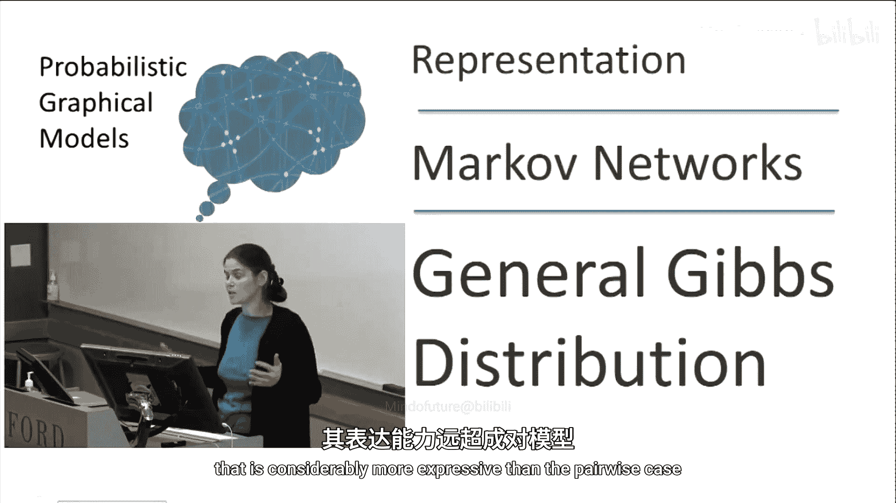
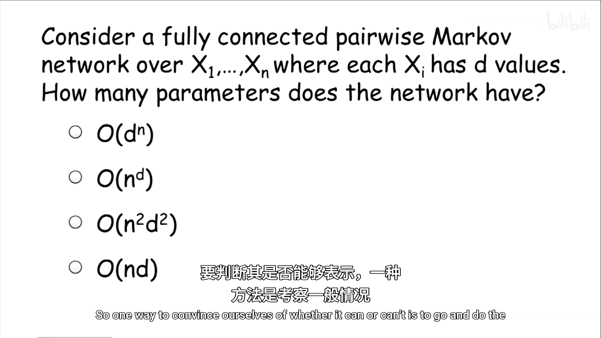
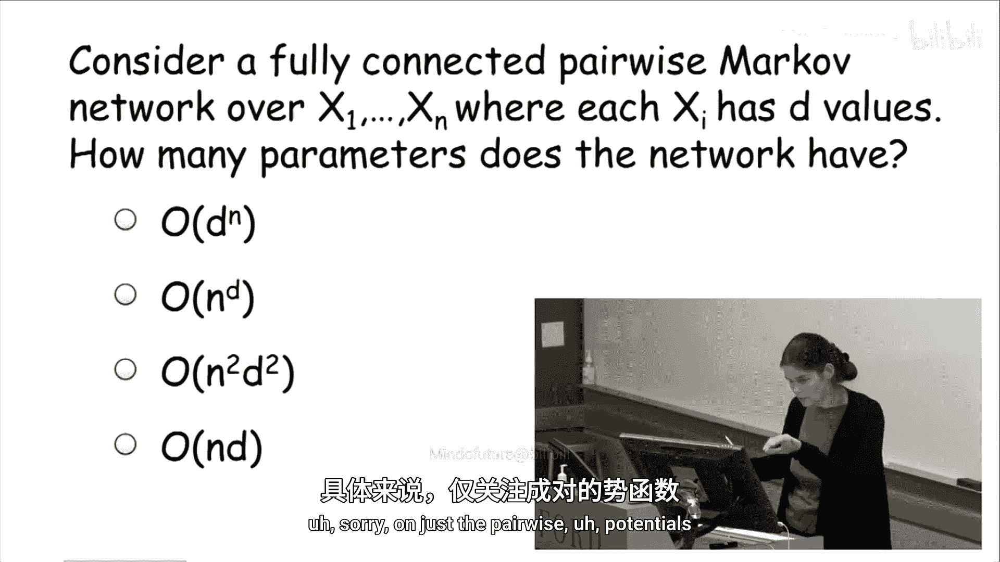
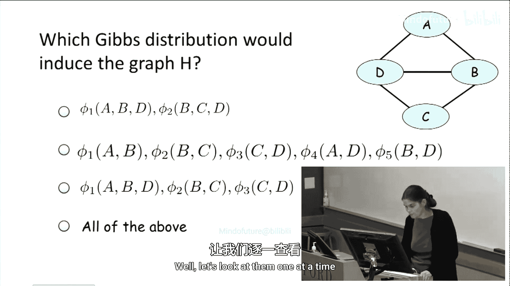
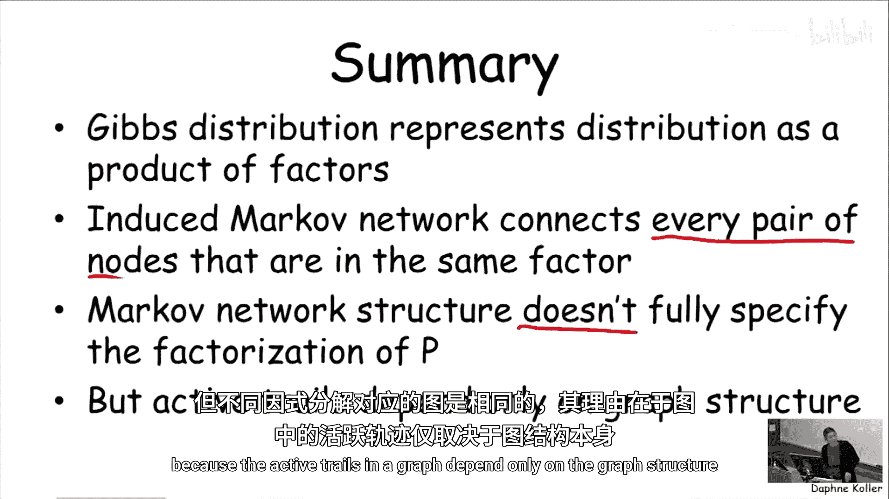

# 【斯坦福】概率图形模型1：表示法 ｜ Probabilistic Graphical Models p29 P29_一般吉布斯分布_05_01_02 -BV1M76VBSEJ6_p29-

So we've previously seen the notion of pairwise Markov networks。

 but now we're going to define a much more general notion that is considerably more expressive than the pairwise case。

 and that definition is called a Gibbs distribution。

So in order to motivate the notion of a Gibbs distribution。

 let's look at the most expressive Markov network that we could possibly define in the context of pairwise interactions。

 so here we have four random variables AB，CD， and I've introduced all of the possible pairwise edges between them。

And so the question is that we'd like to ask ourselves is is this good enough？So。

Is this fully expressive？Or in other words， can it represent？

Any probability distribution over four random variables。So one way to。

Convince ourselves whether it can or can is to go and do the general case and just look at a little bit of asymptotics。

 So consider a fully connected pairwise Markov network over n random variables。

 and let's assume that each variable X I has the values。

How many parameters does the network have， And for the moment。

 let's just focus on pairwise interactions on just the pairwise potentials。

 let's ignore the potentials associated with single node。

Well also let's do a little bit of analysis if we have n variables。

 how many edges are there in the network？How many parameters？Or edge。

So the total number of parameters in a fully connected pairwise Markov network is O n squared times d squared。

Great， can we represent any probability distribution using O n squared 10 d squared parameters？

How many parameters are there in a general probability distribution over N random variables where each has the values？

How many free parameters do we have？嗯。Well， this is much， much bigger。The not？

Which means that if you just even think about it intuitively without getting into formal arguments。

 pairwise Markov networks are not sufficiently expressive to capture all probability distributions。

 so how do we increase the coverage of this undirected representation。

 we need to move away from pairwise edges。So in order to parameterize what we call a general gives distribution。

We're going to parameter it using general factors。Each of which has a scope that might contain more than two variables。

 So whereas before we just had factors over pairs， now we have factors over triples， quadruplets。

And anything else？Can we now represent every probability distribution Well sure。

 because we can have a factor over all n variables together and by you know that immediately defines allows us to define a general probability distribution。

 in fact we even said that a probability distribution is a factor whose scope is X1 up to XN。

So in order to define this general framework more formally。

 a Gibbs distribution is parameterized by a set of factors phi。

And we're going to define this distribution in two steps。Bre up， even。

The first thing we're going to do， just like in the case of Parawise Markov networks。

 we're going to take all of the factors， so here we have K factors and we're going to multiply them。

And this is just the familiar operation of factor product。

Which we've seen in multiple contexts before。Now。This is。Perfectly fine。

 but the problem is that this is not necessarily a probability distribution， in fact。

 it almost never will be a probability distribution because we have put no constraints on the factors and so that's why we have this tilde here that highlights the fact that this is what we called previously an unnormalized measure。

And so if we want to turn the unormalized measure into a probability distribution。

 just like in the pairwise case， we're going to define what's called a partition function。

Which is just a normalizing constant。Which we get by summing up over all possible assignments。

 the variable x1 of the XN。That partition function can then be used to divide all of the entries in the unormalized measure to give us oops。

Something that shouldn't have it tilt on it， but rather is a probability distribution P subhi of x1 up to X。

Now， that was just a definition of the distribution in terms of a set of parameters。

 where's the Markov network in all this？So let's think about what is the Markov network that we would like to have for a Gibbs distribution with a certain set of factors fine。

So in order to get the intuition， let's look at a distribution that involves two factors。

 find one whose scope is A， B and C， and find two whose scope is B， C and D。

And I'm going to use a different color。Re5 to。So what？Edges。

 should the Markov Network have when we wanted to encode the fact that A B and C all get to interact with each other together。

And intuitively， what we'd then like to have is a network that has an edge from A and B。

 an edge between B and C。And an edge between Nancy。

Because that captures the fact that there's direct probabilistic relationships between all of them。

What about the other one？It。Here， we have。Between B and C。Indy。And B And D。

And this is the induced Markov network。In this particular case。More generally。

 if we have a set of factors phi。Each of which has where each Phi I has a particular scope DI。

 the induced Markov network， which we're going to call H sub phi。

Ha an edge between a pair of variables， X I and X J， whenever。There exists。A factor， Phi I。In Pi。

Such that。Oops，系。And phi， such that X I comma Xj are both in the scope。Of the factor F。That is。

 two variables are connected whenever they appear together in the same scope。

Now we can go ahead and turn this around and define the notion just like we have for Bayesian network of when a probability distribution P factorizes over a graph H。

That is。At what point can I represent P over a particular graph age？

And this basically asks the question of。Is there a set of parameters phi？

That are going to let me represent the probability P。

 So this is just of a straightforward going through the definition that we had before。

 Does there exist the Phi such that P。I is equal to P of Phi。

 where P of P is defined as we defined previously as a normalized product of factors。

And such that H is the induced graph。For the set of factors phi。 So P factorizes over H。

 if there exists a set of factors phi， such that I can represent P using those factors。

 and H is the induced graph for that set of factors。

So that's when I can encode a distribution P over graph H。So now let's ask ourselves the question。

If you give me a graph H， can I tell you what the factorization of a distribution P over that graph would be that is which？

Which is the representation of the distribution that I had in mind when I drew this graph。

So here we have this graph over ABC and D， and which Gibbs distribution would induce the graph H。

 Well let's look at them one at a time。 so here we have phi 1 of A BD and Phi 2 of BD。

And。We see that there is an edge。Indeed， between A and B。Bing。Nvy。And conversely between B and C。

 B and D。And CD， so the answer here is yes。This distribution would induce this set of factors would induce this graph。

Okay， what about。The next one。This。And ask yourself the same question。Well。

 P phi1 of A B would induce this edge。Bc， yep。CD， yep。80。And V， well， here's another distribution。

With a different set of factors that induces the exact same graph。

The third one is the same principle。 We have the edges A B B。A B， B D， and AD。

And then we have B C and Cd。 So here is another distribution that induces the exact same graph。

What that tells us。Is that we cannot， and this is important。Cannot。Read。The factorization。

From thegraph。That is， we have different factorizations。

That are quite different than their expressive power。All of which induce the exact same graph。

And we've already seen an example of that when we had the fully connected pairwiseise Markov network。

 we had one parameterization that had O n squared d squared parameters。

 we had another parameterization that had a fully full factor over all n variables so had D to the n parameters。

 and these are two very different representations with very different expressive power that nevertheless induced the exact same graph。

Which brings us to the question of why then is the graph the same。

 What does the graph really tell us given that it's not telling us the structure of the factorization。

So here is this going back to the example in the previous slide， we have these two factorizations。

 one of which use triplet factors and the second one uses pairwise factors。😊。

And let's think about what is the flow of influence in these factors。

 so when can one variable influence another？And we can see， and we think about this intuitively。

 when can B influence D is this different in the two graphs in the two distributions。

 and the answer is well， not really， I mean， once we have a factor，Here in this case， it's phi 1。

 and this case， it's  phi5， that tie is B and D directly， then the fact is that B con insulin D。

What about B can A influence C？So can A influence C。A can influence C via D by going through。

 in this case， the A B D factor， and then subsequently。

Utilizing the dependencies within the BD factor。 And in this case， it can use V D factor。And then。

 the C factor。And so the point is， although the parameterization of the two distributions are different。

 the paths in the graph， the trails in the graph through which influence can flow is the same regardless of this finer grain structure of the factorization。

 which is why the graphs in those two cases are the same。😊，So let's formalize this definition。

 we're going to define the notion of an active trail in a Markov network。

 and this is actually a very simple definition， it's much simpler than the analogous definition in the context of Bayesian network we have that a trail going from X1 up to XN is active。

Given。And set of observed variable Z。If。Basically， no Xi along the trail is in Z because an active trail has to only flows through variables that are underob observedserved once we observe a variable along the trail。

 influence kind of stops because that variable is now set so you can't really influence it and if you can't influence it。

 you can't influence anything subsequently。Alonglong that path。 So for example， the trail from B。

D is active。So this is active。But， not。If a is observed。So once I observe A。

 I can no longer influence， B can no longer influence B by a。So to summarize。

We define the notion of a Gi distribution， which represents a distribution P as a normalized product factors。

We connected that to a graph structure， which is the induced Markov network。

 which connects every pair of nodes。That are in the same factor。And the motivation。

 and although we noted that the Markov network structure doesn't。

Fully specify the factorization of P， the justification for why the graphs for different factorizations are the same。

 because the active trails in a graph depend only on the graph structure。

