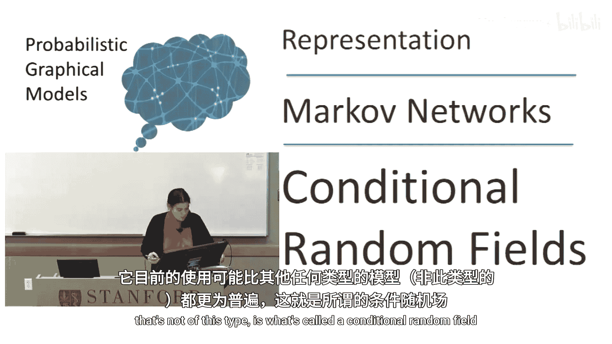
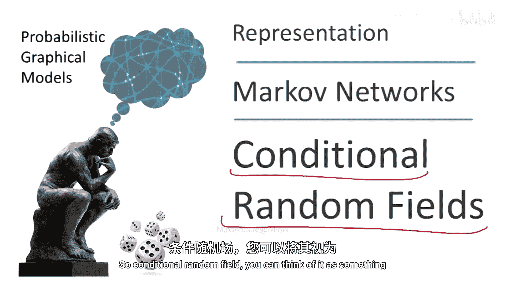
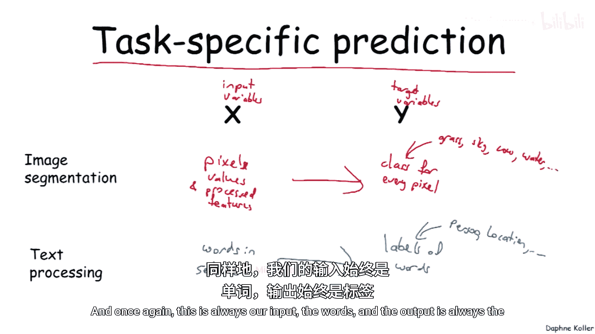
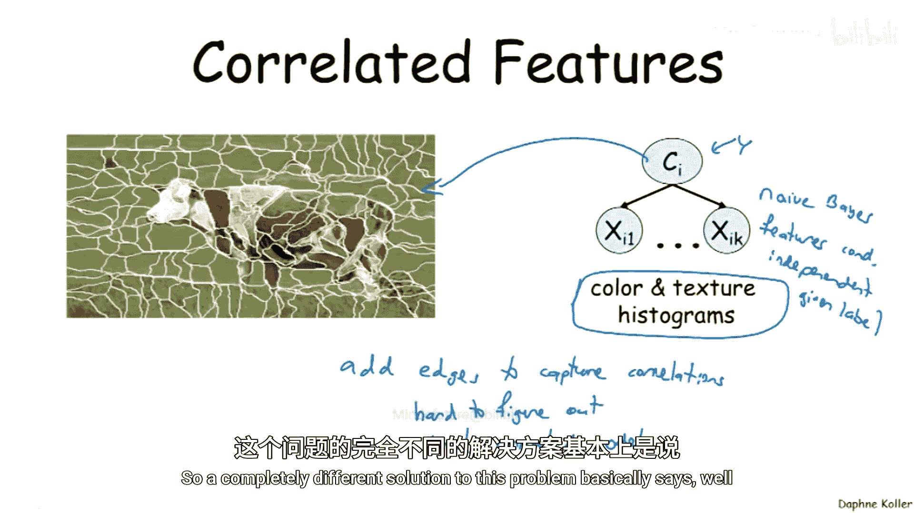
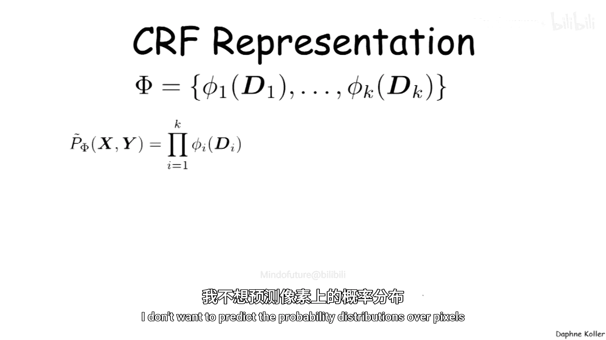
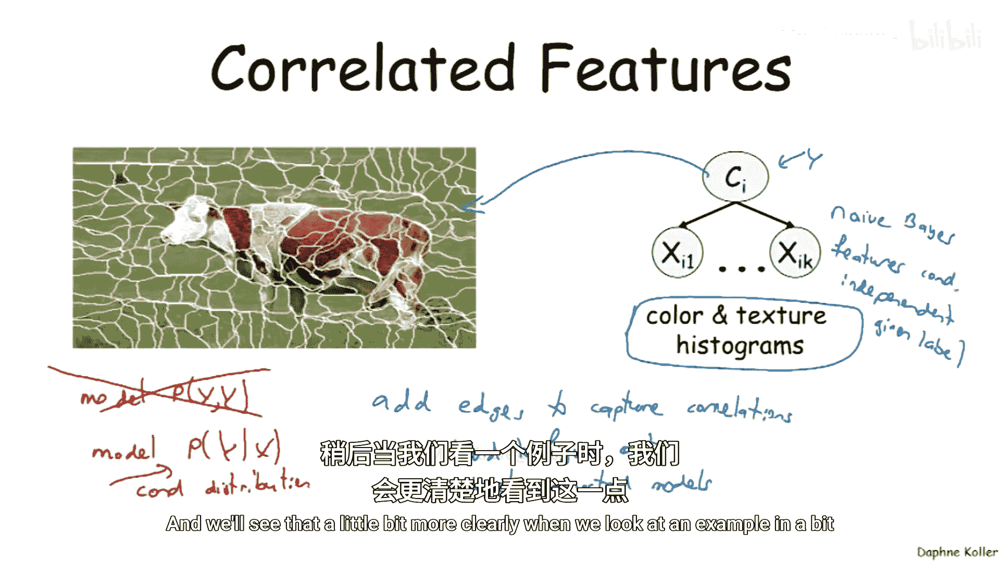
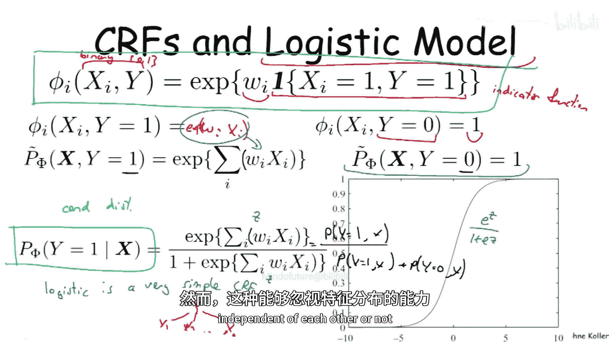
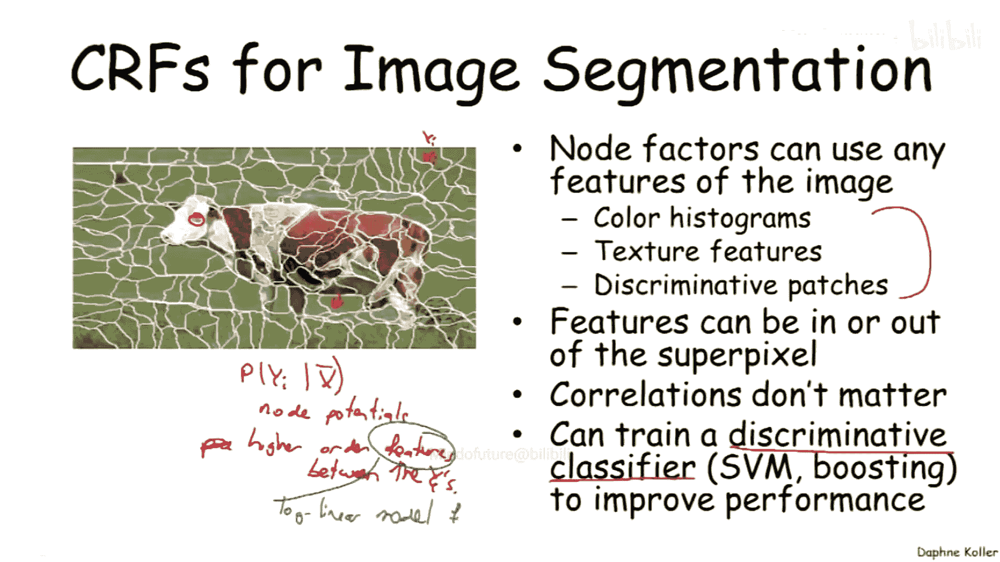
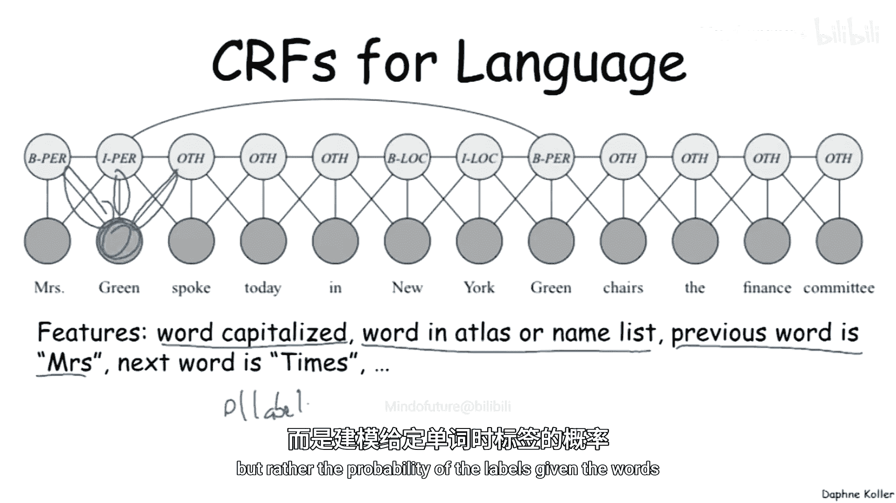
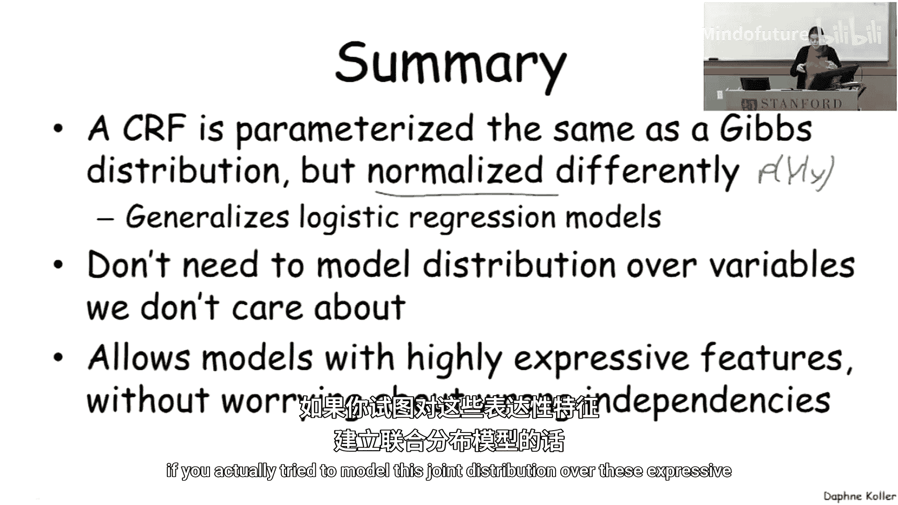

# 【斯坦福】概率图形模型1：表示法 ｜ Probabilistic Graphical Models p30 P30_条件随机场_05_01_03 -BV1M76VBSEJ6_p30-

One very important variant of Markov networks that is probably at this point more commonly used than other kinds than anything that's not this type is what's called a conditional random field。

So conditional random field， you can think of it as a。

Something that looks very much like a Markov network， but for a somewhat different purpose。

So let's think about what we are trying to do here。

This class of model is intended to deal with what we call task specific prediction。

That is where we have a set of input variables。Or observed variables， X。

 And we have a set of target variables。That we're trying to predict why。

And class of models is intended to be designed for those cases where we always have the same。

Types of variables is the input variables and the same types of variables as the targets。

 and we're always trying to solve it is essentially the exact same problem or the exact same type of problem。

So let's about that as let's think about two examples along these lines， so again。

 going back to the example of image segmentation here we have the input is always。A set of pixels。

With their values。Exel value。Which we can process to produce more expressive features like histograms of colors and textures。

 but this is sort of not relevant at this point or although will'll be in a minute。

 so my input X is pixel values and process features for those。And my target variables， Y is a class。

For every pixel。So for example， we're by class I。You know， grass。Fy， cow water。And so on。

And we're always trying to we design the model so as to solve this problem of going from X。T why。

And we want to solve that problem。In some of the text processing or NLP problems that we've discussed。

 the input X are the words。In a sentence。And the output that we're trying to derive is， for example。

 the labels。Of the words。Where again， the labels might be， in this case， things like person。Location。

Organization and so on。And once again。This is always our input。

The words and the output is always the labels。

So。Why what is the problem so fine so we want to solve this kind of prediction problem why not use just a regular old graphical model in the same way that we've done so far so let's think about what some of the issues might be with that so imagine that we are trying to predict in this case CI which is the label of a particular superpixel in this case I。

And we're going to go ahead and process our features of that superpix to provide a range of different color and texture histograms that represent。

You know， different ways of measuring the appearance of the superpixel。 So in this case that's my y。

 just in the notation of the previous slide， this is my target Y and these guys down here are my X's。

So what's the problem with this？The problem of this is that these features that are often much more informative about the class of the pixel。

Are very correlated with each other so for example。Texture histograms。

 which tell us sort of the directions in which lines go in a particular superp。

 they're very redundant in terms of the kinds of structure， the kinds of texture that they measure。

And so if you have features here that are very correlated with each other。

 so variables where two features have a lot of redundant information。

 if we represent this in a naive base model，As I drew here， where the features are independent。Given。

The label。Then I'm effectively ignoring that correlation structure。Now why is that bad。

 it's bad because it allows me to count the same feature again and again and again and again and again。

 so if I have five copies of the feature or five very correlated related features that effectively measure the same thing。

 I counted five times， which means I get really confident because of this one feature。

If I have  a00 copies of that feature I count it 100 times so and again。

 it pushes me towards very skewed probability distributions that don't really that are not really good reflections of。

Of my true beliefs， because they make incorrect independence assumptions。Well。😮，F。

 so let's make correct independence assumptions。 Let's add a bunch of edges。

To capture the correlations。Well， that turns out to be really hard because once you start doing things there are trivial features。

Figuring out how they're correlated is hard。And furthermore。

 even trying to put in these correlations gives rise to- so first of all， this is hard。To figure out。

And it gives rise to densely connected models。If I start putting in all these。

Edges between these features。So a completely different solution to this problem。

Basically says， well。I don't care about the image features。

 I don't want to predict the probability distributions over pixels。

I want I don't care to predict， you know I'm trying to do image synthesis。

 I don't care about the probability of having know a green pixel next to another green pixel next to a brown pixel I'm trying to use a pre given to me。

 something that is already given which is the features X and the only thing I really care about is to model the distribution over y So I've reformulated my problem instead of modeling。

The joint distribution of X and y together。So instead of doing this。I'm going to model。

A conditional distribution of Y given x。Where I'm not trying to capture。The distribution over X。Now。

 if I'm not trying to capture the distribution over x。

Then I don't really care about the correlations between them。

 and we'll see that a little bit more clearly when we look at an example on it。

But before we do that， let's first give ourselves the formal definition of this thing。

 which is called a CRF， which stands for conditional。Random。有了。

And a conditional random field at first glance looks just like a Gibbs distribution。

So just like it givesbbs distribution。We have a set of。Factors。Each with their scope。

And just like it gives distribution， I multiply。The factors。To get an unnormalized。Measure。And。

In order and now so far it's exactly the same except that I have an X and a Y as the arguments of a normalizedized measure rather than just a set of random variables。

This is where the difference comes in。 If I want to model a conditional distribution of y given x。

 I'm going to have to put x on the right hand side of the conditioning bar。

 which means I'm going to have a separate normalization constant。Or partition function。

That is a function of X。And so what does that mean， it means that for any given x， I sum over y。

Which means that for any given X。I'm going to have the sum of all of the y that correspond to that x。

 and then I'm going to construct the conditional distribution。By normalizing。

I'm going to constructing a digital distribution y over y for any given x。

 this shouldn't have a tilde。By dividing by this x specific partition function。

So to be a little bit more concrete， let's imagine that I have a table here。

And I'm going to make life simple for myself， and this is my table for x1 y， x0， y0， x0， y1， x1。

 y0 and x1。Y 1， and for any given x in this case。This， for example， these two entries right here。

I'm going to sum them up。That's going to give me the normalizing constant for these two entries together。

 And I'm going to divide by that。Z of x0。And that guarantees。

That these two entries now sum to one because I' just basically divided by their appropriate normalizing constant。

And similarly。I'm going to add these over here。And I'm going to divide this entry by z of x1。

And so I've now defined a family of conditional distributions。 So this is a family。

Of conditional distributions。Which varies by x。Now。

 it turns out that CRFs are highly related to a model that we have previously seen in many machine learning classes and also comes up as a CPD representation in Bayesian network。

 which is the logistic function or the logistic model。So in order to understand that connection。

 let's look at a very， very simple case where we have both x's and y's are binary random variables。

 so they take on values in the space 01。And we're going to use in our log linear model a simple representation of my log linear features。

 which is just the。Indicator function。So we have one。

 my indicator function is one both when X and y are both1 and0 otherwise。

 and that's going to have a parameter Yi。And now let's actually plug that into the CRF representation and see what happens。

So let's look at phi I of X and y equals 1。Well， if you look at that， in this case， y is always one。

 and now we have two choices， either X is1 in which case the indicator function is 1 or X is 0。

 in which case the indicator function is0， so you can rewrite this as WI times X。Ex， sorry。WI X。

Because if size zero。Then you get x of W times 0， and if size1， you get x of WY。嗯。On the other hand。

 if I make y equals0。Then my indicator function。Is0？Because if y is 0。

 then the indicator function is 0， and at that point I get exponential of0， which is equal to one。

Okay， so these are my two cases。I have what is the value of this factor for y equals 1 and what is the value of this factor for y equals zero。

 and now I can go ahead and compute my unnormalized density。And my unnormalized density。

Has the following， again I'm going to do two separate cases。

 there is the case when y equals0 and the case when y equals1 and my unnormalized density in the case y equals one is just multiplying all of these guys up here。

 so multiplying all these guys， which gives rise to this exponential over here。

 which is because the product and a bunch of exponentials is the exponential of the sum。ok。😊。

So that is in this case， and here clearly the product of a bunch of ones is one。So。

Pretty straightforward and so now putting this all together to produce a normalized density。

 remember my goal is to produce a density， a normalized density， which is the P of y。

 my binary value y given all of the features X and if you just stick this together。

 this is when you just rewrite this， this is the probability of y。Equals one。好吗。X。

 and this is divided by the probability of y equals1 comma x。

Plus the probability of y equals0 comma x， which is my normalizing constant。Yeah。Well。😮。

This is a very familiar。Shaake。It's the sigmoid function。It's E to the power of Z， if we call this Z。

So it's E to the Z。Divided by one plus e to the Z， which is exactly。

So what we have concluded from this is that the logistic model。Is a very simple。Sarf。

So broadening from this particular mathematical derivation。

What we have here is that if we were to think about the model where we had a joint density of y and x together as a kind of a naive base model because we only have pairwise terms that relate the y and the X I。

 so you can think of it as a bunch， if we weren't doing this conditional normalization。

 we would have a model that looks like this， we would have you know the Y。

 and we would have a pairwise feature that relates y to X1。Y to x 2。Up to Y to X N。

And that would be effectively like a naive base model， because since we don't have any features。

 pairwise features that connect the X's to each other。

 we would effectively have a model where the X's are independent given the Y。

So if I weren't doing a conditional model， if I were to just use this set of potentials。

To represent the joint distribution of X and Y， it would be effectively like a naive base model。

And it would make very strong independence assumptions。 But because。

And modeling this is a conditional distribution like this。This is the conditional distribution。

I've effectively removed from this analysis any notion of the correlations between the x's。

 and I'm just modeling how the x's come together to affect the probability of y。

And so that's really the difference between a naive Bay model and a logistic regression model。

And that same intuition extends to much richer classes of models where I don't just have binary variables in a single y。

 but rather a very rich set of y's and x's， and nevertheless。

 this ability to sort of ignore the distribution over the features and focus only on the target variables allows me to exploit allows me to sort of ignore correlations between rich features and not worry about whether they're independent of each other or not。

So for example， going back to our notion of CRS for image segmentation。

 here we typically have very rich features of the variables， so for example。

 when we think about individual node potentials that relate the features，😊，XI to the class label YI。

 we don't worry about how correlated the features are， we can have color histograms。

 texture features， you can have discriminative touches like looking for the eye of the cow for example。

 and all of these are going to be really correlated with each other because I don't care。

You can even look at features that are outside of the superpix， you can say， oh， well。

 if it's green underneath in a completely different superpel。

Maybe it's more likely to be a cower a sheep because they tend to be on grass that's cool too these are definitely correlated because you're counting the same feature for my superp as well as for a different superp that's fine I don't care because I'm not worried about the correlations between the superps。

So the correlations don't matter。You can even， and this is very commonly done。

 train your favorite discriminative classifier， a support vector machine。

 boosting random forest to anything that you like。To predict the probability of Yi given a whole bunch of image features X。

And that's fine too and in fact， that is how one achieves high performance on most of these tasks by training very strong classifiers for in most cases your node potentials。

 that is the predictors for individual variables and then adding on top of that pairwise features。

Or not just pair wise， but a higher order。Teachers。Between between the ones。It's important。

One important point here that is useful to make is that the word features is overloaded in this framework and that might be confusing and rightfully so there are features in the context of image features for example。

 like these guys over here and that's one use of the word features and the other use of the word features which is this usage is in terms of features in my log linear model。

And these Fs that we use to define the log linear model and features are actually used for both。

 which is an unfortunate thing， but there it is。

So hopefully this will be clear from context。The same kind of idea applies when we do CRFs for language。

 again， we usually have here features that are very highly correlated with each other。

 so for example whether the word is capitalized is correlated with whether the word is in some atlas or name list。

 definitely correlated features correlated with whether the previous word is Mres or Mr。

 all sorts of other features that are often very correlated with each other。

 you can even see that the same that this word is used as a feature for more than one。Word。

 that's fine， it's not a problem because we don't try and model this distribution over the words in the sentence。

 but rather the probability of the labels。Give them the words。

So to summarize， a CRF is deceptively like any other Gibbs distribution。But a critical。

 a subtle but critical difference is that it's normalized differently。

 it's normalized so that you're creating a conditional distribution of a Y given X。

And we've seen that as a special case， it subsumes your standard logistic regression model。

 but has a lot of other but has much richer expressive power。

A key feature of it is that we don't need to model the distribution over variables that we don't care about。

 only the ones that we actually care about predicting。

And that a critical utility of this is that you can design really。

 really expressive predictors of pieces of the model without worrying about incorrect dependencies between different variables。

 which would be inevitable if you actually try to model this distribution joint distribution over these expressive features。

