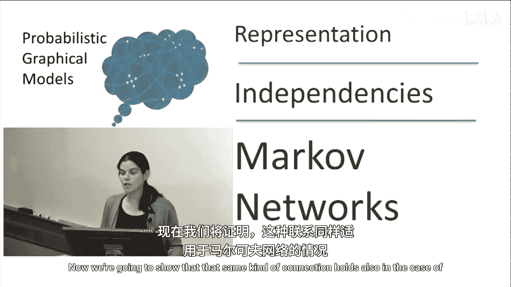
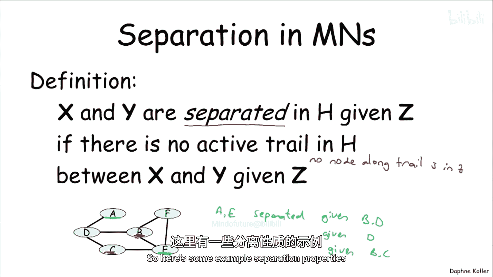
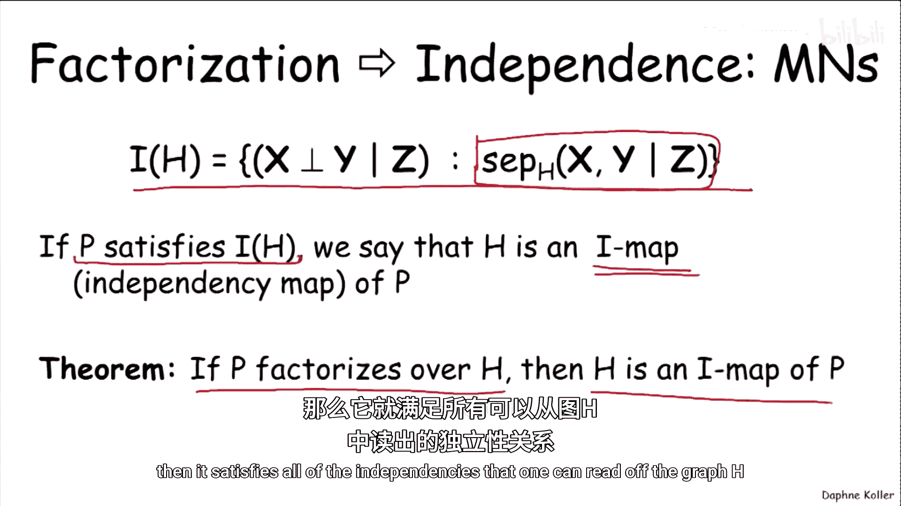
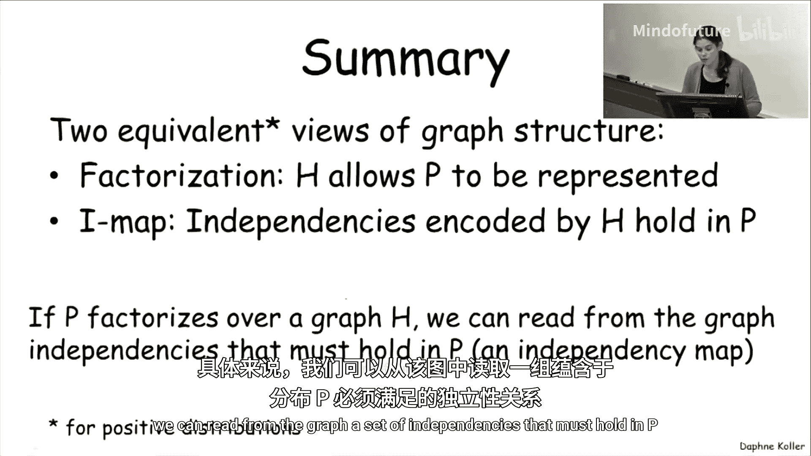

# 【斯坦福】概率图形模型1：表示法 ｜ Probabilistic Graphical Models p31 P31_马尔可夫网络中的独立性_05_02_01 -BV1M76VBSEJ6_p31-

So we've shown the connection between inencies and the factorization of the distribution in the context of Bayesian networks。

 now we're going to show that that same kind of connection holds also in the case of Markov networks。

So first of all， we need to come up with a similar notion of what kinds of inencies are encoded by the structure of the graphical model。

So in this case we're going to have a notion of separation which is the analogous notion to de separation。

 except that now there is no D for directed， it's just a separation and it actually is a much simpler notion because there's not multiple kinds of different flows of influence。

 you only have one type of edge， the undirected edge so it's very simple and so we have the X and Y are separated in H given Z if there's no active trail in H and the notion of the active trail is just you know if no node along the trail is observed。

Yeah。So嗯。So let's look at some example separation properties。So， for example。

 what does it take to separate a。From E。Well， we can separate a from E in several different ways。

 so we have that A and E are separated。Given。For example， B& D。Because B And D block both trails。

 but also given。Justty。And also， given。BNC。Because B and C。Again， block both trails between A and D。

So here's some example， separation properties。

Now we can go ahead and prove an almost identical theorem to the one that we proved in the context of Bayesian networks。

And it tells us that if we have a separation property。X and Y are separated in age given Z。

And we have a distribution P that factorizes over8， then P satisfies。The independent statement。

 x is independent of y given Z， and so just as in Bayesian networks。

 we can go ahead and define the inencies that are induced by the graph H as the ones that are defined by the separation property。

And just as in the context of Bayesian networks， we can go ahead and define this as a term。

 we can define the notion of an IMap and say that H is an imMap or dependency map of P。

 if P satisfies all of the dependencies that we can read off the graph structure of H。

And the theorem that we just proved restated says that if p factorizes over H。

 then H is an imMac for p， because we have shown that if p factorizes over H。

 then it satisfies all of the dependencies that one can read off the graph H。Now。

 in the context of Bayesian networks， we also had the converse theorem holding。

The converse also sort of holds in the context of MarkovV networks。

 the converse being the independence。That if P satisfies the independent statements associated with a graph then it factorizes over the graph。

 so stated otherwise， if H is an imMap for P， that is P satisfies I of H， then p factorizes over H。

The difference here is that it doesn't hold always， it only holds for a positive distribution P。

 which means a distribution P， which is strictly greater than zero for all whose probability is strictly greater than zero for all assignments x。

That is， if you have a distribution that involves the deterministic relationships。

 this property no longer holds， so you almost have the converse that we had in the context of Bayesian networks。

 but it requires one additional and important assumption。So once again， we have two equivalent。

 almost equivalent views of graph structure。Factorization in which H allows P to be represented。

And again， the notion of an imap， which is that I can read from H Inencies that whole。So once again。

 if I tell you that a distribution P factorizes over a graph。

 read from the graph any inencies we can read from the graph a set of independencies that must hold in P。

