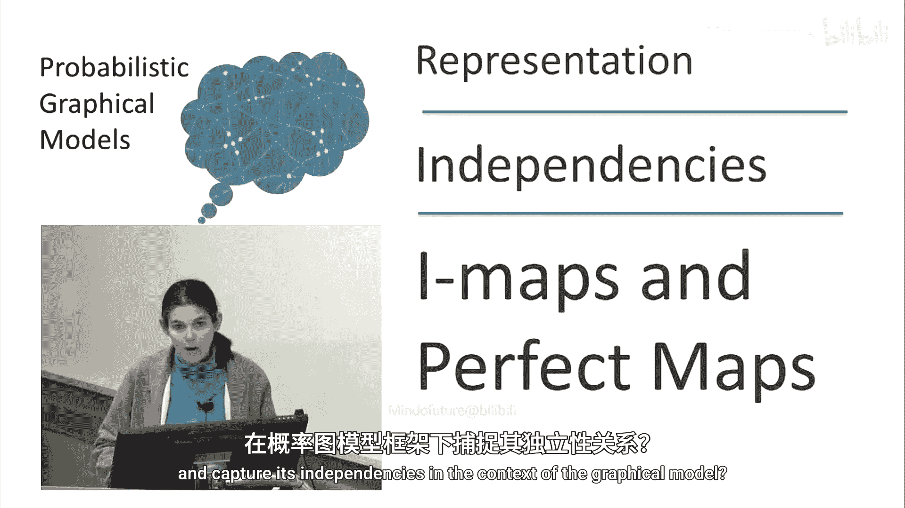
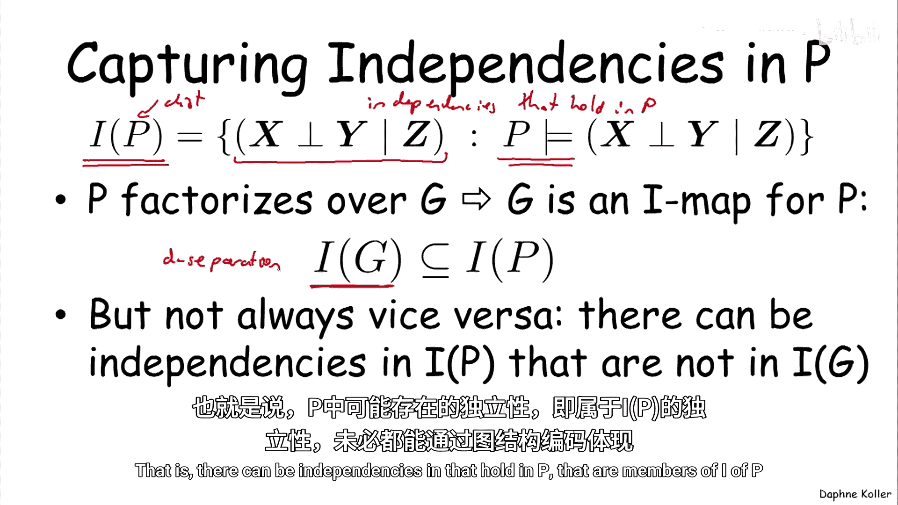
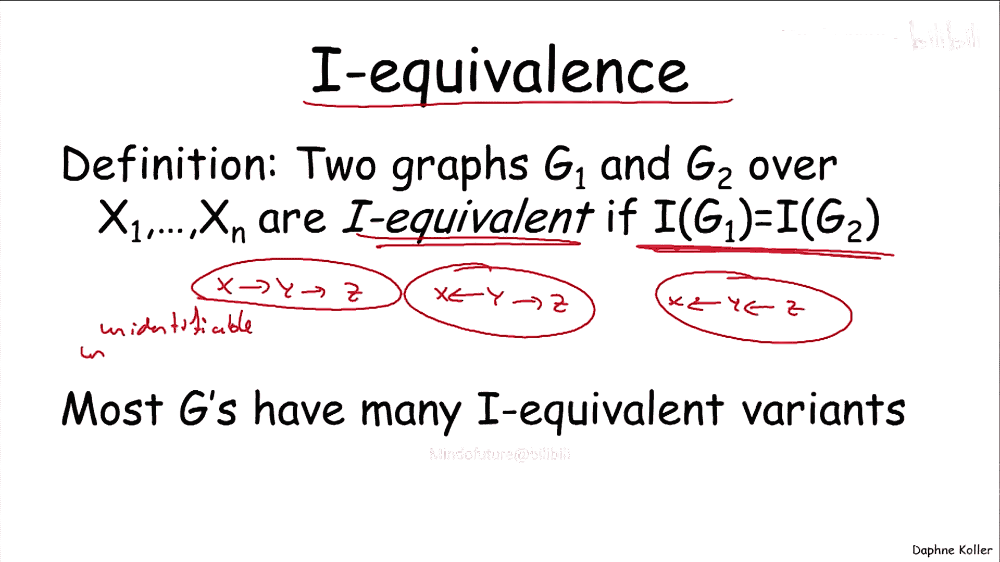
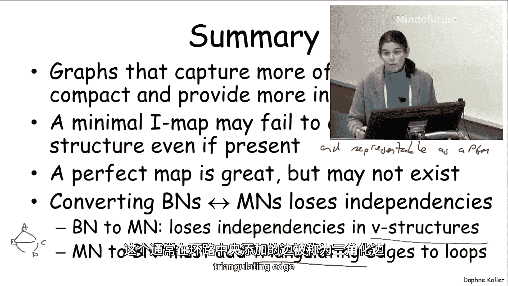

# 【斯坦福】概率图形模型1：表示法 ｜ Probabilistic Graphical Models p32 P32_I-映射与完美映射_05_02_02 -BV1M76VBSEJ6_p32-

We've previously shown that a graph structure encodes a set of independencies and that that set of inencies then necessarily holds for every distribution that can be encoded as a Bayesian network over that graph。

What we're going to talk about now is the question of how to take a distribution that has a certain set of inencies that it's satisfied and encode it within a graph structure。

 how well can we take that distribution and capture its inencies in the context of a graphical model？

So first， let's understand what the dependencies of a distribution are。

 So we're going to define this notion of I of P for distribution P。

As the set of all independent statements。X is independent of y given Z that hold for the distribution P。

 so one can write down potentially an exponentially large set of independent statements and each of those is going to be either true in a given distribution P or not。

 and what we're going to do is we're going to define IFP to be the ones that are true in that distribution。

Okay， so these are independencies。The hold in。And we've already seen that if P factorizes over a particular graph G。

Then G is an im mapap for P， which means that every independence that holds in G that is implied by the de separationation。

Statements。Or de separation properties in G， every such independence also holds in P。

But that doesn't mean that the converse holds， that is there can be inencies in at Holden P that are members of IFP that are not encoded by the graph structure。

So。Why does that matter？Because if we have a graph that doesn't capture some of the independencies in P。

 then it's unnecessarily complicated。And conversely， the sparser the graph。

 the more inencies it encodes， then the sparser it is。

 and therefore has fewer parameters that we need to elicit or learn fewer edges also means that inference is more efficient and finally it means that the graph is intrinsically more informative about the properties of P。

 so we would like graphs that capture as much of the properties。

 independence properties of P as possible。So what do we want in terms of sparsity。

 something that is fairly basic that we might choose to require is what's called a minimal im map。

 That is we want an im map for the distribution P that at least doesn't have redundant edges。 So。

 for example， if we have a graph。X。Y， where y really doesn't depend on x in the sense that p of y given。

 say， x0 in the CPD is equal to p of y given x1， then we could remove this edge。

and still have something that was an imMap for this distribution， and so this edge is now redundant。

 and so from our definition that would mean that this imMap is not minimal because you can have an imMap from which edges can be removed。

So that might seem to be a reasonable strategy， but it turns out that it's not sufficient in terms of ensuring that our graph is as sparse as it might be。

So to understand why that's the case， let's look at a distribution such as the corresponds to this example that we've seen before。

 where the student's grade G depends on these two variables， I and V。So that in fact。

 is a minimal imM for a distribution where D and I are independent and G depends on both of them。

 but it turns out this is not the only minimal imap for this distribution。

 a different minimal imMap is this one。Where we have an edge that goes from D to I， from D to G。

 and from key to I。Let's convince ourselves that， in fact， this is a minimal imMap。

 Let's try and remove any one of those edges and see if we still get an imMap for the original distribution。

So if， for example， we try and remove this edge。That would that would correspond to a statement that D is independent。

Of D， which is certainly not the case in our original distribution。 So that one doesn't work。

What about the second one？If we try and remove the second edge from G to I。

 that would correspond to a statement that D。Sorry， that。G is independent of I。Given the。

 which is also not。The case in our original distribution。What about the final edge。

 the one that doesn't correspond to an edge in our original network， this one？And we remove that one。

 not only seems the most promising of the lot， but if you remove that one。

 it would correspond to the assumption that D is independent of I。Givenive G。

 And and that is exactly the dependence that is induced by intercasable reasoning that we've seen before。

 So， in fact， this is a minimal eye map。 None of the edges can be reduced。

 There is a better minimal eyeap， but this is a minimal eye map。

 So minimal eye maps are not necessarily the best tool for capturing structure in a distribution。

What we really like is a perfect map。😊，The perfecterect map is one where the dependencies in G exactly correspond to the dependencies in P。

 So the G perfectly captures the inencies in P。 And sure enough， if we can get that。

 that would be ideal。Unfortunately， perfect maps are often hard to come by。

So here's an example of one scenario that doesn't have a perfect map。

 this is a distribution P that is actually represented by this pairwise Markov network that we've seen before。

 so one where we have pairwise interactions between A B， B， C， C D and AD。

 so we know that this distribution satisfies certain inencies because of the Markov network properties specifically we know that A is independent of C given B and B。

 because B and B separate A and C in the graph and at the same time we know that B is independent of D given A and C。

So now that we let's imagine that we have a distribution P that satisfies these inencies。

 so P satisfies。This pair of Inencies and and now let's try and encode those inencies using a Bayesian network as a perfect map。

So let's try。One possible attempt。Would be to just try and direct the edges， say this way。

Is that an imap for this distribution？Well， among other things。

 one of the inencies implied by this graph would be that B is independent of D given A。

And that's certainly not supported by the original distribution。 So this， in fact， is not。And I'm up。

Let's try a different way of organizing the edges。So， for example。Here we have sure enough。

 and this is， this is good that B And D。Are independent， given A and C。

And that's one of our inencies that we had before， so it captures correctly that one。

But not all but it doesn't capture the， but it also makes other independence assumptions that are not true in the original distribution。

 for example， that A and C are marginally independent。

And that's certainly not true in the original distribution。 So once again， this is not an imap。

What is an imMap for this distribution as a directed graph？Well。

 one possible imap for this distribution as a directed graph。There's several。Is this one？

And you can confirm that this distribution satisfies that this graph implies that A is independent of C given B and D。

And that's it， in terms of dependencies。And so this， in fact， is an imAT for the distribution。

 because in this case， IiveG。Is a subset of IFP， which is this set over here。

But it doesn't capture all of the dependdependencies。 It only captures one out of the two。

 So this is a distribution that does not have a perfect map as a Bayesian network。Let's come up。

 let's provide another example of an imperfect map and in fact this is a distribution that doesn't have an imperfect map as either a Bayesian network or in fact as a Markov network and this is the famous example of the XO which is as we'll see a counterex to many。

 many things so here we have two random variables x1 and x2 which we're assuming our binary valued and say each of them takes the value 0 or1 with probability 5050。

Y， on the other hand， is the exclusive or of x1 and x2， which means that y is equal to one。

If and only if。Exactly one。Of x1 or x2。Is equal to one。诶。😊。

So let's look at what this probability distribution P looks like。

Here it is we have that there's four possible configurations that have nonze probability and each of them has equal probability of 0。

25 so x1 x2 can be either 0 or 1 with probability 5050 and here's the value of y over here。

But now let's think about other so let's think about what independent statements are true for this distribution。

 So most obviously looking at this graph， we see that x1 is marginally independent of x2。

But if you close your eyes on this part of this of the。Image and just look at the right hand side。

 you'll see that really x1， x2 and y are all symmetrical in terms of their structure。

 and so it's not difficult to verify that we also have that x1 in fact， is independent of y。

And then x2 is independent of y。And all three of these parawise dependencies hold in this distribution。

And so， this is not。In fact， the graph on the left is not a perfect map for this distribution because there are dependencies the hold and T that are not visible in the graph。

And in fact， you can organize the node in this graph any which way。

 but you cannot get all three of these inencies captured at the same time。

Because the only way to do that would be to have x 1， x2， and Y be separate variables。And of course。

 that wouldn't be an imMAP for the distribution。So we've talked about Bayesnets as a perfect map。

 What about Markov networks is a perfect map， The definition here is the same except that we've replaced G by H so a Markov network H is a perfect map if the Inencies encoded by H are and exactly correspond to the Inencies in P and can we capture all possible distributions in terms of a Markov network is a perfect map so I'm sure you're all expecting at this point the answer to be no and sure enough that's true so here is an example of a distribution that has a perfect map in this case is a Bayesian network but not as a Markov network。

So this is the famous V structure example， in this case。

 the difficulty intelligence grade V structure。 and let's think about what。

In what we would need to encode as in terms of edges。for being an imM of this distribution。

So clearly， we need to introduce an edge between DNG and between I and G。

 because it's certainly not the case that we can make DNG independent。Given I or vice versa。

 And so this would be the obvious I map for this distribution。 But this example。

 if we choose this as as a candidate I map， it would imply among other things that D is independent of I。

Givenive G。And that， of course， is exactly wrong because we know that when we condition on G。

 D is independent。 the D and I become dependent。 And so the only im map。

For this distribution is one that has all three edges and that loses the independence that we had over here。

 which is these's marginal independence of body。 So once again。

 there's no perfect map for this distribution as a more covenant work。

The final question that we might ask ourselves is the extent to which a representation of a distribution is in fact。

 unique。And so say that we could represent a distribution using some graph， say as a perfect map。

 Is that a unique representation。So。To understand that， let's look first at the simplest example。

 one where we have two variables， x and Y。And here we have one graph that captures， in this case。

 no independence assumptions。 So I of G is equal to the empty set。Its1。

 and here is G2 that looks the same except that the edges are inverted， the one edge is inverted。

 and once again this is a different graph that has exactly the same vac set of inencies。

So we can see that here we have two distinct graphs that have the exact same of independence assumptions。

 And because of that， they can represent the exact。😊，exactly the same set。Of distributions。그。

Which in this case， is all distributions over the variables X， Y。Now。

 one might think of this as a degenerate example because it's a fully connected graph。

 but it turns out to be not the case。 there are many other situations where two distinct graphs with edges going in different directions represent the exact same set of independence assumptions。

 So for example， when we look at graphs over three random variables。

 it turns out that of these four scenarios。One of those represents a different set of independent assumptions than all the others。

 but all the others are the same。So which is the odd man out。

 which of these following graphs does not encode the same independence assumptions to the others？

As I'm sure。Most of you realized the answer here is the V structure。

 which is one that we've seen before。 so this one has the independence assumption x is independent of Z。

 marginally， whereas these other three。Have the independent assumption that x is independent and Z given Y。

So these three graphs。Again， represent the same set of independence assumptions。

 which is this set over here。 And as such they also can take any probability distribution that can be represented by one of these graphs can also be represented by another by the other。

So the notion for this， the formal term for this notion is what's called eye equivalence。

Where two graphs G1 and G2 over the same space are said to be I equivalent。

If they make the exact same set of independence assumptions。And in the previous example， we saw。

 for example， that X， Y， Z is I equivalent to say。Y being a parent of both X and Z and。

So this third one over here， whereas the V structure is not equivalent。Now。

 why is I equivalentvalence an important notion。It's important because it tells us that there's certain aspects of the graphical model that are unidentifiable。

Which means that if we end up for whatever reason thinking that say this is the graph that represents our probability distribution。

 it could just as easily be this one or that one， so without prior knowledge of some kind or another。

 for example， that we prefer x to be a apparent of y there's no way for us to select among these different choices。

And it turns out that this is not an exception， rather it's the rule。

 most graphs have a large number of equivalent variants。

 and that turns out to be a complicating factor， especially when we get to learning models from data。

So in summary， we prefer to have graphs that capture as much of the structure in IFP as possible because they are more compact。

 therefore easier to learn and easier to inference with。

 and also provide us with more insight about the distribution。

We talked about minimal imMax as one option for sparse graphs and we showed that that's not a particularly good option because it might fail to capture structure even if it's present in the distribution。

 and even if it's representable as anet or as a graphical normal。A better notion is a perfect map。

 which is great， but there are many cases where a perfect map might not exist。

And we've also seen that when we take a distribution that was naturally represented as a base net and try to represent it as a markov that。

As we might， we generally do not get a perfect map。 We lose inencies and vice versa。

 something that was naturally represented as a Markov net。 You try and encode it as a bay net。

 Once again， you lose dependencies。 specifically， when we go from a Baynet to a Markov network。

 we lose the dependencies in these structures。And when you go from a Markov network to a Bayesian network。

 we need to add edges that inside loops like the ABCD。Loop， we had to add。This edge。In the middle。

 an edge typically called a triangulating edge because it turns the loop into a pair of triangles。

