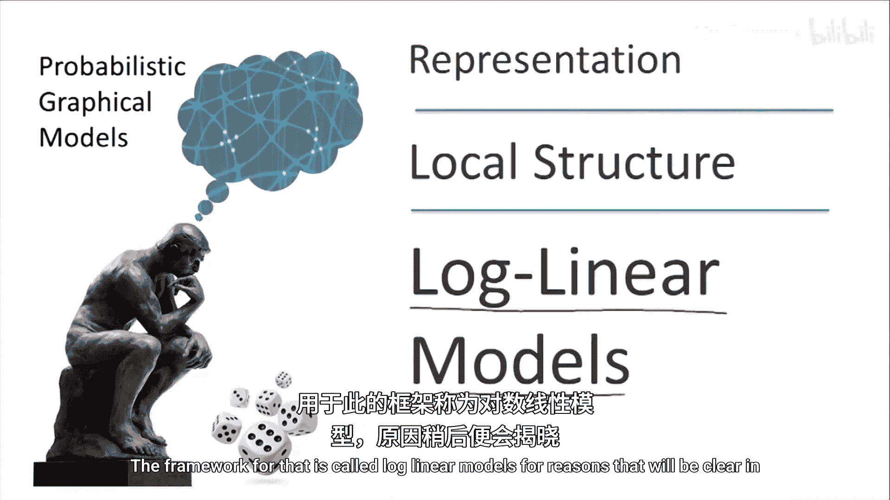
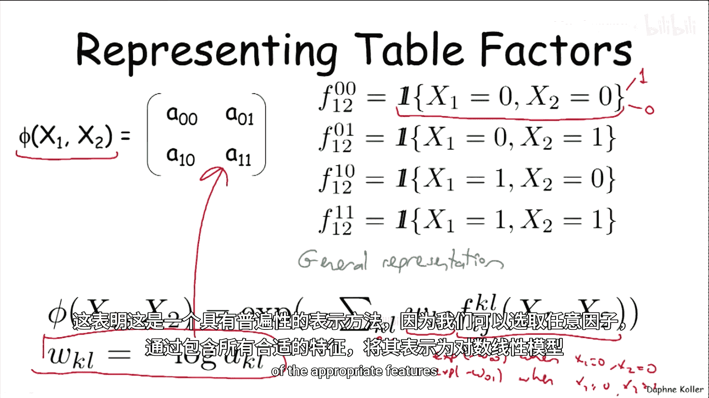
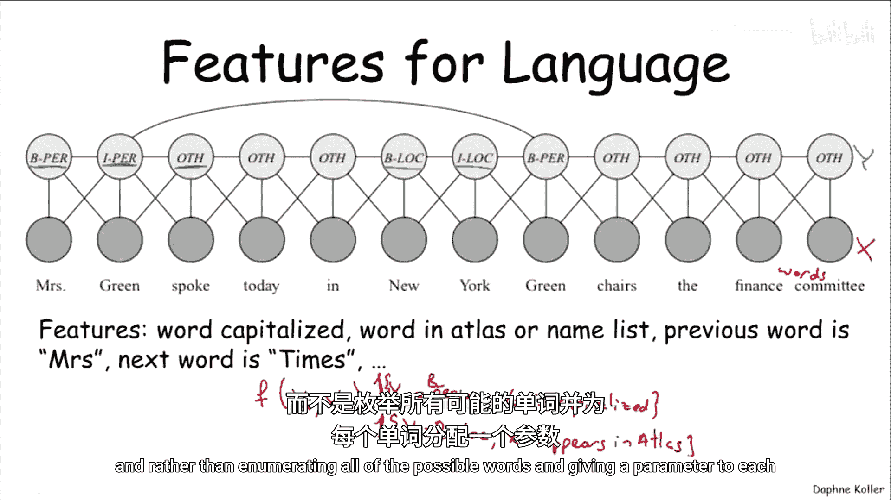
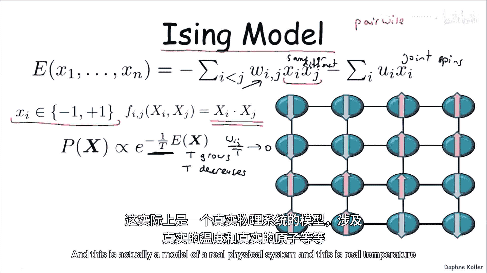
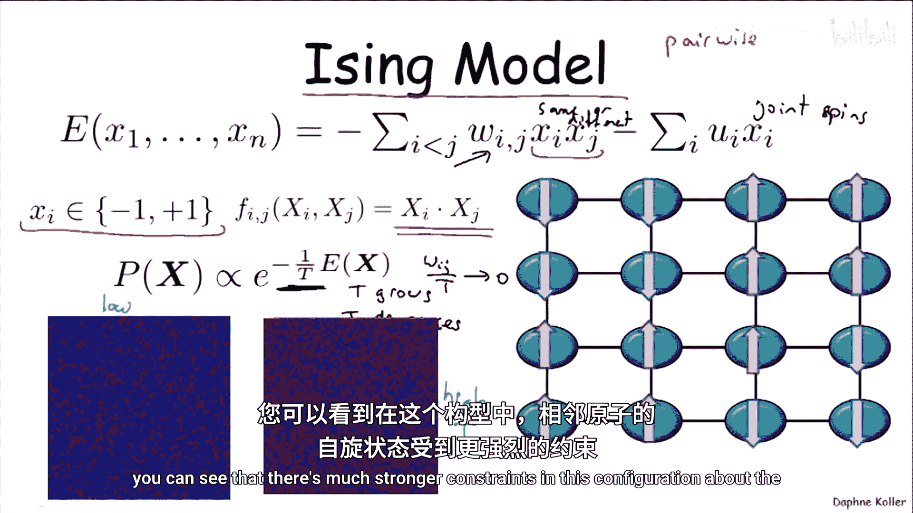
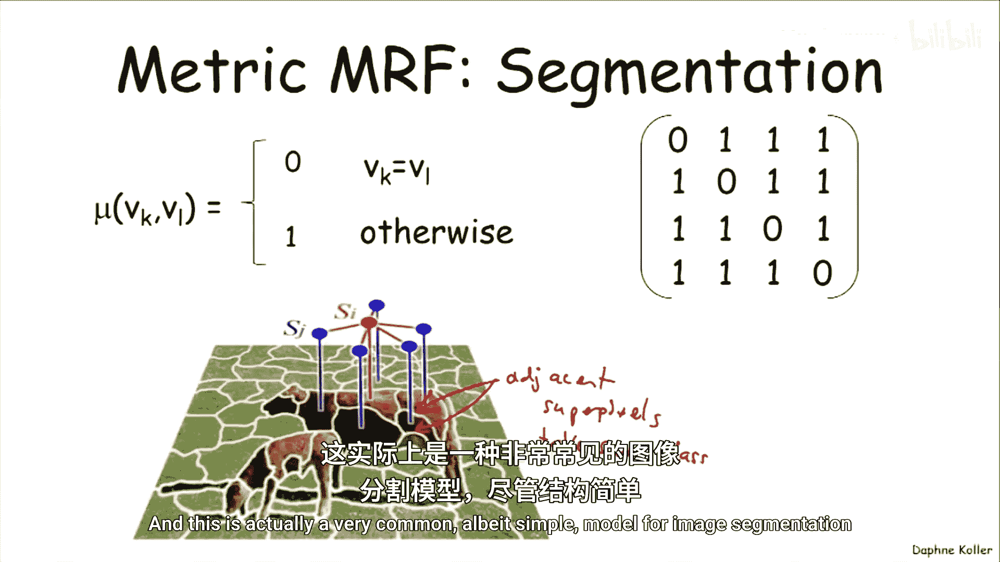
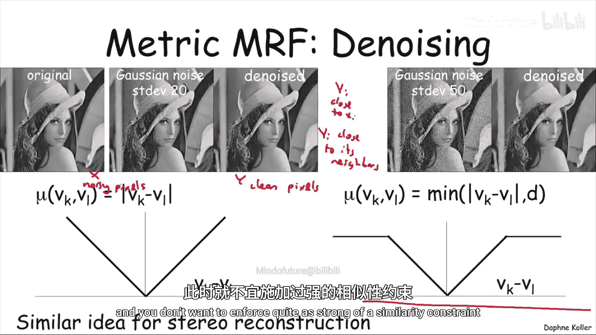

# 【斯坦福】概率图形模型1：表示法 ｜ Probabilistic Graphical Models p33 P33_对数线性模型_05_03_01 -BV1M76VBSEJ6_p33-

Local structure that doesn't require full table representations is important in both directed and undirected models。

How do we incorporate local structure into undirected models。

 the framework for that is called log linear models for reasons that we'll be clear in just a moment。

So。Whereas。In the original representation of the unnormalized density。

 we defined P Tilde to be a product of factors， phi I， DI， which is potentially a full table。

Now we're going to shift that representation to something that uses a linear form。

 So here's a linear form。That is subsequently expon。

And that's why it's called log linear because the logarithm is a linear function。

So what is this form over here， it's a linear function that has these things that are called coefficients。

And these things that are called features。Features like factors， each have a scope。

 which is the set of variables on which the feature depends。

But different features can have the same scopes， you can have multiple features。

 all of which are over the same set of variables， notice that each feature has just a single parameter WJ that multiplies it。

So。What does this give rise to， I mean， if we have a log linear model。

 we have we can push in the exponent through the summation， and that gives us something that is。

A product of。Exponential function。 So you can think of each of these as effectively a little factor。

But it's a factor that only has a single parameter， WJ。So this is a little bit abstract。

 so let's look at an example， specifically let's look at how we might represent a simple table factor as a log linear model。

 so here's a factor phi over two binary random variables。

 x1 and x2 and so a full table factor would have four parameters， a00， a01， a10， a11。

So we can capture this model using a log linear model using a set of such features。

 using a set of these guys which are indicator functions， so this is an indicator function。

 it takes one if x1 is0 and x and x2 is 0 and it takes0 otherwise。

 so this is the general notion of an indicator function， it looks at the。

Event are constrained inside the curly braces， and it returns a value of 01。

 depending on whether that event is true or not。And so if we wanted to represent this distribution as sorry。

 this factor as a log linear model， we can see that we can simply sum up over all the four values of。

K and L。Which are either zero or one each of them。 So we're summing up over all four entries here。

 and we have a parameter or a coefficient WKL， which multiplies。This feature。

And so we would have a product or a summation of。Of WKL of W 0，0。

 only in the case that where x1 is 0 and x2 is 0。 so we would have X。Of negative W 0，0， when。

X1 equals0 and x2 equals0。And we would have XP。Of negative W0，1 when。X1 equals 0。

And x2 equals1 and so on and so forth。 And it's not difficult to convince ourselves that if we。

Deeffinine WKL to be the negative log of the entries of the corresponding entries in this table that that gives us right back the factor that we define to begin with so this shows that this is a general representation。

In the sense that we can take any factor。And represent it as a log linear model simply by including all of the appropriate。

All the appropriate features。So let's but we don't generally want to do that。

 generally want a much finer grain set of features。

 so let's look at some of the examples of features that people use in practice。

 so here are the features used in a language model。

 this is a language model that we had discussed that we discussed previously and here we have features that relate we have first of all let'll just remind ourselves we have two sets of variables。

We have the variables Y which represent the annotations for each word in the sequence corresponding to what category that corresponds to so this is a person。

 this is the beginning of a person name， this is the continuation of a person name。

 the beginning of a location， the continuation of a location and so on as well as as well as a bunch of words that are none of person location。

 organization and they're all labeled other and so the value y tells us for each word。

 what category belongs to so that we're trying to identify people location。

 an organization in the sentence we have another set of variables X。Which are the actual words。

InIn the sentence。Now we can go ahead and define， we can use a full table representation that basically tries to relate each and every y to that has a feature that has a full factor that looks at every possible word in the English language。

 but those are going to be very， very expensive and a very large number of parameters。

 and so we're going to define a feature that looks， for example， at F。Of say， a particular Y I。

 which is the label for the E word in the sentence。 an X I being that Ih word。 And that feature says。

 for example。Y I equals person。It's the indicator function for Yi equals person and XI is capitalized。

And so that feature doesn't look at the individual words it just looks at whether that feature that word is capitalized。

 now we have just a single parameter that looks just at capitalization and parameterizes how important is capitalization for recognizing that something's a person。

We could also have another feature。😊，This is an alternative。

 this is a different feature and they're all going could be part of the same model that says Y I is equal to location or actually I was a little bit imprecis here。

 This might be beginning of person， and this might be beginning of location。And Xi appears。

In some Atlas。Now there is other things that appear in the Atlas other than locations。

 but if a word appears in the Atlas， theres a much higher probability presumably that it's actually a location and so we might have。

 again， a wait for this feature that indicates that that maybe increases the probability in YI being labeled in this way。

 and so you could imagine。😊，That constructing a very rich set of features。

 all of which look at certain aspects of the word rather than enumerating all of the possible words and giving a parameter to each and every one of them。

Let's look at some other examples of feature based model。😊。

So this is an example from statistical physics， it's called theicing model。And the icing model。

Is something that looks at pairs of variables， so it's a pairwise Markov network。

And it looks at pairs of adjacent variables and basically gives us a coefficient for their product。

 so now this is a case where variables are in our binary。

 but not in the space01 but rather negative one and positive one。

 and so now we have a model that's parameterized as features that are just the product of the values of the adjacent variables。

Where might this come up， It comes up in the context， for example。

 of modeling the spins of electrons in a grid。So here you have a case where the electrons can rotate either along one direction or in the other direction。

 so here is a bunch of the atoms that are marked with a blue arrow。

 you have one rotational axes and the red arrow are rotating in the opposite direction。

And you and this basically says we have a term that depend a probability distribution over the joint set of spins。

 so this is the joint。The joint。Sins。In the model depends on whether adjacent atoms have the same spin or opposite spin。

So notice that one times1 is the same as negative one times negative one。

 so this really just looks at whether they have the same spin or different spins and there is a parameter that looks at you know same。

Were different。That's what this feature represents。

And depending on the value of this parameter over here， if the parameter goes one way。

 we're going to favor systems that where the atoms spin in the same direction。

 and if it's going in the opposite direction you're going to favor atoms that spin in a different direction。

 or those are called phromagnetic and antipharomagnetic。Furthermore， you can define。In these systems。

 the notion of a temperature。So the temperature here says how strong is this connection。

 so notice that as T grows， as the temperature grows， the WIJs get divided by T。

And they all kind of go to war zero。Which means that the strength of the connection between adjacent atoms effectively becomes almost mo。

 and they become almost decoupled from each other。 On the other hand， as the temperature decreases。

Then， the effect。Of the of the interaction between the atoms becomes much more significant and they're going to impose much stronger constraints on each other。

 and this is actually a model of a real physical system。

 I this is real temperature and real atoms and so on。😊。

And sure enough， if you look at what happens to these models as a function of temperature。

 what we see over here is high temperature。😊，This is high temperature。And you can see that there a。

 there is a lot of mixing between the two types of spin， and this is low temperature。

And you can see that there's。Much stronger constraints in this configuration about the spins of adjacent atoms。

Another kind of feature that's used very much in lots of practical applications is the notion of a metric of a metric feature in an MRF。

 So what's a metric features， If this is something that comes up。

 mostly in cases where you have a bunch of random variables。

That all take values in some joint label space V。 So， for example， they might all be binary error。

 They might all take values 1，2，3，4。 And what we'd like to do is we have when we have X I that are connected to each X I and X J that are connected to each other by an edge。

 We want X I X J to take。Values。So in order to enforce the fact that Xine xta should take similar values。

 we need an notion of similarity， and we're going to encode that using a distance function mu。😊。

That takes two values， one for X sign， one for xG and says how close are they to each other。

 So what does a distance function need to be， Well distance function needs to satisfy the standard conditions on a distance function or metric。

 so first is reflexivity。Which means that if the two variables take on the same value。

 then that distance better be 0。嗯。Oh， I forgot to say this， sorry。

 this needs to be a non negative function。Symmetry。Means that。That the distances are symmetrical。

 so the distance between two values v1 and V2 are the same as the distance between V2 and V1。

 and finally is the triangle inequality， which says that the distance between V1 and V2。

 so here is V1 here is V2。And the distance between V1 and V2 is less than the distance between V1 and V3。

And then going to V2， so the standard triangle inequality。

If a distance just satisfies these two conditions， it's called a semimetric。Otherwise。

 if it satisfies all three， it's called a metric。And both are actually used in practical applications。

So how do we take this distance feature and put it in the context of an MRF。

 we have a feature that looks at two variables X I and Xj。

 and that feature is the distance between X I and Xj and now we put it together by multiplying that with a coefficient。

W I J。Such that。WIJ has to be greater than zero so that we want the metric MRF。

So what the effect that that has is that the lower。The distance。The higher。This is。

Because of the negative coefficient， which means that the higher。The probability。Okay， so。The。

The more pairs you have that are close to each other and the closer they are to each other。

 the higher the probability of the overall configuration。

 which is exactly what we wanted to have happen。So conversely。

 if you have very values that are far from each other in the distance metric。

 the lower the probability in the model。So here are some examples of the metric MRs。So one。

 the simplest possible metric MRF is one that gives distance of zero when the two classes are equal to each other and distance of one everywhere else。

 so now there's you know just like a step function。😊。

And despite that gives rise to a potential that looks like this， so we have zeros on the diagonal。

 so we get a bump in the probability when the two adjacent variables take on the same label and otherwise we get a reduction in the probability but it doesn't matter which particular values they take。

So that's one example of a simple metric， a somewhat more expressive example might come up when the values V are actually numerical values。

 in which case you can look at maybe the difference between the numerical values so VK minus VL and you want and when VK is equal to VL。

 the distance is0 and then you have a linear function that increases the distance as the distance between VK and VL grow。

 so this is the absolute value of VK minus VL。😊，A more interesting notion that comes up a lot in practice is when you don't want to penalize arbitrarily things that are far away from each other in label space。

 So this is what's called a truncated。😊，Linear penalty？

And you can see that beyond a certain threshold。The penalty just becomes constant so it plateaus so that there is a penalty。

 but it doesn't keep increasing over as the labels get further from each other。

 One example where metric MRFs are used is when we're doing image segmentation and here we tend to favor segmentations where adjacent super pixelixs。

So these are adjacent superpixs。And we want them to take the same class。

And so here we have no penalty when the superpixs take the same class。

 and we have some penalty when they take different classes， and this is actually a very common。

 albeit simple model for image segmentation。

Let's look at a different MRF also in the context of computer vision。

 this is an MRF that's used for image demoising。😊，So here we have a noisy version of a real image that looks like this。

 so this is you can see this kind of white noise overlaid on top of the image and what we'd like to do is we'd like to get a cleaned up version of the image so here we have a set of variables X that correspond to the noisy pixels。

And we have a set of variables Y that corresponds to the clean pixels。

And we'd like to have a probabilistic model that relates X and。

Exllent y and what we're going to do is we'd like so into I mean the so you'd like to have two effects on the pixels Y。

 first you'd like Y I to be close。Why I to be close？Plexxi。But if you just do that。

 then you're just going to stick with the original image。

 so what is the main constraint that we can employ on the image in order to clean it up is the fact that adjacent pixels。

Tend to have the same value。 So in this case， what we're going to do is we're going to model。

 we're going to constrain the image so that we're going to constrain the Y's to try and make Yi close to its neighbors。

And the further weight is the bigger the penalty， and that's a metric MRF。Now， we could use。

Just a linear penalty。But that's going to be a very fragile model because not obviously the right answer isn't the model where all pixels are equal to each other and their actual intensity value because that would be just like a single grayish looking image so what you'd like is you'd like to let one pixel depart from its adjacent pixel if it's getting pulled in a different direction either by its own observation or by other adjacent pixels and so the right model to use here is actually the truncated linear model and that one is one that's commonly used and is very successful for doing image denoising。

Interestingly almost exactly the same idea is used in the context of stereo reconstruction there the values that you'd like to infer the Y eyes's are the depth disparity for a given pixel in the image。

 how deep it is and here also we have spatial continuity。

 we'd like the depth of one pixel to be close to the depth of an adjacent pixel。😊，But once again。

 we don't want to enforce this too strongly because you do have depth disparities in the image and so eventually you'd like things to be allowed to break away from each other and so once again one typically uses some kind of truncated linear model for doing the sterile reconstruction often augmented by other little tricks。

 so for example， here we have the actual pixel appearance， for example， the color and texture。

 and if the color and texture are very similar to each other。

 we might want to have a stronger constraint on similarity versus if the color and texture of the adjacent pixels are very different from each other。

 they may be more likely to belong to different objects and you don't want to enforce quite as strong of a similarity constraint。

