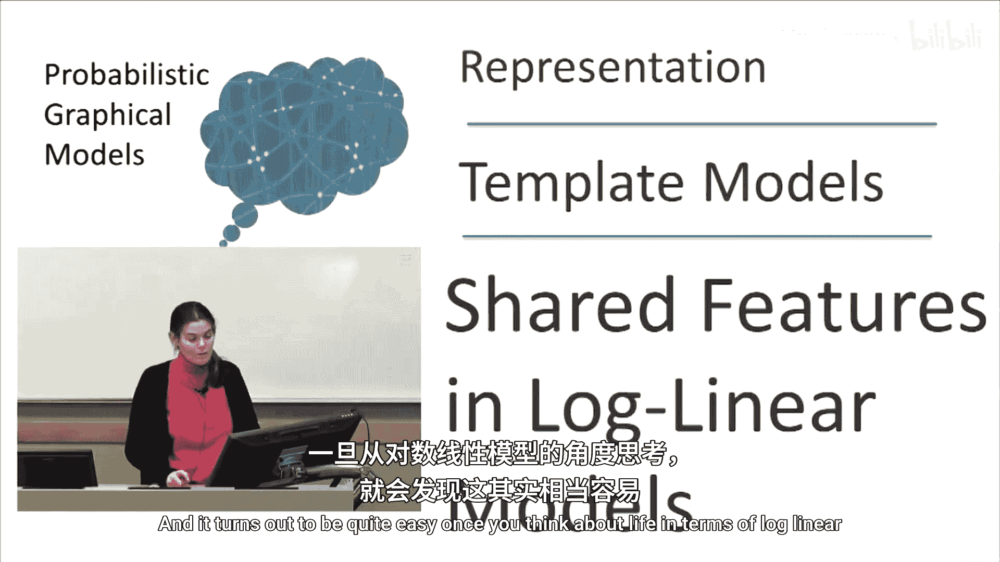
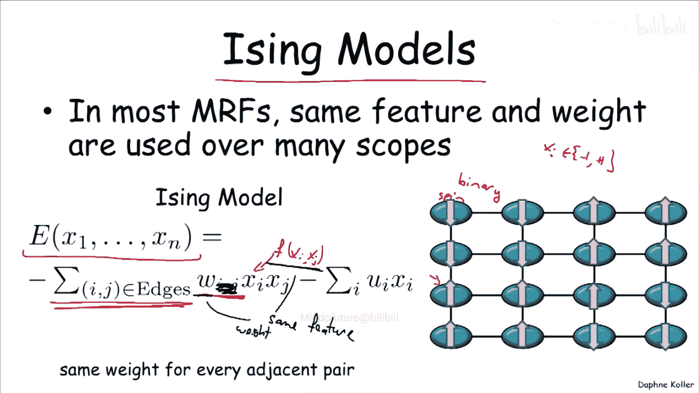
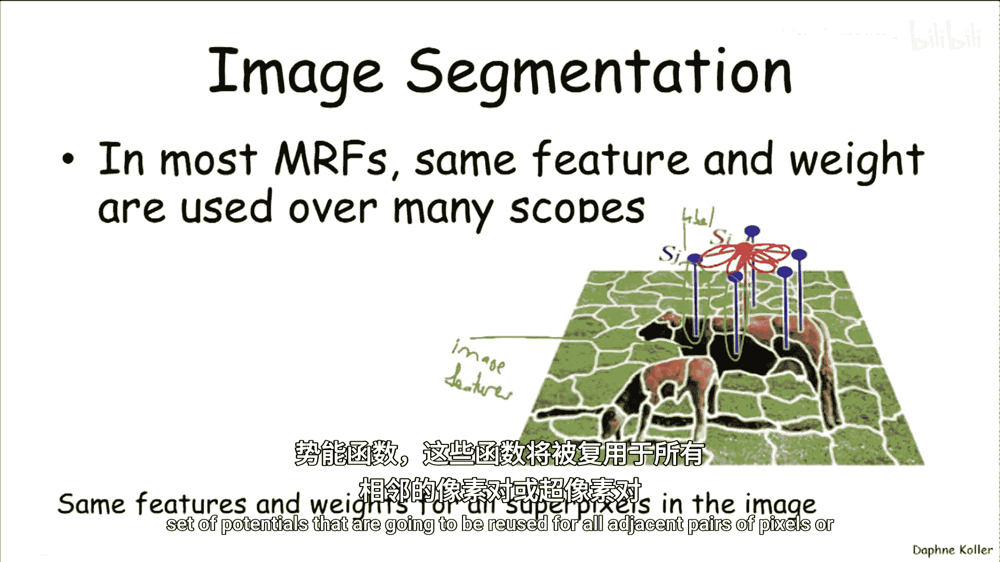
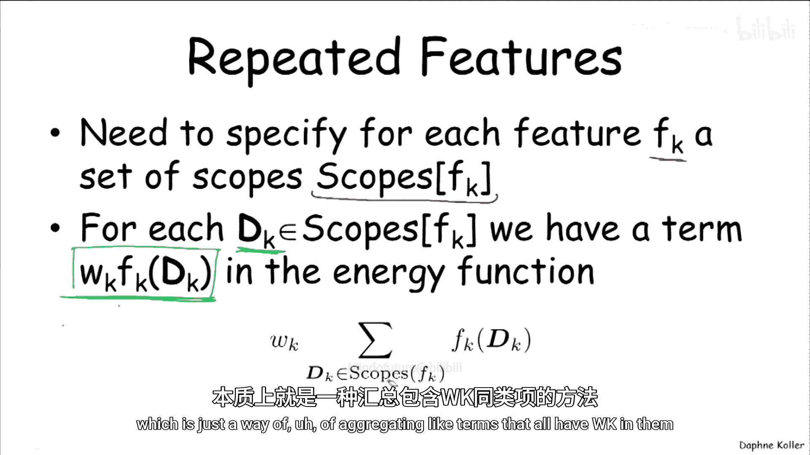
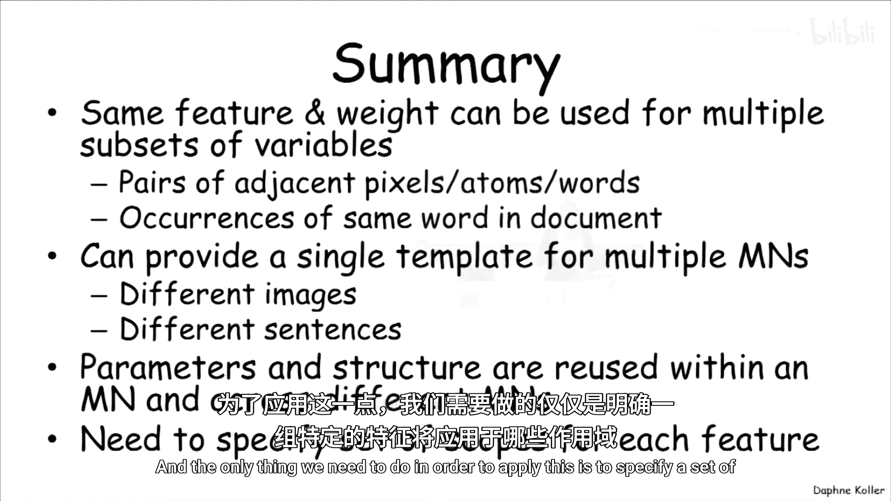

# 【斯坦福】概率图形模型1：表示法 ｜ Probabilistic Graphical Models p34 P34_对数线性模型中的共享特征_05_03_02 -BV1M76VBSEJ6_p34-

Shared structure and shared parameters comes up in directed models， but it comes up。

As much or perhaps even more in undirected models and that is because for reasons that we've already discussed and well continue to discuss eliciting parameters in an undirected model is much more difficult because they don't represent conditional probabilities or probabilities and so it's a lot easier to represent them as sort of。

😊，Templates that are comprised of smaller building blocks。

So let's talk about log linear models and why and how we might share parameters in log linear models。

 and it turns out to be quite easy once you think about life in terms of log linear models。

So let's go to one of the simplest examples that we've discussed， which is that of icing malls。

 so icing malls， as you recall， is a model that was first invented in the context of statistical physics where we have a bunch of binary random variables each which in this case in the original application represent the spin of atoms in a certain grid。

 so here's a spin going one way and here is a spin going the pink coin is a spin going in the opposite direction and we have correlations between the spins of the electrons in adjacent atoms。

And what we had as our energy model。In an icing model is a sum over all of the edges in the icing model。

 So in this example， the edges are organized in a grid of the weight。

That represents the connection of the spin of the two adjacent atoms times this feature over here。

 so F of X Xj， which is the product of X and Xj， and just as a reminder。

 X are all all either minus1 or plus one， so the product is always either negative one or positive one。

 negative one if the two have different spin and positive one if they have the same spin。

Now this doesn't have any shared parameters because we have a separate parameter WIJ for every pair of atoms INJ。

 but clearly we're not going to have in general a separate model for every for every number of atoms in the material that we're trying to model。

 so usually what's going to happen is that we're going to just have a single parameter W that represents the interconnectivity between or the extent of the influence。

 extent and type of the influence of two adjacent atoms on each other and so this is now a model that has the same feature。

And the same weight。So same feature。And same weight。

Reused across sets different pairs of random variables in the model。

Okay。In the natural language processing example that we have used previously， so we have。Again。

 a parameter sharing where we have in this case these are the just as a reminder。

 we have these being the actual words， these being the labels for the words。

 this is the name density recognition problem， but the same thing happens in other examples。

 so here we have we talk previously about the kinds of features that represent that relate for example。

 a label of a word and the word itself， for example， if it's capitalized。

 it's more likely to be a person if the previous word is misses， it's more likely to be a person too。

 and so。And so here again， we have features， which are the ones that we just talked about。

 feature of， for example， is Y I。A person。An Xi is capitalized。

And we would have a term that uses this feature， repeated for every。Position。In the sequence。

 that is the same feature which talks about the connection between the label of the word and the word itself would recur in every position in the sequence because you wouldn't want that same to represent a different parameterization for different positions of the sequence。

And similarly。We have the same energy terms， for example， that relate adjacent。

Words also being repeated across different pairs in this case of adjacent words。

Image segmentation in this example， once again， we have node potentials that represent in this case。

 the connection between the image features。And the label。And once again。

 we're going to use the exact same potentials for all pixels。

 and we're going to have a different in this case。Set of potentials that are going to be reused。

For all， patient。

Theres。Pixels or super pixelixels。So how do we do this， it turns out to be really simple。

What we basically need to specify for a given feature that we want to reuse。

We're going to specify for it a set of scopes， that is the set of scopes to which we would like it to be applied。

And so if we have a set of scopes， and let's assume the decay is one of the scopes。

That to which we would like to apply the feature K。

 So our energy function now is going to include a term。W K， FK of D K in the energy function。 So。

 for example， if Fk is。We have。We want to have FK B applied to。Adjacent。

To adjacent super pixelixs in the image， so the scopes of a feature FK will be the label Y I，YJ。

 such that I comma J are adjacent。And that's going to be the set of scopes to which we apply that feature。

And every time that we have that feature applied， we're going to have a term。

That multiplies in the value of that feature times。The weight， which is shared。

 the weight depends on the feature。So WK depends on K。That's not on the scope。

So this is just a way of replicating the feature with its weight across different。

Different subsets of random variables in the image or in the model。So。Said， otherwise。

And I wrote all over this， so let's see if I can erase this， yes。

We will have a term in the energy function。Which has WK times the sum of the features across all the scopes to which it applies。

Which is just a way of aggregating like terms that all have WK them。

But to summarize。In log linear models it's very common to use the exact same feature and weight for multiple subsets of variables。

 and we've given multiple examples of that， and this allows us just as in the other examples that we've seen in a directed case to provide a single template for multiple Markov networks。

 whether it's different the Markov network for different images or for different sentences。

And the parameter and the structure are then reused both within and across Markov networks。

And the only thing we need to do in order to apply this is to specify a set of scopes to which a particular feature is going to be applied。

