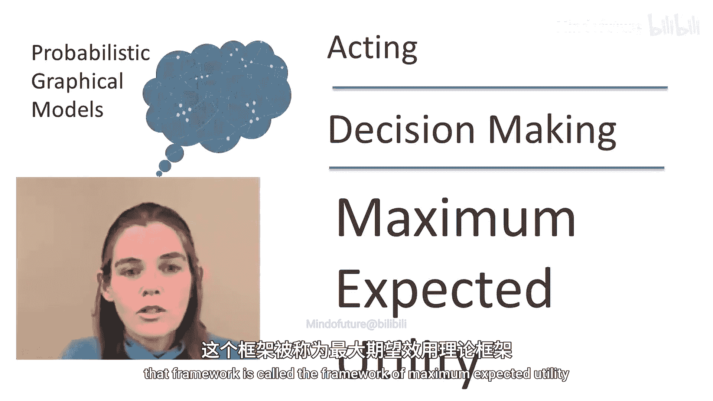
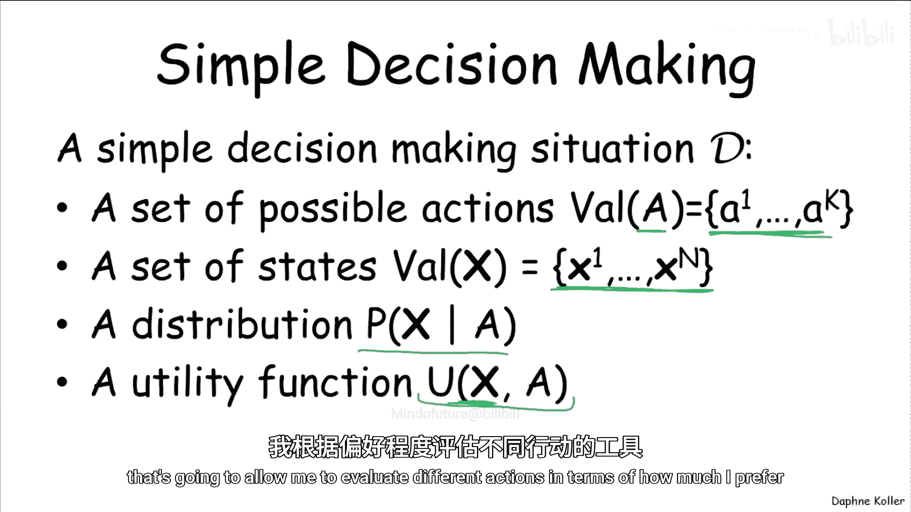
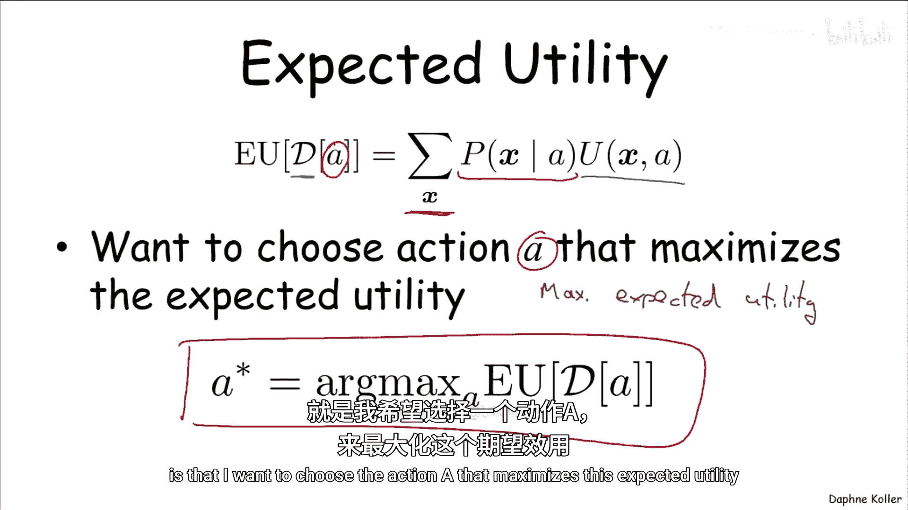
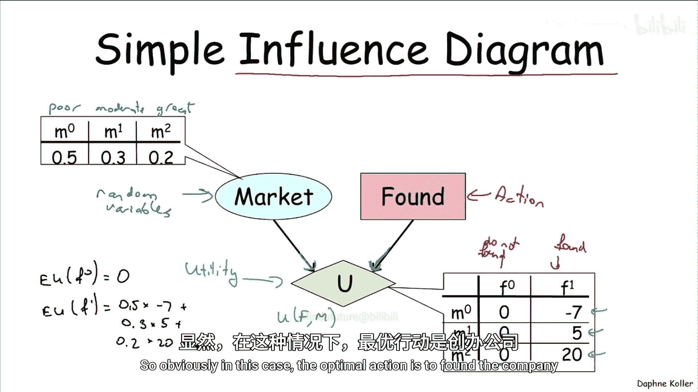
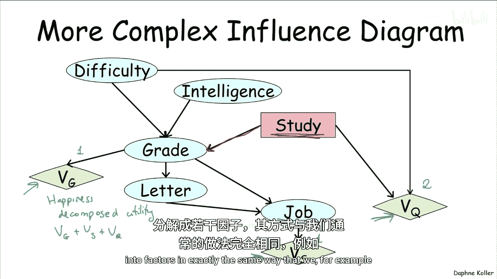
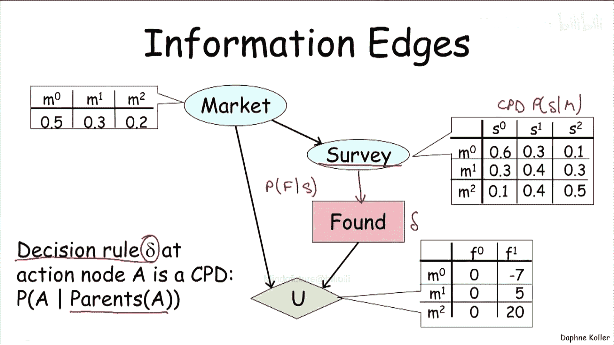
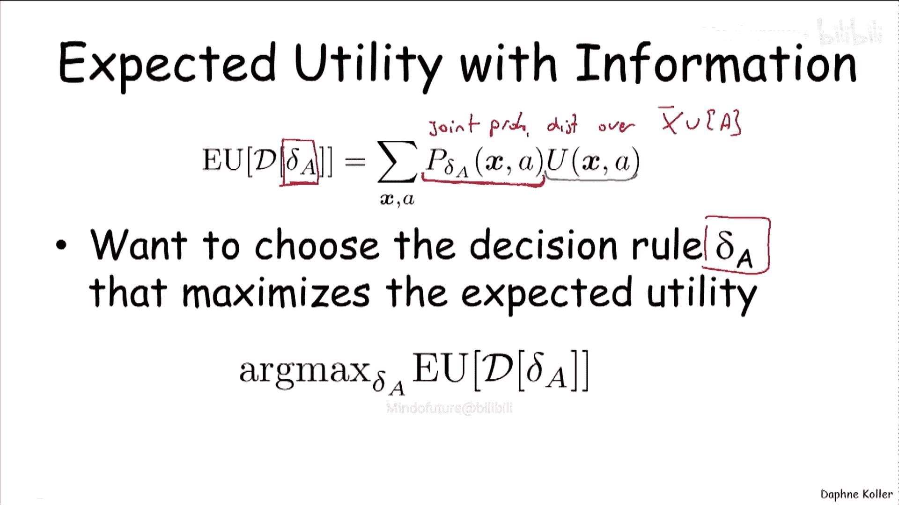
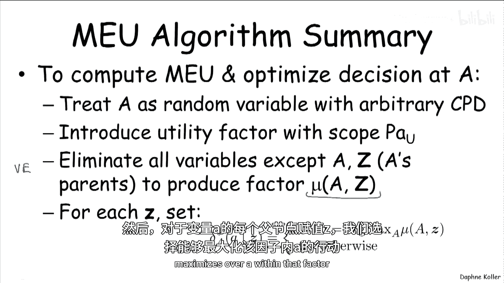
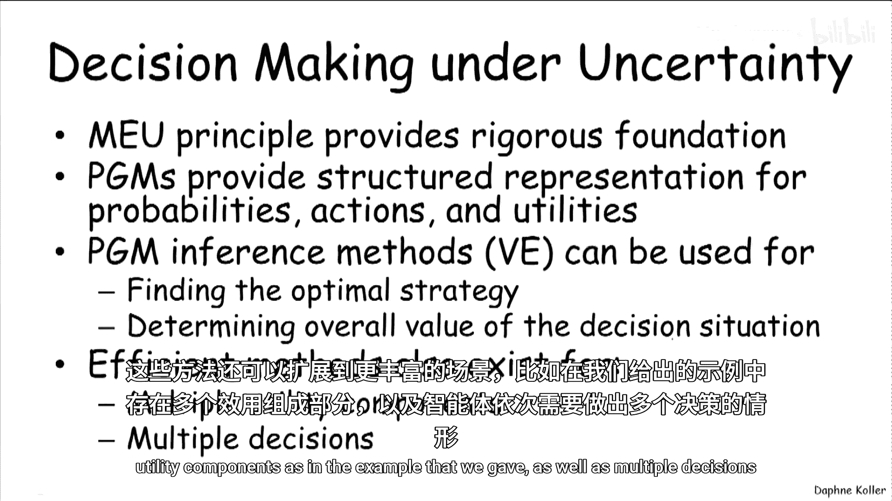

# 【斯坦福】概率图形模型1：表示法 ｜ Probabilistic Graphical Models p35 P35_最大期望效用_06_01_01 -BV1M76VBSEJ6_p35-

We've shown how probabilistic graphical models can be used for a variety of inference tasks。

 like computing conditional probabilities or finding the map assignment。

 But often the thing that you actually want to do with a probability distribution is make decisions in the world。

 So， for example， if you're a doctor encountering a patient。

 it's not just enough to figure out what disease the patient has ultimately need to decide what treatment to give the patient。

😊，How do we use a probability distribution and specifically a probabilisticographical model in order to make good decisions it turns out that the theoretical foundations for doing this kind of inference task were actually established long before probabilisticographical models came to the forefront and that framework is called the framework of maximum expected utility。

So let's formulate the problem that we're trying to solve and then we can define the principle of MEU or maximum expected utility。

So what is a simple decision making situation decomprisise of Well we have a set now it's no longer a pure probabilistic model。

 we have other elements in it， we have an action A which has several different choices that we might take。

 for example， different drugs that we might choose to give the patient。

We have a set of states of the world。X1 up to Xn。And the action can affect。

Wwhichch of those states comes about， so this set of states might include both things that I can't affect like the patient's predisposing factor of which disease they have or which test results came out which way。

 but it can also include things like the outcome that a patient will have after I administer the drug。

 so this set of variables that defines the state can involve things that I can affect and things that I cannot affect。

And then finally， the final piece of the puzzle here is something that defines the agent's preferences。

 that is I cannot make decisions that weigh different consider different actions without weighing the relative merits of different actions and my way of evaluating the merits of different actions is to have some kind of numerical utility that tells me if I take action A in this and I have this particular state of the world how happy am I？

very happy， moderately happy or extremely unhappy， so this numerical utility function is going to be the thing that's going to allow me to evaluate different actions in terms of how much I prefer them。

So。Now I can go ahead and write down the notion of an expected utility for a decision problem D。

 given an action A。And the way in which that's done is a simple expectation。

 I sum up over all possible states of the world。The probability that I get that state given the action。

 and remember， not everything in that action everything in that state might be affected by the action。

And then I multiply that by the utility of the state action pair。

And I sum up over all possible states that I might end up with and that。Smation。

 that expectation is the overall happiness that I have on average in this decision making situation if I take the action A。

😊，Clearly， I want to maximize my overall happiness。

 and so the purpose of the maximum expected utility computation。

 the principle of maximum expected utility。Maximum。Expected utility。

Is that I want to choose the action A that maximizes this expected utility。

We can use the ideas that we developed in the context of graphical models to represent decision making situations in a very interpretable way。

 so this is a structure called an influence diagram。

 and it's an extension of a Bayesian network with two additional pieces。We have。

 in addition to random variables which are denoted as usual as ovals， so here is the random variable。

And random variable is part of my state X。We also have two other kinds of nodes in this diagram。

 We have action variables。Which are places where it's not nature that gets to make a choice over the value of the variable。

 but rather the agent that gets to pick。And then we have the green。Diamonds at the bottom。

 which represents utility。So let's look at this particular example。

 which is probably one of the simplest thing that you could construct。

 this is an budding entrepreneur who just graduated from college and wants to decide whether to found a widget making company or not。

So he has two possible actions， F0， which is do not found and go take a more conventional job。

And this is。Found the company， which of course is a much more risky strategy。

We have a random variable， which is the market for widgets。And this is。AFor market。Moderate。

And the great market。And so now we can- and we have a probability distribution over those different values。

The utility of the agent obviously depends on both whether he decides to found the company and on the market。

 and we're denoting that by having both of these be parents of the utility variable。

 so the parents of the utility variable。Or the utility function are the attributes or the variables on which the agent's utility depends。

So in this case， our utility has two arguments， F and M。

 and we can see that if the agent decides not to found the company。

Then the utility is zero regardless of the market conditions for widgets because at that point you don't really care。

And if the agent does decide to sell the company and the market for widget is poor。

 then his utility is negative seven， say he invests a bunch of money and ends up losing all of it。

If the market is moderate， his utility is five。And if the market is great， his utility is 20。诶。

So now we can go ahead and compute expected utility for the two action choices。So in this case。

 the expected utility of。F0 is0。And the expected utility of F1 is going to be equal to 0。5 times。

Negative 7 plus 0。3 times。5。Plus， 0。2 times 20。Which， if you add it all up， is equal to2。

So obviously， in this case， the optimal action is。

To found the company。Let's look at a more complicated influence diagram。

That involves more random variables and also other richer structures。

 so this is an elaboration of our student network， it has the variables， difficulty and intelligence。

 the grade， the quality of the letter and in this case also variable that represents the job。

Student's job prospects， which we're going to assume depend both on the quality of the letter as well as on the student's grade because the recruiter has access to the student's transcript。

The student has one decision in this example， which is whether it's to study in the course or not。

 which is going to。Probably affect their grade。 and so we have the study variable。

ffectThe study action affects。The distribution that the student has over grades。Now， in this case。

 you'll notice that we have three different。Utility diamonds。VG。VS and VQ。

So what are these what do these represent， they represent different components of the utility function。

 so in this case I've broken down the utility function into constituent pieces。

 This one represents the happiness with the grade by itself。😊。

This is the utility that you guess from saying， yay， I got an A in the course， or， not so good。

 I got a C， so that's one piece of your utility function。

A second piece of your utility function is your overall career aspirations。

 which is the value of getting a good job versus not getting a good job。

 so that's this piece over here。😊，And the final one is the component that is ascribed to the quality of life that you have during your studies。

 so if you don't study， maybe you can go and play ultimateimate Frisbee and go to the movies every night and so that might give you more happiness than sitting there hitting the books every evening and so we're going to assume that that particular utility depends on how much you study and on how difficult the horses is because maybe it's more fun to study if it's easy。

And we're going to assume that your overall utility， that the agent's overall utility is the sum。

Of these。Different components。And this is called a decomposed utility function。

 and we'll come back to that later。Now， you might wonder why I would bother decomposing the utility function instead of having just a single big monolithic utility function that is affected by all of these different factors。

Wow， that is exactly why because it is in fact， affected by all of these different factors。

 so whereas here I have a utility function that has one argument。😊。

And another one that has one argument and one that has two arguments。

 if I had put them all together I would have a single monolithic utility function that has four arguments and that would be much harder to elicit because of the exponential comminatorial growth in the number of possible combinations that I need to consider so this is a decomposition of a function in this case the utility function into factors in exactly the same way that we。

 for example like to decompose a probability distribution as a product of factors。

So another interesting extension that the influence diagram presentation allows us to capture is the notion of the information available to the agent when they make their decision。

So let's look at this example over here which elaborates our entrepreneur example。

 and here we come in with the assumption that the entrepreneur has the opportunity to conduct a survey regarding the overall market demand for widgets before deciding whether to found a company now the survey is not entirely reliable and so over here we have the CPD that tells us how likely different survey results are to come up given different values of the true market demand。

Now， the point is that having conducted the survey。

 the agent can base his decision on the value of the survey。

 and we denote that with the presence of an edge such as this。

 which indicates that the founder that the entrepreneur can make different decisions depending on how the value of the survey turns out。

So from a formal perspective， that means that what the agent allowed to do is to choose a decision rule which we're going to denote Dlta at the action node。

And what a decision rule is is effectively a CPD it tells the agent given an assignment of the values to the Par at A。

 which are the variables that the agent can observe prior to making a decision。

 the agent based on that can decide on the probability distribution of the action that it takes in that particular situation so here for example。

 we would have a CPD which tells us the probability of founding a company which in this case is a binary value variable given the three possible values of the survey variable。

Now you might say why would I need to have a CPD， why would the agent ever want to make a random choice between two different actions and it turns out in fact that in a single agent decisionmaking situation。

 there is no value to allowing that extra expressive power because of deterministic CPD would work just as well。

 nevertheless for reasons that will become clear on the next slide。

 it's actually useful to think about this as a CPD even though in most cases it'll actually be deterministic at least in the examples that we're talking about。

So now that we've given the agent that expressive power。

 how do you formulate the decision problem that they need to make。

 That is what do they get to choose and how do they choose it？ So given a decision rule。

 delta for an action variable A。 if we inject that into the decision network。

 Now all of the variables in our network， both a and the remaining variable X variables X all have a CPD associated phone。

 So now we have effectively defined a joint。Probability distribution。Over。All the variables X。Union。

The variable A because each of them has a CPD。And so， this。Is。

This probability distribution and the agent expected utility once they've selected the decision rule delta a is simply this expectation over here。

 we average out overall all possible scenarios where scenarios and assignment of the chance variables X as well as to the agent's action A and what we're averaging out is the agent's utility in math scenario and so that's the overall expectation that the agent prior to anything going on can expect again given a decision rule delta A。

So obviously， the agent wants to choose the decision rule Delta A that is going to give him the maximum value for this expression that denote his expected utility。

And so this is the optimization problem that the agent is trying to solve。

So how do we go about finding the decision role that maximizes the agent's expected utility？

So let's look at this first in the context of a simple example and then we'll do the general case。

 So over here we see once more the expected utility equation for a given decision Well now we're trying to optimize。

This。Health a。So let's write down the expected utility in this particular example。

 so the Bayesian network in this case has now two original CPDs。

 there is P of M that comes in from the M variable。

 theres P of S given M which comes out from the survey variable。

 and we have the CPD that is as yet to be selected。

 which specifies the decision rule at the action F。And then multiplied with all that is the utility。

Which depends on the decision to found the company and on the true market value。Well。

 this should look awfully familiar。 It is simply a product of factors。

 Some of these factors are probabilistic factors， and one of them。

 the U is a different numerical factor， but it's still a factor。

Which depends on a scope of two variables in this case， F And M。

So now we can go ahead and apply the same kinds of analysis that we've done in previous computations。

 specifically， we can， since we're trying to optimize over this。Expression over here。

 the deelta F of F given S。 We're going to push in everything that we don't currently need to manipulate。

 which is just F and S， which are the two things that appear in the factor of the decision role。

 And so specifically， we're going to push in。M。And leave within the summation over M all of the factors。

They depend on M。And so that gives us a sum over M， P of M。

 P of S given M U of F comma M and if we marginalize out M， what we end up with。

 if we multiply these three factors and marginalize out M is a factor that we're going to call mu of FS。

 and the reason that it's called mu is to suggest that it has utility component U， so mu and U。

And now we have actually a fairly simple expression that the agent is trying to optimize。

 it's a summation over all possible values of S and F over here。Of the deelta。

 the decision rule that the agent。Takes。Over F， given the situation。

 as given the observation as multiplied by this factor that I just computed。

And now if our goal is now to optimize this expression。What。

The agent ought to do is to pick within this factor。M of FS， the highest value。

 the F that gives it the highest value in each circumst。So this is a little bit abstract。

 so let's look at this in the context of an actual numerical example to see this。

 so here are the three factors that we have in this network to begin with。

 this is the CPD for M over here， the CPD for S given M in the middle and here is the utility factor U。

It comeses from here。And now if we're going to go through this expression through this computation。

 and we're going to compute。This。Expression over here， this is what we get。

 it's a factor that gives us this value for each value of the variable of the action F and each value of the survey variable S。

And if we want to maximize this summation。And we look at this factor over here。

 It seems clear that what's going to maximize the summation is if we put full weight on F 0 in the case。

 S 0， which if you think about if you look at these CDs is the case where the survey suggests that the market demand is bad。

And。At the same time， in the other two cases， we're going to choose the action to found the company。

And if you look at this， you can see that no other choice of delta is going to give us a higher value for the summation than this deterministic choice that chooses。

 in the case S0。We choose F 0。 And in the case， S1。And S 2。We choose。To found company。

 And so this is the optimal decision rule。And if you ask， what is the expectation。

 what is the agent's expected utility with this strategy before it does anything before the survey is conducted。

 well， it's just going to be the sum of zero。Plus 1。15。Plus 2。1， which sums up to 2。

25 as the overall expected utility， sorry， 3。25。As the agent's overall expected utility in this case。

Now， if you think back to the agent's expected utility when it didn't have the information about the survey。

 that expected utility， if you recall， was two， so without。Survey。

The agent's best map expected utility was equal to two， so by conducting the survey。

 the agent has gained 1。25 utility points。Then let's generalize this to arbitrary decision diagrams。

 we're going to focus for the moment on single utility nodes and single action nodes。

 the more general cases a little bit more complicated and we're not going to go through it but the principles are very similar。

So once again， going into this example， we see that deelta a， the decision rule a。

 defines a joint distribution。Over all of the chance nodes and the action node。

 and that is multiplied。By the utility under this scenario。

And so we can open up the probability distribution piece of Delta A as a product of two types of CPDs。

 we have the original CPDs。Which is simply the product over I P of XI given its parents。

 and then we multiply that by the decision rule。Delta。

And we're going to use Z just as a shorthand to denote the parents that is the observations。

That the agent makes prior。deciding on a。So we can do the exact same moving in of factors inside and outside of the summation。

 and we're going to marginalize out everything except。The factors。

 except the variables that appear in this factor delta A， so everything except a and its parent Z。

 and we're going to sum out all of the remaining variables which for simplicity。

 we're going to denote W。So this is summing up over all variables other than A and Z of this product of factors。

 including。Utility variable， utility factor。And so we're going to get a utility factor just as we did before。

 which is a function of a and its parents， and we want to optimize the decision rules says to maximize the possible sumation over here。

 and once again the optimal decision rule is just the one that picks for every combination of the parent Z。

 the action that gives us the maximum entry in this factor。

 so deelta star of a Z is something that gives us a probability of one。

This is we start with probability one。The action that gives us the AGmax action for this factor and any other action is selected with probability zero in this conditioning case for Z。

So summarizing how this algorithm goes。To compute the maximum expected utility and find the optimal decision rule at in action A。

 we take the following steps， we treat A as a random variable with at this point an unknown CPD。

We introduce an additional factor beyond the CPDs， which is a utility factor whose scope is the variables that the utility depends on。

 so now we have as usual a collection of factors， we now do effectively variable elimination algorithms。

 so this is plain good old variable elimination to eliminate all variables except a and A's parents which produces a factor。

Mux some Az， and then for each parent assignment Z to the variable A。

 we choose the action that maximizes over a within that factor。

So summarizing this， the MEU principle provides us with a rigorous foundation for decision making under uncertainty。

Building on that， the framework of probabilistic graphical models allows us to provide a compact representation。

For complicated high dimensional decision making settings where we have multiple chance variables。

 multiple actions， and utilities that depend on multiple variables。

We can now build on inference methods in probabilistic graphical models， specifically in this case。

 the variable emination algorithm to both find the optimal strategy and figure out the overall value to the agent of a particular decision situation。

And whereas we didn't talk about this， these methods can also be extended for richer scenarios where we have multiple utility components as in the example that we gave。

 as well as multiple decisions that the agent makes in a sequence。

