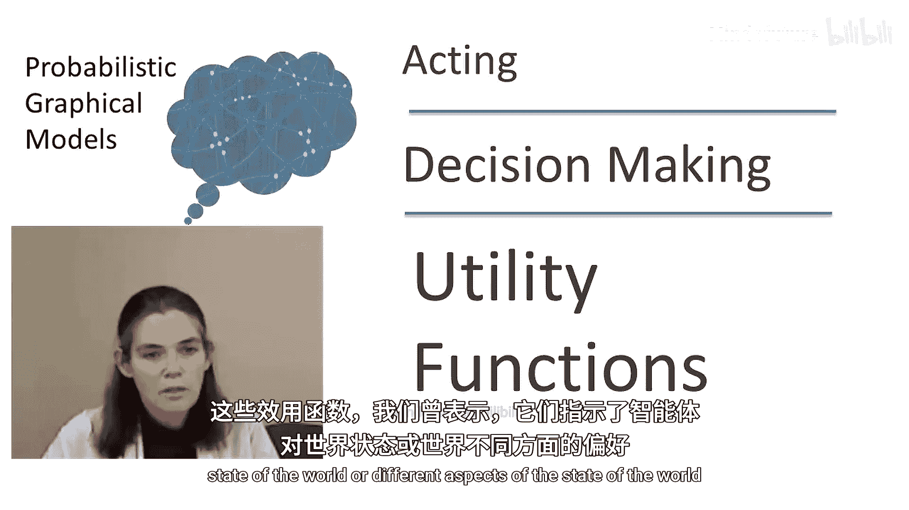
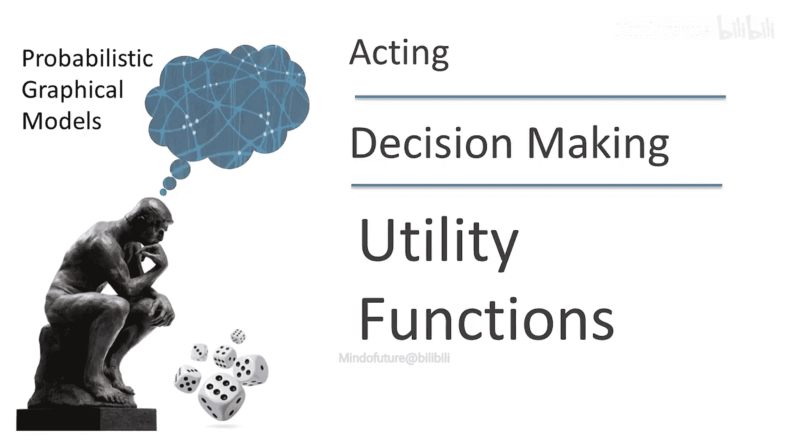
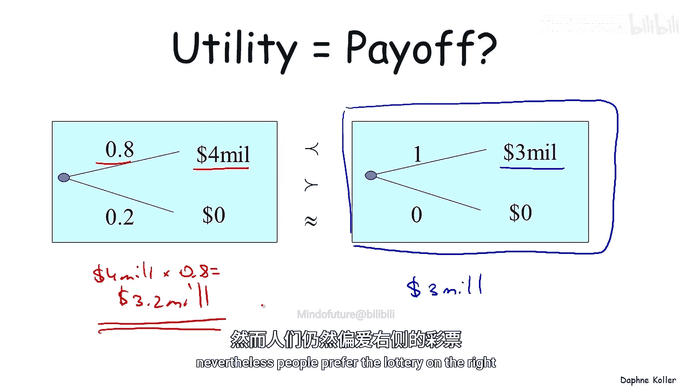
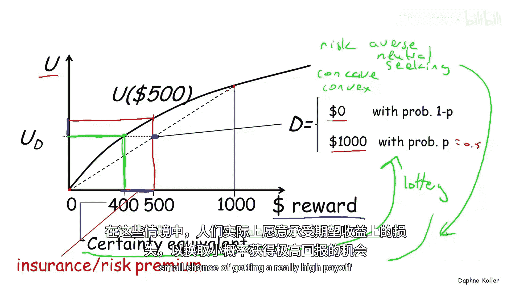
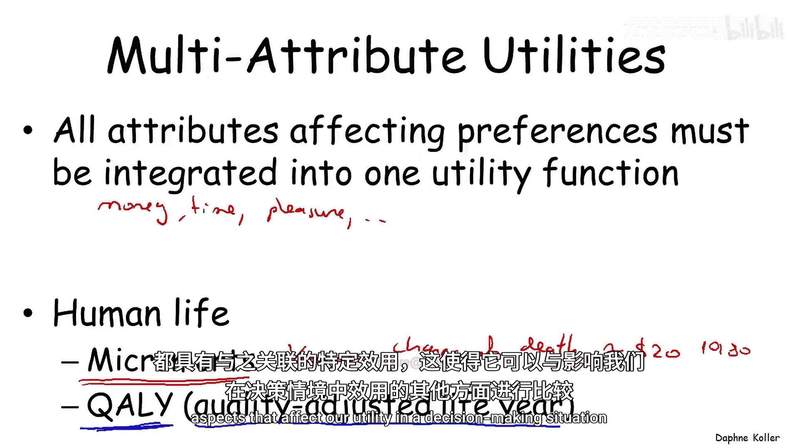
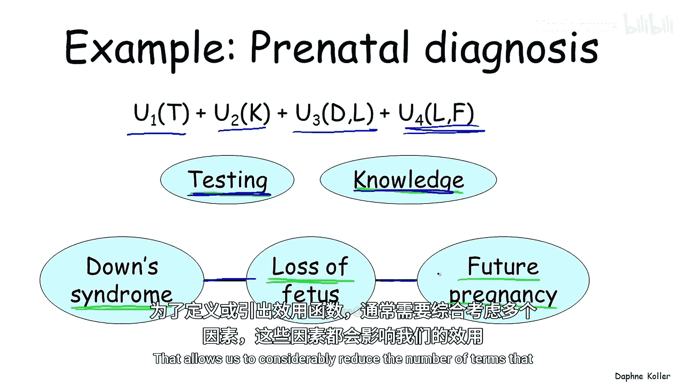
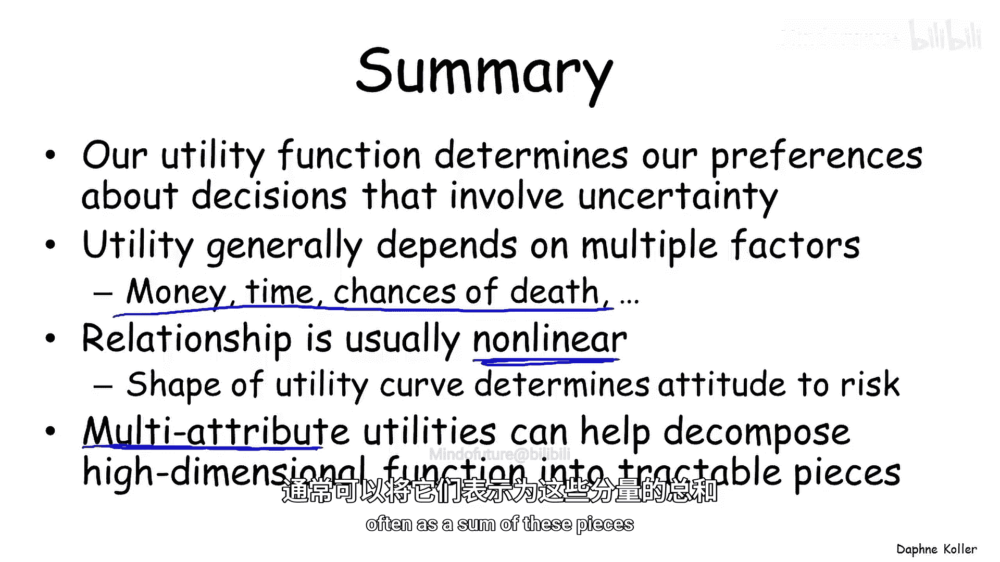
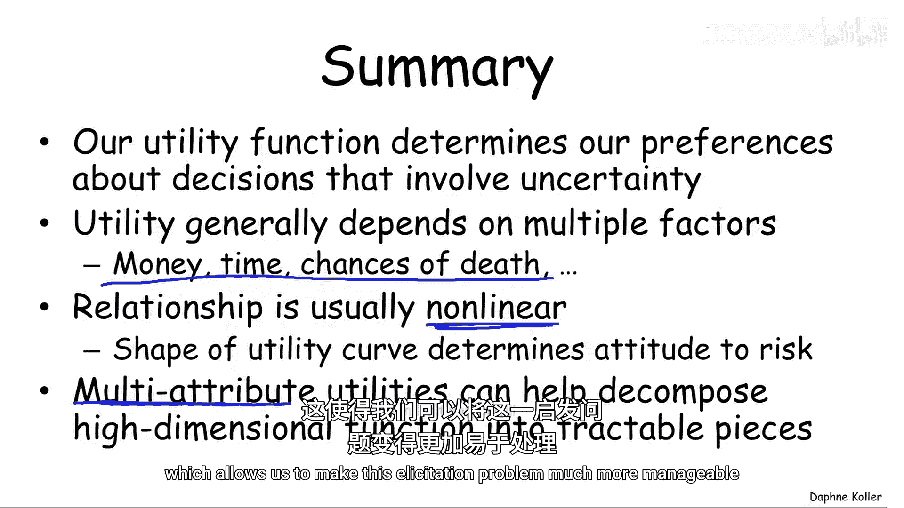

# 【斯坦福】概率图形模型1：表示法 ｜ Probabilistic Graphical Models p36 P36_效用函数_06_01_02 -BV1M76VBSEJ6_p36-

When we talked about influence diagram， we included in the influence diagram nodes that represent the agent's utility function and those utility functions we said indicate in agent's preferences regarding the state of the world or different aspects of the state of the world。

 What are these utility functions and where do they come from。

So utility functions are necessary for our ability to compare complex scenarios that involve uncertainty or risk。

 it's not difficult for a person to say that they preferred outcome where they get 4 million to one where they prefer 3 million。

 but it's not quite as easy to encode a more complicated preference that allows us to compare the utility of these two lotteries as they're called。

Where the one on the left the agent $4 million with probability 0。2。

 and the one on the right gives the agent $3 million with probability 0。25。

Which of those lotteries do we prefer if we had to make that decision？

It turns out that the way to formalize the decisions making process of an agent in this type of scenario is by ascribing a numerical utility to these different outcomes to the outcome of 4 million。

To the outcome 3 million and to the outcome of 0。 And then we can use the principle of maximum expected utility to decide between these two different lotteries。

 specifically， we can then compare $0。2 times the utility of the outcome 4 million plus 0。

8 to the utility of the outcome 0 versus the converse， which is 0。

25 versus the utility expected utility for the second lottery to 0。

25 times the utility of $3 million plus 0。75 times the utility of 0 and we can compare these two expressions and decide whether we prefer the one on the right。

 the one the one on the left， the one on the right or。They're equally good in our view。Now。

 it might be natural to assume that utility should be linear in the amount of payoff that we get so that $5 is preferred about half as much as $10。

It turns out that that's actually not the case for most people and one example of that is this decision making situation over here where on the left the agent has the option of getting $4 million with probability 0。

8 and on the right they have the option of getting $3 million with certainty Most people tend to prefer the lottery on the right。

But if one computes the expected payoff of these two different lotteries。

 we can see that the expected payoff over here is 4 million times。0。8， which is 3。2 million。

Whereas on the right， we have an expected payoff of 3 million。

 so the expected payoff on this side is higher， and nevertheless people prefer the lottery on the right。

Another example， very famous example of this type of preference is what's called the Saint Petersburg paradox St Petersburg paradox is an imaginary game that one can play where a fair coin is tossed repeatedly until it comes up heads for the first time and if it comes up heads for the first time on the end toss。

 you get two to the end dollars。😊，So what's the expected payoff in this case， Well。

 the probability that it comes up heads on the first toss is half， and then you get $2。

 The probability that it comes up heads for the first time is a quarter and。The payoff here is $4。

A problem third toss is 8 times 8 times $8。 And it's easy to see that the expected payoff over here is infinite。

 So in principle， people might be willing to pay any amount to pay this。

 to play this game because their expected payoff is bigger than any amount that that they would be paying to play。

 But the fact is that for most people。The value of playing this game。Is approximately $2。

 which is a strong indication that their preferences are not linear in the amount of money that they earn。

So let's try and quantify that using this notion which is called a utility curve。

 The utility curve in this case has the x axis， the dollar amount that you get and on the y axis。

 the utility that an agent describes to that and now let's compare a few different scenarios here。

 So first let let's look at the utility of getting $500。So if we go up from 500 to the utility curve。

 we can see that the utility of this outcome is going to fall over here。

 so this is going to be the utility of $500。But now let's look at a decision as a situation that involves some risk。

 so let's look at a set of lotteries where I get $0 with probability 1 minus P and $1000 with probability P。

Because of the linearity of expected utility， all of these lotteries are going to sit on this line over here where depending on the value of P。

 I have a different weighted combination between getting the utility of 0 dollars in the utility of 1000。

 so for high values of P close to1， we would be sitting on this side of the curve and otherwise。

 for example， for low values of P， we would be sitting close to here。Specifically。

 what happens if we look at the probability p equals 0。5？Well， in that case。

 we would have this point on the curve over here。Now the important thing to notice is that the utility of this point where I get $1000。

 probability 50% and $0， probably 50%， that utility in this example is considerably lower than the utility of $500。

 so I prefer to get the $500 for certain， which is what most people would say。Now。

 if we look at what the lottery is worth， that is the risky version。

 we can see that that sits over here and might， for example。

 be corresponding to getting $400 with certainty so that $400 is called the certainty equivalent of this lottery over here。

 That is it's the amount that you'd be willing to trade for this lottery in terms of getting that money for certain。

The difference。Between these two numbers， the expected reward and the utility of that lottery is called the insurance premium or the risk premium。

 and it's called that because that's where insurance companies make their money。

Because of a person's willingness to take less money with certainty over a more risky proposition。

So we can see that this kind of a curve that has this shape， this concave。

Shape is is representing a risk profile， which is risk averse。

 That is a person is willing to pay for taking less risk。

Other profiles of this curve would represent different behaviors， so for example。

 if the utility was linear in the reward， that would be a behavior that was called risk neutral。

Conversely， if we had a curve that looked like this。Which is a convex function。

That would be risk seeking。And risk seeking behavior occurs， for example， in Las Vegas。

 where one is willing or in other gambling situations。

 where one is willing to actually take a loss in terms of the expected reward for the small chance of getting a really high payoff。

Now， it turns out that people often have a utility curve that looks like the following。

 So if the X axis is the amount of money that we get and we arbitrarily place the zero point over here。

 which is at one's current。State。And we ask how much do you prefer to earn money and how much do you prefer to lose money。

 what's your utility for these different changes to one state。

 we can see that one's preferences for earning money typically exhibit a form of diminishing returns。

Which gives us the this concave。Utility curve， which suggests risk a behavior in the sense that we would prefer a certain amount of。

 we would prefer to get money with certainty relative to the expected relative to the payoff equivalent。

 uncertain lottery。Now， on the negative side of the spectrum。

 many people exhibit some kind of behavior that is actually more risk seeking。

 which means that many people would prefer a small probability of a large loss。

Relative to a small loss that you get with certainty， and that's a behavior that one often sees。

More importantly， in this region of the space， which is close to one's current state。

 the behavior is often risk neutral， that is small small losses or small gains on the order of a small number of dollars and of course it depends on one's baseline are often something that you don't really care about having the uncertainty and the expected payoff is often very close to the the utility of the expected payoff。

Now， one final important observation regarding utility functions is that one's utility often depends on many。

 many things， not just on the monetary gain， so and all of the attributes that affects the preferences must be integrated into a single utility function。

 This is something that many people find very painful because it forces us to do things like put human life or the loss of human life on the same scale as as monetary gain。

The point is， even if we don't do this explicitly， even if we decline to put human life， for example。

 on the same scale as monetary gain， the fact that our decisions are indicating that we're making those decisions。

 So， for example， when an airline chooses not to run maintenance on the airplane every single time that the airplane land。

 that's a financial decision because that would be too costly， but at the same time。

 it also definitely increases the chance of loss of human life because because of an accident。 Now。

 it's not just a big companies that make these decisions。 we make these decisions ourselves。

 So we don't change the tires on our cars every month or every week。

 because that would be too costly， but clearly having better tires is something that is likely to increase our chances of surviving an accident or a skid。

 So these tradeoffs are ones that we make all the time whether we recognize it or not。

And so it's important when we think about a decision making situation to list for ourselves all of the different things that could affect our decision。

 money， time， pleasure。U， and and many， many other attributes and think about how we could bring them together into a single utility function。

Specifically， in the context of the human life， people have spent a lot of time thinking about how to bring in human life into one's utility function。

And what turns out to be the wrong strategy in terms of reflecting people's preferences is to have a utility for the monolithic event of someone's death。

 And that turns out to be a very difficult thing to contemplate。

 what seems like a better strategy in general， is this notion of a microm。

 which is the one in a million。Chance of death。And so one puts the risk explicitly into the utility function and so what is a 1 a million chance of death worth Well back in 1980。

 so a while ago， people did this study and it turns out that a microor was worth approximately  $20 in 1980。

And。So， of course， you can account for inflation， but it's not a huge amount of money。

And that turns out to be a much better way of ranking people's utility for outcomes that involve risk to human life than asking about the utility of death。

The second way that people use a medical decision making situations specifically for accounting for human life is this notion of quality or quality adjusted life year。

 so each quality adjusted life year， which is a year adjusted for one's quality of life。

 has a certain utility associated with it， which allows it to be compared with other aspects that affect our utility and a decision making situation。

One example from a real world situation is in this context of prenatal diagnosis where researchers did extensive work in eliciting utility functions that involve prenatal testing。

 so relevant variables in this scenario include whether the baby is going to end up with some kind of genetic disorder and specifically the one that they focused on was Down syndrome。

But at the same time， there's other aspects that affect one's utility， so for example。

 the pain of testing for Down syndrome is one aspect。

 the comfort of knowledge that you know what's going to happen is something that also turns out to contribute to one's utility function。

Prennatal testing runs the risk of the loss of the fetus and that is also clearly a component of one's utility function and at the same time the potential for future pregnancy that is whether there will be a future pregnancy or not is another component of one's utility function So if we think about the space here。

 the utility function depends in complicated way on a large number on these five variables and this is a fairly high dimensionmenal space over which to elicit to illlicit utilities。

Fortunately， it turns out that many people have a lot of structure in their utility function and specifically they can break down the utility function as a sum of subutilities。

 just as we had in the context of the influence diagram and for many people that decomposition looks like the utility of the testing。

😊，The separate component for the utility of the peace of mind of knowledge。

And then we have these two pairwise utility terms， the first of which is a term that depends simultaneously on Down syndrome and on the loss of the fetus。

 and the second is the utility that depends on the loss of the fetus and the potential for future pregnancy。

 so people's utility function for many people decomposes in this way。

 which it turns out we could actually think about as a graphical model that has singleton terms as well as these pairwise terms over here。

And that allows us to considerably reduce the number of terms that we need to list in order to get a usable utility function。

So to summarize， our utility function is what we can use to determine preferences about decisions that involve risk or uncertainty。

In order to define or elicit utility function， we generally need to consider multiple factors。

 all of which affect our utility。In most cases， the relationship between these different factors。

 between say money and the utility or micromots in the utility。

 this relationship is usually a nonlinear one， and the shape of the utility curve determines one's attitude towards risk。

Finally， the actual utility function is usually a multiastrobute utility that integrates all of these different factors。

 and it often helps to decompose this utility function into tractable pieces。

 often as a sum of these pieces， which allows us to make this elicitation problem much more manageable。

