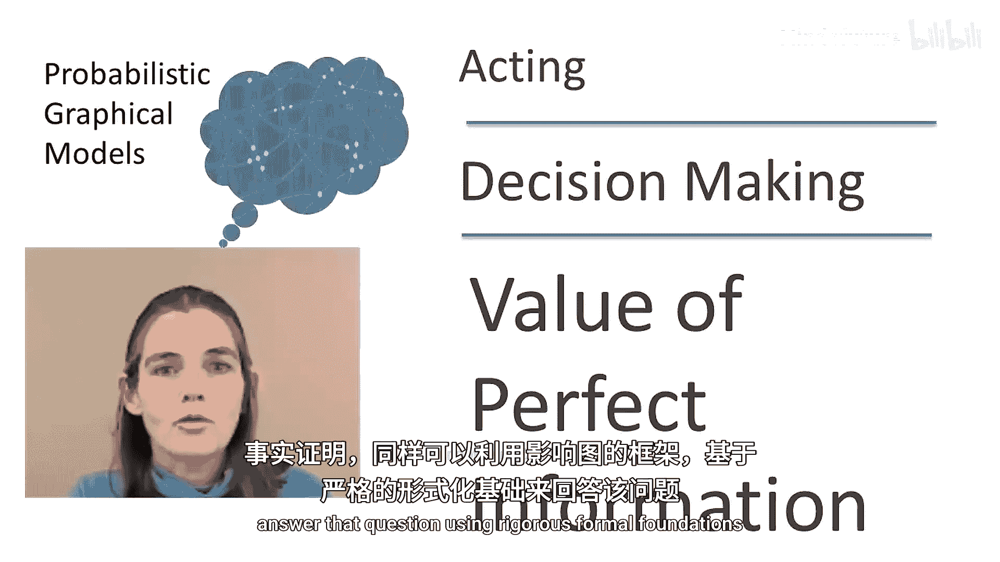
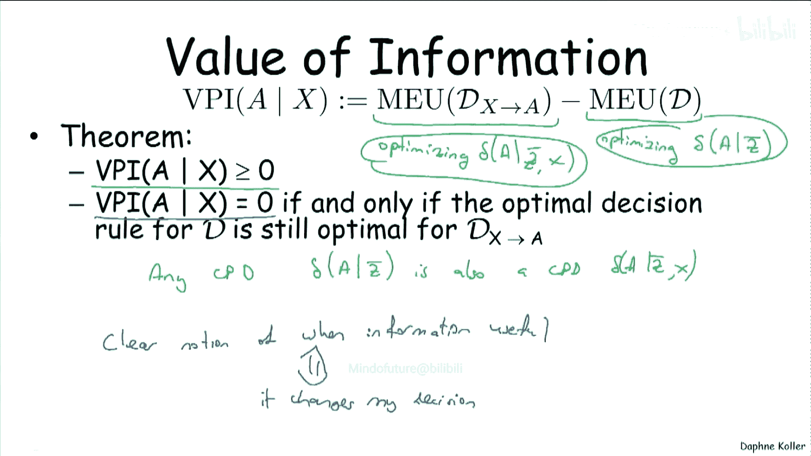
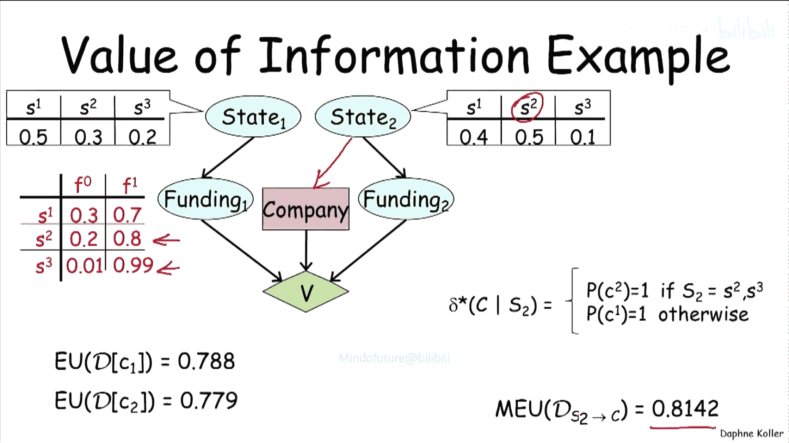
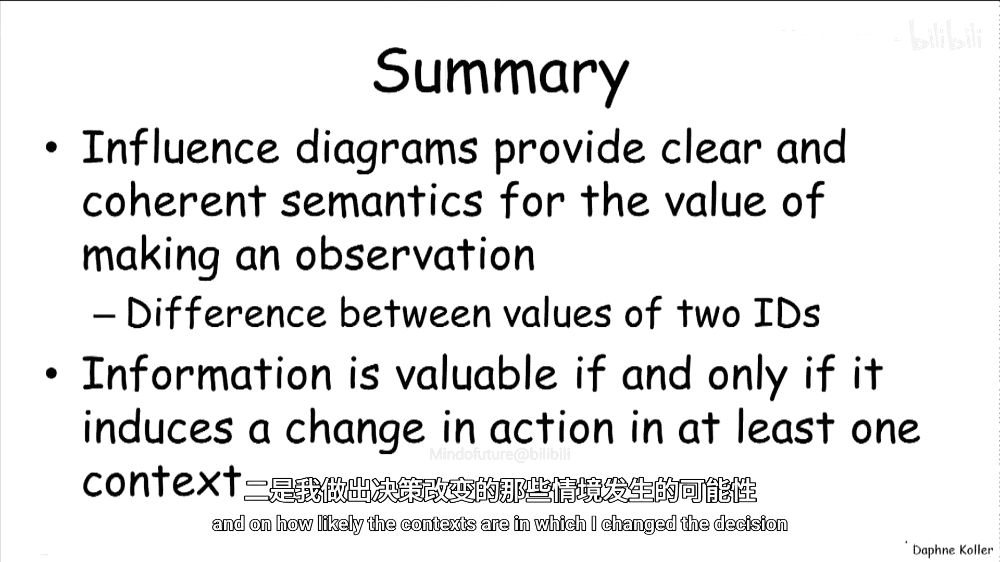

# 【斯坦福】概率图形模型1：表示法 ｜ Probabilistic Graphical Models p37 P37_完美信息价值_06_01_03 -BV1M76VBSEJ6_p37-

We showed how influence diagrams can allow an agent to make decisions regarding what course of action the agent should take given a set of observations。

 but often we want to answer a different type of question。

 which is what observations should I even make before making the decision。 For example。

 a doctor encountering a particular patient might have to decide which set of tests to perform in that patient。

 Test are not free， They cause pain to the patient they come with a risk and they cost money。

 So which ones are worthwhile in which ones are not。

 The same kind of question comes up in any other scenario。 So， for example。

 if you're running a sensor network， Which sensor should I measure。

 the sensor might require energy in order to transmit the information。

 And that might be something that we want to consider carefully。

 And there's many other examples of that。 It turns out that the same framework of influence diagrams can also be used to answer that question using rigorous formal foundations。

how do we provide a formal semantics for the notion of the value of getting information or the value of making an observation？

So。The formal definition that one can provide for this is the value of perfect information。

 So this sound， this stands for value。Of perfect。Information。

About a variable x is the value that we have by observing x before choosing an action at A。

 and perfect means that we observe x perfectly without any noise。

How do we make that a how do we give that a formal value Well。

 if D was our original influence diagram before I had the opportunity to observe x。

 we can compare the value of D to the value of a different influence diagram。

 which is the one where I introduce an edge from x to a。

Because that tells me what the value of the situation would be if I had the ability to make that observation。

 so we can now define the value of perfect information to be simply a difference between the maximum expected utility that I have in the situation where I have this observation minus the value of the expected utility to the agent in a scenario where I don't。

So in this example that we've presented before， we saw that we compared two decision situations。

 one where the agent has found the company without any kind of additional information about the value of the market。

 and the other is where the agent gets to make。An observation regarding the survey variable prior to making the decision。

 whether to found the company so we can compare the value of the decision making situation with a variable from S to F。

Minus。The value of the decision making situation， assuming the agent makes optimal decisions of the original decision- making situation D。

 and we can compare that and see how much the agent gained by this and if you recall we computed this to be 3。

25 and this was two， so the value of perfect information was 1。25。

Which means that the agent should be willing to pay anything up to 1。

25 utility points in order to conduct the survey， because doing that will increase his expected utility。

So let's look at some。Properties of the value of perfect information。

So the first important property of the value of perfect information is assuming that there's no cost of the information。

 so not counting in how much it might cost say to conduct a survey。

 one can show that the value of perfect information is always greater than or equal to zero。

So let's first go ahead and convince ourselves that this is true。

So let's look at this expression over here， which compares。

The maximum expected utility between two different influence diagrams。

 And remember that each of these is obtained by optimizing。Over a decision rule。

 this one is optimize the Mu of the original decision D is optimizing a decision rule Delta。

 which is a CPD of a given its current set of parent Z。And this one， the new influence diagram。

Is optimizing a decision rule Delta where a has。Z as all the original parent Z plus an additional parent X。

And the point that one that becomes obvious when you think of it this way is that this。

Is a strictly larger class of CPDs。T this。That is any CPD。

Of the form Delta of a given Z is also a CPD。Of the form delta of a given Z and x。Which means。

Any decision rule that I could have implemented in my original influence diagram。

 I can also implement in the context of my current influence diagram。

 and if it had a particular value there， it would still have that same expected utility value in the original diagram。

So to go back to our example， for instance， if the agent。

has a decision rule that found decides say to found the company regardless of the value of the survey。

 that is still a legitimate decision rule even when they get to observe the survey and it would have exactly the same expected utility。

 and so that means that the set of decisions that I get to consider is just larger in the context of the richer of the richer influence diagram and therefore one cannot possibly lose by exploring a a larger space over which to optimize。

Okay。So now let's think about the second property， which is when this value of perfect information is equal to zero and this follows from very similar reason to the one that we just talked about。

 so if the optimal decision rule for D for my original influence diagram B is still optimal for the extended influence diagram。

 then I have gained nothing from the information that is any decision that any decision rule that I could have applied before。

 I can still apply and therefore I have gained nothing from this additional observation。

And so this gives us a very clear notion。Of。When information is useful。

Information is useful precisely when it changes my decision。In at least one case。Which。

Thinking about this from the other perspective， if。

There is no ability for an observation to change my decision， there's really no point making it。

Let's see how this intuition manifests in an actual decision making scenario。

 so let's imagine that our entrepreneur has decided against founding a widget company and is now starting trying to pick between two companies that he can choose to join。

For each company， there is the state that the company is in。

 so S1 is that the company doesn't have that grade of a management。

 things are not necessarily going so well， so that's S1。

S2 is medium and S3 is the company is doing great。And that same thing holds for both companies。

We are assuming that the company of funders have access to some of to this information about the company state because they can do some very in depth due diligence and so the chances of a company to get funding。

Depends on the state of the company。 so you can see that if the company state is poor S1。

 then the chances of getting funding are 0。1， whereas if the companys doing great。

 the chances of getting funding are 0。9。 and we're assuming that the agent's utility is one if。

The company that he showed that he joins。It's funded。And zero otherwise。

So now let's think about the two strategies that the agent can take without any information。

And so if the agent chooses to join company one， one can see that company one is。嗯。

That the expected utility now is 0。72。And the expected utility of Company2。

 which is not doing as great， is only 0。33， which， you know， if you look at the state of the company。

 that makes perfect sense。Now， what happens if the agent now gets to make an observation？

And specifically， we're going to let the agent make the observation。Of S2， regarding S2。Which is。

 in this case， the weaker of the two companies。 So the agent has a little mole inside the company and can get access to that information before making his decision。

 What happens then。Well。嗯。The， if you look at。The utility values。

 you can see that if company1 is in state， sorry， if company 2 is in state 1。Then。

 which is a not unlikely scenario， it happens with probability 40%。

 the chances of getting funding are 0。1。And so the agent's expected utility in this case。

 So the expected utility if。The agent chooses C2 and the state of the second company is S1 is 0。1。

The expected utility， if C equals a C， if the company。

 if the agent chooses the second company and it's doing。Moderately well is 0。4。

Both of these are lower than the 0。72 that the agent can guarantee on expectation if he chooses company1。

 even without any additional information on company1。 And so in both of these cases。

 the agent is going to prefer。The stick。With his original。Toice of going with company 1。

It is only in the one。Scenario that that we have， where。S。

 where the second company is doing really great， then his expected utility from going without company 0。

9 because that's the chances of getting funding in this case。And in that case， he would prefer。

To change in opinion。And go with C2。But that happens with very low probability。

 It only happens with probability 0。1。And so that means that the value of information here is going to be very low because although there is a situation in which the agent changes his mind。

 it's a very unlikely scenario and sure enough， if you look at the expected utility in the influence diagram with that edge that I just added。

 it only goes up from 0。72 to 0。743， which means that the agent shouldn't be willing to pay his mall and Company2 too much money in order to get that information about company2。

Okay， now let's look at a slightly different situation where now neither company is doing so great。

 so you can see that now Company one is also kind of this sort of rocky startup without a very good management structure and an unclear business model。

😊，In this case what happens so once again we can compute the expected utility of the two actions and now we can see that the expected utility of choosing company 1 is 0。

35 as compared to the expected utility of company 2 which is 0。

33 so now the decisions are much more finely balanced relative to each other and so you would think that there would be a much higher value of information to be gained because the chances that the agent would change his mind are considerably。

Larger， so let's work our way through that and see that once again。

 if we consider adding this edge from the mole in Company2。

 we can now see that the agent is going to want to change his mind either when he observes S2 or when he observes S3 because both of these both 0。

4 and 0。9 are larger than the expected utility that he gets from sticking with company 1。

And now indeed， the expected utility goes up in the case where we have this influence diagram and it goes up to 0。

43， which is a much more significant increase in their expected utility relative to what we had before。

 because now there is more value to the information。

 we change the agent changes their opinion in two out of three scenarios and that's0 point happens with probability 0。

6。Now， let's look at。Yet， a third scenario where now we've changed the probability that the company gets funded。

 Now， we're back in the bubble days of the Internet womb。 and basically。

Pretty much every company gets funded with a pretty high probability。

 even if their business model is totally dubious。And in this case， what happens？

So now we can once again compute the expected utility of C1。Which is 0。788。

The expected utility of C2， which is 0。779。And we can see that。Again。

 these expected utilities are really close to each other。And intuitively。

 what that's going to mean is that even if the agent changes。Their mind。

It doesn't make much of a difference in terms of their expected utility So here we see that because of in this case。

 we can see that 0。8， which is their expected utility in the case that they observe S2。

This value S 2。I is bigger than 0。788。 and so they're going to pick。

They're going to decide to change their mind and go from C1 to C2 and similarly for S3。

 but the actual utility gains in this case are fairly small and so now the utility the expected utility that we have in the scenario where the agent gets to observe this variable before making the decision is 0。

8142 which is only a fairly small increase over the 0。

788 that they could have guaranteed themselves without making that observation。

 so once again this is a case where the poor mole in Company 2 doesn't get that much money。

So to summarize， influence diagrams provide a very clear and elegant interpretation for what it means to make an observation as simply the difference in the expected utility values or the MEU values rather between two influence diagrams and this allows us to provide a concrete intuition about when information is valuable and that is only and exactly when it induces a change in the action in at least one context。

 and now quantitatively it means that the extent to which information is valuable。

 it depends both on how much my utility improves based on that change and on how likely the context are in which I changed the decision。

😊。

