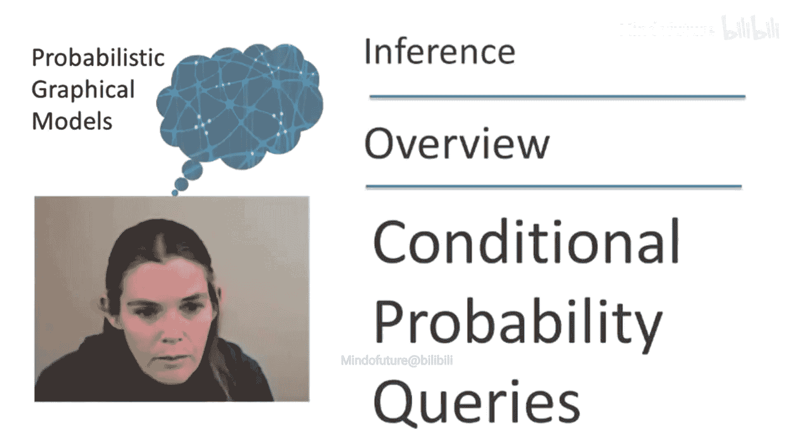
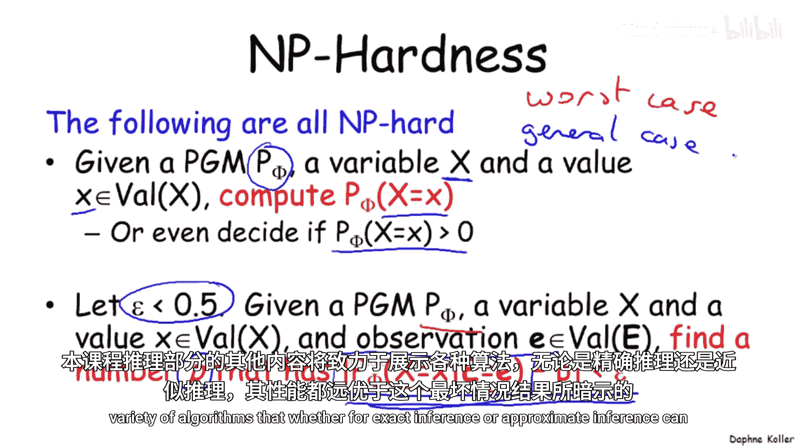
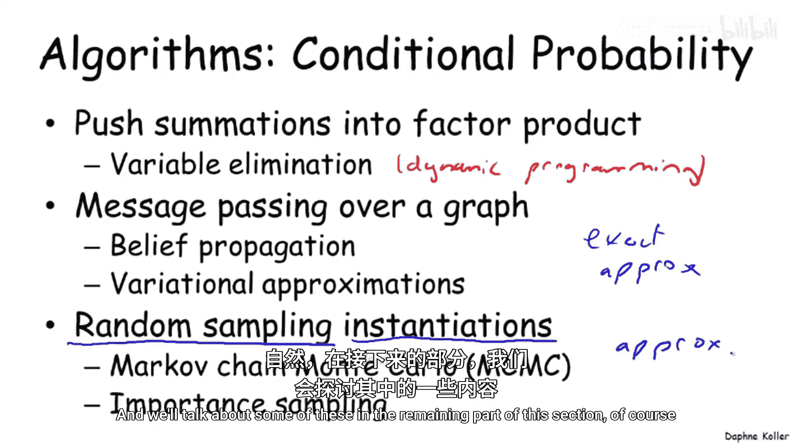

# 【斯坦福】概率图形模型2：推理 ｜ Probabilistic Graphical Models 2 Inference p01 P01_条件概率查询概述_01_01_01 -BV1fY6VBBEyo_p1-

So far we've talked a lot about the representation of probabilistic graphical models。

 we defined different classes of probabilistic graphical models， base Nes。

 MarkovNes and talked about their independence assumptions。

 Na as operationalized probabilistic graphical models and CiG how to use this declarative representation to answer actual queries。

It turns out there's many queries that one can use a PM to answer。

 but perhaps one of the most commonly used one is what's called a conditional probability query。

 so let's define a conditional probability query。

In a conditional probability query， we have some set of observations。E。

 little E about a set of variables， Big E， these are the variables that we happen to observe。

We also have a particular query that we care about。Which is。

Usually which we are going to denote as a set of variables， why。

So our goal here is to compute the conditional probability of the variables Y。

 given the evidence equals little E or a conditional probability。

This type of queryrry is useful for a variety of different applications， for example。

 in the medical or fall diagnosis domains that we've spoken about。

 we might have observations about certain symptoms or test results and we're interested in predicting the probability of different failure modes or different diseases。

In the pedigree analysis example that we also talked about。

 we might have observations about the phenotype or maybe even the genotype of some individuals in a family and are interested in reaching conclusions about other individuals。

So unfortunately， like most interesting problems， the problem of inference and probabilistic graphical models is NP heart so before we talk about that let's first remind ourselves what MP hardness is。

 I'm not going to define it formally in this course。

 but as a rough intuition if a problem isn't shown to be NP hard it means that it is extremely unlikely to have an efficient solution。

 slightly more formally it means that all algorithms that people have devised for this problem and a bunch of problems that are equally hard require at the very least time exponential in the size of the representation of the problem。

 which means that it's unlikely to be solvable for any problem that is bigger than a small handful of say variables in our context。

So which particular problems in the context of PGM inference are NP hard Well。

 first the basic problem of exact inference in a PGM is NP heart。

 so given a PGM P of phi defined by a set of factors phi in a particular target variable x and the value little x computing the probability of the event。

 x equals little x is NP heart。In fact， even a simpler special case of this problem。

 one where we just want to figure out if this probability is even positive， that too is NP heart。

So one might then say well okay exact inference is intractable but what about if we compromise a little bit on accuracy。

 what if we're just looking for an approximate answer after all we don't necessarily care about the1 significant digit in this probability does that make the problem easier unfortunately turns out that the answer is no and there is many different variants of n hardness results for approximate inference。

 this is just one of them this one says that again given a pGM and event x equals little x and some set of observations。

 the problem of finding an approximate answer P for which we are guarantee that this approximate answer is within epsilon of the truth is empty heart and this is true for any epsilon that's less than 0。

5 and note that epsilon equal to 0。5 can be obtained by simply random guessing or guessing the value equal to 0。

So any non trivial approximation for this kind of conditional probability query is also intractable。

So it's a rather depressing observation。And might want to make us give up on using PGMs for inference。

 but it turns out that one shouldn't get depressed too quickly because importantly this is a worst case result。

 which means we can construct these bizarre PGMs for which exponential time is the best we can do。

 but that doesn't mean that in the general case。One can't do better。

 and the rest of the inference section of this course will be devoted to showing a variety of algorithms that whether for exact inference or approximate inference can do considerably better than this worst case result would suggest。

So first lets to understand results might be where these algorithms might be getting their power。

 let's drill down into the inference question a little bit more。

 and here is a slightly elaborated version of our student network where we now have additional variables。

 for example， the coherence of a course influences。

 its difficulty and a variety of other variables that we're not going to talk about。

So inference in this model and in general， inference for probabilistic graphical model uses the notion of factors that we've talked about before。

 and it turns out that it's convenient to use factors because it means that the algorithms apply equally well to Baynets and Markov networks and it's a very useful abstraction。

 so let's think about this Bayesian network in the context of a set of factors so here for example。

 we had initially a prior probability over the C variable P of C that translates into a factor whose scope is C。

 we had for example， here P of G given I andD and that translates into this factor whose scope is G I andD and in general。

 each one of the CPDs in this network converts to a factor over the scope of the family that is the variable in its parents。

So now let's assume that our goal is to compute the probability of the variable J。

 and so we'd like to compute P of J。And what we see here is the joint distribution。

 so this is the joint distribution which we have defined using the chain rule for Bayesian networks。

In order to compute P of J， what we need to do is only to eliminate or marginalize out all of the variables except for J。

 and so we end up with a summation that looks like this。

Which is why this problem inference of conditional probability inference is often called some product because we have some overproduct factors。

The inference problem for Markov networks takes exactly the same form。

 so here we have once again a product of factors in this case the factors are the form in which the network is originally defined。

 so we have the factors phi 1 over A Phi 2， Phi 3 and Phi4 and if we're interested in computing the probability P of D。

 then once again we need to compute the product of these factors and then marginalize out。

Now what I wrote here is not actually quite right because the product of the factors isn't actually in Markov networks。

 P of ABCD， rather it's Ptilde of ABCD， which is the a normalized measure and in order to get the normalized measure。

 we need to normalize or，Divide by the partition function。

So how do we deal with that if our goal is to compute P of D？Well。

The point is that if what we have computed， if we ignore the partition function。

 and rather we compute Ptilde of D， we can infer that P of d is actually equal to 1 over z Ptilde of d。

Because the normalizing constant is a constant， and so if we've computed P tilde of D。

 we can obtain P of D by a simple process of renormalization。Of Pildo the。What about evidence？Well。

 evidence， it turns out， can be done by a simple preprocesing step of factor reduction。So here。

 if we're trying to compute the probability of a set of variables Y given evidence。

 that by definition is the ratio between the probability of y and the evidence divided by the probability of the evidence。

And if we look at the numerator of this expression over here。And define a set of variables。

 define W to be all of the variables that are neither queryrry。Nor evidence。

Then we can once again consider this as a sum product expression， So P of Y and E。

 we're going to introduce the variables W into this expression。

 So this probability over here is the sum of this probability marginalizing out the W。Now。

 if we now rewrite this expression。Over here， we can view it as a product of factors。

 And that's the case， whether it's a Bayesian network or a Markov network。

 And that product of factors is only those factors。

 which are only the components of those factors that are consistent with my evidence E equals little E。

 which means I reduce the factors by the evidence。 So to understand what that means。

 let's look at this example over here， And let's imagine， for example， that we have an observation。

Say a equals little a。 And we want to compute the probability of the distribution。

In the context of this observation， what that means is that we're going to take every single one of those factors equals。

 say equals a 0。 We're going to remove。From every factor that involves a。

The entries that correspond to a equals little a1。Because those are not going to be consistent with our observation as little A0。

Once we've reduced those factors to be consistent with those evidence。

 we have now still a product of factors and we can go ahead and treat it in exactly the same way as we did before。

And so we now have sum over the variables W that need to be eliminated of the product of the reduced factors。

 And once again， we can ignore the partition function by computing。This probability。And then。

 renormalizing。At the end。This applies equally well in the context of Bayesian networks so here we might have say the observation I equals little I and H equals little H。

 so now this is no longer an equality but rather because we have not yet conditioned on the evidence and so if we want to make this equal。

 we have to reduce each one of the factors involving I and H based on the evidence。

 and so this turns into phi I of little I， which as it happens is a constant there's no other variables in the scope and similarly here。

And here and for the H equals little H。😊，We do the same thing。

 which in this case involves only the staff over here。And now it's back to being in equality。

And if we want to compute probability of J given。I equals little I and H equals little H。

 We take this summation。And renormalize。Just like before。

So to summarize the some product algorithm can be done as follows。

 it looks at you convert the conditional probability into a ratio。That the numerator of this。

Ratadio is a product of reduced。Factors。Someund out。Over the remaining variables。The denominator。😮。

Of this is simply the numerator summed up over the variables over the query variables why。

And if we divide these two together， we realize that we can get away by computing simply this product of reduced factors and normalizing at the end。

There are many algorithms for computing conditional probability queries。

One of those involves pushing the summations into the factor product。

 this gives rise to an algorithm called variable emination。

 it turns out to be a special case of a class of algorithms called dynamic programming。

And it's a form of exact inference。A generalization of this algorithm performs message passing over a graph that also effectively deals with summations。

 and factor product and factor summation。And theres many variants of this algorithm。

 some of which are exact and others are approximate， here are some names of algorithms。

 only some of which will have an opportunity discussed and then finally there is a very different class of algorithms that uses random sampling as the key for as the key technique and it samples complete instantis or assignments in a variety of different ways and uses those assignments to approximate the probability of a particular query。

 so here we have both exact and approximate。Methods， and this is an approximate method。

And we'll talk about some of these in the remaining part of the section， of course。

