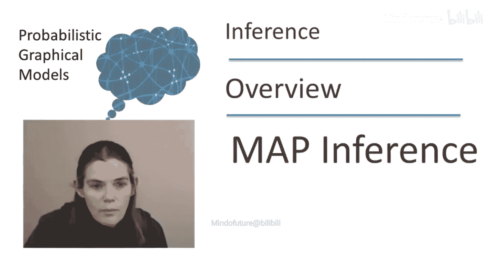
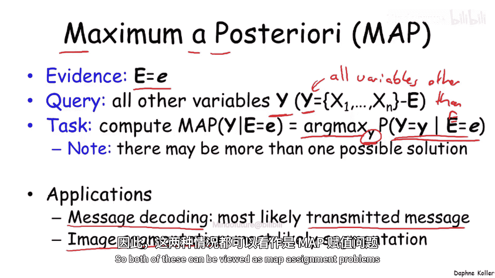
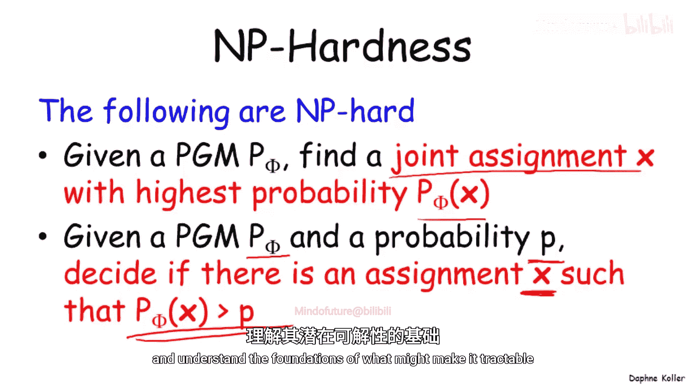
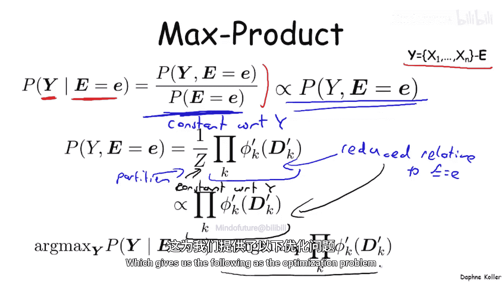
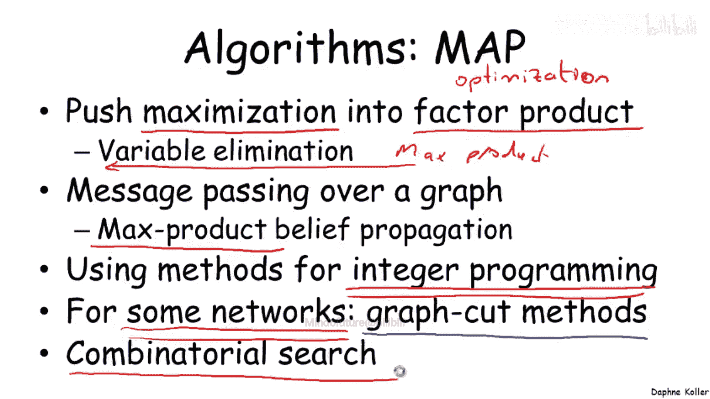
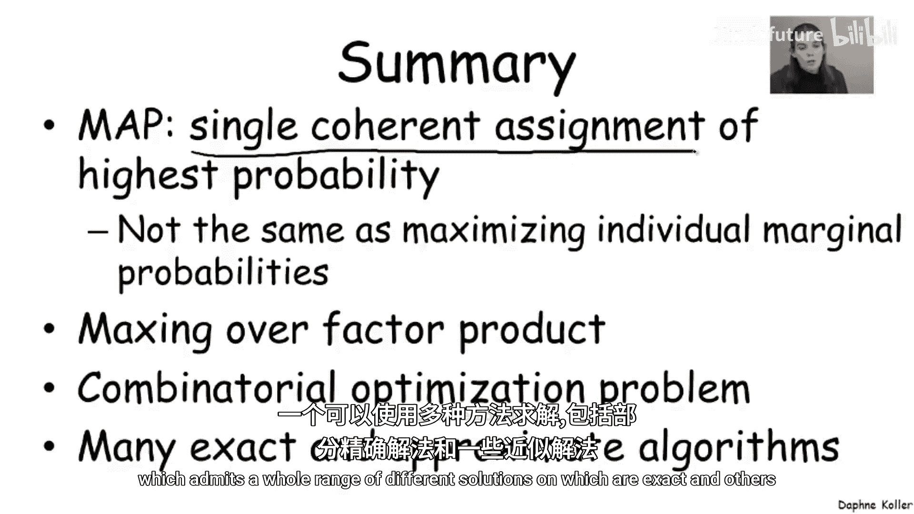

# 【斯坦福】概率图形模型2：推理 ｜ Probabilistic Graphical Models 2 Inference p02 P02_最大后验概率推断概述_01_01_02 -BV1fY6VBBEyo_p2-

As we said， there is many different kinds of queries that one can use a graphical model to answer。

 Conal probability queries are very commonly used， but another commonly used type of inference is what's called map inference。

 So what is map inference。

Map stands as a shorthand for what's for maximum。posterii。 And it's defined as follows。

 Here we have a set of evidence of observations is little E over some variables of E。

 And we have a queryrry Y。 And it turns out that for computational reasons that we're not going to discuss for the moment。

 it's important that the set of ys is everything， all of the variables other than E。

So now our task is to compute what's called the map assignment。

 which is the y the assignment little Y to the variables y that maximizes the conditional probability of the variables Y given the evidence。

Now， so for those of you who haven't seen the notation AG Max， AG max is the Y。

That provides the maximal value to this expression over here。

Now note that in some cases this maximizing value might not be unique。

 that is there might be several different assignments。

 say y1 and y2 that give the exact same probability。

 and so the map is not necessarily a unique assignment。This has many applications。

 some of which we've discussed before， so in the context of message decoding， for example。

 where we have a set of noisy bits that are passed over the channel。

 over noisy communication channel， what we often want to get is the most likely message that was transmitted。

 that is an assignment to the transmitted bits that is the most likely given our evidence。

In the context of image segmentation， we would like to take the pixels and figure out the most likely assignment of pixels to us to semantic categories。

 so both of these can be viewed as map assignment problems。

Now an important thing to understand about map is that it really is a different problem than conditional probability queries so understand that let's look at the following very simple example over just two random variables so here we have a Bayesian network over the variables A and B and if you multiply the two CPDs its you get the joint distribution shown over here and it's not and it's fairly immediate to see that the map assignment is this one because it has the highest probability。

😊，Can we get at the map assignment by looking separately at the variable A and at the variable B so if we look at that。

 we see that if we look separately at the variable A。

 we the most likely assignment to the variable A is a1 as opposed to in the map assignment。😊。

The variable a took the value a0， and so one can't look separately at the marginal over a and over B and use that to infer the map assignment and the reason is that we're looking for a single assignment over all of the variables that together has the highest probability。

Unfortunately， just like the conditional probability inference， however。

 this problem too is empty heart， so again let's formalize what exact problem is empty heart in this context and so here's again。

 one example of an empty heart problem in the context of math。

 which is just to find the joint assignment with the highest probability。😊。

It's not the only NP hard problem， here is another one。

Figuring out for a given probabil graphical model and some threshold little P。

 whether there exists in assignment little X whose probability is greater than P。

 That problem too is NP P hard。So should we give up， well。

 just like in the context of conditional probability queries。

 the answer is no and there's algorithms that can solve this problem very efficiently， in fact。

 in an even broader set of problems than for conditional probability queries。

So let's again look deeper into this problem and understand the foundations of what might make attractiveable。

So。Going back to our example of a Bayesian network， once again， we're going to view CPDs as factors。

 So here a P ofC again translates into a factor over C just like before。

 and whereas in the case of conditional probability queries we wanted to sum out some of the variables marginalize them Now we're going to what to find the Argm。

 which is the assignment to all of these variables， which maximizes the product。

 And so here we have a max。Of a product， which is why this is often called a max product problem。

Let's break down the max product problem， so imagine that we in more general have and the more general case have a probability over y given e equals little E and let's remind ourselves that y is the set of all variables other than the ones in E and so by the definition of conditional probability we have this ratio where we're trying to find the maximal y that maximizes this ratio and notice that the denominator。

Is constant relative to why。Sorry， yes， with respect to Y。

 which means that for the purpose of finding the maximal y。

 we don't really care about the denominator， only the numerator。

 which is the probability of y comma E equals little E， the unormalized and unormalized measure。

This numerator in the general case is a product of factors。Normalized by the partition function。

Where the factors here are the reduced factors。Reduced relative to the evidence。哦。Once again。

 we notice that。This。Is the partition function？And it's constant。Relative to why。

Wwhichch means that we can ignore it and so once again we have that this expression is now proportional to a product of the same reduced factors and so what we're trying to do is we're trying to maximize a product of factors in this more general case as well。

Which gives us the following as the optimization problem。

There's many algorithms that can solve the map problem The first is analogous two algorithms for some product。

 these algorithms take the maximization operation and pushes that into the factor product giving rise to a max product variable emination algorithm。

We also have message passing algorithms， which， again。

 are a direct analog to algorithms for some product。

 and they give rise to a class of algorithms called Max product belief propagation。 However。

 because the map problem is intrinsically an optimization problem。

One can also call on techniques that are specific to optimization。

And the class of such methods include methods that are based on integer programming。

 which is a general class of optimization over discrete spaces。

 it turns out that this class of methods that build on integer programming techniques is one of the most popular methods in the last few years and has given rise to a whole new range of map algorithms that are considerably better than many of the previous algorithms developed up to that point。

 especially for the approximate case。😊，It also turns out that for certain types of networks that some of which will discuss。

 there are specific algorithms that are very efficient for that particular class of graphical model。

 and one of those perhaps the most commonly used， but not the only one is methods based on class of algorithms called graph cuts。

😊，And finally， because it's an optimization problem。

 one can also use standard search techniques over comminatorial search spaces。

 and there are problems for which this is also a very useful and successful solution。

So to summarize， the map problem aims to find a single coherent assignment of highest probability。

 and that means that it is not the same as maximizing individual marginal probabilities as we saw in the example。

One can reformulate this problem as one of finding the max over factor product。

 and this is a comminatorial optimization problem which admits a whole range of different solutions on which are exact and others approximate。

