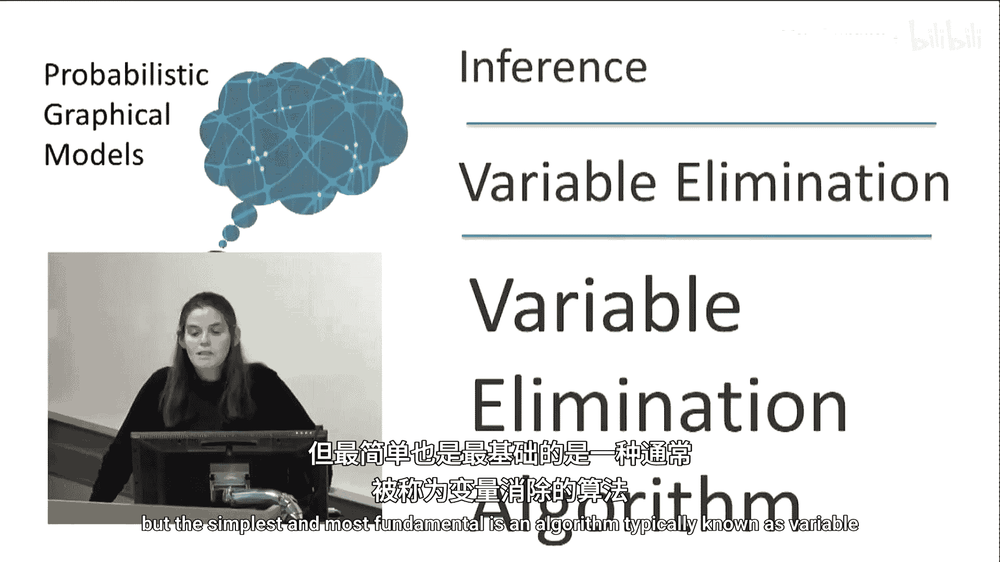
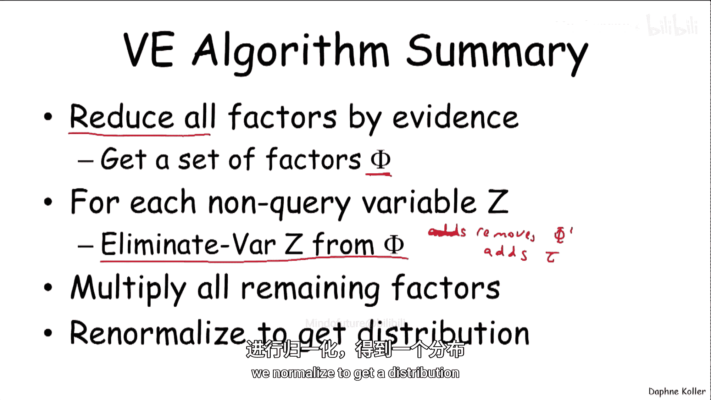
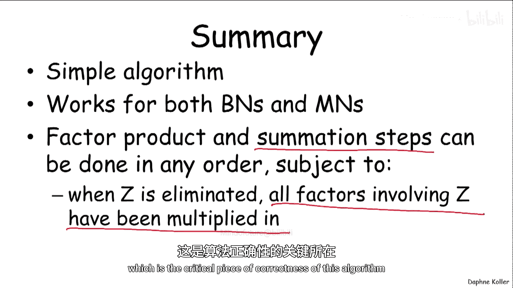

# 【斯坦福】概率图形模型2：推理 ｜ Probabilistic Graphical Models 2 Inference p03 P03_变量消元算法_02_01_01 -BV1fY6VBBEyo_p3-

We've already said that there is many different algorithms for inferencing graphical models。

 but the simplest and most fundamental is an algorithm typically known as variable in nation。

Let's consider the variable emination algorithm in the context of a simple example of a graphical model structure as a chain。

Here we have， we're interested maybe in computing the distribution over variable E。

 so we're interested in P of E， and as we've already said that probability is proportional to the unnormalized measure P tilde over AB。

C， D and E， suming up all of the variables except for E。

So now let's see how we can do this more efficiently than simply constructing the joint distribution and then summing things out。

So the first thing we do is we write up this unnormalized measure as a product of the constituent factors。

 and for the moment we're going to assume that we only have pairwise factors for the edges in。

This graph， so we have a factor for AB， a factor for BC。CD and V。

 So those are the factors Phi1 up to P phi4。Now what is the first observation that we have when we see the summation over ABC and D of a product of factors Well。

 we've already done this exercise previously when we were doing some proofs related to graphical models that if we have a factor that doesn't mention a particular variable in its scope。

 we can move it out of the scope of the summation， so specifically phi2 of BC can be moved out of the summation over a as can phi3 of CB and Phi4。

Of the E， which leaves us only with the summation over a of Phi1 AB。

So that gives us the expression over here now this is。Now this is a summation over a pairwise factor。

 and the result of this is a factor over a single variable B， which we're going to call tau1 of B。

And so we end up with an expression that looks like this。So now let's continue this expression。

 developing this expression further。Noting that we now have an expression that doesn't involve A。

 only the variables B， C， D， and E， so that effectively we've eliminated A from our graphical model。

So let's go back to this expression， we now have this product of four factors and once again we can look at what factors involve the variable be in which ones don't and the ones that don't。

Can be moved out of the summation just as before， giving us this where now we have an expression。

 which is a product。Of these two factors on that over B。

 And this is going to give us an expression how2 whose scope is C。

And so we now have an expression that does not involve the variable B。

 and so now we've eliminated B from this graphical model。

 and we can similarly continue to eliminate C and D so that ultimately we'll end up with an expression that involves only the variable E。

 and that expression is going to be proportional probability to the marginal probability of B。

Now let's do this algorithm in the context of a somewhat more complicated example。

 which is our enhanced student network that we've played around with before。

So let's imagine that our goal is to compute the probability of the variable J。This one。

 and in order to do that， we're going to have to eliminate from the joint distribution。

 all of the other variables except for J。So this is our expression and note that we have this product of factors。

 I've taken already in this expression the factors that were the CPDs and turn them into factors so that we can have a consistent notation。

 and now we need to eliminate every one of the variables except for J。

So we're going to start with eliminating the variable C。First。And。And so once again。

 we're going to take the summation over sea and we're going to push it in。

 leaving in the summation only。The factors that involve C。And those are Phi D and Phi C。

Multiplying them together and eliminating C is going to give us a factor。

 which we're going to call tau 1。And whose scope is the？诶。

And by putting T 1 into this expression and removing the ones that we've just multiplied together。

 we end up with this expression。Over here。Having eliminated C， we now go ahead and eliminate D。

So here we have the variable D and which factors involved D well tau 1 of D and phi g of G and D。

 and so everything else is taken out of the summation and we just have this expression over here。And。

That's going to give us。Tau2， whose scope is G and I after having eliminated the variable D from this product。

 whose scope is G I？AndD。And T2 gets put back into the bucket。Together with everything else。

Moving forward， we're now interested in eliminating I。And so the factors that involve I are Tu2。

Of G and I and phi S of S and I and phi I of I and so。We go ahead and multiply them together。

To give us a factor whose scope is G comma I comma S， and eliminating I gives us a factor。How three。

Whose scope is S& G？And so the process continues and let's just finish it all the way to the end。

 now our goal is to eliminate H。 Well H is a little bit of an interesting case。

The only factor that mentions H is this factor5 of H。 and if we think about what5 of H is。

5 of H as it happens。Is P of H given GNJ？And so if we're summing that up over H。

 we're actually summing up what is in fact a conditional distribution。

 and since we know that a conditional distribution。

 when you sum up on the values on the lefthand side。

 the summation necessarily is equal to one So in principle。

 we could have taken this entire expression。Esed it and written one instead。

 and that would have given us something that is a factor that doesn't depend on anything would have just disappeared。

But for purposes of demonstration， we're not actually going to do that because in fact。

 not every algorithm is clever enough to notice these kinds of coincidence。

 as it depends whether they were designed to look for that。

 and so we're going to do this the same way in the same sort of naive way that we've done before。

 which is just to turn this into a factor which is going to be tau4 of G comma J。

So now we have that factor， which really is one， but we're not going to pay attention to that particular aspect for the purposes of demonstrating how the algorithm would work。

Okay， next is eliminating G。And we have this expression， which we inherited from the previous slide。

 and G is one of the big ones because it appears in。嗯。fi l。Pow 3 and PAu 4。

 so when we think about the variables here in the scope。

 we see that this one actually has this product over here。

 actually has a scope of L comma G comma S comma J， which is the largest factor。

 the one with the largest scope that we've encountered so far。Summing al genee。

 we end up with a factor whose scope is。LS。And J， so we're missing an S。And and now we put that into。

This expression and outcomes a now product of two factors。

 and really at this point we may as well just multiply them and end up with a factor。Over J。And。好吧。

So that gives us variable elimination in its naive form。

 what about variable elimination with evidence？Well。

 we've already basically established how to deal with evidence。 If we're interested in deal in。

 for example， solving the query probability of J。Coma I equals little I。Coma H equals little H。

 the way in which we do that is by computing the probability of the joint event。

 J comma I equals little I comma H equals little H。

 and the way in which we do that is by reducing the factors to correspond to this scope。

And so these were， so we take each of the factors that involved I and we basically instantiated to take a particular value for that I。

 the value little I and similarly for H。And so we see here， for example。

 that whereas phi I initially dependent on I， now it doesn't depend on anything because this is simply the value phi I of little I。

 which is a constant。And whereas， for example， G depended on D and I。

 as we can see in the original diagram， here， phi G in the reduced factor doesn't depend on I and is really probability of G given little I and D。

And the same reduction occurs for H equals H。 so we end up with a following set of reduced factors。

 and now once we have that set of reduced factors， we do elimination as exactly as before。

No changes whatsoever to the algorithm。The only aspect that's a little bit different is notice that we don't eliminate。

No H and no I， because there's no point eliminating a variable that has a single value。

 there's no need to sum up over it when it only has a single value。

So would this give us a unified framework for dealing with queries。

 whether they involve evidence or not？And then how do we get the probability of J given the evidence？

This is straightforward， we simply renormalize。Because we can take this。

And simply divide by what it turns out to be the probability， the normalizing constant。你是。Okay。

So let's see whether the same idea applies to Markov networks。

 so here is our simple Markov networks network with four variables。

 let's imagine that our goal is to compute P of D and so in order to do that we need to eliminate A B and C from the unormalized measure so we have this being the unormalized measure and we're summing up over A B and C and the process works in exactly the same way。

 so if we want to sum out A first then here is the factors that involve a P1 and AB this one。And 5。

4 of AD D multiply them together。 We get a factor whose scope is A B D， and then we sum out a to get。

A factor whose scope is BD。That gives us a new set of factors where A has。Effectively。Been。

Eliminated from the graphical model。And at the end of the process。

 we get a factor over the single remaining variable D。 So tau 3 of D and that。

The factor is not the probability of D。 It's proportional to。The probability of D。

It's actually equal to。Pilde of D， which is the unnormalized measure。And so in order to get P of D。

 we renormalize。So to summarize the main routine in this algorithm is something as a routine which we call eliminate variable Z from a set of factors phi。

 and what it does is the following， we first look within Phi。

And we defined a set of factors phi prime， which are all factors that involve E。Yeah。

And that's what this mathematical expression says the factors Phi I such that Z in their scope。

We take all those factors and we multiply them。And then。We sum out。The variable Z。

 which is the one that we want to eliminate。Now， and here is the important point。

 We've already used up these factors， these ones over here。Have now been used。

We don't want to reuse them。And so we take them out。Of。A set of factors。

 and instead we introduced the one that we just created by multiplying those factors and summing them up。

This basic operation is what we use in the context of the algorithm as a whole。

 we begin by reducing all factors by the evidence。But which is just eliminating the rows that are not consistent with the observations。

 and that is what gets us our set of factors phi。Now， for each non query variable。

 we need to eliminate it。 and so we run one at a time， something that eliminates。

The variable Z from the set of factors phi， each such step changes my set of factors。

 It adds factors。And removes so actually starts by removing factors。

Which we phi prime from the previous line， and it adds a new factor tell。And then finally。

 at the very end， when all variables have been eliminated。

 there may be one or more factors remaining， so at that point we multiply all of the remaining factors and then weorize to get a distribution。

So to summarize， this is very simple algorithm。It works equally well for basenets and moreovnets。

And it uses a factor product and factor sumation steps。

 and it does that by ensuring that when you sum out a factor。

 when you do the summation step over a variable Z， then all factors involving Z have been multiplied in。

Which is the critical piece of the correctness of the algorithm。

