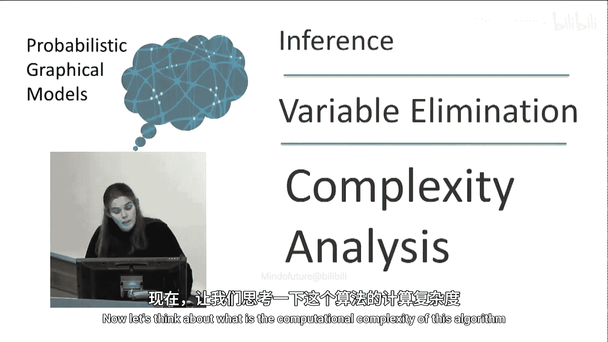
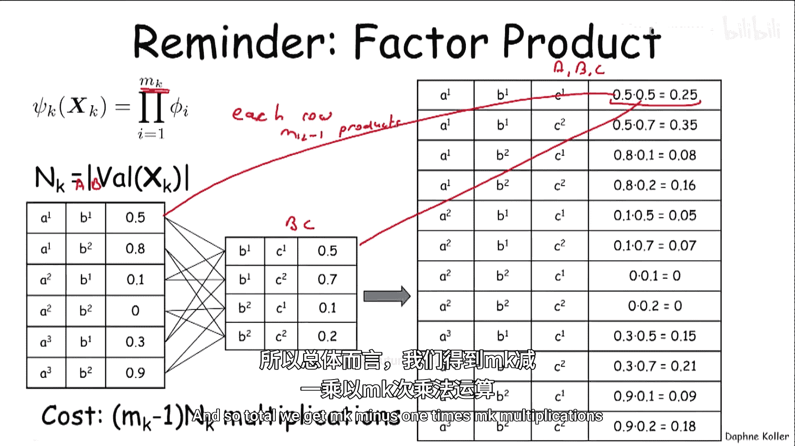
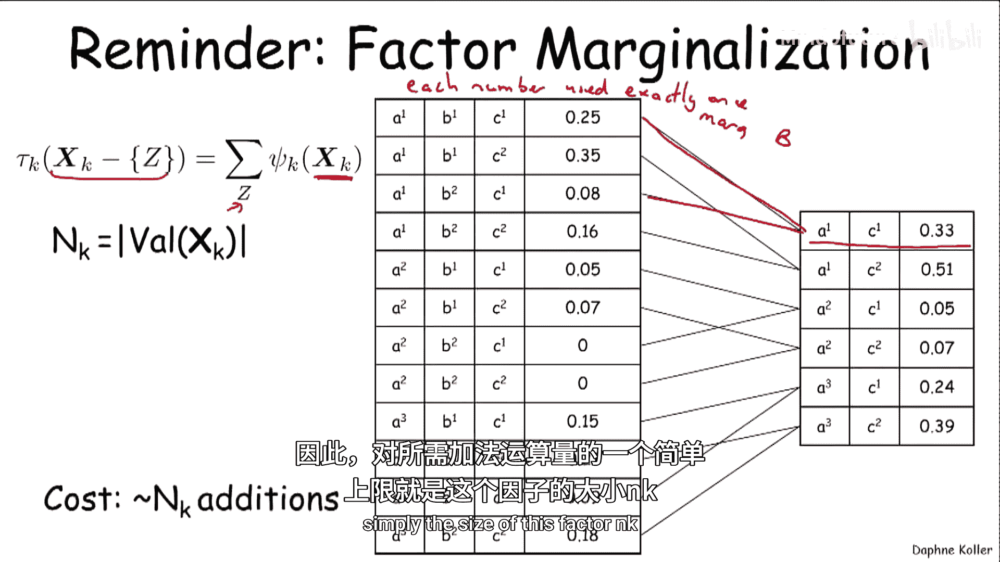
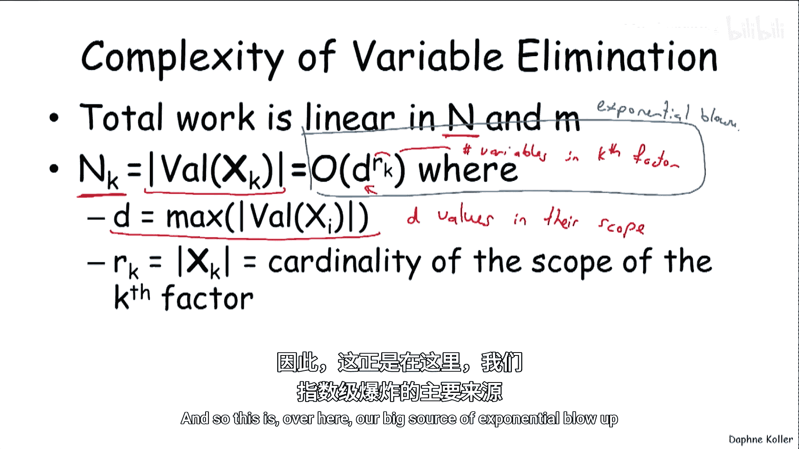
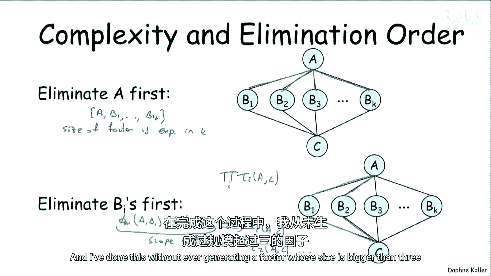
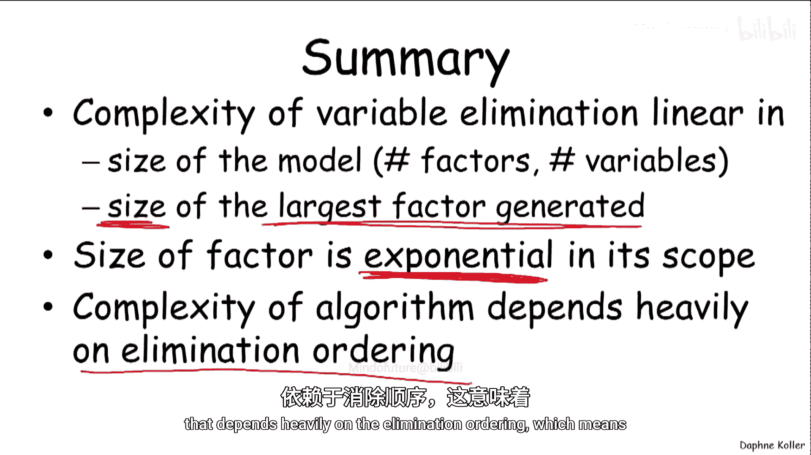

# 【斯坦福】概率图形模型2：推理 ｜ Probabilistic Graphical Models 2 Inference p04 P04_变量消元的复杂度_02_01_02 -BV1fY6VBBEyo_p4-

So we've previously presented the variable elimination algorithm。

 now let's think about what is the computational complexity of this algorithm。

So let's first look at the basic operations that are used when we do an elimination step。

 and there's these two basic operations， there's a factor product。And the actual marginalization。

And so what we're going to do now is we're going to count the operations used by each of them。

So let's start with a factor product。And first， let's remind ourselves what factor product is doing。

 so factor product is taking， in this case， for example， a factor whose scope is AB。

And one who scope is BC and producing a factor whose scope is ABC。

Now let's think about how each of the numbers in this result is produced。

 so each of these is a product in this case of two numbers。

 one that comes from this table and one that comes from that table。

So we have to produce every one of the rows inness in this new table and this new factor。

 so let's call NK the number of the rows in this new table and how many operations are there that we need to produce each such row。

 well if we need to multiply in in this case， MK different factors， so for each row。

We have Mk minus1 product。And so total， we get Mk minus1 times Mk multiplications。

Now let's look at the factor marginalization， so here we had a factor whose scope was xk。

 we summed out z and we end up with a factor whose scope is1 less so again let's remind ourselves this is a marginalization in this case over B so marginalized B。

And we see that each of the rows in our output is produced in this case， by summation。

Of two of the rows in the original factor。But if we turn this on its head， we also see that each row。

So each number in this factor is used exactly once。嗯。

Each one gets added to only one of the rows in the new factor。

And so a simple upper bound on the amount of additions that we need to do is simply the size of this factornk K。

So now let's total up the computational complexity of variable emination。

 So let's assume that we start with M factors。 for Bayesian networks。

 M is really effectively N because we have one factor。For every variable。Which is the CPD。

And the reason I wrote less than or equals because of the reduction by evidence。

Now for Markov networks it can actually be larger， so if you think of a grid Markov network or a fully connected Markov network。

 the number of factors might be so fully connected pairwise Markov network。

 the number of factors can actually be larger than the number of variables。

 so that's why we have the complexity in terms of M as opposed in terms of N。Now。

So that's the set of factors that we start out with。

 and then what happens as we do an elimination step， an elimination step takes some of those factors。

And generates another factor。 But each elimination step generates exactly one factor。

How many elimination steps do we have？Well， each elimination step corresponds to an elimination of one variable。

 so we have it most n elimination steps。So the total number of factors that we ever produce is which we're going to call M star is going to be equal to at most。

M， which is the set of initial factors， plus the newly generated factors， which is at most n。

And so altogether， M star is less than or equal to m plus M。So now that we've figured that out。

 let's look at what the complexity of the algorithm is in terms of various key quantities。

Is the size of the largest factor that I ever create。

 which is the max of these different NKs that I had。

So now how many product operations do we have well remember that we had a sum over different elimination steps。

 so some were okay， and this was the number of product operations that we have。

But now here is the critical observation。Each factor。Is multiplied in。most onces。

Because as soon as we multiply it in。As soon as we multiply it in， it goes away。

Which means that the sum over k Mk minus-1。Is it most the total number of factors？

And so so said otherwise， we can write that this is less than or equal to n times the sum over k。

MK minus1， and this is less than or equal。To Mstar。

Because this is at most the total number of factors in my universal factors。

What about the number of summation operations， well here this is less than or equal to？

The sum over K and K， which when you。Which is n times less than or equals to n times the number。

Of eumination steps。Which is simply less than or equal to n times。

So altogether between these two steps over here we have n times m star over here we have n times n。

 which tells us that the total work that we have is linear in n。And an M star。Great linear time。

 aren't we lucky？Well， not quite because。The NK， which is the contribution to this quantity N。

Is the total number of values in a factor？And so if we let if we say， for example。

 just for simplicity， all variables have d values。In their scope。So that， for example。

 all variables are binary that would be d equal to2， for example。

Then the number of values in a factor is exponential where the base of the exponent is D and the exponent is the cardinality of the scope of the case factor。

 that is the number of variables。In the case factor。And so this is over here our big source。

Of exponential blowup。

So let's understand how this complexity manifests in the context of a real example。

 so this is the run of variable elimination that we did before。

 I've just written it out all in one slide。And so now let's see what the complexity of this is。

 we see that we have produced several factors here。

 and let's write down how many variables are in the scope of each of these factors， this one has two。

This one has three。G I and D， this one has3 S G and I， this one has3 H G and J。

 this one has4 L GS and J， and this one has3 JL andS and so the size of the largest factor is it is this one that has four variables in it and that is what's going to in general drive the complexity of the algorithm。

Not in an example as simple as this， but in more realistic examples。

So now let's understand how elimination ordering plays into this。

 we've previously said that variables can be eliminated in any order so long as we're careful about multiplying things in at the appropriate time。

But now， let's see how elimination order might affect the complexity。 So assume that in this example。

 I'm going to make a not very judicious decision， and I'm going to start by eliminating G。

So which factors do I need to multiply in in order to eliminate G Well， phi L of L and G。

 phi G of G I and D？And Phi H of H G and J。And so if I multiply all these together。

 it turns out that I now end up with a factor whose scope is， let's see， L，D， I， D， H。And J。

 so a total of six variables， whereas before the largest factor that we ever generated had four variables。

So that maybe you might say six versus four， not a big deal， I mean。

 it's how much difference does it make？So let's convince ourselves that in other graphs。

 it might make a bigger difference。So here is a graph that has it's a simple pairwise Markov network with A and C and then a bunch of variables in the middle B1 up to BK and imagine that I start by eliminating A first Well。

 what are the factors that involve A？Well， we have。A factor A B1。A B2， A B3 up to A B K。

 and the total scope of the factors is of this factor that we generate is going to be A， B1。Up to Bk。

So it's going to be exponential in K。 So the size of the factor。Is exponential。Okay。

Maybe this is inevitable。Well no， so let's imagine that instead we're going to eliminate the B's first so let's think for example that we're going to start by eliminating B1 well B1 is in a factor with a and then a factor with c。

 so we're going to end up with a product of say phi1 phi a1 of a comma B1 times phi C1 of c comma B1 and that's going to give me a factor whose scope。

Is。A。B1 and C。 and the result。Of summing out， B1 is going to be a factor tau 1 of A and C。

We're going to get the exact same behavior when we now eliminate B2。

 and that's going to give me a factor tau2 of A and C， and so on and so forth。Until at the very end。

 I'm going to have a bunch of factors。 how I。Of A and C that are all multiplied together。

And I've done this without ever generating a factor whose size is bigger than three。

So to summarize， the complexity of variable elimination is linear in the size of the model。

 the number of factors and number of variables， and more importantly， in the size。😊。

Of the largest factor generated during the course ofvari elimination， and unfortunately。

 that size is exponential in its scope。And that is the thing that drives the complexity of variable elimination。

And we've also seen that the size of this factor is something that depends heavily。

On the elimination ordering， which means that choosing a judicious elimination ordering is important。

