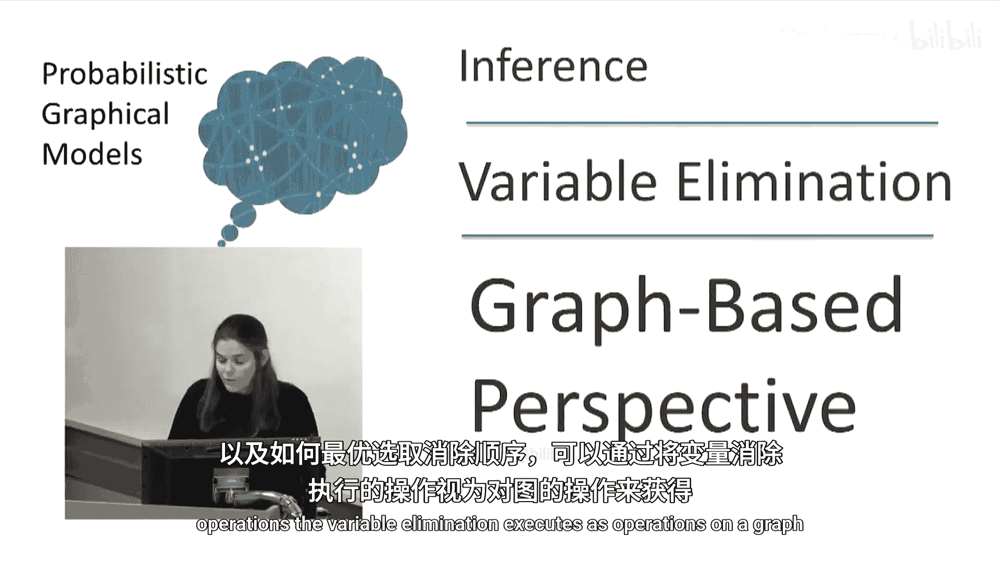
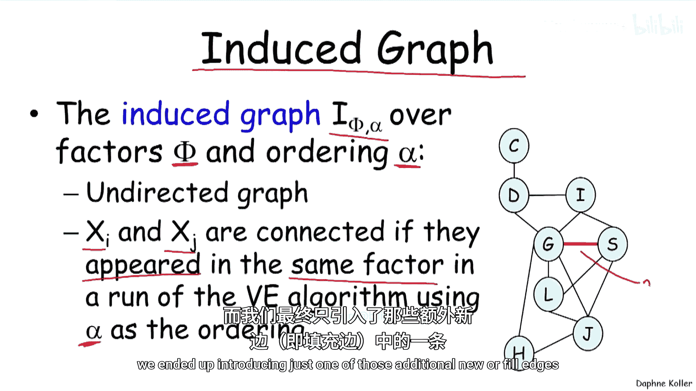
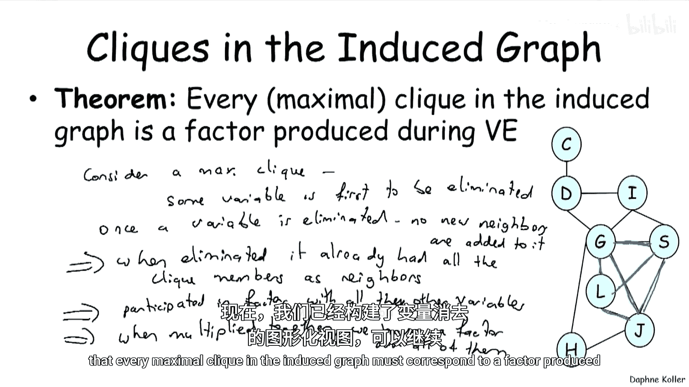
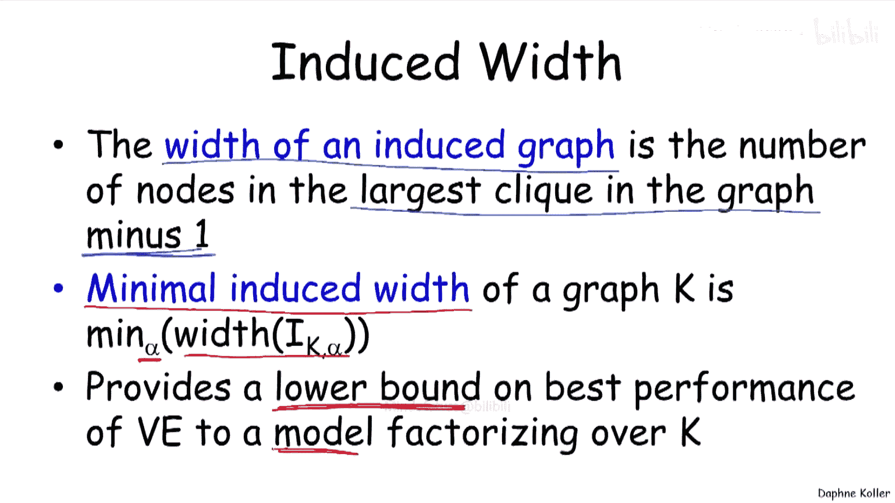
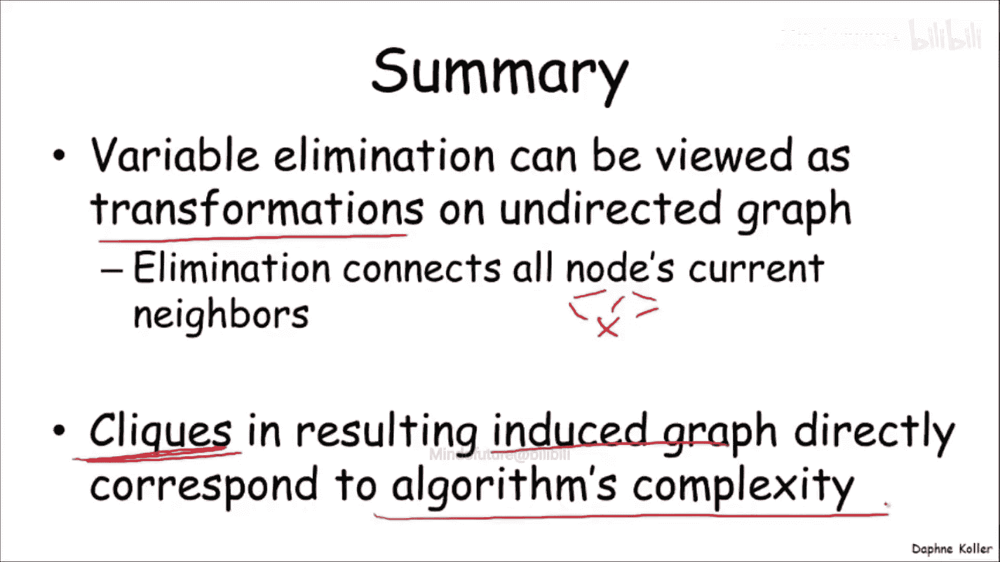

# 【斯坦福】概率图形模型2：推理 ｜ Probabilistic Graphical Models 2 Inference p05 P05_基于图的变量消元视角_02_01_03 -BV1fY6VBBEyo_p5-

Very important insights about variable elimination and how to best pick the elimination ordering is provided by thinking about the operations that variable elimination executes as operations on a graph。

 So let's see what that does。

So let's consider the initial graph in our example and let's first view this graph in terms of the factors that it involves so if this is the set of factors that we have in our analysis viewed as undirected viewed as simply as factors so what is the structure of the graph that corresponds to this set of factors Well first we're going to make all of the edges undirected。

 but that's not enough because we see for example that we have a factor here which is a factor over G I and D and so what we need to do is we need to and an edge between I and D to represent the fact that they're together in a factor。

Other examples in other cases where we need to do this correspond to the other V structures that we have in this graph。

 so here for example we have a V structure involving J。

 so we're going to need to connect J's two parents and similarly for H's two parents。This step。

 by the way， is called not by me， moralization。Because of the dubious moral value of marrying the parents of a child。

 no matter how many of them there are。And so I did not invent that name。

So having moralized the graph， we now have this version of it。

 And this is what we previously defined to be the induced。Markov network。

Or the current set of factors。So now let's think about a variable emination step and what it does to this graph。

So let's begin by eliminating C and if you remember that involved this operation。And so first。

 eliminating C is changing the set of factors it removes these two factors over here from the set。

And introduces a new factor Tu one of the。So the induced graph is now going to look like the following。

 they can see out。And this， the remainder is the induced graph over the set of factors。 Okay。

 now we're going to continue。 We're going to eliminate D。 So once again。

 we're going to take the two factors that we've now introduced。 sorry。

 these two factors that are involved here， which is tau1 of D and phi G of G I and D。

 going to multiply them and going to eliminate D。And so the resulting and then the resulting graph is now going to look like this。

WhereAgain， the noses with the dashed edges are not really there。

 they're just there to remind us that they were there before。Continuing on。

 we're going to eliminate I， and that involves multiplying in。This term。

 this term and this term and now something interesting is going to happen the factor that we introduced。

 which is tau 3 of S and G is a factor that doesn't have an edge in the current graph so if we're interested in having this graph represent our current set of factors we are going to need to introduce this edge between G and S。

Because that edge is necessary because S and G are together in the same factor。

So that edge is called a fill edge。It's an edge that I had to introduce。

Because of the elimination ordering。So one way to think about this is using the following example imagine that every variable that's eliminated is going off on a trip around the world and when it's doing that it's throwing a big goodbye bash and inviting all of its friends to come and join it And when it does that。

 all of its friends get to meet each other and say， oh you guys are nice。

 I'm going to be your friends too And so all of the friends of the variable that's eliminated。

 become friends as a consequence of the elimination stuff。😊，Okay。

 so let me write that down all variables。Connected。True， in this case， I。

Become connected after it's eliminated。 So become connected directly。

And that's a general consequence of the elimination step process is that the previous ones didn't happen to introduce fill edges。

Okay let's continue so now we're going to eliminate H H also doesn't introduce any fill edges and so we're going to end up with that and basically the remaining steps are pretty mundane we're going to eliminate G L and S and we're going to end up with the following graph so this particular variable elimination process only introduced one fill edge which is a fairly conservative thing and shows that we selected a pretty good elimination ordering in this case。

So we can now take and put all of these edges that we ended up using together in a single graph。

 and that graph is called the induced graph。And the induced graph， which is denoted I for induced。

Phi comma alpha over a set of factors phi and induced by a particular ordering alpha。

 because you remember that we were getting different complexities and we're going to have different fill edges depending on the order in which variables are eliminated。

 So this variable， this induced graph has the following properties。

 It's an undirected graph where we connect every pair of variables， X I and Xj。

 if they ever appeared in the same factor when we ran variable emination using alpha as the ordering。

And so in this case， all of the original， all of the black edges were there to begin with。

 and we ended up introducing just one of those additional new or fill edges。

So nows there's some interesting properties of the induced graph that are worth noting。First of all。

 there's properties that relate factors produced during variable elimination。

And cliques in the induced graph。 So first all， let's define what a cleeique is。A clique。

Is a maximal。Hoully connected subgraph。So let's parse that too。So， for example。嗯。

D IG here is a fully connected subgraph because all of its three nodes are connected to each other and it's maximal because I can't add any other variable to this and still have that property to hold。

 So if I try and add S for example， then S is not connected to D if I try and add C C is not connected to IRG so I can't add any other variable to this particular clickique。

 so it's a clickique。Here is a clique that's not maximal。So here is- so it's not a clique。So， GL。

A is a connected， fully connected subgraph， but it's not maximal because I can add S。

And still have that old。 So here is another cl in this graph。 So we have G I D being one click， G， S。

 L And J being another cl。 We're going to have a third one， which is。G， S and I。Another one。

 which is C。 And let's see if I have enough colors to do this。And a final one， which is G，H and J。

And if we now look at the factors that we produced in the course of variable emination。

 we see that there is an exact correspondence between the factors and those cliques。 So here。

 for example， the yellow one。Is C。Which is this one over here。This one over here， which is GID。

Is the red one。This one。So that's the red one。This one has SIG。So that's the green one， this one。

This one is HGJ， which is the brown one。How5 induces the big factor。

 the one that involves four variables， and that's the blue factor over GSL and J。H。

And this one doesn't actually introduce any new cliques。

 which is why it doesn't have any cliques associated with it。

So every factor produced during variable emination is a clique in the induced graph。嗯。

We can equally well check， and we saw that in the previous slide already。

 that every maximal clique in the induced graph is a factor that's produced during variable elimination。

So we've demonstrated this to ourselves by inspection， but let's actually do proof of this。

So let's consider a maximal clique in this induced graph， so let's consider， for example， GSL and J。

That's a maximal clique。And now let's consider the run of variable emination。

 and one of those variables has to be。One of those variables has to be the one to be eliminated first。

So some variable in this clickique。Some variable is first to be linked。Well。

 what happens when a variable is eliminated？Once it's eliminated。ItIt doesn't。

Have any more edges that get added to it。 So once the variable is eliminated。

It has no more no new neighbors are added with。Which means。The app。The time that it was eliminated。

It had all the neighbors that it had in the clique。All the cleek members his neighbors。

But if that's the case。Then it means that it had factors。Involving all of those other guys。

 So it participated。In faxers。With all these other guys。

And that means that when I multiply them all together。

We're going to end up with a factor over all of them。

And that is a proof that every maximal clique in the induced graph must correspond to a factor produced during the variable elimination element。

So now that we've constructed a graphical view of variable emination。

 we can go ahead and construct a measure of the complexity of variable elimination。

 and that is a measure known as the induced width。So first。

 we're going to define the width of an induced graph。

Is the number of nodes in the largest cl in the graph？By convention，-1， Y-1， no good reason。

 but that's with people。 That's the definition of induced width。

The minimal induced width of the graph。Is the minimum over all possible elimination orderings alpha of the width of the induced graph。

 so this is the best achievable complexity that one can aspire to with any elimination ordering。

You can think of the minimal induced width of the graph as a lower bound。

On the best performance of variable emination for any model that factorizes over the graph K。

In summary， we've seen that the variable emination algorithm can be viewed quite intuitively as taking a set of steps。

 each of which transforms a graph， specifically a variable emination step for a variable X takes all of x's neighbors that may or may not have been connected before and connects them to each other。

😊，The result of all this is something called the induced graph and we've seen that the induced graph is possibly quite connected as a result of this variable elimination process and that the cliques in this induced graph。

 that is the maximally connected subsets， maximally fully connected subsets correspond directly to the complexity of the variable elimination algorithm and as we'll see can therefore help us analyze its computational properties。

😊。

