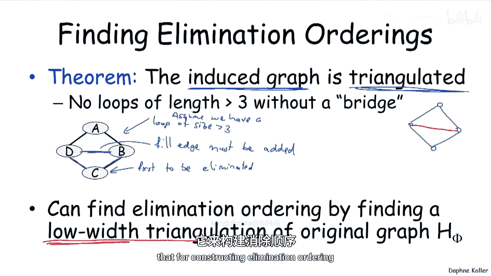
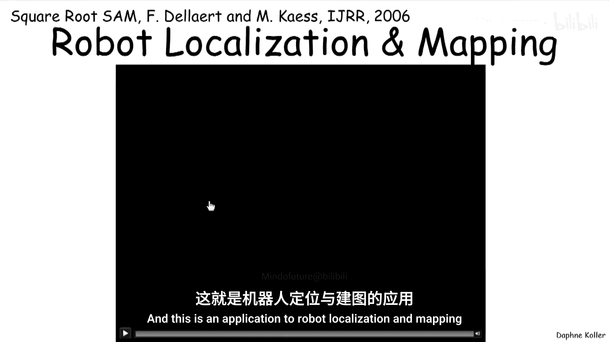
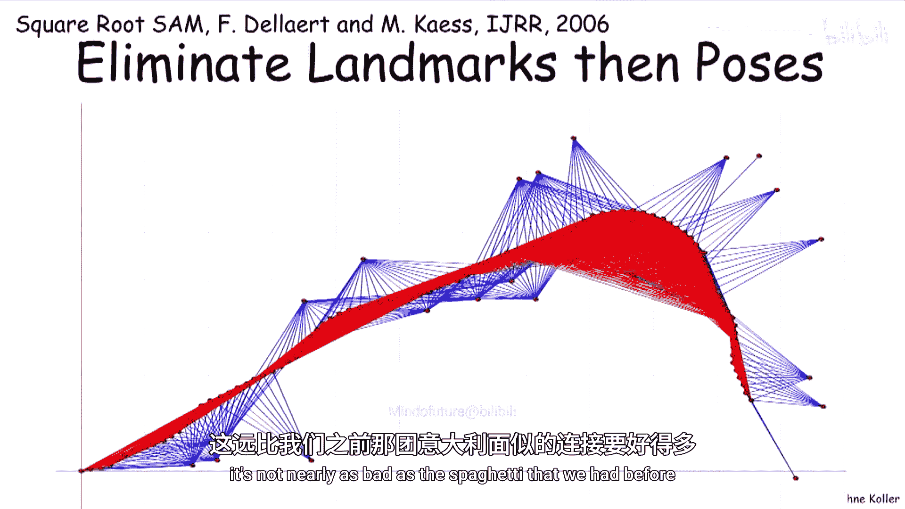
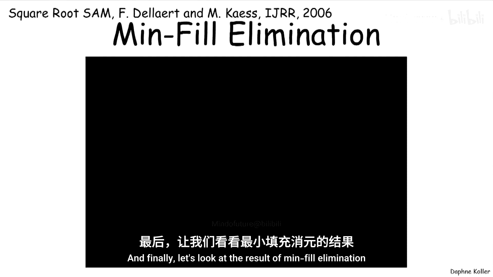
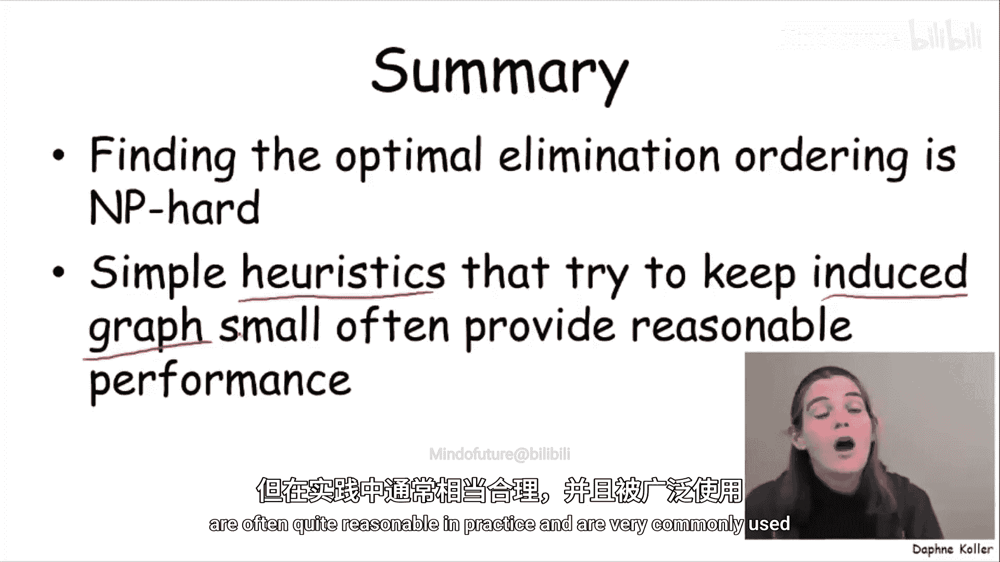

# 【斯坦福】概率图形模型2：推理 ｜ Probabilistic Graphical Models 2 Inference p06 P06_寻找消元顺序_02_01_04 -BV1fY6VBBEyo_p6-

When we discussed variable elimination， we said the variable elimination is correct。

 no matter the elimination ordering that's used， but we also showed that the elimination ordering can make a very significant difference to the computational complexity of the algorithm。

 So that begs the question of how we find a good elimination ordering。Fortunately。

 the computational analysis based on graphs that we recently did gives us an intuition into how to find good elimination orderings because it turns out that the notion should've been induced graph and the way in which it indicates the complexity of variable elimination can allow us to construct good method for finding elimination orderings with good computational properties。

How good of an elimination ordering can we construct？

So here is yet another example of the fact that any interesting problem is NP hard。

 so the following problem is NP hard also for graph H。

 determining whether there exists any elimination ordering alpha。

For which the induced widths is less than or equal to some fixed value K。

 that problem is NP complete。So you might say to yourself， well， that's not surprising， I mean。

 probabilistic inference is empty complete， so obviously finding a really good elimination ordering is going to be MP complete。

Turns out that this is a separate NP。AnP hardness problem。 That is。

 even if you could solve this problem， even if somebody gave you the best elimination ordering。

 you're still going to have graphs for which the width is sufficiently large so that you can't actually solve the problem in polynomial time。

 So finding the best induced width or these sorry the elimination ordering that gives you the best induced width does not gives you polynomial time performance in general。

 And so these are two separate empty hard problems。So how do you find a good elimination ordering？

 Fortunatelyly， simple heuristics actually do pretty well。

 So one standard way of finding good elimination ordering is to simply do a greedy search。😊。

Eliminating one variable at a time。Where at each point in the elimination。

 you've used some kind of heuristic cost function to decide which variable you're going to eliminate next。

And there's some obvious cost functions to use， and it turns out that surprisingly they work pretty well。

So for example， one cost function is what's called min neighbors。

Which is to pick the node that has the minimal number of neighbors in the current graph。

 so you want to pick the variable that's connected to the fewest friends so that it has the smallest party。

Or produces the smallest factor。 So this corresponds to the smallest factor。

Or the one whose cardinality is smallest。In terms of the number of variables。

M weight accounts for the fact that sometimes you have variables that have 100 values and others that have two values。

 and if you just count variables you're going to ignore that distinction。

 so min weight computes the weight。Or the total number of values in the factor form So midwa is a way of capturing the fact that if you have two variables。

 each of which has 100 values， you might prefer to nevertheless pick a factor that has five variables。

 each of which has only two values。So these just look at the size of the factors formed and they ignore the fact that some of these factors might be inevitable。

So a different strategy is to look at how much extra work is caused by the elimination ordering so Minfi is a strategy that says if I eliminate this node。

 how many nodes that weren't friends before become friends due to this elimination step so here basically I'm counting added of the complexity above and beyond the complexity that I would have had from the edges that I previously generated。

And finally， again， you have a weighted version of the fill heuristic that takes into account not just the number of edges。

 but also how heavy they are， that is how big what's the domain size of the variables that they connect。

And it turns out that Minfill， which is actually quite often used in practice。

 is a pretty good heuristic。Now， one important way of understanding the issues of finding elimination orderings is by looking at the following result。

And the result tells us that the induced graph that is produced by variable alimination。

 regardless of the elimination ordering is triangulated。Now what does triangulated mean。

 Triangulated means that you cannot have a loop。Of size， more than three。That doesn't have a bridge。

 an edge that goes in one direction or another so that there's a way of crossing across that loop without going all the way around。

Let's convince ourselves that this is true。So here is a simple proof。So once again。

 assume- so consider a set of variables。And assume I contradiction that there is a loop like this。

 so for example， assume that we have a loop。Of size。Greater than three。And again。

 one of these variables has to be the first to be eliminated。

So assume that C is first to be eliminated。Well。Once we eliminate C， we end up introducing an edge。

Betweenen B and D and so there has to be an edge between those two neighbors of C because when C is eliminated。

 the CD edge must exist， the C edge must exist because as we've observed before。

 you don't add any neighbors to C once you eliminate it and so at that point a fill edge must be added。

So it turns out that one way to find an elimination ordering。

 an alternative to the heuristic that I mentioned earlier is to find a low width。

Tangulation of the original graph and there's been a lot of work in the graph theory literature on triangulating graphs which we're not going to talk about。

 but it turns out that you could use all of that literature for finding good low width triangulations and then use that for constructing elimination ordering。

So now let's convince ourselves that this can make a big difference。

 So let's consider a practical application。And this is an application to robot localization and mapping。

 so what we're going to see here is a robot moving around。

 and at each point in time it sees several landmarks and it knows which landmarks it sees。

 it can recognize them， and what it senses at each point is some kind of approximate distance to the closest landmark。

So let's write that down as a graphical model， the graphical model looks something like this we have at each point in time a robot pose。

Which is the robot poses a time 01 up to the end of the trajectory P。And we have a set of landmarks。

Whose positions are fixed， the landmarks don't move。

 So notice that these are not random variables that change over time。

 They're just there and and they're constant。 And what you see here in gray are the observations。

 So this， for example， assumes that a time1。Robot Sa landmark 1。

And so what we have here is the observation， the observed distance is a function of the robot pose。

And the landmark position。And here at time two。We have that the robot saw landmark2。

 so we have this dependency over here。And at time three， the robot also saw landmark2。

 so you have two observations for the same landmark And here I didn't draw the fact that you could actually see the same landmark so you can see more than one landmark at any at a given point in time。

 but that also is easy to add in。Okay， so now if we take the previous robot trajectory that we saw and we write down the Markov network that represents the factors。

 we see that we have these light blue。Little dots。That represent the robot pose at every point in time。

 we see that we have these temporal persistence edges that represent the fact that the robot pose a time T is correlated with its position at time T plus one。

 and we have these dark blue。Robot pose variables that sorry。

 these dark blue landmark position variables where we see that a landmark is connected to all of the。

Positions at which it was visible by the robot。 And this is an edge that's induced by the V structure。

That we have over here。 So this is an edge that's induced by this V structure。

 which we have because Z1 has been observed。Okay so does landmark， does elimination ordering matter。

 oh boy， this is what you get when you eliminate the robot poses first and then the landmark and this what you see here is the induced graph。

And you can see that you get this huge spaghetti where most of the landmarks are connected to all other landmarks。

Okay， what about a different elimination ordering This one's already better。

 This is what happens when you eliminate landmarks and then poses and you see the induced graph that you get over poses and you can see that it's still pretty densely connected。

 but it's not nearly as bad as the spaghetti that we had before。

And finally， let's look at the result of minfill elimination。 So this is。😊。

What you're seeing is the fill edges being constructed。

And you can see that it's actually very sparse， let's look at it again。Very few fill edges。

Are actually added over the course of the trajectory。

And so so the elimination ordering makes a very big difference In summary。

 we've seen that finding the optimal elimination ordering is an NP hard problem and that it is an NP hardness that is different from the intrinsic difficulty of inferencing graphical models。

However， we've also shown that the graph based view of variable elimination gives us a set of very simple and intuitive heuristics that allow us to construct good elimination orderings and those work by looking at the induced graph as it's constructed in the course of variable elimination and trying to keep it small and sparse these heuristics。

 although simple and certainly potentially not providing notted performance in the worst case are often quite reasonable in practice and are very commonly used。

😊。

