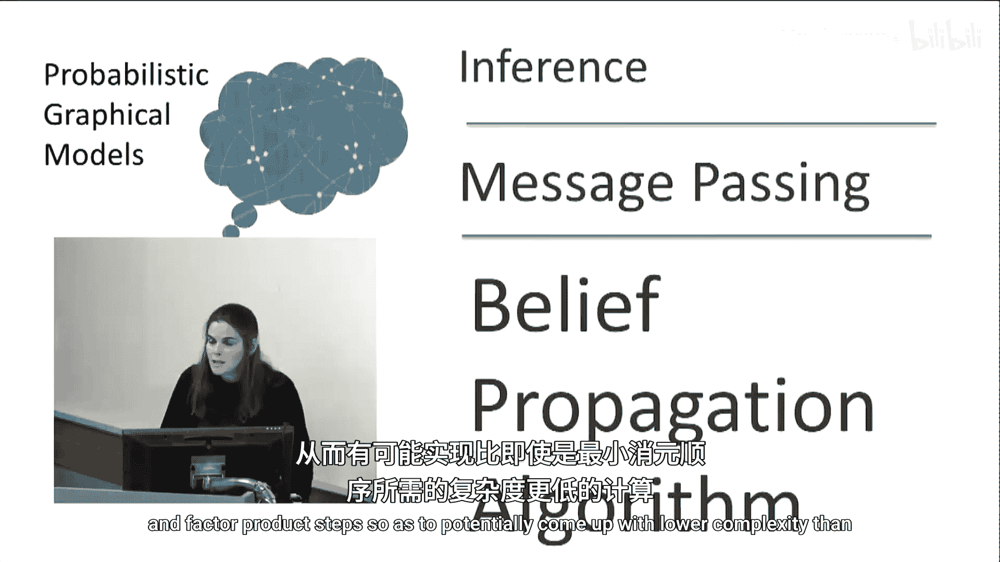
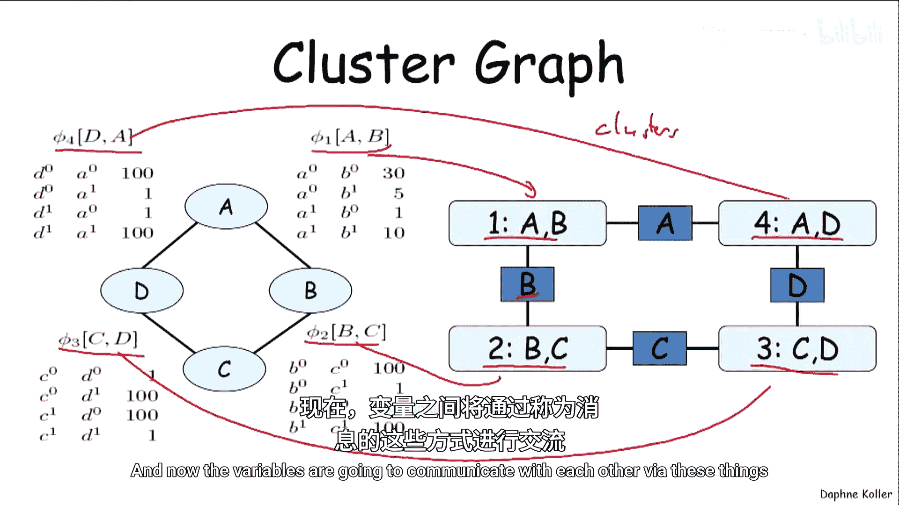
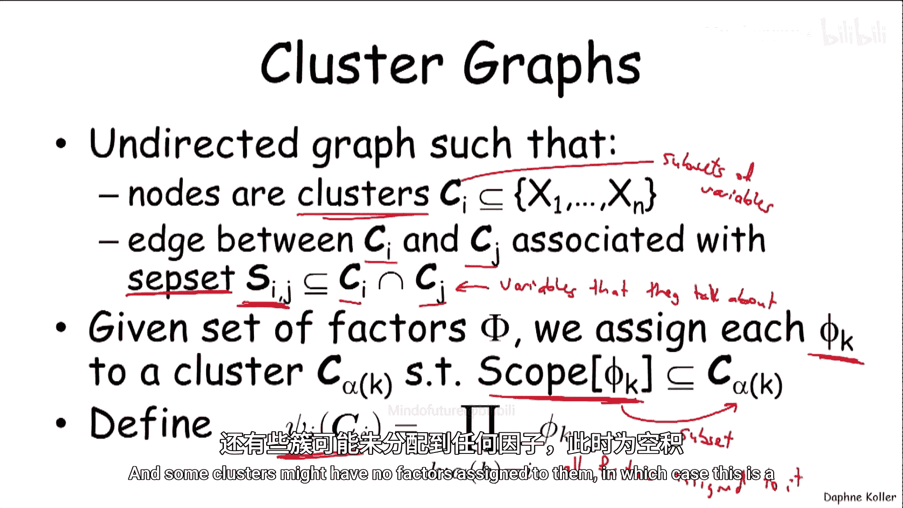
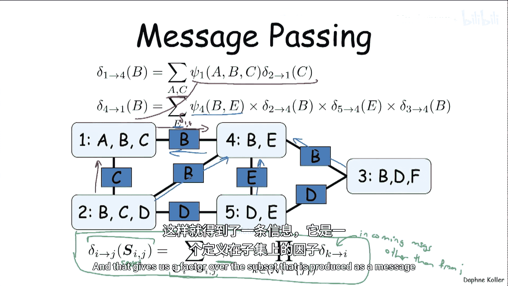
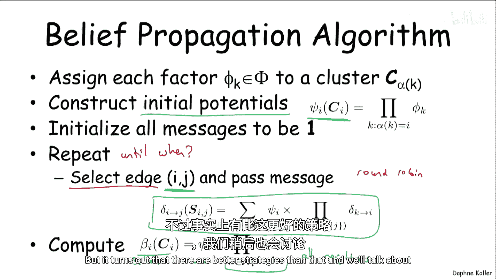
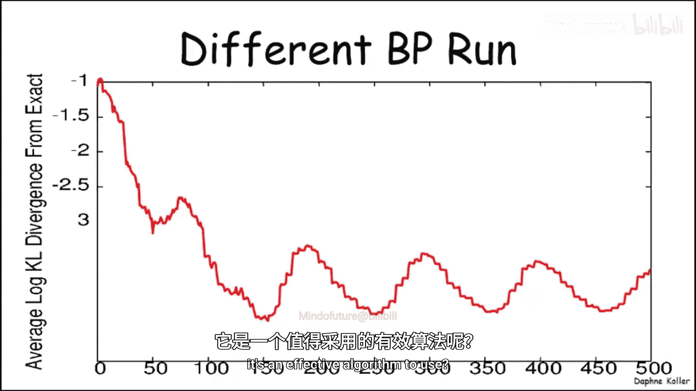
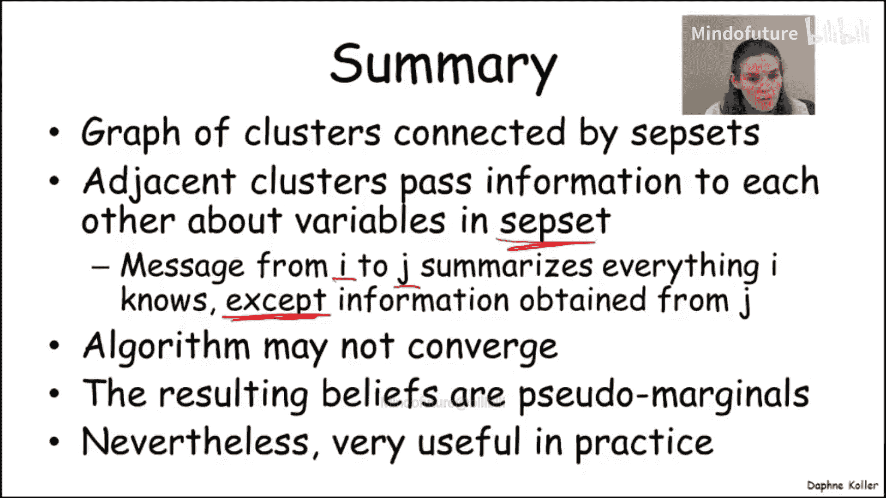

# 【斯坦福】概率图形模型2：推理 ｜ Probabilistic Graphical Models 2 Inference p07 P07_置信传播算法_03_01_01 -BV1fY6VBBEyo_p7-

An alternative class of algorithms to the variable elimination algorithms is the class of message passing algorithms。

 and as we'll see， this is a class that is in some ways closely related to variable elimination but also offers us additional flexibility in how we do summation and factor product steps so as to potentially come up with lower complexity than would be required by even the minimal elimination ordering。

So let's consider a simple Markov network of the following type and let's assume that I don't want to go to the cost of eliminating variables。

 although this network is not going to be too expensive and instead what we're going to do is we're going to construct what we call a cluster graph。

A cluster graph is something where what is a data structure in which we're going to take little bits of knowledge from this graphical model and we're going to place them in things called clusters。

So here we have four clusters。In this example， cluster1 is a cluster whose jurisdiction of influence is the pair of variables AB。

Coluster 2 has jurisdiction over B and C，3 is over C and D， and4 is over A and D。

And these clusters are going to sit there and they're going to talk to each other。

 and they're going to try and convince each other that what they think about a variable that they both consider to be under their jurisdiction is correct。

 So， for example， cluster one is going to talk to cluster2 about the variable B and it's going to tell cluster2。

 what it thinks about V so that cluster2 might become more informed about the distribution over V。

And so what we're going to do is initially each cluster is going to have its own little piece of information。

 so phi1 is going to go here， Phi 2 is going to go there， phi 3 goes there， and phi 4。

thereAnd now the variables are going to communicate with each other via these things called messages。

So we're going to slightly rename things， we're going to call the initial set of beliefs。

 if you will， or evidence that a factor that a cluster has over the variables in the jurisdiction。

 we're going to call those size in the example we just had ps where just the phis in the original model。

 but as we'll see sometimes it becomes a little bit more complicated than that。

So now factor the cluster1 has the factor Psi 1 and cluster 2 has psi 2 and so on and now let's imagine that Psi 1 wants to send a message sorry this Psi 2 this cluster two wants to send a message to cluster1 so it has to figure out what it believes and our priori we're going to assume that it going we're going to start out by initializing with a totally uninformed message。

So because initially they haven't even started talking to each other。

 so all messages are initialized to be one。But now cluster2 can come back and say， okay。

 I'm going to take the information uninformative as it was that I got from cluster 2 and notice that I call this message Dlta to 1。

 deelta2 being the from，And one being the two and so I've taken delta21 and now factor 1 cluster1 is going to say I'm going to take that I'm going to multiply it with my current thoughts about the variables AB。

 and that's going to give me a more informed factor and now I'm going to communicate that information to factor 4 to cluster 4。

But cluster 4 doesn't care about a sorry， cluster 4 doesn't care about B。

 And so what I'm going to communicate to cluster 4， which is this method， Dlta 1。

4 from 124 is the sun。Over。B， which is the variable that4 doesn't want to hear about of the incoming message。

Times my initial beliefs。From my initial factors。Now this general process is what keeps the message passing algorithm going。

 so each variable， each cluster is going to send messages to its adjacent clusters that reflect this exact same process。

 So for example just to take a different different example here is delelta 34。

 so this is the message that goes from3 to4 and that message takes into consideration the evidence that two sent to3。

 which is this guy over here times whatever three thought about C to begin with。

Notice and this is important that the message that three cents to four doesn't take into consideration the information that it got from four so there isn't in this expression over here the contribution of deelta 43 because you want to have you want to avoid this case of I repeat back to you a rumor that you just told me and we all become more convinced about the truth of this rumor because I thought about this first but now you're reinforcing me by telling it to me again and the beliefs are just going to go up and up and up and so what happens here is that we deliberately only restrict attention to evidence that comes in from other sources so three only uses evidence from two when reporting to four and it only uses conversely evidence from4。

When reporting to two。And so now this defines a set a communication protocol by which one factor or one cluster rather in the graph can communicate information to its neighbors。

What do we do with this so how do we generalize this message passing process let's construct a more general version of this so this uses a data structure called a cluster graph a cluster graph is an undirected graph whose nodes are not variables anymore not as not in this is not you know a graphical model of the type that we've seen the nodes in this undirected graph or clusters that correspond to subset a variables just like we had before。

And we're going to connect to adjacent to cluster C and CJ。

And this thing called the subset is the variables that they choose to talk about。

And clearly each one can only talk about variables that it knows about。

 which is why the subset SIJ has to be a subset of both C and CJ So once again。

 C is the jurisdiction of cluster I， these are the variables that it understands and SIJ is the communication between two adjacent clusters in the cluster graph。

Yeah。So。Now， given a set of factors， phi。We're going to initialize the model by giving each cluster in the graph a certain amount of information。

So each of my initial clusters， each of my initial factors。

 phi k in my graph is going to be assigned to one and only one cluster。And this is important。

 it needs to be at least one so that the information is taken into account somewhere。

 and it shouldn't be more than one because if you give it to more than one person to more than one cluster。

 theyre going you're going to double count the evidence。

 they're each going to think it's an independent piece of evidence and it's going to be counted twice。

Now where do we put the information corresponding to a factor K。

 We put this only in a we can only put it in a cluster that understands every single variable in that factor。

 So if we have a factor whose scope has a certain that has a certain scope。

 that scope better be a subset。Of the variables that the cluster understands。

Because otherwise they can't even talk about these。So。Yeah。So once we've done that。If I can。

Erase this。哎。We can now define the initial beliefs of a particular cluster。

As the product of all of the factors that are assigned to it。

Now some variables some clusters might be assigned one factor in which case psi is just equal to that phi。

 that was the case in the example that we just saw。

 some clusters might have several factors assigned to them in which case we need to multiply them to create a single factor that is sort of the total informed beliefs of the cluster and some clusters might have no factors assigned to them in which case this is a null product and is equal to one。

So now let's look at an example of a somewhat more interesting cluster graph than the trivial one that we showed earlier。

 here we have a set of factors phi1 of ABC， Phi2 of BCC， Phi3， Phi4，5，6 and something。

 so initially we have to figure out for each of those factors， a cluster in which to put it。For ABC。

 there's really only one choice because there's only one cluster in this entire graph that understands about all of A B and C。

 and that's this cluster over here。BC， however， has two choices， it can go into cluster one。

Or it can go into cluster 2 because both cluster 1 and cluster 2 understand about B and C。

We're going to put it in cluster two。I mean， we could have put it in either one， both are fine。

53 has， again， two choices。It can go into cluster2 or it can go into cluster three。

 we're going to go ahead and make the decision to put it in cluster2。

Cluster 54 goes has only one choice because only one cluster has both D&E and its scope。

 so it goes here。Phi5 similarly only over here， BD again。

 there is more than one choice we can put it in cluster2 or we can put it in cluster 3。

 that's for simplicity put it in cluster3 and BDF only one choice。

 This is one possible way of assigning the cluster the factors to clusters。

 There is other alternatives， as I said that would work。If we do this， we end up， for example。

 with Psi2。Being the product of Phi 2 times phi 3。Whereas Psi 1？Is simply equal to P1。And Psi 3。

Is equalhi to phi6 times pi 7。Here is a different assignment of the same factors to the clusters。

 and we can see that it's also equally legitimate。Okay。

 this was one cluster graph for those set of factors。 Here's another cluster graph。

 So let's compare them 1，2，1，2。They different for the exact same set of factors。

 and notice that it' still notice that in fact the clusters haven't changed。

 what's changed is the edges and the subsets between them。Different cluster graph。Okay。

 so now let's think about message passing in the context of this more richly structured cluster graph to see what it looks like here。

So here， for example， if we're interested in passing a message from。Cluster one to cluster 4。

 we're going to take Psi 1， which is the factor， the set of factors that were initially assigned to cluster 4。

 we're going to take in the message that this cluster got from。It's other neighbor too。

 we're going to multiply them together， and then we're going to sum out all of the variables that one understands。

 but two doesn't。 So here， for example， one understands A and C and two doesn't。

 so we have to sum out over A and C。And that is the message。Delta 1，4。What about Dta 41。

Beelta  for1 is the message goes in the other direction。对。

And here notice that4 gets messages from all sorts of other clusters。

 so in addition to its original factor Psi 4， it gets a message from cluster2。

It gets a message from cluster 5。And it gets a message from cluster3 each over its own scope。

 all of these are going to be multiplied together to give the current most informed beliefs about the variables B and E。

 which are then marginalizing over E which cluster1 doesn't understand to produce a message over B and once again we know that the message from one is not used to inform the message that's4 sends back。

So that gives us overall the following expression for message passing between cluster I and cluster J。

 so Delta I J。Over the scope of this， which is the Se。SIJ。

 and that has the following general expression。It takes the factors initially assigned。

 the cluster I。Multipies in all of the incoming messages。Other。Then。From J。Multipies it all together。

Thumbs out。The variables that cluster J doesn't know about， so everything that's in the scope of CI。

 but not in the scope of CJ。And that gives us a factor over the subset that is produced as a message。

对。But putting that together that gives us an algorithm which is generally called belief propagation for the reasons that the clusters are propagating。

 if you will inform beliefs to each other， and here is the summary of the algorithm Each factor phi is first assigned to a cluster。

That is used to construct our initial potentials， these size that we talked about。

We initialize all of the messages before anybody starts communicating to be one。

And then we repeat the following process， we select some edge。In the graph。Between adjacent clusters。

 and we pass the message between cluster I and cluster J over that edge。And we repeatedly。

 and this is the expression for that message， it's the one that we saw on the previous slide。

 and that process is repeated again and again。At the end of the process。

We now a cluster needs to know what to believe about the variables that it understands。

 and so it takes all of the it takes its own initial beliefs and all of the information that it got from all of its neighbors。

Multipies it all together， and that produces these things， which are called beliefs。Now。

 there's several important。Aspects of this algorithm that are left undefined。

And that we're going to need to talk about later on。 The first of these is repeat until when。

When do we decide that we're done？And that we can stop。

And we'll talk about that in the context of different variants of this algorithm later on。

The second thing that's left undefined is how I select。Each of the， how do I select edges。

 Which edge do I select to pass messages over。So here there's you know the obvious simple things。

 which is just to go in some prespecified order， and that's one option is round Robin message passing。

 but it turns out that there are better strategies than that and we'll talk about that too。

So is the algorithm any good？Well， it turns out that， you know， yes and no。 So first of all。

 if you pass messages over a graph like the one that I showed before， like the， you know。

 little ABCD loop。 eventually， you see that we achieve convergence。So this is。

Here we can see that eventually we do converge to some probability。But。

That probability is a little bit off。That is， the answer is not exact。So in general。

 with exceptions that we'll talk about， this is an approximate。Algorithm。

Which shows that there's no free lunch， if the problem was NPp hard。

 it's not like I have an easy way of solving it。So given all these problems with the belief propagation algorithm。

 what makes us that it's an effective algorithm to youth。

When the algorithm was red discoveredcover in the 1990s， Murphy Weis and Jordan as well as others。

 looked at its performance in the context of real networks and specifically networks that have a lot of loops。

 which is what causes the loopy belief propagation algorithms and misbehave and so here is an example network it's called the pyramid network。

 it's a network that is analogous to one that arises in image analysis and what they showed is that when you compute on the one hand。

 the exact marginals on the X axis and for different marginals in the network and on the Y axis we see the marginals computed by loopy belief propagation。

 we see that the marginals by and large sits almost exactly on a straight line。

 with few exceptions showing that the loopy belief propagation is very close to accurate on this network。

Here's another network， this is a simplified version of a medical diagnosis network。

 and once again we can see that when we compare the correct marginals on the x axis to the belief propagation marginals on the y axis。

 the marginals sit almost exactly on the straight line， which shows that again， they're very close。

 the belief propagations is very close to accurate。So to summarize。

The belief propagation algorithm passes messages over a graph of clusters that are connected to each other via subset。

 The adjacent clusters pass information to each other in these messages。

 transmitting information only about the variables in the subset which are the ones that they have in common。

The message that cluster I sends to cluster J summarizes everything that AI knows about the variables in the subset except for information that it obtains from J so that one avoid direct double counting of the same piece of evidence where J gets his own information back again via I。

We've seen that the algorithm may not converge and it can have this oscillatory behavior and that the resulting beliefs are pseudo marginalgiinals in that they are not necessarily the exact marginals from a theoretical perspective。

 but nevertheless as we've seen， the algorithm actually performs quite well in a range of practical applications。

 which is why it's quite commonly used。

