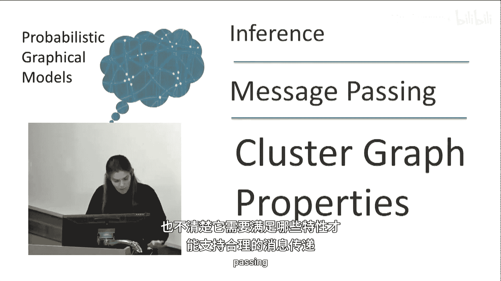
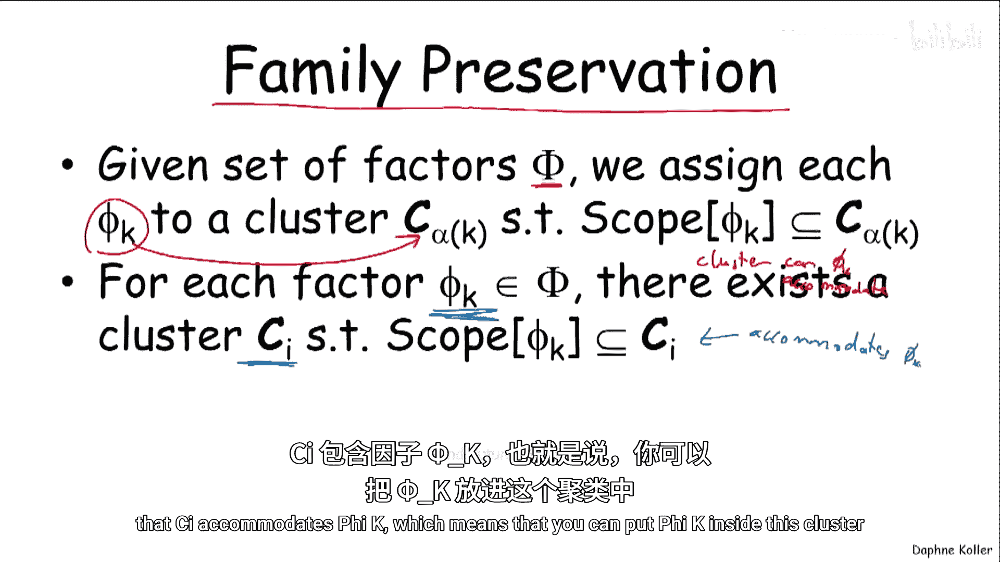
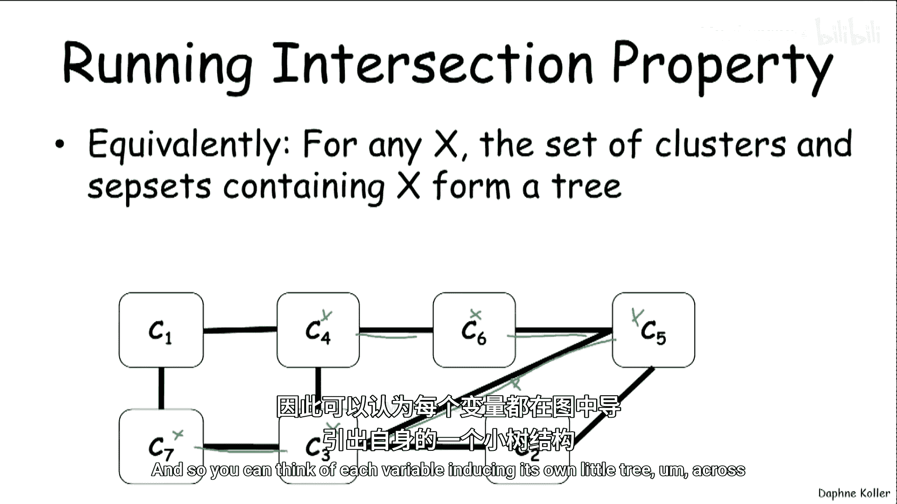
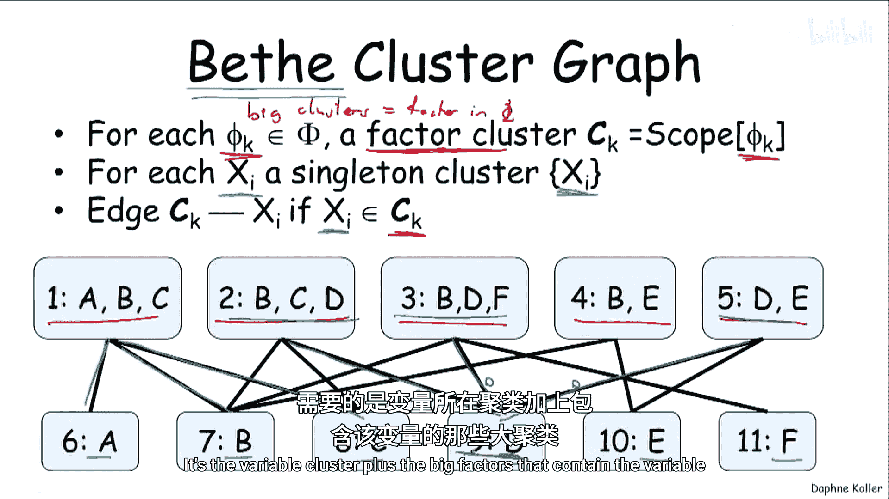
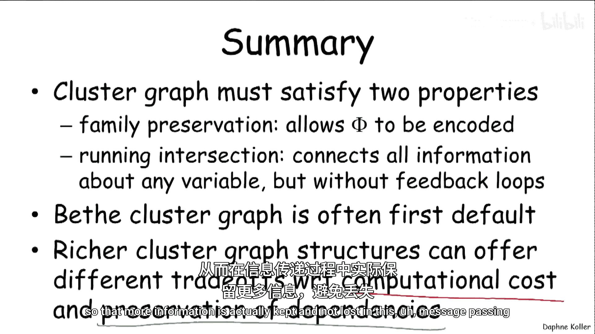

# 【斯坦福】概率图形模型2：推理 ｜ Probabilistic Graphical Models 2 Inference p08 P08_团图的性质_03_01_02 -BV1fY6VBBEyo_p8-

We described the belief propagation algorithm as passing message over cluster graph。

 but we left unspecified how that cluster graph would be constructed and what properties it needs to satisfy in order to support reasonable message passing。

So let's remind ourselves what cluster graphs are， a cluster graph is an undirected graph whose nodes are clusters that involve subsets of variables and edges involve a subset SIJ。

Which is a subset of the two clusters on the two endpoints。

What are some properties that the cluster graph has to satisfy the first property is one called family preservation。

 an obvious value where I'll remember that we need given a set of factors phi。

 we need to be able to assign each phiK to some cluster。C Al K。

 such that the fact such that the cluster can accommodate。The scope， so can accommodate PK。Oops。

 accommodate。Well， in order for the clustergraph to allow this to be done。

We need to have an appropriate cluster in the cluster graph。

 so this imposes a constraint on the cluster graph that says that for every factor phi K in my set of factors phi。

 there exists some cluster C that such that C accommodates。PK。

 which means that you can put PK inside this cluster。

That's the family preservation property。The second property is a little bit trickier to understand it's called the running intersection property。

The running intersection property let's first read the definition and then understand what it says。

 It says that let's assume that we have a pair of clusters， C and CJ。

And a variable x that belongs to both of them。 So， for example。

 we might have the variable x sitting here in C7 and the variable x sitting here in C5。

This property says that there exists a unique path between C and CJ for which all clusters and subsets along the path contain X。

 What does that mean， It means that， for example， should I choose this to be my unique path。

It means that x needs to sit here， here and here。So there is a connecting path that involves x and that path is along the entire route and that path is unique。

So let's try and understand the intuition between both sides of this definition。

 the existence and the uniqueness。Imagine that I let's do the existence first and imagine that for whatever reason I decide that there is not going to be a path over here。

So there is no way for C7 to communicate to C3 about the variable x。Well。

 that means that we now have these two separate， isolated communities。

 each of which has some information about X and they can never talk to each other about X。

 so they're never going to get to agree about x， there's never going to be any information transfer of these two pieces of information。

Well。😮，So that's not very good， which is why we need that path to exist。that's the exist part。

What about the unique part， the unique part is a little bit trickier to understand。

 but let's try and provide some intuition for it， let's imagine that I have two paths。Then involve X。

Well， so now let's think about this message passing algorithm。So C3 can send the message。

To C5 with information about x， for example， I think x is taking the value 1。

 I have a factor that suggests that x takes the value 1。 Well。

 C5 you know integrates that with his own information and sends it on to C2。

Which sends it back to C3？And now C3 heres from C2 thatoo x needs to take the value 1 that reinforces its beliefs that x needs to take the value 1 and so the probability goes up。

 it now goes back and sends that information on to C5 which sends it on to C2。

 which sends it back to C3， and then once again the probability in x taking the value 1 goes up and so we have this sort of self-reinforcing loop that's going to give rise to very extreme and very skewed probabilities in many examples。

And so a way of avoiding that is to， or at least reducing that risk is to， is to prevent。

These kinds of feedback loop。Now it's important to realize that by preventing these loops that only reduces as opposed to eliminates the problem。

And specifically， this is kind of a little bit of a digression。

 but it's important to know is that imagine， for example， that we have X。And why。

That are very strongly correlated。So here we have， for example， x and Y。And here we have a path。

That involves why。诶。So now what's going to happen is that C3 sends information to C5 about x C5 translates that to information about y。

 Y should take the value1。That information about Y goes back to C3 and increases the probability in xta the value one。

Now， this is a little bit of a forward looking hint about some of the issues that we'll see with belief propagation later on。

 which is that belief propagation。Does very poorly。When we have strong correlations。

And that's because of these feedback loops。So the more skewed the probabilities in your graphical model。

 the harder time belief propagation has in terms of the results that it gets。嗯。

So with that digression aside， let's go back to the running intersection property and let's provide an alternative definition of the running intersection property just to give ourselves some additional intuition。

 the running intersection property is equivalent to saying that for any X。

The set of clusters and subsets that contain X form a tree。So for example， if we have x here， here。

 here， here， here， and here。We can see。That the set of cluster is in subsets that contain x form a tree。

 it has to be connected because of the existence of the path and it can't be a nonree because that would give us two different paths and so that's a different view of this and so you can think of each variable inducing its own little tree across which information about that variable flows in the graph。

So now let's go back with that definition and consider some cluster graphs that we might adopt for for this example that we've seen before。

 so here we have our five clusters and let's check whether it satisfies the running intersection property we've already done family preservation for a particular set of factors so let's consider for example the variable B and we can see that we have B here here here here。

Here， here and here。And we can see that that's a tree。 Here' is my tree。嗯。Note。Very carefully。

 that B isn't here。If B were here， that wouldn't satisfy the running intersection property。

 that would be an illegal cluster graph actually on a subsequent slide。

Here is an illegal cluster graph。It violates the running intersection property Y。Because here is B。

And here is a bunch of other bees。그。And there's no way to connect cluster 2 to any of the others。

 So this one violates the existence。Yeah。嗯。This one， which we just talked about。

 violates the uniqueness。Because here we have。Yeah。All of the clusters in a sepsis that involve B。

 and there's this nice little loop over here。That has a two paths between。

 say cluster 1 and cluster four。If we wanted to take the cluster graph and still allow communication between B and C。

 so we want to have， for example， we want cluster 1 and cluster two to be able to transmit to each other information about how B and C are correlated with each other。

 which they can't do in this graph over here。So one way to do that is to we have eliminated in this case。

 this edge that we had over here that involved B， and now once again we have B。

Being a tree in the graph Now focused on B here， but it's not difficult to convince yourselves that other nodes also satisfy that we satisfy the running intersection property also with respect to other variables。

 so just as an example， here is the set of clusters and subset involving V and that two is a tree here is the ones involving E and that two is a tree and so on so and running intersection property needs to hold for every one of the variables。

How do we construct a cluster graph that has a desired properties。

 one very simple and in some ways degenerate， but still because of its simplicity very often used is a cluster graph called the beta cluster graph。

 and that's a term from statistical physics where people use this kind of approximation to energy functions in some calculations in statistical physics。

So here we have in the beta cluster graph， we have two types of clusters。

 we have big clusters and little clusters。The big clusters， these are the big clusters。

Correspond to factors。Infi。So for each 5 k， we have a cluster。A factor cluster。

Whose scope is exactly the scope of IK？That's the big clusters。

The little clusters correspond to individual variables， so for each X。

 we have a cluster whose sculpt is just a single variable X itself。

Now we're going to connect CK to X exactly when X。Is a subset of CK is a member of CK。

So if we consider the set of factors that we had before。

We can now produce a different cluster graph than the one that we had previously。

 This is a beta cluster graph。 noticeice that we have these big clusters。

 these are these four sorry these five。And we have these little clusters corresponding to A，B，C， D。

 ENF。And we can see that we have an edge， for example， between the ABC cluster and the A cluster。

The B cluster and the C cluster。And that's how messages are passed and you can see that this graph is degenerate in the sense that it only allows information about singletons to be passed。

 it loses in every message passing step， any information about the correlation between variables。

 but nevertheless it's simple to construct and it's guaranteed to satisfy the running intersection property Why is that So let's consider for example。

 all of the factors that involve the variable D。So here is。

 what are the clusters that involve the variable D while there's this one？And then there's this。That。

that those are where we have the subsets， which I didn't mark and then these ones。

And notice that it's a tree by definition。Because D doesn't appear on any other subset。

Except these ones。And so the tree is a star。 It's the variable cluster plus the big factors that contain the variable。

 So D， And in this case， the three clusters that contain it。

So to summarizerise。We we looked at the properties of the clustergraph and we see that there's two of them that it needs to satisfy。

 the first is family preservation， which allows the set of factors to be encoded。

And the second is the running Interception property， which serves two purposes。

 the first is to connect all information about any single variables so that it can all be transmitted through the graph。

 but without creating tight feedback loops， they're going to give rise to the self- reinforceincement and the highly inaccurate answers。

The beta cluster graph is often the first default that people use because it's easy to define and it's guaranteed to be correct。

 but richer cluster graph structures of the type that we talked about can offer very different and sometimes significantly better tradeoffs with respect to on the one hand。

 the computational cost and on the other hand， which of course as you start increasing the amount of the sizes of the messages that are passed that can grow more expensive but at the same time allow us to improve。

The preservation of dependencies as messages are passed in the graph so that more information is actually kept and not lost in this message passing process。

