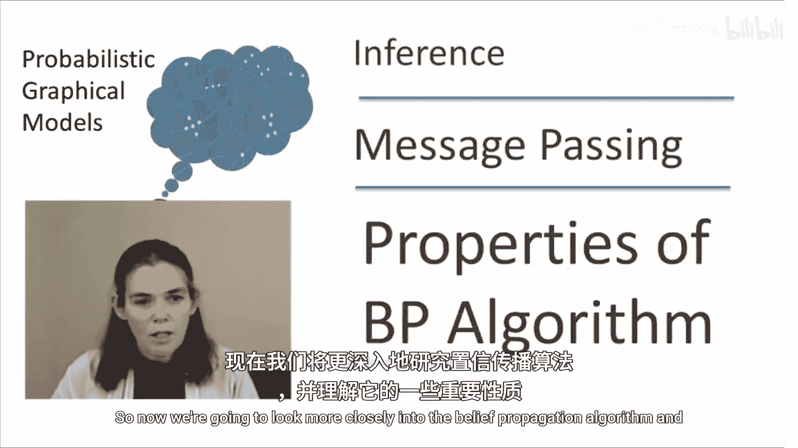
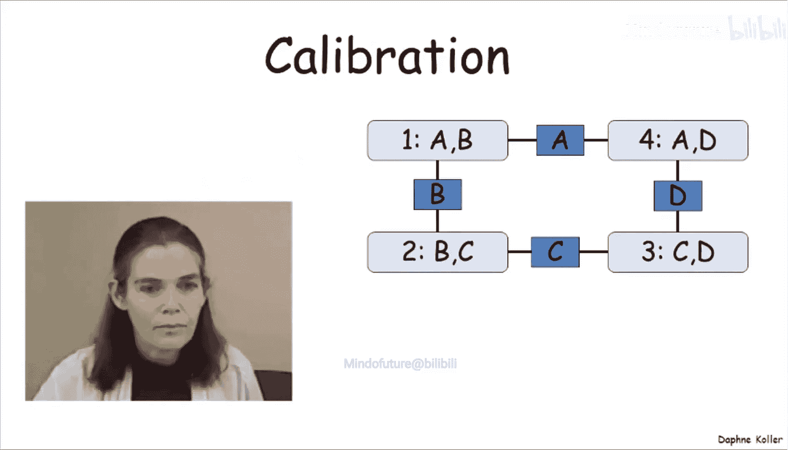
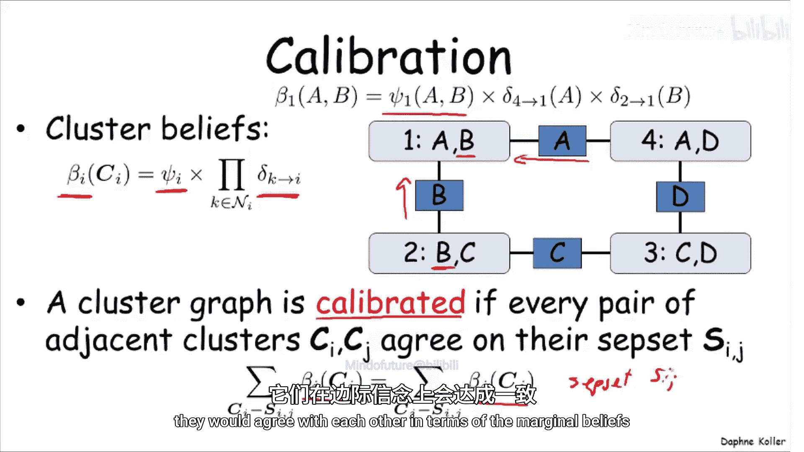
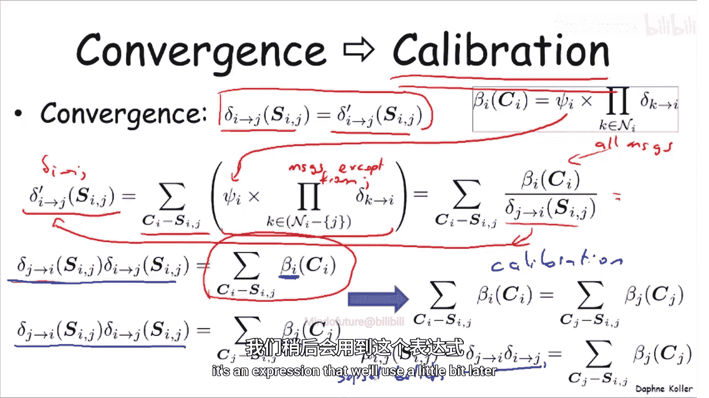
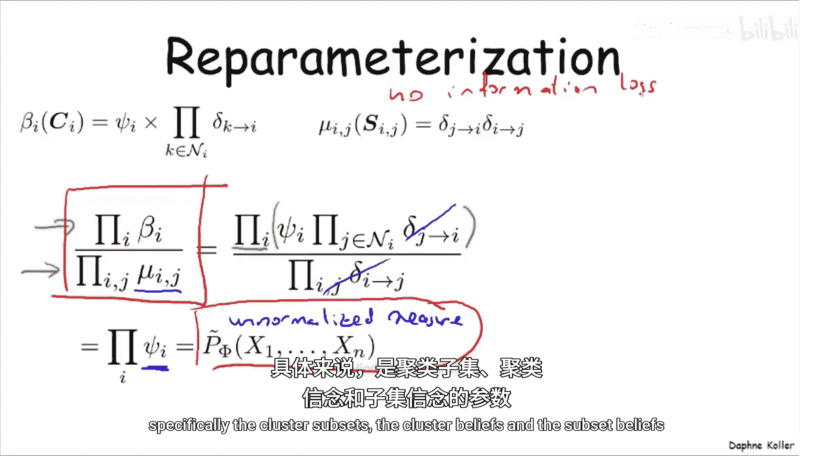
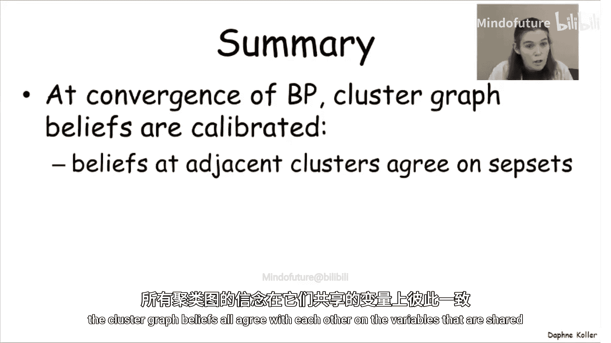
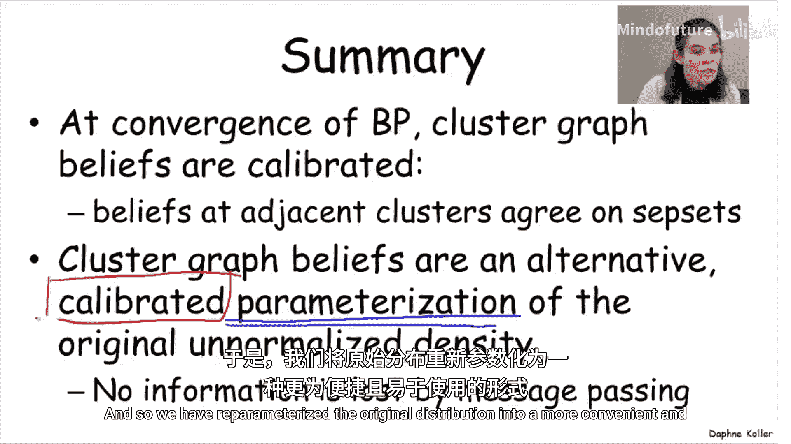

# 【斯坦福】概率图形模型2：推理 ｜ Probabilistic Graphical Models 2 Inference p09 P09_置信传播的性质_03_01_03 -BV1fY6VBBEyo_p9-

So now we're going to look more closely into the belief propagation algorithm and understand some of the important properties that it has。

So heres our example cluster graph with the four clusters over the loop。

 and now let's remind ourselves that the cluster beliefs are defined to be the product of the factors assigned to the clusters up Psi1 up to Psi  four times the product of the messages that were incoming into the clusters。

So， for example， the beliefs over cluster 1 is Psi 1 of A B times the message coming in from cluster 4。

 who scope is A， and the message coming in from cluster2， whose scope is B。Now。

 a cluster graph is said to be calibrated。 if the clusters agree with each other。 So specifically。

 if in terms of their beliefs， beta I， if we were to ask cluster 1， what it thinks about， say。

 a variable B and we were to ask cluster 2 what it thinks about the variable B。

 they would agree with each other。 Forly， this says that if we marginalize out the belief at say cluster I and marginalize out the beliefs in cluster J and we ask them what they agree about their joint subset。

S I J， they would agree with each other in terms of the marginal beliefs。

Now， an important property of cluster graph belief propagation is that convergence of the belief propagation algorithm implies calibration。

 So to understand why that's the case， let's go through a simple derivation。

 so the convergence of belief propagation occurs when the message at the next time step equals the message at the previous time step。

😊，So now let's see what the implications of that are。

 So if this is the message at the next time step， it's computed as the product of the style eyes。

 which are the factors assigned to the to the cluster eye times all of the messages。Other。

 except for。Cluster J。And those are all multiplied together and marginalized out over the subset。

So now let's remind ourselves of what the beliefs would be at this point in the process if we were to compute them。

 and that's derived from this expression over here。

 So this is the same psi eye that we had over here。 And this is the product of all messages。

So if this is， if here we have the product of Psi I and all messages except one。

 and here we have Psii and all messages， we can equally well rewrite it in this form over here where we multiplying all of the messages and then divide out the one that wasn't included Delta J I。

So now because of convergence， we have that this is equal to this is equal to Delta I J because of this equality。

Over here。 And so if we rewrite that， we can see that we have that Delta I J times Delta J I is equal to。

This summation over here， because we can multiply Delta J I on the right hand side。

By Delta I J on the left hand side。So we have shown that Delta J I times Delta I J is effectively the marginal over the beliefs at that point in the process。

But we can equally well using the identical argument。

 show that Delta J I times Delta I J or is also the marginal over the beliefs for cluster J。

 So this is the beliefs for cluster I。This is the beliefs for cluster J。 And so， and。

 but we've shown that in both cases。The marginals are equal to the same expression。

 which is the product of the messages on both sides of the link。

And so because both expressions are equal to the same thing， they must be equal to each other。

 And this is exactly the calibration property that we were trying to prove。

So we've shown the convergence of the belief propagation algorithm implies calibration。

This expression， which corresponds to the subset beliefs。

Because it's the marginal over the cluster beliefs is called mu I J。

 And it's an expression that we'll use a little bit later。

In particular， one of the important properties that we get by putting these pieces together is another property called reparameterization。

 Now that's a bit of a mouthful。 So let's first do the derivation and then understand what the word means。

 So remember that as we run belief propagation at the end of it。

 we have these beliefs over the clusters。Which are defined in this expression。So specifically。

 for example， we have for cluster 1， we would have Psi 1 times delta 41 times delta 21。

 and similarly for the other clusters。We've also just now defined these costly subset beliefs。

Which are， which we've just shown are a product of two messages on the two different going in each direction。

 So specifically here we would have， for example， that mu of 1，2 is equal to Delta 1。

2 times delta 21。 Now， if we look at this graph with all these all these little factors attached to the clusters in the subset。

 we see that there's a lot of repetition here。 So Delta 4，1 appears， for example， here。

 But it also appears there。 And in fact， if we look at it。

 we see that each of these expressions appears， each of these message expressions appears exactly twice。

 So Delta 4，1 appears here and here。 And for example， Delta 1，2 appears here and and here。

And so if we write all of these together in a different form。

 we can see that if we multiply all of the beliefs and divide by all of the subsets。

We would end up with multiplying in Delta 41， for example， on on the belief side。

 but then canceling it out when we divide by mu1 comophore。And similarly。

 Dlta 12 would be multiplied in on in terms of beta 2。

 but then canceling out in the denominator in mu 12。

So if we wanted to write this in a little bit of a broader setting。

 So if we have a product of the beliefs over here multiplied and then divided by a product of all of the subsets。

 we can see that this numerator is equal to the product over I of Psi I times the product of all of the incoming messages into click I。

 The denominator is simply equal to the product of all of the messages on each direction。

And we can see that here we're just counting the same message in two different ways。

And so it each message appears once in the numerator and once in the denominator。

 which means that they all cancel with each other。 And so what we end up with is the product of all of the initial potentials p Psi I。

 And that product is simply the unormalized。Measure。

And so the implication of this is that this expression over here。

 this ratio is simply a different set of parameters that captures the original unormalized measure that defined our distribution。

 And so we haven't lost information。 No information loss。

As as a result of the belief propagation algorithm。

 the representation of the unormalized measure is still there just using a different set of parameters。

 specifically the cluster， the cluster beliefs and the subset beliefs。

So to summarize， we've seen the add convergence of belief propagation。 The cluster。

 graph beliefs all agree with each other on the variables that are shared among them。

And as a consequence of that， the clustergraph beliefs are simply an alternative parameterization of the original unnormalized density。

 but one that has this nice calibration property， which allows us to read off information about a variable from any clique in which it appears。

 And so we have reparameterized the original distribution into a more convenient and easily usable form。

😊。

