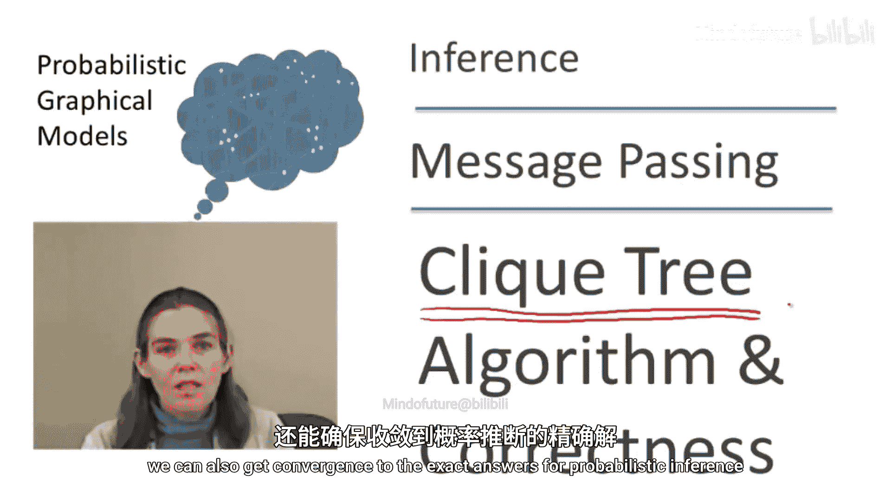
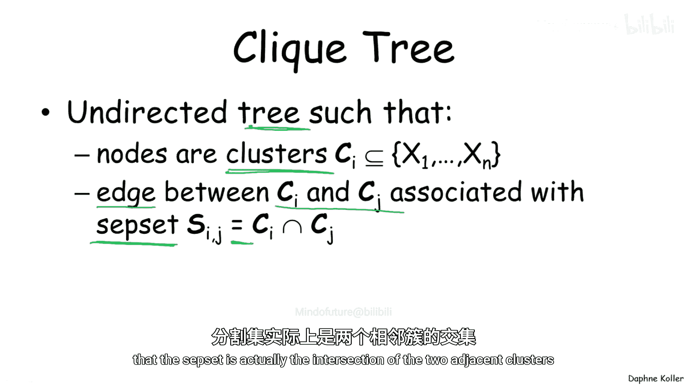
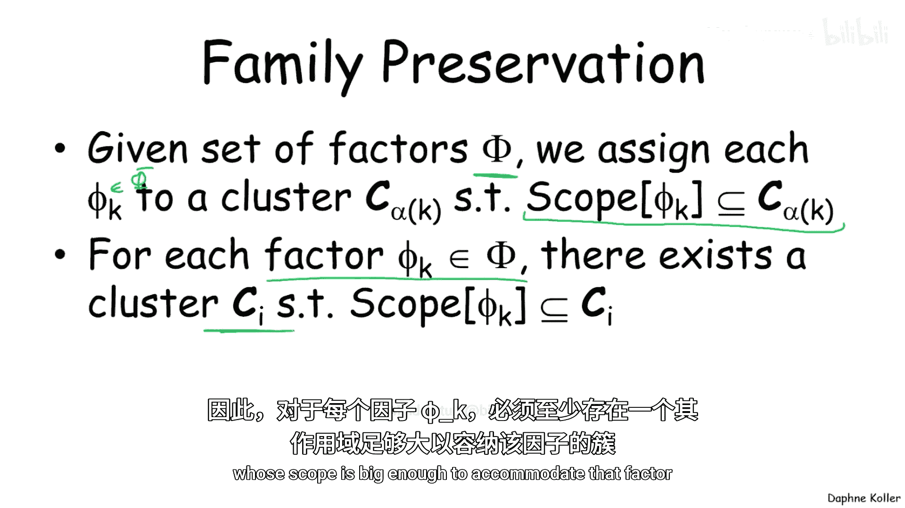
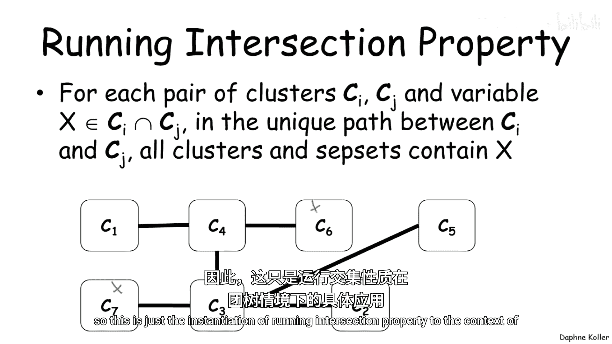
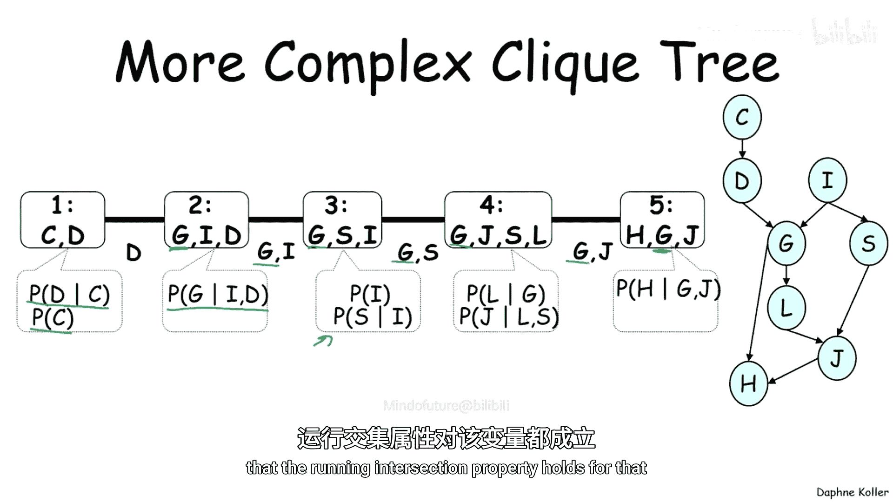
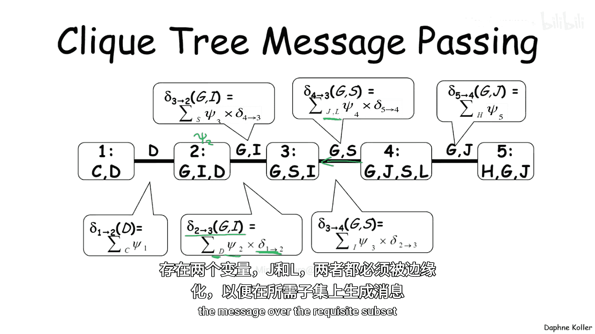
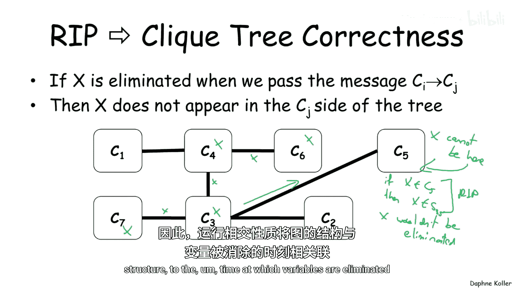
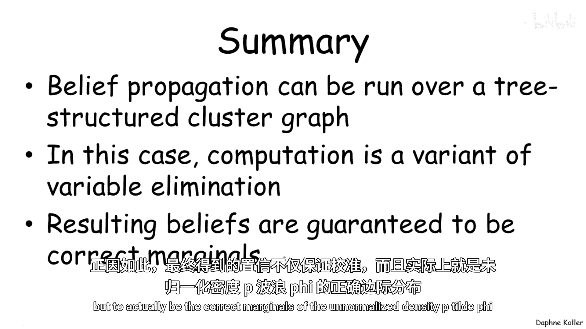

# 【斯坦福】概率图形模型2：推理 ｜ Probabilistic Graphical Models 2 Inference p10 P10_团树算法正确性_03_02_01 -BV1fY6VBBEyo_p10-

We define the belief propagation algorithm as a message passing algorithm over a fairly general data structure called a cluster graph。

 and we showed that if the cluster graph has certain properties and sold does the belief propagation algorithm。

What we're going to do now is we're going to look at a special case of the belief propagation algorithm where we pass messages not over a general cluster graph。

 but rather over a data structure called a cleeique tree。

 which as will show as a special case of a cluster graph。

 but interestingly when we pass messages over cleeique tree we can show that the belief propagation algorithm has a much stronger performance guarantees than it does over the general graph and specifically we can show that not only can we get convergence much faster we can also get convergence to the exact answers for probabilistic inference。

So let's consider the case of passing messages。Tree and let's start with the simplest kind of tree which is just a chain。

 so in this case we have a chain ABCDE and we're going to assume that this is an undirected MRF or CRF and so we have a for simplicity we're only going to consider the pairwise potential。

 that loss of generality and so we're going to have just pairwise potentials here that for example。

 in the cluster AB， we're going to have the pairwise belief over the pairwise potential over AB and so on。

So here we have Psi1， Psi 2。By three。嗯 likeful。So now let's think about the message passing process。

And we're going to start passing messages from the left and so cluster the message to cluster2。

 and since there's no incoming messages at this point。

 the message that gets passed is simply the sum over a of Psi 1 of AB。

 and that's a message whose scope is B。Now we're going to have cluster 2 take that message and pass a message to cluster3。

 and so now it's taking its own potential Ps2 and multiplying in this message into this。

 and the result is a factor over B and C and we're going to sum out over B because we only want to restrict to the scope C which is the shared scope between cluster 2 and cluster 3。

 and so deelta 23 is this message over here。Now we're going to pass messages one more time。

All the way down to the end and so now again， we're taking delta 23。

 multiplying it with p Psi 3 that comes from there， and that gives us a message over scopepe D。

 which gets sent to cluster 4。You could also pass messages in the other direction， so this。

 for example， would be what would happen if we pass messages from cluster four to cluster 3。

Regardless of when that message gets passed， there's no other messages that cluster 4 would multiply in when sending a message to cluster3。

 because whether it got the message from three or not， it's not going to multiply that in。

 because remember， you only send the cluster of message that doesn't involve messages that you received from it。

And so in this case， the message that you get is the sum over e of the factor psi4。

 which we get from here。Passing messages in the other direction again。

 we see that the message of the cluster 3 passes to cluster 2， which is delta 32， involves Psi3。

And this message。Over here。And。Finally， exactly the same idea。

These are the messages that gets passed。嗯。So one important property that you have when you run message passing in the way that we just showed is that somewhat surprisingly relative to what we've seen before。

 the resulting beliefs that you get are correct， and let's convince ourselves of that relative to cluster3 and so in the order that we defined cluster 1 past delta 12 to cluster 2 which was then used to define Delta 23 at the same time we had delta 43 and so the beliefs that we get here are the product of Psi 3。

Time' Delta 23 timess delta 43。Let's unpack each of those messages。

So Delta 23 as we remember was defined here， and so we're going to rewrite what Delta 23 is as the summation over B of Ps 2 delta 12。

And similarly， we unpack the Dlta 43 to get using this expression that we have over here right there。

Now we're going to do one further level of unpacking。

And we're going to remind ourselves of what Dellta 12 is， which is as defined over here。

 and so that gives us this expression over there。And now look at what we have。

We have a product of all of the four initial factors in the network， Psi 1， Psi 2， Psi 3， and Psi 4。

We have a sumation over all the variables that are not in cluster 3， which are A。B and E。

 C and D are in that cluster so we sum out over everything else。

 So already we see that we have a product of factors。Marginalized out。

Were we marginalized out irrelevant variables or unnecessary variables？

So this is really reminiscent of variable elimination。And if you recall。

 when we talked about the correctness of variable emination。

 we said that variable emination is correct as long as as when you sum out a variable。

 you first multiply in all factors that relate to it。That involve that variable in their scope。

 So let's convince ourselves that that is， in fact what's going on here。

 So let's look first at the variable E。 And when we sum out E， we're multiplying。

 we are we're only involving p Psi 4， but that's okay because only the cluster 4 has E in its scope。

Here we're summing out A。And once again， only Psi 1 involves。

Invols a in its scope Here we're summing out B。And really there should be parentheses here。

 they were there implicitly before， and so you can see that when I'm summing out B of involves Psi2。

 which involves being in at scope， as well as what was left over from summing out Psi 1。

 which is the other factor that has be in its scope。

And so you can see that I've marginalized out the variables in a legal order。

ing in only multiplying in all of the expressions that I needed to multiply before I did the sumation。

And so this is illegal legal。😊，Order of operations。And， therefore。

It gives me a correct result of the。So now let's expand that into the somewhatud broader case。

 we're now going to define this notion called the Cleique tree。

And a cleeique tree is an undirected tree。Kind of like a cluster graph was an undirected graph。

 so in this case it's a tree。Such that， once again， the nodes are clusters。And once again。

 we have edges between the clusters， which are called subset。And in this case。

 whereas before we had that the subset needed to be only a subset of CI intersection CJ。

 it could be smaller， it could be equal， it could be smaller。

 here we're going to require that the subset is actually the intersection of the two adjacent clusters。

So now let's go and understand what properties the cluster。

 the clique tree that we showed has as a special case of a cluster graph。

 so for a cluster graph we had the notion of family preservation and the reason that we had family preservation is because if we have a set of factors phi。

 we needed to take each phi K in Phi， and we needed to assign it to some cluster so that each piece of information that we have is represented somewhere。

 and the factor needed to be such that the cluster could accommodate its scope so that the scope of a factor was a subset of the set of variables in the cluster。

And the same requirement holds here because a clickique tree is a special case of a cluster graph so that we have that for every factor P K。

 there must exist at least one cluster whose scope is big enough to accommodate that factor。

The second property that we had in cluster graph was the running intersection property and let me clarify that the property that we see here is the cluster graph variant we're going to make it。

Specacific the cleeek trees in just a minute。So the cluster graph variant told me before that for each pair of clusters。

 C and CJ， and a variable x that is present in both of them。

 there're needed to exist a path between C and CJ for which all clusters and subsets contain X and needs to be unique。

So what does that mean in the context of cleaek trees。

 let's assume that we have C7 containing X and C6 containing X。

 and the cluster and the running intersection property says that there needs to exist a path between them。

For which all clusters in sepsis contain X。 Well， there's only one path in a tree between C7 and Z3。

 it's this one。And so what that property now tells me is that x has to be here， here， here， and here。

Because otherwise， the running intersection property is going to be violated in this case。

So that means that in the context of trees， the running intersection property can actually be written much more simply。

 it can be read as saying that a pair of clusters C and CJ and a variable x in their intersection。

Each cluster and subset and the unique path between them must contain X。

And so this is just the instantiation of running intersection property to the context of cl trees。

So now let's look at a more complicated clique tree。

 this is the Cleek tree that corresponds to the network that we previously used to demonstrate variable elimination。

 this is the elaboration of our student network， and so this is unlike the previous example。

 this is actually a Cleeeek tree for a Bayesian network as a postal Markov network。

 but as you'll see theres really no difference。So here we have a set of factors。

 in this case the factors are CPD， and because of the family preservation property。

 we can be assured that each factor must be assignable to some clique and so here we have a P of C and P of D given C are assigned to this clique。

P of G given ID， P of I and P of S given I and so on and so forth。

 so each of the CPDs that we have is assigned to one and exactly one of the cliques in this cleaek tree。

And we can convince ourselves。And we can convince ourselves that this tree satisfies for example。

 the running intersection property， so let's look for example， the variable G。

 the variable G exists here， it exists here， and sure enough it exists here， here， here， here。

 and here。And you can similarly convince yourselves of that for any of the other variables in this cl tree that the running Inter property holds for that。

Let's look at what message passing looks like for this more elaborate clea tree。

 so it's a little bit only a slight bit more complicated， so here we have， for example Delta。

So it's not even that much more complicated。 So here is Delta 23， for example， and Delta 23。

 which is the cluster between， which is the message passed between cluster2 and cluster 3， takessi2。

 which is。The product of the factor is assigned to this click actually there's only one in this case。

 so it's only P of G give it I and D， so that's Ps 2 multiplies it with the incoming mess of delta 12 and it sums out over D。

The only slight difference between this and the previous example that we had is that here。

 for example， when cluster4 passes a message to cluster 3。

 we can see that over here there's two variables， J and L。

 both of which must be summed out in order to produce the message over the requisite subset。😊。

Now we define the running intersection property， one of the really nice aspects of the running intersection property is that it by itself。

 together with family preservation， suffices to prove the correctness of message passing in a cleaique tree。

And the reason for that is the following。If。嗯。So let's consider a variable x over here。And let's。

And what we want to prove is that。Is that if we eliminate x at some point in the tree。

At some point in the message passing process， then we have multiplied in all factors that involve x。

And so here we have， for example， x here and here and by the running intersection property。

 we have the x is here and here as well and on this subset。

And let's imagine that X is eliminated on this。Edge that is the message that's passed from C3 to C5。

Doest the messages passed from C3 to C5 doesn't involve。X and so x must be summed out at this point。

Well， at this point， we know that x cannot。Be here。Because if x were in C5。

 then it would also be in the subset if x in C5， then。X is also in S35。

 at which point x wouldn't be eliminated。And the reason we know that if x is in C5。

 then x is in S35 is because of the running intersection property。

So the running intersection property relates the structure of the graph the structure to the time at which variables are eliminated。

So now let's convince ourselves of the correctness in this slightly more complicated example that we've seen satisfies the running intersection property。

Here once again we have。Pi 1。Which is the product of these two factors， Psi 2， which is this one。

 Psi 3， which is these product of these two factors。Side four。By5。And once again， let's， for example。

 consider what we get at cluster 3， and we can see that we have multiplied in all。Of。The potentials。

 Psi 1， Psi 2。啊。Side 3， site4，s5。And that we have eliminated all of the variables except for GSI。

 so here we'veve eliminated C。啊好。J， L and H。Leaving us only with the variables GSI。

 which we want to keep。And we can similarly convince ourselves， as we did before。

 that when we eliminate a variable， we've multiplied in all of the factors that involve that variable。

😊，So， to summarize。We can take the leaf propagation and run it over a clustergraph that happens to be tree structured。

And when we do that， it turns out that the computation that we're running is actually a variant of variable elimination。

And because of that， the resulting beliefs are guaranteed not only to be calibrated。

 but to actually be the correct marginals of the unnormalized density healdeify。😊。

