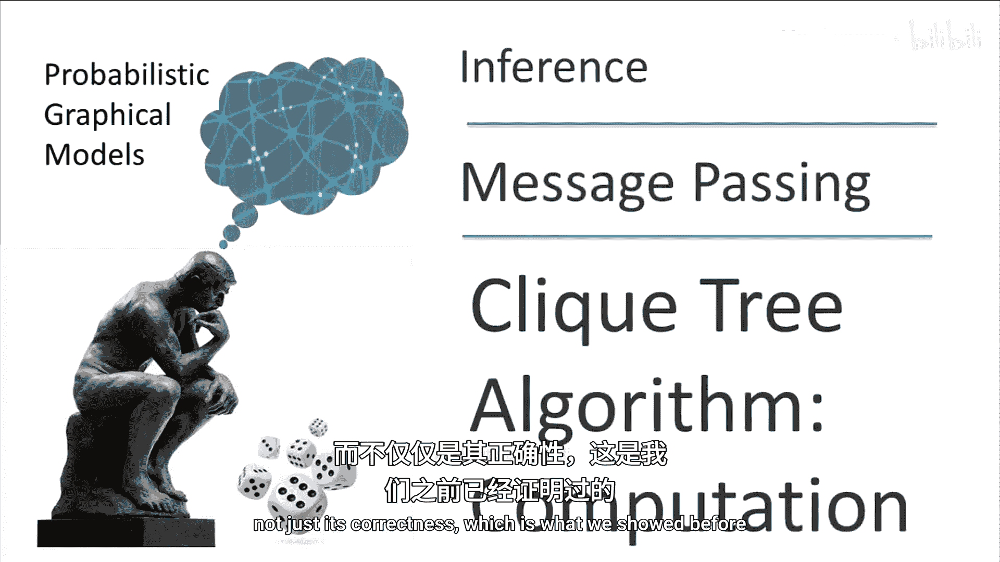
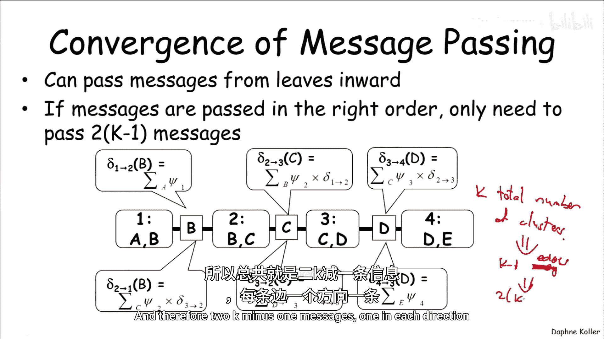
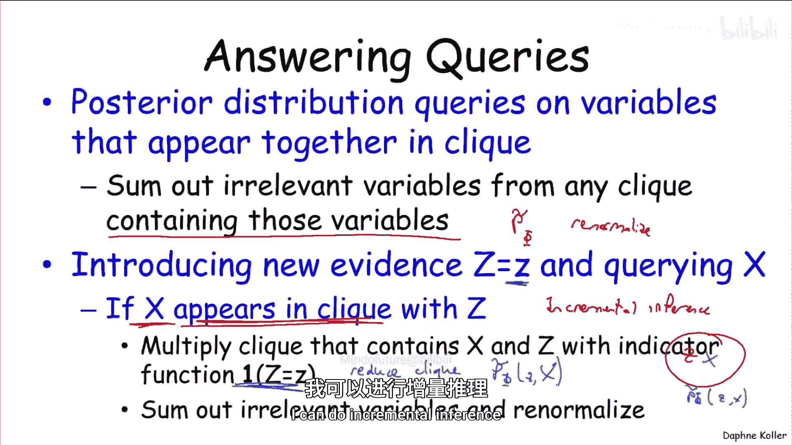
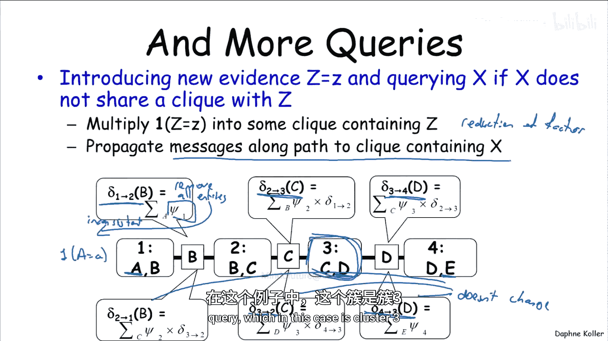
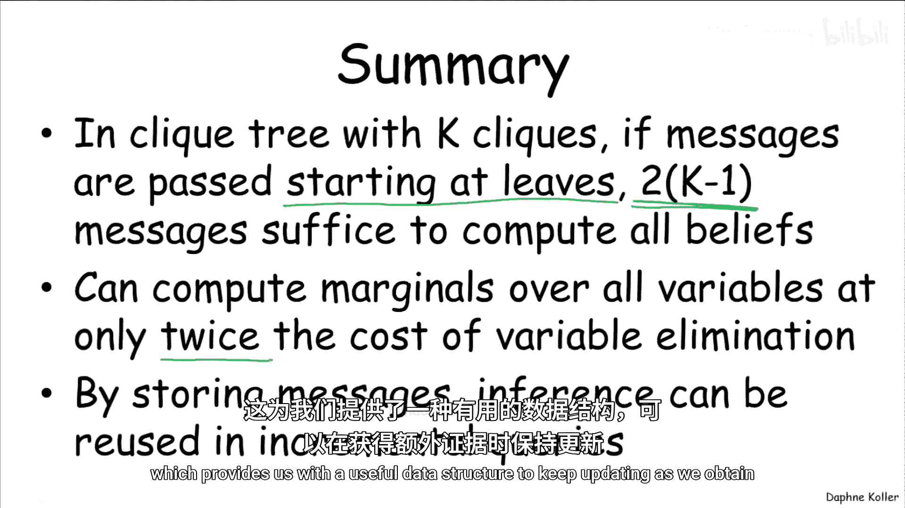

# 【斯坦福】概率图形模型2：推理 ｜ Probabilistic Graphical Models 2 Inference p11 P11_团树算法计算_03_02_02 -BV1fY6VBBEyo_p11-

But previously we defined the cleeique tree algorithm。

 which is just the belief propagation algorithm run over a graph that happens to be a tree。

 as it turns out we can exploit the aspects of the tree to greatly improve the computational behavior of this algorithm。

 not just its correctness， which is what we showed before。

So let's go back to our message passing in this very simple tree， which has just these four clusters。

 ABBC， CBDMDE。And let's see what the messages do， so here is the message Dlta 12。

 which is the message that's passed on this edge。And here is the message Delta 23。And so on。

 And these are the six messages that we have。And now we can notice one very important property。

Delta 1，2， once computed。Never changes。So you get instant convergence of Delta 12 once you compute it for the very first time。

 here its convergence。Now， what about Delta 2，3？Well that depends on when deelta 23 is passed。

 if Delta 23 is passed first， before cluster 2 gets a message from cluster 1。

 then once it gets that message， things might change， but if cluster 2 is clever， it's going to wait。

And it waits until that message is passed， and once that message is passed。Since it doesn't change。

Delta 23 doesn't change either， ever。If it's smart enough to wait。What about Delta 34？

Delta 34 needs to wait a little bit longer because it needs to wait for Delta 23。

 but if it waits for both deelta 12 to be past the cluster 2 and Dlta 23 to be passed to cluster 3。

 then now that it's now that it sends Dlta 34， Dlta 34 doesn't change either。So Delta 23 has to wait。

4。Delta 12。And Delta 3，4 has to wait for Delta。2 three， but assuming it waits。

Then convergence is achieved in a single message fast step。

Now there's nothing magical about going left to right， if you go right to left。

 you get the exact same behavior， so here you have that this one converges instantly。This one。

 you need to wait。For Delta 4，3。And this one， you need to wait。Or。Delta 3，2。But again。

 one assuming you wait。Then。The messages converge in a single step。

And so we can compute all of the messages in this entire tree in one pass in either direction。

 one pass from left to right and one pass from right to left。

In the context of chain structures like this one， is actually this actually has its own name。

 so for chains。You might see this under the name forward backward。Algorithm。

And it's very commonly used in things like a Hi Markov models and other similar chain structured。

Representations。And so the point is。The total effort that we had to compute all of these messages is just one message passing step in each direction。

 one from left to right。And one from right to left。And。The result of that。

 remember that once all messages have been passed， we have beliefs。That are correct。

 beliefs that represent。That are marginals of Pel de Pphi。

And so we've computed all of the marginals of all of the clusters in this graph。

 in sort of two sweeps over this clea tree。And so more generally， as we said。

 one CI receives a final message from all of its neighbors， except for CJ， if it waits。

If it waits to send the message to J until it receives a message from everybody else。

 then that message， Delta IJ is also final。So if these are final， this is also final。

Can you always find a message passing order that will achieve that goal， I mean。

 maybe you kind of everybody ends up waiting for everybody else and they all get stuck and they never send anybody any messages。

The point is that you could always start because the message from a leaf。

Is always immediately final and once the message from a leaf is finalized。

 then you can send the message from the parents of the leaf and so on and so forth and because this is a tree。

 it's guaranteed that you will be able to find a legal message passing order。

And if we pass the messages in the right order， then we only need to pass 2 k -1 messages where k is the total。

Number。Of clusters。And why is that？Because if you have a tree over k nodes， in this case， K clusters。

 then there's K minus1 edges。And since each edge has a message in both directions。

 So have we have K minus-1。Messages sorry K minus-1 edges。And therefore， two a minus one messages。

 one in each direction。

Let's look at a couple of message passing orders to see which ones are going to work and which ones aren't so we can start with any leaf。

 any leaf works so say we start with oh I don't know C2。Once C2 is past its message。

 what other clique can pass its message Well C3 can't pass messages yet because it's still waiting for messages from all sorts of other guys。

So we have to go to another leaf， for example， C1， C1 can pass a message now。

Neither C3 nor C4 are candidates for message passing yet because each of them is still waiting for another message。

 but C6。Can pass a message， and now we have the option of activating C4。 C4 can now send the message。

To see3。Because it got everything except the message from C3 before。

C7 can say pass the message to C3， and you notice there is a lot of arbitrary decisions on how I ordered this。

 I could have used C5 next。And now C3 has the option of passing a message。The C5。

And notice that at this point， everyone has received all of the messages or all of the messages。

 but one。And so now we can start passing in the other direction， so C5 can pass the message to C3。

The three can pass a message to any of C 2， C 7 or C 4。 And at this point。

C4 can pass any can pass a message to both C。Six， let's see one。

What is an example of an illegal message passing order so for example。

 if C1 passes a message to C4 and C4 jumps the gun and says yeahy I'm going to send the message to C3 next。

 that is an illegal message passing order because C4 does not yet have all the information that it needs to pass passage to C3 is still waiting for a message from C6 so that's not for good ordering。

Cleek treeses have other very elegant computational properties that make them a useful data structure。

 so let's think about the kinds of  quaries that one can answer using clque trees and some of these are fairly obvious but others are a little bit more subtle so imagine that we wanted to answer a posterior distribution query on either a single variable or a set of variables that appear together in a clique。

Well， in this case， you could take any clique that contains all of those variables。And some out。

The variables that you don't care about from that clickique to get a posterior。

Over just those variables。Now， remember that that posterior is pit theide。 It's an unorized measure。

 So in order to get the normalized measure， you actually need。To renormalize。Yeah。嗯。Now。

 you could also do something a little bit more clever。

You could say you wanted to introduce new evidence regarding some variable and query another variable。

 So this is a form of incremental。Inference。Where you've already calibrated the clk tree。

 and now you say， oh， wait a minute， I made another observation。 Let's see what happens now。

So it turns out the cleaek trees are really good for that。

And so we're going to divide this into two cases， the easy case in a slightly less easy case。

 so imagine that we want a question to query a variable x that appears in the qua with my new evidence。

😊，So here is my cl。And here is Z。 and here is X。 And I'm going to， And I want to figure out。

What the posterior of x would be if I further observe Z。Well。

This is actually really easy because what I have here is P till de Phi。Let's assume for the moment。

 just Z and x， if there's other variables there it's not。

 it doesn't change anything because we could always just get rid of them。We can now condition。

Or reduce the creique。 So this is a cl reduction。By just restricting attention to the entries that are consistent with my evidence Z。

And then。I end up with P till de Phi。Of little Z harmarma X， and in order to get a posterior。

 I can some of the relevant variables and we normalize。Like can do incremental inference。

Okay， well， that's the easy case if the two variables are together in a cl。

What about a somewhat more elaborate case where I introduce the new evidence and I query a variable that doesn't appear in the same variable in the same clique as Z。

 so using an example， let's imagine that what I did is observe evidence on a。

 and I want to query say E。Actually， it's a different example， let's imagine that I want to query B。

What。In this case。I can do the following。I can。Multiply this indicator function or what we call this reduction。

Of the factor。Into a cluster that contains the evidence so in this case。

 we're going to multiply in the indicator function of a equals little a。

 which corresponds to removing all entries in cluster one in the beliefs of cluster one that are not consistent with。

With。F not into the beliefs。 We multiply it into Psi 1， removing。All entries。

That are inconsistent with that。So now what happens when we change Psi one？

Imagine that we're doing this entire computation from scratch。

 that is forget everything that we did before and think what would happen to this model in the hypothetical case that we were passing messages with a nuopsi one instead of the Op Psi one。

Well， some messages would change， which messages would change。

 Delta 12 would change because Psi 1 changed。Delta 23 would change because Delta 12 changed。U。

Delta 34 would change， but we don't care about Delta 34 if we're interested in this belief over here。

What about other messages， Delta 43 doesn't change。Neither does Delta 32。

Neither neither does deelta 21。And so only a subset of the messages in the Cique tree change as a result of of this change。

 which means that we can reuse at least half the messages， if not more。

 in computing our beliefs about，In this case， cluster three。

And the only messages that we need to recompute are the messages that are along the path to a clique that contains the variable x that we want to query。

 which in this case is cluster 3。

So to summarize， if we have a clique tree with k cliques， and we pass messages in a careful order。

 which means that we start add the leaves and propagate inwards。

 then we can construct an ordering such the 2 k minus1 messages suffs to compute all of the beliefs in in the clique tree which means we get a posterior over every single variable in the model。

 contrast that with the computational cost of running variable elimination and times to compute posteriors in n different variables。

 here you get a considerable computational savings。

 in fact a computational savings of order of the number variables。

And so what we can do is we can compute all of the marginals at only twice the cost of variable elimination as opposed to n times the cost of variable elimination。

And we've also shown that by caching or storing the messages， we can reuse inference， for example。

 in the context of incremental queries， which provides us with a useful data structure to keep updating as we obtain additional evidence。

