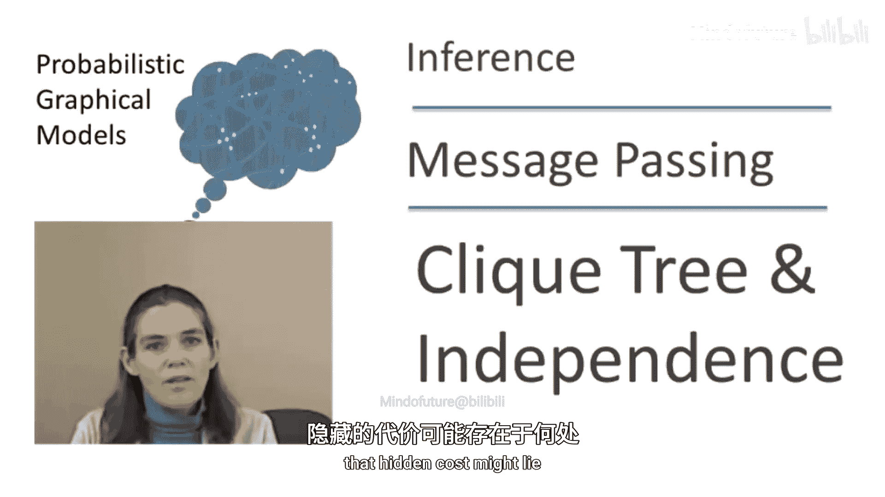
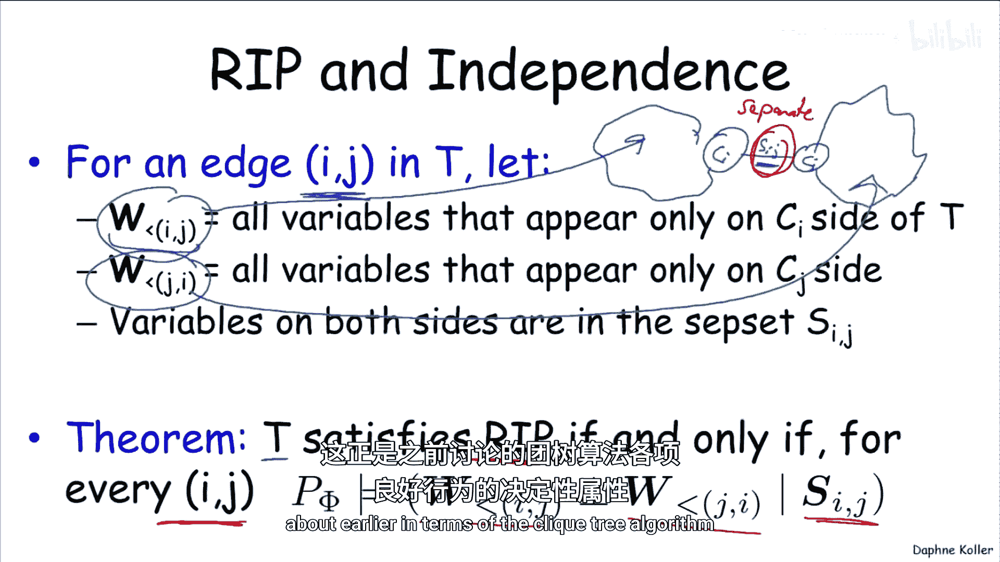
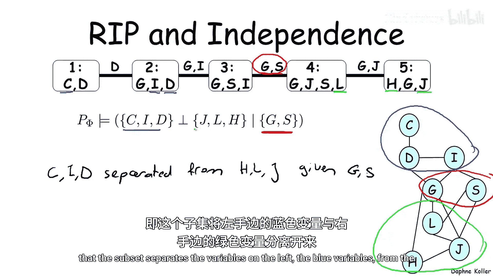
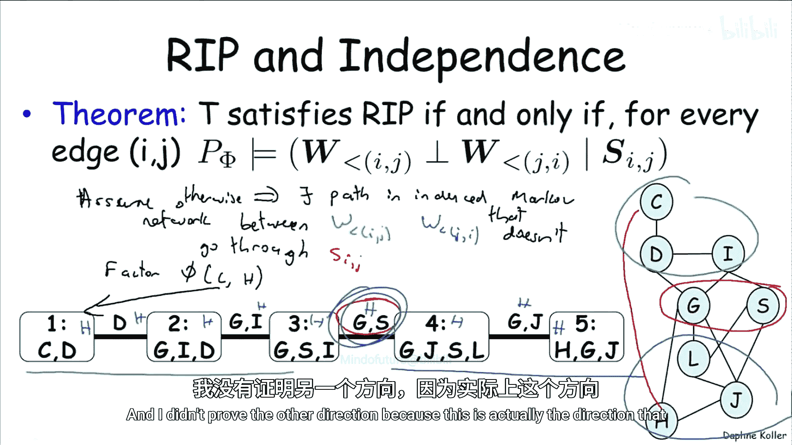
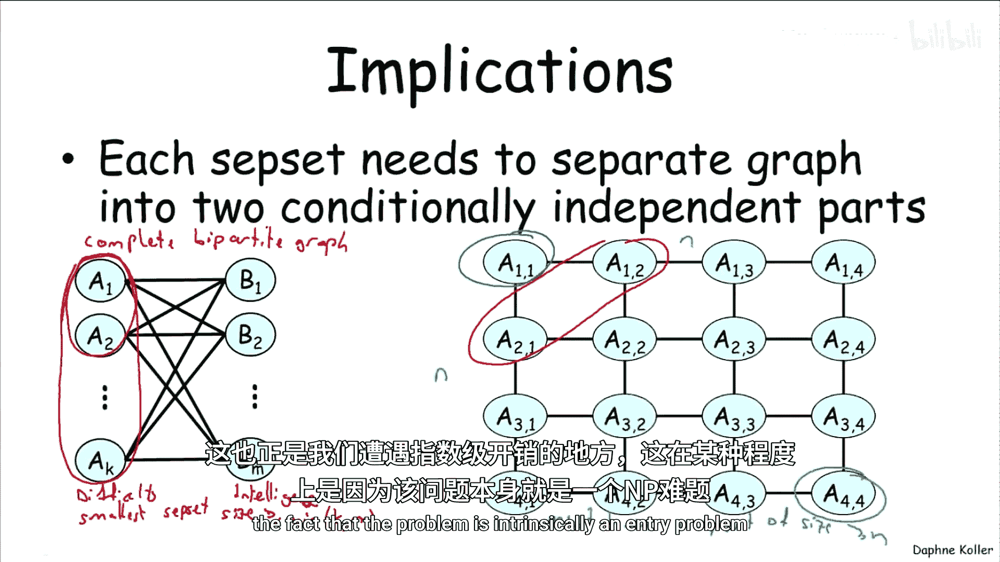
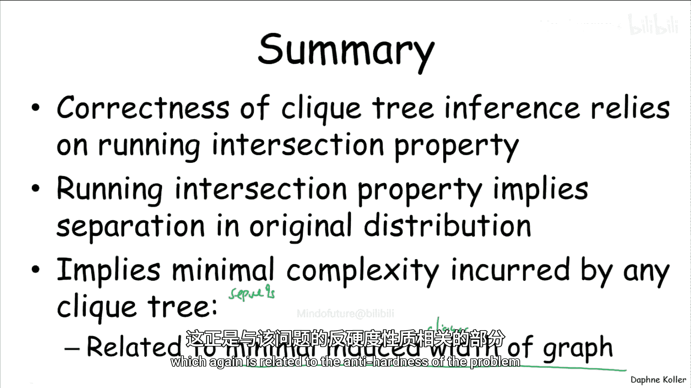

# 【斯坦福】概率图形模型2：推理 ｜ Probabilistic Graphical Models 2 Inference p12 P12_团树与独立性_03_02_03 -BV1fY6VBBEyo_p12-

We've shown that the Ceeree algorithm has some pretty cool properties that it guarantees that we achieve the correct marginal at every single clique and therefore that these marginals necessarily agree with each other。

 we've also seen that these marginals can be computed using a single upward and downward pass over the clea tree。

 so a fairly efficient computation。But we also know that the problem of inference in probabilistic graphical models is an NP hard problem。

 and so somewhere over there there must be a catch。

 that is there must be a computational cost that occurs at least in certain cases when we run the cl tree algorithm and what we're going to do now is we're going to try and understand where that hidden cost might lie。

So。Well we're going to do- so in order to analyze the computational complexity of a clique tree。

 we're going to define a little bit of notation。So let's consider an edge IJ in the Cleek tree P。

And let's define a little bit of notation。 We're going to divide the variables into three groups。

There is this group， so here what we have is a cl tree， here's CI。And CJ。

They're adjacent cliques and they're connected to each other via stepset SIJ。

 and then there's this whole Cek tree， a whole bunch of cliques on the left side and a whole bunch of cliques on the right side。

We're going to divide the variables into these three groups。

W less W that's on the IE side of the IJ edge are the variables that are just。In this。Group here。

 not counseling the subset。Which is going to appear in both sides。W that's on the J side。

Is over there。And SIJ is the stuff that's in the middle。

 so these are three mutually exclusive and exhaustive groups that partition all of the variables in the tree。

And now here is an interesting and quite enlightening theorem that says that the Cek tree T satisfies the running Inter property if and only if for every subset IJ。

 we have that the variables on the left side of the edge。

 are independent of the variables on the right side of the edge。

 given the variables in the middle of the edge。😊，That is these variables， the subset， separate。

The left side from the right side。Now， remember that the running intersection property was the critical property that we used to prove correctness of the Cleek treeree algorithm and so this is a coming up with this condition that tells us exactly when running intersection holds is important because this is the defining property for all of those nice behaviors that we talked about earlier in terms of the Cleek treee algorithm。

So let's try and convince ourselves of this by looking at a concrete example first。

 let's look at the cl tree that we have over here and let's， for example， focus on this subset。

 which has the variables GNS and the variables on the left side of that subset excluding the variables GNS are I。

D and C。On the other hand， the variables on the right side of this subset， again。

 excluding GNS are H。J and L。 So now let's look at where these variables placed themselves on the graph structure over here。

 which is the induced graph corresponding to the Markov network。

 which we derive from the factors in this Bayesian network， so Bayesian network CPDs produce factors。

 the factors give us this induced Markov network。So where are the subset variables G and S。

 those are over here， where are the variables on the left hand side。

 these are the blue variables CID and they're sitting over there and the green variables。

 H J and L are sitting over here。And a simple inspection can show us that there are no paths or trails between the blue variables and the green variables that do not go through the red variables so that we conclude from that that the variables C the are separated。

From。H。Oh。And J， the given。GNS。And from the connection between the graph structure and independence in Markov networks。

 we can conclude from that that this independence property。

Holds that is that C I and V are independent of H J and L given G and S。

 which is exactly what we wanted to show that the subset separate the variables on the left。

 the blue variables from the variables on the right， the green variables。

Let's try and give a slightly more general argument for this。

 one that isn't just demonstrating it in the context of a particular example。

So let's ignore for a moment the concrete letters inside this example and just think about what would why this is going to be true。

 so let's imagine that this is now a generic。Eepent。And this is it over here。

 And we'd like to prove that all the variables。On the green side are independent of all the variables on the blue side。

So let's assume otherwise， this is going to be approved by contradiction。If this were not the case。

 then that means that in this induced Markov network， there needs to be some。😡，So there needs to be。

They'll assume otherwise。Which means there needs to be。A path。In the induced Markovv network。Between。

The blue side。And the greenside。 So between W less than I J。And。W less than JI。Well。

 if there exists a path that goes from one side of this graph to the other。

 it means that there eventually has to be an edge where one node is on one side and one node's on the other。

So that means there needs to be some edge that goes from the blue side to the green side。Now notice。

 as I forgot to say， this path that exists in the induced Markov network doesn't。

That doesn't go through。The subset。Because otherwise the subset would separate it so it doesn't go through SIJ。

So there needs to be an edge。It goes， for example。From here to there。

 or it doesn't matter which node I pick， which pair of nodes I pick。

 there needs to be some node on the green side and some node on the blue side。Its a green side。

And this is blueside。And an edge that goes between them that doesn't go through the subset。

But now that implies that there needs to be some factor。I， that involves those two variables。

So in this case。Dcoma H。But now because of family。Preservation。That factor must sit in some。

One of the cliqueeks in this clek tree。And that clique。

Is either on the green side or on the blue side？Has to be somewhere。

 So let's assume that we put that clique without loss of generality on。The greenside。

But now what happens。We have an H。But sitting here， remember H is a blue variable。

And H is also sitting here because it's on the blue side。

And now we have an H in one quick and an H in the other。

 and running intersection property tells us that H needs to be everywhere in between。

And specifically。It needs to be in the substance。Which is violation of the assumption。

Either of the running intersection property or of the assumption that the variable H is not in the subset。

And so that's sort of。Somewhat formal proof outline that can with a little bit of extra effort and notation be made into a rigorous proof of why running intersection property implies this independence assumption。

And I didn't improve the other direction because this is actually the direction that we care about more。

So we start out this whole discussion by saying that these properties have computational implications。

 but where are these computational implications， what can we conclude from the fact that the subset needs to separate the graphs through conditional independent pieces？

Well， it turns out that in many graphs that implies a certain minimal complexity that can sometimes be quite large。

So this let's look at this in the context of two quite simple but very commonly used examples。

 so here is an example of what's called a complete bipartid graph。😊。

Where we have two sets of variables。That have no edges between each of the sets separately。

 but where all of the cross edges are present。This is a structure that is that we've actually seen before。

 we saw it in the context of the play model for student for course difficulty。

And student intelligence， where we had a bunch of difficulty variables。

 a bunch of intelligence variables， and there were no edges between the difficulties or between intelligences。

 but for every difficulty intelligence pair， there was an edge that was induced by the V structure corresponding to an observed student grade between the course difficulty。

 of corresponding to that course difficulty in that student intelligence。

So what is the smallest subset that we could possibly construct for this graph， can we， for example。

 look at just say these two A's and separate out the graph into two conditionally independent pieces？

Well， no， not really， because for example， if we now look at these two Bs。

 we can see that you can connect them via any one of the other A's that I didn't include in the subset and so is no this doesn't decouple the graph at all。

With a little bit of extra thought， it's not difficult to convince oneself that the smallest subset that we can construct。

That actually breaks up the graph into meaningful pieces is either all the variables on the one side or all of the variables on the other。

 which means that the smallest subset，Or the small。In any kind of meaningful cl tree has size。

Greater than or equal to min of k comma M， where k's number of variables on the one side and M on the other。

A slightly less obvious example， but one that is also imposes some very significant lower bounds in the context of a grid。

 such as we encountered in the context of the  Iing model or when doing image analysis where the variables correspond to pixels。

 and now let's try and think about how we might break up this graph into conditionally independent pieces。

Now we can construct cleaique trees that have smaller subsets， small subsets， for example。

 here is a subset。It breaks away A11 from everything else。

But notice that that still leaves me a very large everything else。But if we try， for example。

 to break up the graphs so that A11 appears on the one side and a44 appears on the other。Any。

Cleek tree that you give me that will have this separation with a11 on the one side and A44 on the other。

 any such clek tree has to have。A subset。Of size。Greater than or equal to n。

 where this is an n by n grid。Which means that if you try and break up the end by end grid in a way that puts one corner on one side and one corner and the other。

 then you're going to have a subset that's at least a dimension of the grid。

And breaking it up in other ways doesn't make it any better。

So here are two cases where we can place a lower bound on the size of the subset that is required for running Cek re。

 and that is where we pay the exponential blowup that is in some sense required by the fact that the problem is intrinsically an problem。

So to summarize。We've shown previously that the correctness of the clion inference algorithm relies on having the running intersection property。

😊，And we have now shown in turn that the running interception property implies certain separation properties on the original distribution。

These separation properties， in turn can be used to analyze the complexity of inference in different graphs and provide certain minimal bounds on the complexity that would have to be incurred by the best possible cl tree on。

😊，Gras。And we've already seen before a notion of minimal complexity。

 which is the minimal induced width of the graph。 this notion is a little bit different because it talks about subsets。

Whereas the induced width really talks more about creeks。

 but these are both different ways of analyzing the complexity。

 a certain minimal complexity that has to be incurred by exact inference。

 which again is related to the antiharness of the problem。

